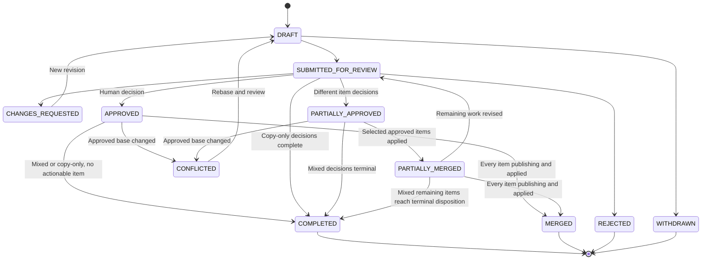

# Functional Workflow and UX Specification

**Current package amendment:** 1.4.47 — 26 November 2026; PROPOSED / NOT FROZEN. Read the final revision 1.4.47 section for this update. Earlier revision headers and receipts below retain their historical scope.

**Document ID:** TESBO-FS-002 | **Revision:** 1.4.39 — 21 November 2026; module authoring principles and contextual guidance integration; NOT FROZEN | **Status:** proposed workflow plus scoped native preview; NOT FROZEN.
**Scoped implementation evidence:** Native preview increments are tracked in Tesbo PR95 and PR98; use their exact-head receipts and the MBT contract/acceptance sections below. Historical full-source audit pins and older review results retain their original scope/date. Unverified criteria and independent assurance remain open; this is not package-wide implementation or deployment certification.

**Interaction/ownership doctrine (P-01–P-20):** One Copilot presents Tesbo-owned sessions and linked QA artifacts; never embed another product's standalone project/chat hierarchy. Imported UI primitives must retain Tesbo's real project/session routes, current auth, violet tokens, accessible focus/keyboard conventions, and source-linked task/review views. Users can switch project/session/provider without moving or cloning KB files, reports or approved cases. Third-party demo flows are references only.

**Current integration amendment:** Read revision 1.4.28 below for ASER scope, exact canonical owners and contracts. Earlier dated source/implementation claims retain their original scope. The original QA round trip and P-07/P-14/P-17/P-18 are preserved. New runtime tests remain NOT RUN; the package is NOT FROZEN.

## 1. The reference workflow (current vs target)

| Today — manual | Tesbo target | Safeguard retained |
|---|---|---|
| User discusses feature with ChatGPT | ChatGPT authors a durable Tesbo testing task and prompt revision | User can review/revise before dispatch |
| User copies prompt into OpenCode | Registered OpenCode instance claims task via Tesbo MCP | Exact prompt retained |
| OpenCode uses its own Chrome MCP to test the DMIS **pilot website**; other clients/targets use their supported executor | Same behavior, unchanged; Tesbo only coordinates | No mandatory test execution framework |
| OpenCode produces report; user pastes to ChatGPT | OpenCode submits original report and attachments into Tesbo | Original is immutable, attributed |
| ChatGPT critiques report and drafts cases/issues | Assistant reads task/report from Tesbo MCP, drafts proposals | Fact/inference separation preserved |
| User asks ChatGPT to correct drafts multiple times | User comments or edits on review proposal; assistant revises | Entire conversation of revisions auditable |
| User approves source-workbook update in the pilot | Approve + merge selected proposed case changes in Tesbo | Test suite is protected, approval verified server-side; import is optional |
| User files approved issue in pilot tracker (GitLab) | Copy an approved tracker-neutral issue draft and file manually | No unrequested external tracker write |

**Global vs pilot:** These journeys describe platform primitives. DMIS names, OIDC, role hierarchy, Excel source and the reported browser delays are only *illustrative pilot inputs*. Another project may use an API target, different auth, a different suite structure or no import/tracker. Unsupported target kinds must be labelled unsupported; they must not inherit the web-browser action policy by accident.

## 2. Conceptual objects and their distinctions

- **Test Task:** what needs to be tested; does *not* require any test case. Stores the exact testing prompt and contextual constraints.
- **Task Assignment:** which agent instance is permitted to work on a specific task/prompt version; supports lease, expiry, cancellation.
- **Execution Report:** what the agent actually observed; immutable primary evidence. An exploratory report may precede all cases.
- **Analysis:** interpretation of one or more reports, with claims/evidence/uncertainties clearly separated.
- **Change Proposal:** review request containing case operations, optionally accepted execution results, and issue drafts; similar to a GitLab MR.
- **Official Suite:** approved published case definitions; conceptually `main`. This is a **protected data state**, not necessarily real Git version control.
- **Issue Draft:** copy-ready GitLab text, managed and approved independently. Not a posted GitLab issue.

## 3. Primary user journeys

### WF-01 — New exploratory feature with no existing test case

**Preconditions:** human has a Tesbo project; analysis assistant has task-draft permission; one active execution agent instance exists. A Tesbo model key is not required for this external task. **Input:** feature and questions, not test-case IDs.

1. In the **illustrative DMIS web pilot**, the QA lead discusses `DMIS > Master Data > Events > Create Event` with ChatGPT and agrees on test scope.
2. ChatGPT composes a task prompt. Proposed fields: title, objective, role, environment, navigation, actions under test, preconditions, test-data and cleanup constraints, expected evidence, known issues, stop conditions.
3. Assistant submits draft to Tesbo; user sees/edit/reject/send options. Approval-to-dispatch follows project setting, independent from suite approval.
4. Task is assigned to `OpenCode (workstation A)`; its agent-side process queries Tesbo MCP. No Tesbo server makes an inbound connection to Chrome or a local computer.
5. Agent claims task and receives exact prompt revision plus allowed context. The assigned executor uses its own authorized target tool; in the pilot, OpenCode launches **Chrome MCP** and tests the DMIS site.
6. Agent submits the complete unmodified report and screenshot references, noting which steps ran, blocked paths, observed UI/network facts and open questions.
7. Tesbo marks task `REPORTED`; it does **not** create or edit official cases.
8. ChatGPT reads the raw report and existing published cases, deduplicates findings, labels confidence, drafts cases and standalone GitLab issue text. It submits a review request.
9. Reviewer asks to correct a prerequisite and not file an unsupported defect; analyst submits revised proposal. Original proposal revision/comments remain.
10. If the analyst or reviewer requests verification/retest, ChatGPT submits a linked follow-up through Tesbo MCP (or the human uses the same Tesbo task UI); OpenCode executes a new authorized browser-tool attempt and returns a separate report. The assistant reviews both sources and issues new analysis/proposal revisions.
11. Human edits, rejects or approves *specific* case, official-result, native-Tesbo-defect and optional tracker-text operations. A separate Merge approved action publishes only selected approved case/result/bug operations through protected services, with explicit links and safe bug-create side effects. Tracker-text copy approval causes neither Bug creation nor outbound filing.

**Postconditions:** accepted cases have stable IDs/history; provenance links task/report/reviewer; rejected and copy-only dispositions remain historical. A fully decided mixed proposal can close without publishing rejected or copy-only items; no unauthorized issue is posted.

### WF-02 — Existing regression case

Task references stable external case ID and immutable published case revision. Agent can read permitted fields and execute a regression via Chrome MCP. Report can suggest `PASS`/`FAIL`/`BLOCKED`; official result handling follows independent execution-result policy. An unexpected observation cannot silently update expected results. Proposal can update authored test definition when justified, separately from execution result and issue draft.

### WF-03 — Analyst or reviewer requests clarification/retest

After reviewing a report, ChatGPT (with `task.create` plus allowed source-read authority) or a human selects the incomplete/contradictory finding, enters a **specific question** and creates a linked follow-up task through Tesbo MCP/Tasks UI. Example: reproduce twice, inspect the error response, test a boundary value, or gather a missing screenshot. Bind original task, report, finding and evidence IDs; include only permitted excerpts and a newly authorized immutable target scope. An authorized dispatcher approves/assigns if project policy requires it.

A registered executor (OpenCode initially) claims a **new fenced assignment/attempt**, invokes its own configured Chrome MCP or Playwright MCP tools, and finalizes an **independent source report**. The assistant discovers/read-backs both originals, compares observations and revises analysis and only impacted proposal operations. Prior evidence, decisions and rejection history stay intact; any approval made stale by changed evidence or operation payload is invalid until human re-approval. The workflow can iterate multiple times without becoming a hidden direct-write path. A failed/offline executor leaves an honest blocker and a human continuation path, not a fabricated PASS. If scope broadens, user/project dispatch policy must authorize it. This loop works for any supported target adapter, not just the DMIS pilot.

### WF-04 — Swap execution agent runtime

Admin deactivates/pauses OpenCode instance and registers `Claude Code - Workstation B` or `Kimi Code`, assigning the same capability profile. Reassign unclaimed or expired tasks with explicit audit. Prompt/report schemas do not change; only runtime/instance identifiers change. Never share machine credentials between agents.

### WF-05 — Human edits proposal directly

Reviewer opens a proposal, edits a proposed case's Expected Results in a draft, and saves a new proposal revision. Tesbo records that author is a human, retains the assistant's earlier draft, displays diffs, and requires approval of latest revision; there is no need to return to ChatGPT for every correction.

### WF-06 — Reject or partially merge

A proposal contains proposed cases A, B, C and issues I1, I2. Reviewer approves A and B; marks C `CHANGES_REQUESTED`; approves I1 for copying and rejects I2. Tesbo merges **only A and B** in a protected transaction. C, I2 and review comments persist, and I1 is not auto-filed in GitLab. Reattempting the same merge cannot duplicate A/B.

### WF-07 — Unauthorized direct-write attempt

An OpenCode task token sends an existing `update_testcase` MCP tool or REST `PATCH /api/testcases/...`. Even if its owner's user role has access, project protected policy and principal capability prevent direct mutation. Response is `403` with a safe error; case definitions/revisions unchanged; safe denial logged without fabricating a successful user action.

### WF-08 — Verified defect enters existing Tesbo Bugs (independent of tracker copy)

1. The analyst stages a potential defect linked to one or more specific observations and authorized original evidence, flags uncertainty and optionally suggests a case/run association. No `bugs` row or execution-status side effect is created.
2. ChatGPT requests a follow-up task when reproduction is ambiguous; the linked new report informs a new immutable defect proposal revision.
3. The human reviewer examines expected versus actual, source evidence, scope, severity, duplicate matches and the **impact of linking a Bug to a case/run**. Selects reject / request retest / approve-for-copy / approve-native-publication, each with distinct scope.
4. A separate authenticated human Merge approved action uses shared staging plus existing Bugs writer/links under the same policy/transaction and creates only the approved native Bug. It writes an idempotent receipt, official bug ID, authorized links, audit and provenance. Unapproved/pending proposals remain staged.
5. External tracker filing (if configured) is *not* native Bug publication. Copy an approved tracker-formatted issue or use a future separately permissioned connector after explicit authorization. Synchronization must not silently duplicate native Bug records.

**Oracle:** A five-case/two-defect analysis can approve three cases and one native defect while withholding the rest; only selected reviewed records publish. Revisiting the operation cannot create another Bug or case. Unverified allegations remain proposals, not confirmed published defects.

## 4. Detailed lifecycle models

### 4.1 Task status and transitions

| From | Action | To | Allowed actor/capability | Validation |
|---|---|---|---|---|
| — | Draft task | `DRAFT` | `task.create` | Project membership, prompt schema |
| `DRAFT` | Ready | `READY` | `task.submit` | Valid immutable prompt revision |
| `READY` | Assign | `ASSIGNED` | `task.assign` | Active registered instance, allowed project |
| `ASSIGNED` | Claim | `CLAIMED` | `task.claim.assigned` | Assigned principal; atomic single lease |
| `CLAIMED` | Start/progress | `IN_PROGRESS` | Assigned executor | Current attempt/fencing generation valid |
| `CLAIMED` or `IN_PROGRESS` | Finalize initial current-attempt blocker/test report | `REPORTED` | Assigned executor | Verified required artifacts, narrative and current authority; browser execution not required for a truthful setup-blocker report |
| `CLAIMED` or `IN_PROGRESS` | Reserve/upload primary report | unchanged until finalize | `report.submit.assigned` | Pending receipt is not an available report; finalize uses current attempt generation |
| `DRAFT`, `READY` or `ASSIGNED` without active executor lease | Finalize authorized manual primary receipt | `REPORTED` | Human report.import.manual plus dispatch/manual-adoption policy | Task-version CAS; actual human/source attribution; close unclaimed assignment as manually fulfilled, never fake a claim |
| Active executor or analysis/terminal task | Manual historical/supplemental receipt | existing task state | Explicit manual import or scoped report.supplement | Append provenance only; no silent executor cancellation/completion or terminal rewind |
| `REPORTED` | Acknowledge analysis | `UNDER_ANALYSIS` | `analysis.create` | Original report immutable |
| `UNDER_ANALYSIS` | Close | `CLOSED` | Authorized analyst/user | Closure reason and linked proposal refs |
| Any nonterminal | Cancel | `CANCELLED` | Task owner/dispatcher | Preserve historical records |
| Active assignment | Lease expires | task remains assignable; attempt becomes `EXPIRED` | Server | Retain expired attempt; only explicit authorized reassign/claim creates new authority |
| Ready/assigned/active task | Ask clarification | `NEEDS_CLARIFICATION` | Permitted executor/reviewer | Persist question, prior state and exact prompt revision; active lease is released/paused rather than held indefinitely |
| `NEEDS_CLARIFICATION` | Answer clarification | awaiting explicit resume | Authorized human/dispatcher or scoped analyst | Append answer and provenance; material scope/target/action changes require new prompt revision |
| Answered clarification | Resume | `ASSIGNED` then new claim | Authorized dispatcher/executor per assignment | New fenced attempt; expired/reassigned old attempt never regains authority |
| `REPORTED` | Request follow-up | separate task | Reviewer/analyst allowed | Link parent task/report, never overwrite |

**Concurrency:** claiming is an atomic compare-and-set guarded by assignment state/lease. Lease token is scoped, expires, and is never exposed in logs. Progress submissions require correct assignment. A duplicate report with identical idempotency key returns original receipt; differing payload on same key is conflict.

### 4.2 Report status

`PENDING_RECEIPT → UPLOADING → FINALIZED_AVAILABLE`; `ABANDONED` closes unfinalized reservations by policy. Reserve returns report ID before uploads. Finalize binds immutable narrative/manifest after required artifact checks. Only initial primary finalization advances the task under §10.5; manual evidence-only and supplemental receipts leave its lifecycle unchanged. Same finalize key/payload returns the receipt; changed payload conflicts. Optional absent artifacts are explicit, never fabricated. Corrections use a new supplemental receipt linked to a finalized original. Disputed is a reviewer annotation, not an edit. Abandoned-byte cleanup preserves audit and does not delete finalized evidence.

### 4.3 Proposal status

**Partial review:** aggregate proposal status is derived from operation states. Use `PARTIALLY_APPROVED` when reviewed items differ and `PARTIALLY_MERGED` when committed and outstanding items coexist. Do not label an entire request completed while hiding actionable pending work. Rejected/withdrawn items and issue approval-for-copy are terminal review dispositions, not perpetual uncommitted work. When no actionable item remains, use MERGED only when every item was a publishing operation and applied; use REJECTED for all rejected or WITHDRAWN for all withdrawn; otherwise COMPLETED for mixed/copy-only dispositions. Legacy generation task done remains a separate projection. Track committed operations and apply receipts independently; further merges select only currently approved, uncommitted items. Issue approval-for-copy is a separate decision and causes no live bug/result mutation.

**Approval is scoped to** (project, proposal ID, exact revision/hash, operation IDs + operation hashes, reviewer ID, approval time, project-policy revision). A changed approval-relevant field or protected base requires renewed approval; a new proposal revision never silently inherits an earlier decision. Unchanged items may be re-attested explicitly for the new revision. A user can reject one operation while approving others. `MERGED` means every publishing item in the request was committed and no other item disposition exists. A successful selected apply has its own receipt; outstanding items remain explicit and keep the aggregate nonterminal.

### 4.4 Issue draft lifecycle

`DRAFT → READY_FOR_REVIEW → APPROVED_FOR_COPY → MANUALLY_FILED` (optional final status entered by human). `CHANGES_REQUESTED` and `REJECTED` branch off from review. Filing is an external human action, not an API write.

## 5. Placement in the existing information architecture

The live project uses existing Test cases, Test plans, Runs, Bugs, Insights, Agents, Knowledge base, Activity stream and Project settings. Extend those surfaces; do not add separate top-level Test Tasks, Execution Reports, Review Requests, Issue Drafts and Audit applications.

### UI-01 — Agents → Tasks

Keep current List/Task window and Kanban shells; make the page heading Tasks instead of Zyra. Add External testing and Built-in generation kinds. Add **Change requests** beside the current views; label the current duplicate Review Board **Duplicate review**. External task create/claim/report must work with no internal AI key.

Task columns: ID/title, kind, prompt revision, role/module, selected instance, state, last contact/update and creator. Details use five tabs: **Brief**, **Execution**, **Reports & evidence**, **Proposals**, **Discussion & history**. Assignment is not proof of claim; report receipt is not approval or publication.

Brief preserves exact dispatched prompt, environment identity/snapshot, allowed targets and referenced instructions/profile versions. Execution shows manual/poller pickup mode, attempt/lease, questions and reassign/retest controls. No secret browser context is copied into tasks.

### UI-02 — Agent list and existing project settings

Extend **Agents → Agent list** with Built-in and Connected instance views. Registration includes display name, runtime/client, owner, project, configurable grants/profile, last contact and credential status. A registered or enabled instance is not necessarily online.

Use **Project settings → API & MCP** for existing credential issuance/rotation/revocation and setup. Link it from instance details, avoiding a second credential store. Add **Workflow & access** and **QA formats** configuration within current project settings for policy/reviewer delegation and profile/schema rules. Model providers stay in Workspace settings → AI Providers; they are not OpenCode/ChatGPT runtime registration.

### UI-03 — Reports & evidence

Task-owned original report, submitting instance, attempt, immutable prompt revision, receipt/hash and evidence. Supplements append. Show ChatGPT's separate analysis/claim classifications in Proposals; never overwrite the raw report. Reuse existing attachment/storage handling after adding report ownership/access validation. A report may exist before any official case or run.

### UI-04 — Change requests and shared proposal review

Generalize the existing Zyra staged review panel/editor/selected-save foundation. Header shows task/source reports, author, exact revision, target suite, profile/policy versions, reviewer and aggregate state. Stable operation rows show current/base/proposed fields including custom values, evidence, comments and individual decisions.

Actions: Edit draft, Comment, Request changes, Request retest, Reject item, Approve selected, Merge approved changes. Show the exact selected uncommitted operation count. Check human authority, approval/base freshness and required fields server-side, then publish atomically. Conflicts cause zero selected definition writes. Preserve old revisions/comments and rejected/pending operations.

A reviewer can directly correct text without asking ChatGPT. A later active ChatGPT or alternate assistant can retrieve changes/comments through MCP; the system must not promise to wake an inactive chat.

### UI-05 — Existing official repository and runs

Use existing suites for approved Role → Module hierarchy. Case detail/history gains links to proposal/reviewer/task/report and definition version. Reuse current run/execution snapshots/history for accepted outcomes. Separate case lifecycle status from Pass/Fail/Blocked and preserve historical expected results.

### UI-06 — Issue drafts within Proposals

Use typed staged issue operations with project-format sections: Title, Description, Steps to Reproduce, Actual, Expected, Evidence; optional Impact only if configured/useful. Approve for copy and optional manually filed URL remain independent of case merge. No live bug creation, linking or external post as a side effect of drafting or copy approval.

Existing Bugs can be an explicitly selected later destination, subject to its own policy and known linked-execution effects. Existing KB supplies reusable requirements/instructions; raw report receipts remain distinct from editable KB content.

## 6. Configurable test-case rendering contract (DMIS pilot profile)

| Group | Fields and behavior |
|---|---|
| Identity/traceability | Source Test Case ID, internal UUID, Requirement ID, role, module, case revision |
| Authoring (DMIS pilot template; **not global schema defaults**) | Test Type, concise Test Case Title, Test Scenario, Prerequisite, numbered Test Steps, Method, Endpoint, exact Test Data, numbered Expected Results, Expected Response |
| Execution (separate) | Run ID, observed actual result, outcome, execution environment, run date, evidence, report ID, tested published case revision |
| Review/quality | Proposal ID, field-diff, comments, validation, reviewer decisions, approved revision hash, merged timestamp |

Under the **DMIS profile**, do not put hard-coded inputs in Steps. Prerequisites are setup conditions only, not “test X already passed.” The DMIS profile rejects generic “DMIS QA environment is available.”; other projects use their own precondition rules. The current DMIS convention requires Verify-prefixed titles and scenarios; new/revised titles name the primary role and expected behaviour immediately after “Verify that”. Apply that convention only through the selected profile, not as a global Tesbo default. Duplicate or invalid email test data belong in Test Data, not action steps.

**Guidance in the existing workflow (revision 1.4.39):** The case editor and shared review show the effective module guidance/output profile and their exact revisions, distinct from the case's governing requirement. Apply canonical 06's Test-case authoring guidance in the native approved representation, with Preconditions, inputs and Action↔Expected Result meanings kept clear. Offer a targeted field-level correction and show unresolved input/requirement gaps without resetting execution history. Reuse original source identities for an amendment and references for additional classifications. A supported accountless/API/manual context must not acquire an invented browser, login or workbook. Skill content directs the method; the existing review/apply service governs publication.

## 7. Review quality rules

A proposed case or defect must not be represented as confirmed solely on an agent's assertion. Provide review labels such as `LIVE_OBSERVED`, `API_CONFIRMED`, `CODE_CONFIRMED`, `DOCUMENTED_REQUIREMENT`, `REQUIREMENT_CONFLICT`, `INFERENCE`, `NOT_VERIFIED` when relevant; other projects can configure taxonomy. Missing requirement evidence results in a clarification/review flag, not a fabricated expected result. Reviewers can request more tests before approval.

**Examples:** “Closed Event Date earlier than Start Date” might be an evidenced defect only if an approved rule exists; “Find Match does nothing” remains investigation until response/state checked. Preserve reproducibility details and source screenshots; avoid inferring a failure from an unrelated blocker.

## 8. UI acceptance conditions

- Every pending case change can be edited and commented upon independently; no approval occurs just by viewing it.
- Reviewer can see the original prompt/report alongside draft case/issue and who authored each.
- A revised proposal preserves previous comments and makes the reapproval requirement visible.
- User can approve 2 of 3 case changes and reject an issue; only selected case changes enter official suite.
- Agent and chat client disconnection do not block manual review and merge.
- A denied or failed merge leaves authoritative case records unchanged and shows an actionable conflict/error.

## 9. Live reconnaissance limits and compatibility

Live inspection confirmed the inactive Zyra task/chat UI, duplicate-specific Review Board, broad Read/Write token form and existing case/run/bug/import/custom-field/environment surfaces. One labelled KB document was saved, searched, reopened and inspected in history. No real task handoff, raw report upload, staged review, case publication, result write or MCP call was performed. Proposed workflows above are not live acceptance results.

Preserve existing Zyra generation task/status behavior through adapters; do not repurpose its generation POST for external testing. Existing counts/caches, plan gates, KB comments/history and reports should share navigation and post-commit updates. The default human review workflow must function when ChatGPT/OpenCode is unavailable.

## 10. Team-reviewed continuity and recovery rules

### 10.1 Source-neutral discovery and durable navigation

Human Change requests and active analyst clients list/search paginated proposals and reports awaiting analysis by project, source kind, state, author/assignee and task. Keep old pending work discoverable even beyond 50 newer generation tasks. A proposal may originate from chat/external MCP without a task-board card. API adapters read generalized staging, not the generation list's chat exclusion.

Direct case/revision URLs reopen the existing repository drawer and exact history/provenance after refresh/new tab/back navigation; the current tcId redirect stub is insufficient. Add read adapters over existing testcase_versions, not another case store. Preserve readable project routing, filters and foreign-project denial.

### 10.2 Operation identity, hierarchy and partial apply

Logical operation identity persists across immutable revisions and has at most one official commitment. Already applied A remains historical when revision 2 changes B; a fresh request key cannot make A eligible again. A later correction to A is a new explicit compensating operation with the current official base. Content equality alone is not identity.

A proposal can include SUITE_CREATE and reviewed suite rename/reparent/placement operations, with parent/destination references to stable logical operation IDs. Only an explicit dependency-closed approved selection can apply. A previously committed dependency is satisfied by its exact receipt/mapping and still-valid reviewed context, without reselecting/reapproving/reapplying it; uncommitted dependencies require explicit approved inclusion. Reject cycles/missing/unapproved dependencies and conflicting same-target mutations; do not silently add parent approval. Refer to existing suite UUIDs or reviewed new-suite operation references, never a project-global name match. Deletion remains separately governed with reviewed affected children/cases.

### 10.3 Client authority and clarification

Claim returns current attempt identity/fencing generation, authoritative expiry and renewal guidance. Use it on progress, heartbeat, primary-report reserve/finalize and explicit resume; manual/historical receipt authority follows §10.5. A blocker can be truthfully reported while claimed, without claiming the browser ran. Clarification releases/pauses active work; answer is append-only and explicit resume creates new current authority. Changes to scope/allowed actions create a new reviewed prompt revision, never instructions smuggled into an old tested prompt.

A cooperating execution client checks current authority before material target actions and during work. On cancel/revoke/lost lease/sustained connection loss it stops new actions, preserves local evidence and seeks explicit recovery. Server cancellation cannot undo an in-flight action or forcibly stop an unreachable local runtime; a single server lease is not a guarantee of exclusive physical browser activity.

### 10.4 Human/manual fallback and unsaved edits

Within task Reports & evidence, provide human Paste/import report and file attachment. Store actual human submitter plus separately labelled asserted runtime/source; never manufacture an executor claim. Human analysis and Stage proposal use the same shared services without a model key. Current Zyra Feedback/regenerate and outbound tracker-selection UI must not be repurposed as raw receipt or human synthesis.

The draft editor distinguishes editing, saving, saved and conflicted states. Closing/navigating with dirty text offers save/keep/discard; remote edits do not replace typed content. On reconnect/session expiry recover explicitly and revalidate base before a new revision/decision. Avoid unscoped browser storage of sensitive report content. Reuse and harden existing modal/drawer/focus/label primitives.

### 10.5 Primary, manual and supplemental receipt transitions

Reserve/upload is legal from CLAIMED as well as IN_PROGRESS, including a setup-blocker report. Initial current-attempt primary finalize performs REPORTED once. Replay returns the old receipt rather than rewinding later analysis/closure.

A human manual primary report from DRAFT/READY/ASSIGNED can mark REPORTED only with current report.import.manual authority, dispatch/manual-adoption policy, expected task-version CAS and no active executor lease. Close an unclaimed assignment as fulfilled manually with a recorded reason. If an executor is active, manual receipt remains evidence-only; display that executor work remains active and require a separate explicit dispatch/cancel decision. Never fabricate a claim, silently stop the executor or rewrite what it tested.

Supplemental/historical receipts append under explicit scoped report.supplement or manual-import authority referencing a finalized original; they do not rewind UNDER_ANALYSIS/CLOSED/terminal tasks. This permits extra previously acquired evidence/clarification, not new testing without a valid follow-up assignment. Current grants/revocation/project/parent access are still enforced.

## 11. Full-assurance operational journeys and recovery contracts — revision 1.3

### 11.1 Context observed, not merely instructed (D01)

External task Brief displays the authorized **intended** context snapshot (environment identity/version, approved host/paths/actions, optional tenant/role/build) separately from the executor's **observed** context (actual URL after redirects, observed account/tenant/role/build where safely visible, browser/tool version, observation time/source, or UNKNOWN/NOT_REACHED). A source report may contain multiple contexts. Each requested action has a scope disposition TESTED, BLOCKED or NOT_TESTED and explains interruptions and uncertainty. A reported success without contextual evidence never becomes an authoritative coverage claim. Out-of-scope redirects, identity-provider flows, new tabs and downloads require the explicit bounded authority policy in API §12.

### 11.2 Case/results and evidence decision boundaries (D02, D04)

For zero-case exploratory testing, keep the original report, draft new case and final tested outcome **different records**. Under the MVP's conservative rule, a new approved definition must be retested against its exact immutable snapshot before a formal PASS/FAIL result; earlier observations remain analysis evidence, not retrospective execution certification. `NOT_VERIFIED` / `NEEDS_CLARIFICATION` cannot be relabelled PASS by a staging or UX shortcut. Report upload displays PENDING, QUARANTINED/RESTRICTED, SAFE_DERIVATIVE and FINALIZED where applicable, with explicit owner/permissions; an unsafe original stays preserved under restricted access and a separately hashed redacted version is clearly distinguished. Access is reauthorized on each request, including evidence from closed tasks.

### 11.3 Real target exception journeys (V02)

QA exercises three independent browser conditions before claiming workflow success: a genuinely slow DMIS page (~30 seconds reported), an OIDC idle/session expiry (~30 minutes reported), and a horizontally offscreen Next/Update control in the separate Item creation wizard at a reported 1536×770 viewport. These are **reported scenarios to verify**, not established observed runtime metrics. Preserve partial evidence and stop uncertain mutations rather than replaying clicks/form submissions blindly; use scoped clarification/retest and accurate BLOCKED/NOT_TESTED reasons.

### 11.4 Source completeness and fresh-session continuation (D05)

The task/proposal views provide a stable discoverable continuation summary derived from current durable task, prompt/context revision, report/evidence, proposal/decisions, signed receipt and **exact linked reference versions**. No second chat transcript or parallel store is required. A fresh authorized analyst sees pending work even beyond 50 newer tasks, obtains all report chunks and correct source hashes/lengths, and can identify missing/unauthorized evidence instead of inventing prior content. The optional compact convenience projection (Green GT-M01) may be deferred; exact content retrieval and resumption are required.

### 11.5 UX uncertainty, responsive layout and feedback (V07/V08)

Declare supported viewports, keyboard-only operations, focus restoration and accessible label announcements for actual current shared components. Compare Base / Current / Proposed with three explicit labelled panels or adaptive stacked equivalent, preserving punctuation/custom-field/long-text differences without relying on color. Empty or unknown expected/actual scope/evidence statuses use neutral `UNKNOWN`/`NOT_VERIFIED` presentation; disable consequential approval/result actions until required evidence/validation is complete. An apparent spinner or old cached result cannot stand in for current execution proof.

### 11.6 Full matrix and publication-state truth — revision 1.3.1

In every journey, distinguish the separately granted actions `submit`, `assign`, `claim`, `upload`, `analyse`, `edit proposal`, `review`, `approve`, `merge`, `administer`; UI controls cannot imply authority not possessed by the current principal. The agent registry distinguishes known credential timestamps from inferred runtime-online state, and a reviewer sees any rejected credential or unavailable source without a false successful state. The original report must remain byte-for-byte immutable after finalization, even when an authorized supplement or safe derivative is added. A blocked/uncertain observation is not an official case result. See QA-116–QA-119 and QA-121–QA-122 for test requirements.

### 11.7 Unknown state and assistive-navigation resilience — revision 1.3.2

When a task/proposal/review state or effective permission is absent, stale or unknown to the installed UI, label it **Unknown — refresh or contact administrator** (human-readable, without exposing raw backend enums as the primary label), preserve unsaved user content and source identity, disable consequential assign/approve/merge/result actions, and offer safe refresh/recovery. Do not coerce unknown into COMPLETED, PASSED, APPROVED, or a permissive capability. Backend authorization independently denies unknown grants. Capture diagnostics separately with scope-safe logging; server/client version mismatch must not discard previously approved history.

Check reflow at **320 CSS pixels** independently of **200% text zoom**, rather than assuming a 1536×770 screenshot proves responsive usability. Declare supported browser versions, OS, keyboard and assistive-technology combinations before release and verify labelled Base/Current/Proposed comparison, persistent selected operations, reading/focus order, close/return path and conflict announcements against them. This is Tesbo reviewer UI validation, distinct from DMIS target-browser offscreen-wizard tests.

## Revision 1.3.3 — implementation-policy decisions and canonical-source discipline

**Workflow defaults, linked to README PD-01–PD-08:** New external tasks are manually assigned and claimed; current off-line instance status is not an error and never represents automatic execution. The composer defaults to explicit allowed HTTPS origin/path plus **read-only** target actions. Separate task policy authorizes login/IdP redirects, form submissions that mutate state, downloads, new tabs or evidence egress; unanswered ambiguity blocks the action and offers clarification. Authentication secrets use an approved out-of-band path only.

Approval uses a live project-owner or expressly delegated *human* reviewer grant for an exact immutable proposal revision. Approve and Merge are separate actions/rights; a machine's token issuer is not the approving human. Show selected policy/profile version, grant/revocation and a last-reviewer protection, with conflict handling on revoked authority or changed approval-relevant text. No two-person rule imposed on routine one-person QA, but an explicitly configured stronger policy must be enforced.

Reports & evidence show private/pending/quarantined/redacted/final states, immutable source and derivative checksums, upload quota/error and synthetic pilot retention clock; sensitive evidence intake for any real project stays visibly BLOCKED until that project’s classification, region, retention and redaction/export policy are approved. Before seven-day synthetic evidence expiration, check for every approved/proposed result or preserved review/source lineage; place required referenced bytes on preservation hold rather than breaking history. For eligible unreferenced expiry, keep truthful history/audit and status without fabricating preserved bytes. This does not grant published case access to raw secrets.

New-session recovery starts at existing Tesbo task/proposal/report source-neutral discovery and exact authorized source-version reads. The external ChatGPT Project documents that describe *this product* are the existing eight canonical Project attachments, not the application task/report store. No implementation may rely on the assistant remembering previous chats as proof of a runtime receipt. A Project-source revision mismatch must show an explicit stale-reference warning.

For QA checks, validate Chromium and Firefox desktop on the declared test OS and separately exercise 1536×770, 320 CSS-pixel width, 200% zoom, full keyboard and chosen screen-reader stack. In unsupported/unknown future workflow states, disable unsafe actions, present typed recovery and never coerce to Published/Approved.

## 12. Project-scoped sessions and native Copilot experience — revision 1.4.0

**Navigation:** Present **one Tesbo Copilot chatbox** by generalizing the existing `Agents`/Zyra chat shell and preserving existing routes where possible. A project selector and session sidebar allow authorized create/search/resume/branch of **multiple QA sessions** without instantiating a new Copilot for each. Each session header shows its project, members, source/profile version, selected analyst backend, executor assignments, and last durable event. Switching sessions swaps conversation/history and source context atomically, keeps unsent drafts with the correct session, and enforces project access. Do not duplicate task boards or chat storage.

**Composer, modeled on the interaction concept in the supplied Open Design screenshots:** retain Tesbo violet tokens, shared controls, responsiveness and accessible contrast. Near Send, show **AI backend** selection for *available configured API/BYOK models or agent-backed analysis services*, and a compatible model when the selected backend exposes verified models. A separate **task executor selector** chooses a registered authorized **user-managed, remote/gateway or optional hosted** Tesbo execution agent for browser/Playwright/other testing; do not conflate executor with analyst model. Show real `Ready`, `Authentication required`, `Busy`, `Offline`, `Unsupported`, `Unknown` connection states and diagnostics, but never `Local CLI`, device installation/PATH scan, companion pairing, or invented user subscription entitlement. The app runs entirely in the browser with backend services; an independently installed executor runs separately and uses its own network/browser tools.

**Conversation and context panes:** distinguish authenticated human, Tesbo Copilot analysis, external analyst and execution-agent tool-event messages; display streamed responses, tool permission prompts, report links, screenshot-byte access, source KB version chips, historical decision receipts, cost estimates when available and links to exact affected case/bug revisions. User chooses what source documents to reference within permissions; show `No authorized source` rather than hallucinating history. KB remains shared per project, not copied into each session. A promote-to-KB proposal requires review and canonical version update, not a second attachment.

**Execution location is descriptive, never a prerequisite to web chat:** `On user machine`, `Remote agent/gateway`, `Tesbo managed (if enabled)` are runtime metadata; show capability/last contact instead of inventing connectivity. When an agent already reaches the target locally, do not show a mandatory Tesbo VPN/tunnel/setup step. **Task/retest/review lane:** Copilot prepares scopes and dispatches through existing Tasks/MCP, displays real executor claims, attempt/fencing, logs and evidence; `Verify again` creates a new linked retest task with its own original report, never overwrites. `Review changes` opens existing Zyra-derived shared Change requests with per-item approval and protected publication to current Test cases/Runs/Bugs. Existing Duplicate review remains distinct.

**Platform responsiveness:** One responsive Copilot chatbox supports desktop split view and narrow-screen Chat / Tasks / Evidence / Reviews tabs; project/session picker, accessible composer, keyboard navigation, and screen-reader announcements for agent readiness, permissions, streaming and approvals. Preserve session-specific unsent drafts and streamed event ownership on context changes. Hosted executor disconnects, unknown completion and revoked access must be recoverable. Do not expose arbitrary shell controls.

**Concrete session ownership:** Single shared Copilot UI → selected authorized `project_id` → `session_id` → ordered session events, associated tasks/reports/reviews and version-pinned KB references. Each session remains separately stored and accessible; the selected AI backend and provider thread are participant bindings, not Copilot instances. Concurrent writers require server-assigned event sequence and idempotency, not timestamp-only ordering. A session administrator cannot impersonate human approval.

## 12. Two distinct Tesbo operating journeys and summaries (revision 1.4.4)

**Journey A — external ChatGPT/Claude controls Tesbo through MCP:** A user connects the Tesbo MCP service from the external AI app; consent/identity and *enabled-project discovery* show only their opted-in projects. They select or create one project session; the assistant retrieves versioned requirements, official cases and existing task/attempt state; it submits a real external executor assignment. A running user-managed agent claims via MCP and tests using its own Chrome/Playwright/Appium/API drivers and already-available network access. The external analyst reads original report/evidence and either requests a linked retest or stages selected case/result/native-Bug draft operations. An authenticated **human** inspects/approves/applies via existing Tesbo review UI. This entire workflow must function without the user visiting Tesbo Copilot.

**Journey B — single native Tesbo Copilot:** The user opens **one web chatbox**, switches project/session, selects a compatible verified conversational backend (provider API OR server-hosted/remote agent API/SDK/CLI gateway), loads the same canonical KB/session context and uses the same Tasks, Runs, evidence, proposal and approval services. An execution agent is chosen separately for testing. Reusing an existing coding agent for interactive Copilot is not proof it is registered as an external task executor, and vice versa.

**Summary/handoff UX:** For external ChatGPT/Claude provide a discoverable `save_session_summary` MCP operation, a read-only summary template/instructions and optional user-prompted per-chat/periodic check-in. Do **not** claim complete automatic provider-chat sync. For OpenCode/Hermes/OpenClaw and other executors expose `submit_execution_summary` linked to attempt/report, and allow an authorized native Copilot checkpoint. In session History show source (external user-contributed, native, executor), window/gaps, revision, last updated, referenced original event/report IDs and unverified status; correction creates a new revision; promoting an insight to KB requires existing knowledge editorial rights and human action. Allow users to filter original events vs summaries.

**External MCP permissions UX:** Project Settings → `External AI & MCP Access` (extend existing `apiTokens` and `integrations` tabs, not a new application): default OFF; enable/disable control for permitted project managers; effective organization policy indication; list connected clients/user identities, credentials, capabilities, sessions/data-class scopes, last use, expiry and revoke; a preview of what the external assistant can discover; clear confirmation that disabling blocks new requests. Sensitive project OFF does not block native Tesbo work. `Agent` credentials are distinct from analyst connections. No project list/card, notification, KB search or session deeplink may reveal disabled project metadata externally.

**Module-aware navigation:** Use the current sidebar. Copilot session history is a child/overlay of the **one** Copilot; Tasks/reports link to Agents and existing task board; KB context links to existing Knowledge Base/Requirements; approved cases go to Test Cases; tested approved snapshots/results to Runs and Test Plans; approved native defects to Bugs; aggregate trends to Insights; significant task/report/approval events to Activity Stream; access controls to Project Settings. Preserve legacy filters, lists, forms and dashboards and deduplicate notifications rather than cloning them in Copilot.

**Per-chat handling:** Within a QA session, a `Conversation threads`/history selector may show a native Tesbo thread plus ChatGPT conversation A and Claude conversation B as *external contribution handles* only. Each external chat can independently submit summaries; authorized users can compare them with the session event timeline. Never render missing external raw messages as if Tesbo stored them. All threads inherit the project's external MCP OFF switch and can have narrower per-session/thread access grants.

## Revision 1.4.5 — user-facing consent and multi-thread recovery

Project Settings explains **MCP OFF means external analysts AND MCP-connected executors cannot claim tasks or submit reports**. It distinguishes project exposure from named ChatGPT/Claude/agent grants, and shows which projects/sessions/threads are actually visible before applying settings. Disabling access during work leaves existing accepted records intact while showing the executor as blocked/unknown and requiring authorized manual reconciliation; it does not quietly continue claims in the background.

The single web Copilot first chooses the project and **QA session**, then shows linked conversation threads: a native thread has Tesbo-held messages; an external ChatGPT/Claude thread may have only explicitly submitted summaries and tool/action receipts. A session may have several native/external threads and executor reports concurrently. Never merge private transcripts into one fictitious full transcript or expose one participant's restricted thread merely because another participant can read the parent session.

## Revision 1.4.6 — cross-module journey consistency and truthful states

Do not add duplicate pages or another testing repository. From either ChatGPT/Claude via MCP or the single native Copilot, a user must be able to follow one authorized session/task/report/proposal reference to the current **Requirements, Test Cases, Test Plans, Runs, Bugs, Insights, Agents, Knowledge Base, Activity Stream or Project Settings** record, and return without losing unsaved review work. Existing requirements integrations, imports/bulk actions, sync status, webhook/notification history, report exports and external sharing are **alternative system entrances or projections** and must remain consistent with the same operation identity and exact approved source.

For an external source ID duplicated in another project, search/import/linked-ticket and KB history UI must not reveal the other project's existence or data. Source links must resolve with authorized project context; a deliberate cross-project sharing action is separately authorized. Explicit empty/denied/unknown/incomplete/awaiting-review/retry states replace false success claims. Access OFF or revocation stops future MCP-dependent work while retaining authorized internal session history. Exported copies may already be out of Tesbo's control and must be labelled accordingly.

A **full-journey coverage review**, not a UI feature, shall traverse alternate frontends/clients and all materially affected modules. UI designers need a coverage crosswalk from user goal→entry point→screen/state→authoritative action→read model→next step/recovery; risk-based negative and accessible/low-knowledge branches are mandatory. The blind secondary review is performed outside the normal Tesbo UX and must never be displayed as a product-tested result unless real execution occurred.

## Revision 1.4.7 — reconciled technical change

Baseline: the same eight rev-1.4.6 files and pinned fork were reviewed in the completed Work second-pass (G0/G1 only). Read `00_README.md` for version/evidence and the standalone reconciliation audit for all IA-001–IA-040 dispositions. The content below records only this document’s assigned responsibilities; no live acceptance or source change is claimed.

### Existing product continuity and truthful failure journeys (G0/G1, no live acceptance)

- Native Zyra/Copilot drafts must be scoped to project + QA session + exact thread; a delayed response from a prior selection is ignored. A failed send retains recoverable unsent text in its original authorized thread.
- Existing Requirements/KB search, Reports, Insights and Activity must distinguish loading, **genuine empty**, denied, unreachable/stale, and source-version-unavailable. Late asynchronous results must not replace the selected scope; a report export must disclose and match its filter/grouping/snapshot.
- Project archive/delete must state retained authoritative records and separately governed public-share links; never label metadata archive 'permanent deletion' without matching storage/share semantics. Existing plan edit must distinguish an explicit cleared field from an omitted field, and all save failures must remain recoverable. An unavailable schedule action must clearly show NOT_SUPPORTED before encouraging data entry.
- When existing role DTO omits a management grant, do not show privileged plan/run controls as permitted; a hidden button is never the security gate. Revocation applies to cached native views and external MCP/REST operations.
- Reviewed Bug side effects use decision BUG-EFFECT-01; the UI must show proposed correction separately from current official execution history. Cancellation before the first original report displays no-primary/recovery status; post-finalize summary displays source and authorization gaps.

## Revision 1.4.8 — direct/side-finding lifecycle and QA playbook UX

### WF-09 — Classify observation, assess coverage, and preserve outcome

1. Capture observation from specific report, task/attempt, step ID, optional expected-condition ID, build/environment and original evidence. It begins `UNDETERMINED`; if demonstrated violation of a required applicable expectation, reviewer marks `DIRECT`, records the failed condition and proposes the affected attempt `Failed` where publication permits. If outside those expectations, classify `SIDE` and leave this attempt's result determined solely by its own verified conditions.
2. Show a **finding disposition workbench**: original discovery, exact observed behavior/evidence; apparent defect identity/duplicates; impacted requirements/conditions; existing test-case search (including retired/historic versions); suggested coverage relationship with confidence/source; and one of `existing_case_retest`, `revise_existing`, `new_regression_case`, `duplicate/non_defect`, `needs_clarification`. The AI proposes and explains; human selection is authoritative. A side finding remains discoverable even if no Bug is created.
3. If reusing a case, compare the defect against that case's expectations/preconditions and target build. Create an independent test execution/retest to verify it rather than failing an unrelated old execution. If revised case needed, preserve old version and demonstrate why expanding its test scope is coherent. If new case needed, create staged definition with conditions; use preserved observed evidence only when the approved definition is fully and independently verified on that actual environment/build. Otherwise show `NOT RUN / awaiting reproduction`, not a fictional Failed execution.
4. On developer-reported fix, create a linked new attempt against the affected approved definition/build. Only independent observed outcomes change current regression status; Bugs/Activity/Insights show history, reopens and divergence between declared fixed and observed still failing.

### WF-10 — Configure and consume persistent QA Standards & Playbooks

1. Project admin visits **Project Settings → QA Standards & Playbooks**; chooses module (Requirements, Test Cases, Test Plans, Runs, Bugs, Reports/Evidence, other applicable domains) and sets one approved, versioned operating guide and optional authoring format/template/examples. Organization mandatory safety constraints cannot be overridden by project/user style preferences. Editors preview effective scope, inherited defaults, conflicting rules, change diff, published status and audit.
2. Existing module views expose a contextual **Guide / Standards** action showing the *same canonical effective guide* (not a second per-tab rule database). Copilot displays active guide version on drafts and when composing findings.
3. External ChatGPT/Claude through Tesbo MCP and authorized executors read the effective guide with version/hash before handling the relevant artifact. Tesbo supplies it in session/task context as structured policy + permitted template fields. If rules are absent, unavailable or stale, declare it; never pretend an unconfigured organization format is known.
4. Human reviews staged output, with format compliance, source condition/finding links, revision drift and policy violations shown explicitly. Protected apply performs server-side validation; compliant prose from a model does not bypass approval. Store guide versions on created drafts and approved records for reproducible authoring.

### Test Case Evolution / finding UI

Test Case detail: **Definition | Version History (field/step/condition diffs) | Executions | Findings (Direct and Side) | Coverage & Retests** as tabs/sections inside the current route. Execution detail: which approved definition/version, per-condition result/evidence, direct failures, side observations and correction events. Bugs detail: independent **discovered during** vs **directly causes failure of** edges; duplicates and affected cases. Insights/Activity: new coverage, regression reopening, trend of side discoveries, direct failures, revisions over builds; all source-backed, no auto-reclassification of history.

## Revision 1.4.9 — execution checklist, corrected status and contextual history

### WF-11 — Perform a test definition, not merely fill a result field

1. The existing Runs/Executions view opens the **immutable tested definition version** (ordered steps, expected conditions and applicability) from its run/attempt binding. Never substitute the current mutable case.
2. Render each step as a compact task row with action-progress state, per-condition expectation(s), observed actual result, evidence/source and optional conditional/skipped/blocked context. The performer marks action completion separately from the assertion verdict. AI action traces and human observations receive exact attribution.
3. One action can have multiple required/conditional assertions; evaluate each applicable condition. Unverified mandatory assertions prohibit an unqualified Pass; a witnessed failure of one required condition fails that execution, while a skipped/blocked action is not silently counted as successful.
4. The user can expand only the active/failed step for detail, attach evidence, pause/resume with stable ID, and review the final verdict and exception summary before its governed acceptance. The sequence is accessible on keyboard and touch; mere checkmarks never stand in for test proof.

### WF-12 — Review correction and track value history in context

1. An evidence-backed correction proposal names the original finalized attempt/version, previous effective result, proposed new result, affected assertions, rationale and evidence.
2. Approval with current-version compare-and-swap writes a separate immutable correction event. **Effective label** shows `Failed (corrected from Passed)` or the reverse. Original events and the exact tested definition cannot be modified by this action. Denied/stale/cancelled proposals do not alter effective status.
3. Consequential fields/statuses show a restrained history affordance next to their current value. Hover/focus previews latest meaningful change(s); click/tap opens authorized full timeline with old/new, actor, when, why and source. Changes to definition fields are derived from existing `testcase_versions` snapshots; authoritative accepted status uses append-only events. History never appears only on hover and never leaks protected values.

### WF-13 — Explore semantically typed connections

From an approved requirement/condition/execution/observation/bug/retest, present **contextually relevant typed relationships** such as `covers`, `assertion_failed`, `discovered_during`, `regression_for` and `retested_by`; each link resolves the exact authorized version/attempt/occurrence and its evidence as-of the activity. Current editable versions are shown distinctly. Unrelated/unsupported links are not fabricated, and users can navigate back to the original context. Reuse existing Test Cases, Runs, Bugs, Requirements, Activity and Insights screens; a large graphical network visualization is optional, not required.

## Revision 1.4.10 — as-built UI mapping and in-place journey upgrade
**Existing Test Case repository → retain:** left project sidebar; suite tree; sortable/filterable repository; status/priority chips and preferred columns. Right-side create/edit panel is **already real**, not a blank replacement: create mode contains Title, ID prefix, Description, Suite, Type, Priority, Status, Automation Type, Duration, Component, Severity, Preconditions, Postconditions, Test Data, individual numbered Action/Expected Result step cards, Notes, tags/custom fields and sticky Save/Create & Add Next/Cancel. Edit mode already has Overview/Steps/Custom Fields/Bugs/Context tabs. Preserve semantics/validation and the current visual tokens; provide optional collapse/grouping for less-frequent metadata rather than a new wizard with changed ownership.

**Existing execution → extend:** a Run row opens a right-side `Drawer` with a read-only ordered Steps section, a single whole-execution status chooser, assignee, actual-result notes, persisted Bug link rows, `ExecutionEvidencePanel` and an **Open full page** action. That full page exists and currently duplicates read-only step rendering. Extract a shared `ExecutionStepReview` view/model from both while retaining their respective shells. Read frozen approved step/condition version; display per-action performed/unperformed and per-condition required/conditional verification, evidence and actuals, without treating a checkmark as Pass. The existing run-level status picker remains an effective-result summary and retains appropriate human correction controls; avoid forcing separate drawers or navigation for every expected condition. Save/resume and error feedback must work in both shells.

**Existing Bug path → correct, do not replace:** use `LogBugDialog`, Test Case Bugs tab, existing `bug_links`, Run drawer and full-page Bug association UI. Current source documents that a successful bug link triggers `failLinkedExecutions` and UI forcibly shows Failed; other statuses hide Bug details. Remove this causal assumption at the shared backend writer; allow direct failure only from an accepted applicable failed expectation. Side findings remain associated and discoverable for Passed/Untested/Blocked attempts, including through repository case Bugs tab and Bug details. A side observation cannot silently move status, and unlink/relink must preserve history, cause classification and non-destructive original results.

**Compact contextual history → reuse existing status chips:** effective status, `corrected` indicator, brief hover/focus preview (previous value, actor, when, why) and tap/click full timeline. Apply field diffs where existing V63 snapshots justify them; no invented historic data. Show Test Case definition `Draft/Approved` distinctly from execution `Passed/Failed`. For expanded relationships, expose typed links in existing tabs/detail surfaces—not a mandatory graph canvas.

**Visual QA observation, unconfirmed cause:** one uploaded repository screenshot shows a `Draft` case row while the top status counts appear to read `Draft 0` and `Deprecated 1`. Reproduce against the same dataset, status filters and storage refresh before labeling it a defect. Add parity tests across repository summary, filtered rows, deep-linked record and authoritative query.

## Revision 1.4.11 — existing Run drawer/full execution before and after

**Before (source reconstructed):** Run row → existing `Drawer`; steps render as read-only action/expected prose; a separate overall status selector and actual notes own most visible progress. `Open full page` routes to an existing full execution view with another read-only step rendering. The existing `LogBugDialog` says “Test case marked as Failed” and Run `onLogged` assumes `failLinkedExecutions` necessarily changed status. Bug details are hidden in non-Failed attempts. These are static-source behaviors, **not** proof of production observations.

**After, in the same screens:** Retain header, status chip, saved actions, assignee, `ExecutionEvidencePanel`, Bug dialog and deep link. Under the existing Steps section show a compact per-attempt checklist and independent required/conditional expected-condition results with stable IDs. Show action progress and assertion verification as separate totals, expand exceptional/active details, and preserve entered actual/evidence on navigation and failure. Frozen tested definition vN is always visible separately from latest edited definition. User can inspect `Failed (corrected from Passed)` or reverse through an accessible compact history control and the full immutable timeline. Keep `Log bug` where it already is, but add DIRECT/SIDE/UNDETERMINED classification and coverage disposition to the existing dialog; no automatic failure on association and no hiding SIDE links for Passed attempts. After Bug submission reconcile with server authority rather than displaying hard-coded Failed.

**Parity invariant:** Navigating Run drawer → Full page → Run drawer does not alter or duplicate actor-verified action or expectation status; two contexts use one canonical persistence owner, component/view model, definition version and evidence. Save-in-progress partial state, server revision, concurrent edits, retries, permissions and no-false-Pass rules apply identically. Project-specific labels and format playbooks remain configured rather than hard-coded DMIS controls. Reference the separate 1.4.11 UI review/prototype for before-and-after layouts; sample data are illustrative. This is a specification, not a deployed screen.

## Revision 1.4.12 — authenticate visual reference before redesign

For the Test Case repository/create drawer, the original user screenshots are direct observation of the current interface and must remain **unchanged** in the baseline viewer. For Runs/Full execution, source analysis establishes functionality and layout code, **not** the exact rendered visual state. The only approved source of a Before screenshot is an actual running Tesbo capture (or the user's original capture) at a declared viewport, theme, zoom, role, fixture and build. Annotate proposed modifications separately; render the After in the same real frontend, then compare. Mark live visual matching BLOCKED while no Run screenshot/live rendering is available. The fake source-reconstructed Run screen from v1.4.11 is withdrawn as a UI parity artifact.

## Revision 1.4.13 — historical truth and multiple attempts in existing execution UI

Preserve current Run list → Run drawer → full execution page → existing Bug dialog/evidence navigation. Both actual execution views MUST use the same `attemptId`, verified snapshot/provenance badge, expected-condition map, record revision, evidence owner, allowed result corrections and current-vs-all history projection. Where old `executions.history` contains imported previous results without stable identifiers, display **Legacy results (source imported)** separately from **Reviewed corrections** and **Live attempts**, with no fabricated per-assertion causal chain. Older V119 backfilled `snapshot_steps` may be shown as `Reconstructed after execution — original definition not proven`; do not silently represent them as the originally tested instructions.

A single Run may show a current/effective status summary while allowing a compact accessible timeline of separately identified attempts (original, retry, verification/retest, correction), their tested definition/build, step progress, and evidence. Current run counts are not counts of every historical attempt. The existing `LogBugDialog` must classify the exact *observation occurrence*, and showing linked Bugs must not depend on the effective status being Failed. The Run drawer and full-page route MUST not simultaneously save stale versions or treat a lost acknowledgment as permission to overwrite newer state: reconcile server revision/receipt, preserve unsaved user work, and offer explicit conflict resolution. Do not reuse imported `history` as field-audit history. Test Case authoring keeps its current numbered step cards; stable step/condition identity and version pinning are data-model changes, not a second editor. The authentic runtime baseline remains required for pixel comparison.

## Revision 1.4.14 — connected end-to-end workflow review

For every supported entry channel—web, project REST, generic REST, external MCP, SDK, import, integration sync, queue or admin—trace actor and entitlement → project/child ownership → canonical domain mutation → activity/audit event → cached/report/notification projection → recovery and revocation. Test the same business command at its **real URL**, not only a happy-path `/api/projects/:id` alias. A locked project remains readable while no alternate mutation entry can unintentionally bypass it. Validate explicit authorized exemptions rather than accidental HTTP path omissions.

When a Bug is logged from an existing Run drawer/full page, show its relation to a **specific observed attempt** (DIRECT/SIDE/UNDETERMINED); a single Bug can reappear on later attempts with different meaning. Projected related-Bug badges persist regardless of Passed/Failed status. Current Test Case/Run/Bug navigation remains unchanged; reuse KB Change History's familiar concise timeline/diff interaction for correction history, with keyboard/touch equivalence. Approved corrective changes show effective status plus previous value.

Failure UX requires different states for `empty`, `loading`, `stale`, `failed`, `denied`, `partial`, `historical reconstruction unknown` and `pending review`; no zero/green/Passed indicator may be inferred from a failed fetch or a merely queued job. Module-specific screen fidelity remains unverified until actual running app captures exist.

## Revision 1.4.15 — real delivery and relationship handling in the existing flows

**Test Run / full execution / SDK result presentation:** Reuse `cycles/[cycleId]/page.tsx`, `execute/[executionId]/page.tsx`, the Run table and existing automation result metadata. Each displayed status is a projection of the **accepted logical attempt** with a distinction between submitted, accepted, superseded, late/closed-rejected and corrected. A delayed lower-attempt report cannot flip the displayed result back. Show a compact historical reason/actor/attempt indicator using the existing KB history/timeline affordance where appropriate. A Run closure is a visible finalized boundary; late agent or SDK results must produce an explicit resolution receipt (rejected/queued-for-reopen) rather than silently rewrite history. The SDK console must not claim success when its final close PATCH was unsuccessful.

**Bug linking:** Reuse the existing `LogBugDialog`, Bugs detail/selector and Run evidence panel. When a user or AI selects a Test Case, Run and execution, check the hierarchical chain before save; a valid Test Case in another Run or a Run paired with another execution does not constitute a valid joint reference. Show explainable error and retain the draft rather than dropping mismatched fields or failing an unrelated execution. The DIRECT/SIDE mapping is observation-specific and cannot be inferred from the mere presence of a link.

**Performer/history display:** Changing assignment or commentary is not “re-executing the test.” Preserve original execution attribution; a genuine amended result displays its accepted effective status and correction history, as previously decided. Preserve current dense/compact interface patterns, and do not invent a Before screen for these cases; test using an authentic rendered app and pinned implementation.

## Revision 1.4.16 — current interfaces, truthful progress and stale-response behavior

**Requirements:** The existing Jira/Linear/Notion tabs, historical source selector, linked-case counts, progress and Zyra actions are retained. Distinguish `loading`, `stale`, `failed`, `empty`, `partial` and `connected but temporarily unavailable`. A late source-A ticket/history response cannot overwrite source-B data after the user switches tabs; when the linked-coverage call fails, retain the known previous value with a freshness warning rather than displaying an unqualified zero/uncovered state. Cache entries are project+source+filter+version scoped and not patched by stale source requests.

**Integration status:** `SyncStatusPanel` retains its current UI; show exact eligible, processed/succeeded, failed, skipped-invalid, retriable and pending ticket counts. One storage-capacity failure is one terminal ticket event. A `succeeded` run means all eligible tickets were handled as specified, not that all were discarded before enqueue. A partial run's notes link to the existing provider mapping/connection recovery surface.

**Test Plans:** Keep the Plan detail screen, Run associations, edit fields and progress summary. A secondary summary/list read failure shows an inline retry, preserving primary Plan details and any unsaved edits; it must not use the same navigation as a genuinely missing or unauthorized Plan.

**Review Board:** Continue using existing analysis/recommendation pages. A reclaimed/expired worker cannot publish stale findings; an interrupted/reclaimed analysis has a precise terminal or owned-in-progress status and never implicitly wipes reviewer choices.

**Retry visibility and Plan ownership:** The existing SyncStatusPanel and provider history should distinguish last remote-poll checkpoint, completed mirror coverage and outstanding source revisions. A partial outcome cannot be displayed as safe and fully synchronized merely because the cursor advanced. In the existing Plan item-picker and Run-to-Plan associate action, disallow or clearly reject Suite/Test Case/Plan references outside the active project while preserving the user's in-progress selection. No replacement page or extra permanent status column is needed.

## Reconciled existing screens — no inferred replacement UI

In the existing Plan picker and Run association flows, a foreign/deleted resource rejection preserves the draft and uses the existing validation/error surface. Preserve read-only scoped Plan/Run projections. In the existing Zyra review/save UI, failed validation and rolled-back selected Save must leave the review actionable without showing a phantom new Suite or saved cases. In the existing Knowledge Base editor, a contentJson-only revision and a concurrent edit conflict must follow the documented existing history/review/notification UI; an error must not masquerade as successful save. **Before changing any screen, capture its exact source-backed baseline and actual build screenshots; these are behavioral deltas, not a newly invented UI.**

## Revision 1.4.17 — preserve actual surfaces, remove hidden destructive paths

**Existing public Run screen:** `Tesbo-Frontend/app/share/[token]/page.tsx` renders the same shared report header, name, description, status, environment, build and dates, status cards and case summary as it does today. It requires no database user, project owner or secret columns. Keep that exact page and the existing Run Share action, but restrict the unauthenticated response to the fields actually shown; the visible disable/re-enable flow must make revocation real. Do not draw a new public report or force sign-in without a product decision.

**Existing Custom Fields settings:** `CustomFieldDefinitionList.tsx` uses session-local Undo after Delete, with `restoreCustomFieldDefinition()` as the only restore path. If another definition has acquired the same active name, Undo displays a recoverable conflict in the existing inline error state. The historical custom values and hidden definition remain intact. Existing Test Case tag editing preserves current tag chips and selections on validation failure rather than deleting all previously selected tags; use the existing project tag picker and field-level errors.

**Existing Forgot/Reset Password:** Preserve present forgot-password, reset-token and credential entry screens, password policy and invalid-token states. Concurrent submission, consumed token and recoverable system error must have deterministic response states; do not display an acknowledged success before the durable transition completes.

**Existing project API & MCP settings:** Show the actual effective scope and issuing context, not implied write access based merely on a human association; when read-only, all write actions are denied regardless of alternate REST URLs. Do not substitute a second token manager.

**Existing analytics job:** The daily user metrics Basecamp report is a scheduled outbound operation, not a new Reports/Insights dashboard. Correct claim, provider receipt, retry and failure observability in the existing job/service without adding a new UI screen.

## Revision 1.4.18 — session learning and product-discovery journeys

**Session placement:** add a Learning & Product Discoveries view within existing QA-session navigation, not a second Copilot or backlog application. Separate Principle/Guide and Product discovery views, showing status and source completeness. Project-wide reconciliation links to the same candidate records. Existing Requirements, KB, proposals and Activity remain their current domain destinations.

**During work:** at start/resume, load the last checkpoint, open candidates and exact applicable rules/spec revisions. Capture a meaningful observation without blocking the primary test task. At a substantive milestone, reconcile discoveries and show a compact checkpoint with evidence, existing-capability match, proposed action and unresolved questions. No-new-discovery is a valid result; arbitrary quotas are forbidden.

**Review journey:** observation → classified/reconciled candidate → draft amendment → human review → exact selected specification apply → separately authorized implementation → actual workflow validation. Reviewers may revise, reject, defer, link to existing work or request evidence. Candidate agreement is not specification approval; specification approval is not permission to deploy. Editing a reviewed revision returns the affected amendment to review. Preserve history rather than repurposing an old approval.

**Retrospective journey:** choose authorized sessions/date ranges/sources; display scope, resource budget and known missing/private sources; create an actual accepted job receipt only when a worker exists; inspect coverage and candidates; resume from persisted checkpoint or re-evaluate changed sources. Cancel/revoke does not delete prior evidence or apply remaining changes. External MCP-only users can perform equivalent authorized work without native inference.

**UI truthfulness:** distinguish Observed, User-reported, Source-only, Summary-derived and Unknown evidence; Candidate, In review, Rejected/Deferred, Covered by existing, Approved amendment, Implemented and Validated are not interchangeable. Implementation/validation links require receipts. Display no source title, identifier, snippet or count that leaks a private project/thread. A proposed layout is not an approved mockup.

**Pilot:** PD-01 must show why fixture, expected-reference image, observed screenshot and derived report have different roles; PD-09 must resolve to existing FR-046 rather than produce another profile feature.

## Revision 1.4.19 — default testing method and granular history journeys (proposal; reuse existing surfaces)

**WF-14 — First workspace and project, no customer-specific assumptions.** An authorized user creates a workspace through existing onboarding. Tesbo attaches one approved platform method *reference*, displays its exact version in the existing workspace/settings path, and does **not** force the user to create a project immediately. When the user creates a project (or joins an existing one), the existing QA Standards & Playbooks view resolves the workspace pack plus applicable project guides and states what is approved, overridden, missing or unverified. Existing workspaces are unchanged until explicit adoption. No default app targets are executed or external MCP access enabled by this operation. Failure of required pinning must be rolled back/retried or shown as **not configured**, never silently treated as fully installed.

**WF-15 — Authorized MCP or native Copilot reads the method.** A caller selects an already authorized project; the same effective method resolver returns a lightweight index with pack ID, workspace pin, selected section links/revisions, applicable project context and missing-information markers. Follow-up asks for one section/template only; never dump full pack, hidden documents, private draft or other workspace's guide. With external MCP OFF, the client cannot discover or read the project regardless of its token; native user read permissions remain independent. A revoked role/session is rechecked at actual retrieval, not inferred from last cached assistant output. An unconfigured workspace sees a clear setup/review action, not a fabricated version.

**WF-16 — First analysis: outcome, applicable context and attributed draft.** The Copilot/agent loads project policy/source boundaries and derives the outcome, initiating actors/events, relevant capabilities, permissions, lifecycle, consumers and recovery conditions from permitted evidence. Select a fitting profile: human-centered work may use Primary User Type → Module → Context and an “As a…” story; machine/event/contract work may use its corresponding representation without invented people or story wording. Preserve unobserved scope and justify sampling. Every draft retains independent source/version and observable acceptance criteria. Only an actual Requirements-owner write can establish the corresponding approved record; a Knowledge Base note remains visibly a note/draft. FR-109/110 and AC-077 govern this profile choice.

**WF-17 — Historian and reviewer.** Existing testcase/requirements/KB detail drawers and QA Standards & Playbooks show their own independent published version + draft iteration with hover/focus/touch/click History. Show exact changed fields and related artifact/link changes, author/agent, governing skill and requirement source, reviewer state and impact on linked neighbours. An unchanged linked test case can remain approved without a fabricated new version; the link validity for a new requirement version can still need review. A reviewer editing D2 invalidates approval of D1. Old run/case data remain bound to the original approved versions. Restore older content by proposing a new draft revision, never rewriting old versions.

**WF-18 — Manual and optional agent automatic mode.** Current protected human-only publication remains binding. Agent edits are drafts and enter the existing shared Review/Change requests queue. The requested automatic mode is a **pending policy-design decision**, not available as a checkbox or implied grant; after explicit owner ratification, any eligible auto-apply must still pass the same authorization, content-hash, source, dependency, concurrency, audit and notification checks. A mere preapproved pack installation is not case/skill publishing. Unknown/invalid policy presents a blocked state and no partial update.

**WF-19 — Regression, exploration, evidence and learning.** Maintained regression operates on pinned approved case/method/requirement versions; fresh-eyes exploration starts with user goals and declares when prior solution memory is withheld. Distinguish simulated exercises from actual authorized execution, tool failure and product failure; preserve direct/side findings, blocked/unrun scope, old attempts and evidence. One tested case can inform an authored draft, but that draft is not itself executed. Work-quality scores are advisory and cannot override missing authorization/evidence or critical-scope gates. Skill improvement proposals follow the existing session Learning/Guide review, not a new self-training assistant or global silent pack update.

**Required UX states:** success/pending/boundary conflict, no method installed, no project yet, project MCP disabled, insufficient permission, private draft, missing source, stale pack, partial retrieval, revoked actor, long method, empty story list, pending review, disconnected/offline agent, failed/safe retry, and missing approved user-story owner. Test at source-matched real current UI, keyboard/touch/320px and a desktop viewport; hover is not the only history route. Do not draw an invented Before screenshot or create a second Skill Management navigation tab.

## Revision 1.4.20 — change-first, version-aware QA journey and shared UX (PROPOSED)

Extends existing WF-01–19, D-04/D-05 shared staged review, D-14 QA Standards & Playbooks and D-17 typed context/history. No new standalone Copilot, task hierarchy, cloned test repository or forced model-first wizard. Two initial paths converge on a single operational changeset and QA assessment lifecycle.

### First: Tesbo Primary User Type → Module → Context (source-verified scope)

| Primary actor | Tesbo module/context | Applicable permission and evidence boundary |
|---|---|---|
| Project Owner/Manager | Settings, membership, requirements and review governance | May be nominated to approve graph/case changes only under existing human policy; exact QA closure/approval role is a new OPEN product decision. |
| QA Engineer | Requirements, Suites/Test cases/Plans and Runs/Bugs | Reviews affected tests, proposes case changes, executes/observes applicable paths; cannot infer publication or target permission from a graph link. |
| Coding agent | Existing project-scoped MCP / authorized API | Reads approved relevant context and submits incremental source/behavior observations; must not approve own proposed expectation. |
| Testing agent / CI reporter | Existing `automation` ingest/MCP and Tests | Retrieves version-pinned testing scope, executes in separately approved environment, reports real attempts/evidence; no free authority to run tools on a target. |
| QA reviewer or designated manager | Existing staged Review and proposed QA impact inbox | Assesses scope, staleness, ambiguity, related native cases, required evidence and closure; reviewer identity and decisions recorded. |
| Jira/Linear/Notion sync actor | Existing Requirements and integration mappings | External source identity/revision is preserved. Current synced KB mirror is reference material, not separate native approval. |

These are the primary actors in **Tesbo itself**; the target application's relevant actors/events, outcomes and context are independently reconstructed per project under FR-109; a selected human-centered profile may use Primary User Type → Module → Context. Never use Tesbo, DMIS or Nesberry roles as default tested-application actors.

### WF-20 — Spontaneous fix, incremental changed behavior, and independent scope

1. Developer/agent starts a fix without a pre-existing approved model or case. Optional `get_quality_context` retrieves only applicable authorized requirements, affected cases and source/version/gaps; absence does NOT block creating a `quality_change_set` draft.
2. During work, `append_quality_change_event` records exact source file/symbol/route or provisional workspace digest, observed changed state/guard/handoff, known dependencies, existing tests, omitted/uncertain areas, actor, event hash and idempotency key. The UI shows `AGENT_REPORTED`, not verified source truth.
3. An authorized source-diff/CI attestor compares immutable base→head or recorded patch digest to the agent's declarations. A changed route/file not mentioned by the agent becomes an additional impact/unexamined-scope row. Uninspected semantic consumers remain `UNEXAMINED`, never assumed absent.
4. If behavior differs from an approved requirement/AC, the proposed revision becomes `CONFLICTED`, not approved. If no authority exists, the gap becomes `EXPECTATION_UNKNOWN`; a reviewer can select a provisional oracle for testing only if independently authorized under product policy.
5. A single atomic accept of the event and its impact obligations creates a durable QA inbox record and notification-outbox entry. The current bell is an alert surface; notification failure does not lose the inbox work item.
6. QA reviews the change, relevant approved behavior/requirements, affected existing cases and missing obligations. QA may request targeted source inspection, flag a case for review, stage a new native case, or return questions to the coding agent. No silent update to approved expectation.
7. QA executes selected tests through native Runs/Executions and approved adapters; actual attempt-level assertions/evidence update only the evidence graph. A new result may reopen impact assessment if it reveals another path/finding.

**Recovery:** crashed or interrupted event ingestion resumes by changeset ID/event sequence and exact idempotency key. Lost notification can be retried without re-creating QA impacts. Deleted/foreign project, stale base and revoked roles return blocked/denied without leaking existence. Worktree-only evidence may be recorded but stays provisional until source attestation.

### WF-21 — Prepared change: identical lifecycle, different initial context

An existing approved source requirement/AC, plan or case initiates a `quality_change_set(origin='prepared')` with exact known revision. From step 2 onward it uses **WF-20** unchanged: incremental implementation observations; independent diff; potential model delta; impact inbox; QA case reuse/refine; actual execution and evidence. Do not create a separate prepared-change QA queue or duplicate the source requirement into KB. If upstream source changes during implementation, the change and QA item become stale/review-needed rather than silently rebased.

### WF-22 — Durable QA impact inbox and assessment states

The first-class project inbox lists source changes, model family/revisions, affected native cases, missing/no-case obligations and external source conflicts. It supports filters for `NEW`, `ASSESSING`, `ACTION_REQUIRED`, `BLOCKED`, `VERIFIED`, `CLOSED`, `SUPERSEDED` and scope flags `COMPLETE_WITH_LIMITS`, `PARTIAL`, `UNEXAMINED`, `STALE`, `UNKNOWN`. These flags are not interchangeable with execution status.

- **NEW → ASSESSING:** QA claims/acknowledges an impact with actor and exact item revision (optimistic concurrency). Marking the bell as read does not change this state.
- **ASSESSING → ACTION_REQUIRED:** QA records impacted existing cases, necessary new case, missing oracle, evidence or fixture/adapter work. Reviewed case updates follow existing shared proposal/publish policy, not inline silent edits.
- **ASSESSING/ACTION_REQUIRED → BLOCKED:** missing approved expectation, unavailable source/build, permission/target restrictions or inconsistent evidence, with explicit responsible party and recovery path.
- **ACTION_REQUIRED → VERIFIED:** requires actual applicable execution/assertion receipts with verified source/build pins, independent oracle and no outstanding required obligations; QA review confirms what was and was not tested.
- **VERIFIED → CLOSED:** explicit authorized QA disposition with rationale, outstanding low-risk work and links; a later related change, conflicting requirement or failed retest creates a new linked impact event/assessment rather than rewriting history.
- **Any → SUPERSEDED:** only through a linked newer exact change revision. Earlier assessment, tested build and evidence stay navigable; supersession never upgrades coverage automatically.

**Notification recipients:** derive from current project membership and configured assignment policy, not stale user lists. An attempted cross-project inbox search, deep link, counts or preview returns non-enumerating denied/not-found. Multiple change events may consolidate UI presentation only when their individual immutable origins and obligations remain traceable.

### WF-23 — Connected models, case selection, and real proof

A reviewer opens an impact and sees two synchronized lenses: **behavior** (initial state/actor/context, events, guards, permitted/refused alternatives, bounded retry/re-entry, required/forbidden effects and handoffs) and **trace** (source requirement/AC revision → behavior obligation → native case revision/step → native Run/execution/attempt → assertion/evidence/build/finding). The selected graph path is a planning aid until concrete initial data, fixture, actor, actions, independent assertions, environment/adapter and cleanup are supplied. A link or computed reachability cannot mark anything executed.

A QA member must be able to perform the entire flow via searchable **list/table**, with responsive grouped rows, keyboard focus, clear labels/status text, link provenance and text descriptions of branches. The graph visualization is optional progressive enhancement using the same service owner, not a separate editor or permission surface. Existing case create/draft, Run execute, evidence and Bugs UI remains the operational write surface.

### WF-24 — Side finding, corrected result, historical retry, and source evolution

A failed attempt carries its own original verified observation, actor, time, build, case/model/source snapshot and evidence; a later passing retry may update the native effective result projection but **cannot erase** the earlier attempt/observation. A side finding unrelated to the originally selected approved condition creates an explicit finding/coverage proposal, not an unapproved rewrite of its expected behavior. Unknown/deployed build, source or evidence remain distinct status indicators. When a case/requirement/graph revision changes, historical Runs read their pinned definition and build, and the impact inbox shows `STALE_BINDING` on affected prospective tests, not retroactive historical reclassification.

**Required test states:** no requirement/model; partial uncommitted change; trustworthy commit; mismatch between reported and verified diff; unreachable required path; valid refusal; new behavior with no case; inaccessible evidence; double delivery; concurrency conflict; outbox retry; revoked project token; passed retry after an earlier failure; target tool failure separate from product behavior. All statuses require visible recovery and not-checked descriptions.

## Revision 1.4.21 — source-based exception journeys for WF-20–24

**WF-25 — Unsynchronized or contested requirement:** A coding agent links an external ticket key to an existing case or submits an unplanned changeset. QA sees the link and source provider but `LINKED_UNVERIFIED_SOURCE` until a permitted read confirms the ticket's exact revision, approval authority and relevant AC. The requirement cannot be silently replaced by a Knowledge Base mirror. If two source-backed expectations conflict, show a human decision task with both frozen source references; keep testing against an explicitly selected provisional oracle (when authorized) separate from approved product conformance.

**WF-26 — Notification failure, revocation and durable work:** A source-confirmed change produces a project impact and outbox record in the acceptance transaction. If the notification attempt fails, deduplicates or finds no authorized recipient, preserve the impact and delivery classification. A revoked user opening an old bell notice sees no protected project title, adjacency, count, evidence or deep-link preview. Bell `read_at` never marks QA work assessed; reassignment and closure require fresh project access and an independent impact revision.

**WF-27 — Evidence unavailable after native result:** The reporter posts a Passed or Failed native result. Screenshot/trace upload may be skipped for quota or fail after a partial object-store operation. The native result remains truthful; the graph displays `MISSING_EVIDENCE` (if a required assertion artifact is absent), `EVIDENCE_PENDING` (until confirmed durable) or separately `OBSERVED_NO_ATTACHMENT` when the approved test layer permits metadata/readback alone. No UI treats filename, upload intent, source-diff presence or the latest native status as immutable proof of an earlier attempt. QA can request a new authorized verification; no past failure is erased.

**WF-28 — Review-gate and audit refusal:** A user/agent with permission to submit a proposal cannot infer publication permission from the existing duplicate-case Review Board or a generic project write token. If the trusted approval pathway is unavailable, stale, plan-limited or the mandatory audit insert fails, the proposal remains pending/conflicted and *no graph expectation or native case is published*. Show explicit denial and retry guidance without committing a partial revision.

**WF-29 — Historical snapshot uncertainty:** A run-item with `V119` field snapshots or `V140` JSON history is linked to a source testcase, but the exact case definition or attempt at the historical moment cannot be established. The trace view identifies `SOURCE_SNAPSHOT_BACKFILLED` or `HISTORY_IMPORTED_UNVERIFIED`, not `HISTORICALLY_SOURCE_CONFIRMED`, and keeps current cases/other run records intact.

## Revision 1.4.22 — Model Studio MBT-001 revision 0.2

Specification amendment only. Earlier source reviews and decisions above retain their historical dates/baselines; they are not current deployed claims. Existing IDs/content are preserved. This amendment extends native graph, Zyra, case, run/evidence and publication owners, not a parallel platform. Owner ratification and independent delta closeout remain open.

The MBT-C namespace below defines proposed design contracts. The eight files remain one package; each clause has the normative home listed here. All files apply the full cross-referenced contract; omission of duplicated prose never waives a dependency.

| Contract | Normative file |
|---|---|
| MBT-C-01 | `03_TECHNICAL_DESIGN.md` |
| MBT-C-02 | `02_WORKFLOW_AND_UX_SPEC.md` |
| MBT-C-03 | `03_TECHNICAL_DESIGN.md` |
| MBT-C-04 | `03_TECHNICAL_DESIGN.md` |
| MBT-C-05 | `03_TECHNICAL_DESIGN.md` |
| MBT-C-06 | `01_PRODUCT_REQUIREMENTS.md` |
| MBT-C-07 | `04_MCP_API_CONTRACTS.md` |
| MBT-C-08 | `04_MCP_API_CONTRACTS.md` |
| MBT-C-09 | `07_UI_DESIGN_TASKS.md` |
| MBT-C-10 | `03_TECHNICAL_DESIGN.md` |
| MBT-C-11 | `00_README.md` |

#### MBT-001-D — Test-case-centric use and workflow

1. **Open any canonical case → View in Model.** Show linked models, exact model revisions/elements, mapped steps, unlinked/uncertain status and path highlights. If a case is exploratory, accessibility, security, performance or otherwise not state-based, show it in the broader traceability graph; never force an invented finite-state path. Many-to-many links are supported and can be proposed, reviewed, rejected, removed and versioned.
2. **Open model → inspect test inventory.** Accessible list and graph show elements, linked cases, live case revision, approvals, actual native run attempts/evidence, model revision comparison and explicit unknowns. A model can exist without any cases; a case can exist without any model.
3. **Create or import model.** Manual UI and typed versioned JSON import produce a draft. An assistant may propose a draft using requirements/cases/source observations, marking every supported source and unresolved assumption. Import cannot execute arbitrary scripts, reference foreign projects, auto-activate a model, grant roles or include secrets.
4. **Validate and review model.** Apply fatal schema/type/security/authority/unsupported errors separately from reachability, infeasible-guard and dead-end diagnostics (MBT-C-03). Unresolved semantic diagnostics block complete normative approval until corrected or explicitly reviewed/excluded with rationale. Finite cycles are bounded traversal inputs, not inherently invalid. Never hide unresolved/excluded elements.
5. **Approve immutable revision.** Native protected-publication policy and explicit model action bindings in MBT-C-06 apply, not the duplicate Review Board entitlement by analogy. Approval pins model bytes, historical rule versions/accepted snapshots and validation receipt. Material edit creates a new revision. Activation is separate; mappings require separate accepted decisions.
6. **Generate bounded paths.** User chooses model revision, objective (state, transition, transition-pair, targeted risk, negative rule/invariant), actor/role, environment and deterministic budget. Generator returns previewed proposed paths with rationale, reproducibility/coverage forecast, dead-end/unreachable diagnostics and what remains unknown. It does not create approved cases or dispatch agents by itself.
7. **Map/reuse first.** Match generated paths against existing canonical cases by accepted mappings and signatures. Default is to reuse/refine cases, not flood the repository with duplicates. New case text remains a draft, including preconditions/fixtures, steps, expected results, negative assertions and side findings separated by scope.
8. **Prepare native run explicitly.** Human selects approved case revisions and/or approved runnable path adapters, chooses run/environment/data/permissions, sets budget and dispatch consent. Existing attempts, attachments and defects remain authoritative. Report genuine step observations, blockers and discrepancies; preserve raw reports.
9. **Assess coverage & change.** Compare approved model revisions and independently observed source graph; impact existing mapped cases, paths and actual runs. A code-only change, an unknown implementation declaration or changed expected model creates review candidates, never a failed case or automatic approval.

### MBT-C-02 — Revision, activation and historical eligibility

Approval lifecycle and activation are independent axes. Lifecycle is DRAFT → PROPOSED → IN_REVIEW → APPROVED or REJECTED. Changes to submitted content invalidate the review receipt and produce a new draft revision; approved content is immutable. APPROVED → RETIRED is an explicit action, never an automatic effect of approving another revision. SUPERSEDED is a derived display label for an approved revision formerly active and now inactive; it is not loss of approval or deletion. Rejected/retired bytes and decision history remain retained.

One active pointer exists per `(projectId, modelId, declaredScopeId)`. Model and revision identities and this pointer are the SAME FR-117 family-owned authority under C-12; each M1/M2 family has one immutable scope. Scope identifies the model's normative applicability, not arbitrary UI filters. Overlapping model scopes require an explicit composition/conflict decision; the platform must not select an oracle by last write. Activation atomically compares `expectedActiveRevisionId` (including null) and `expectedPointerVersion`, validates approval/current policy, writes the pointer and activation event, and increments its version. Approving r2 leaves active r1 unchanged. Concurrent activation against the same pointer version has one winner; the loser receives `409 ACTIVE_REVISION_CONFLICT`. Rollback is activation of a previous still-approved revision with a new event; it never rewrites an attempt or previous activation event. Retiring the active revision is rejected with `409 ACTIVE_REVISION_IN_USE`; explicitly deactivate it or activate a replacement first. Retirement cannot be undone implicitly; re-adoption creates a new approved revision preserving its origin.

| Revision state / selection | Preview and compare | Normative generation | Run preparation / dispatch | Coverage interpretation |
|---|---|---|---|---|
| Draft/proposed/in-review/rejected | Authorized draft inspection only | No; draft-only exploratory preview clearly labeled | No normative dispatch | No official denominator |
| Approved and active in declared scope | Yes | CURRENT mode | Current target consent and exact binding required | Current claims only for matching build/actor/fixture/oracle scope |
| Approved, inactive, never active | Yes | HISTORICAL/INACTIVE mode explicitly selected | Historical-labeled replay only with exact consent | Separate revision-specific view; never current |
| Approved, formerly active (derived superseded) | Yes | HISTORICAL mode explicitly selected | Historical-labeled replay only with exact consent | Original history retained; no current promotion |
| Retired | Authorized historical inspection | No new generation | No new preparation/dispatch | Retained historical observations only |

CURRENT requests include the expected active pointer version. Recheck it at admission, protected commit and immediately before dispatch. If it changes, return `409 MODEL_SCOPE_CHANGED`; preserve selections and require a refreshed preview/consent, or a new explicit HISTORICAL request. Do not silently convert modes. An already dispatched attempt stays pinned and is marked historical relative to the new pointer; late results cannot attach to the newly active revision. Activation, mapping acceptance, case publication and target execution each require their own action authorization.

## Revision 1.4.23 — Model Studio revision0.3 reconciliation

**Canonical identity:** MBT-C-12 in `03_TECHNICAL_DESIGN.md` binds Model Studio to the same FR-117 behavior family/revision owner; model IDs are aliases, and current-published is the active pointer, never a second latest-approved authority. This v1.4.23 clarification governs operative FR-117/MBT identity and selection wording in earlier proposal sections; historical source evidence retains its original pin.

Prepared WF21 and spontaneous WF20 show the same canonical family/revision and active selection. A removed selected mapping before dispatch shows BLOCKED/MAPPING_CHANGED, retains the draft/selection, and guides renewed acceptance/consent; it never silently recreates the mapping. Already-dispatched historical evidence remains visible.

## Revision 1.4.24 — opt-in native M1 candidate preview

MBT-C-13 in `04_MCP_API_CONTRACTS.md` owns the exact ephemeral structural preview contract. This adds no expected-model identity, publication, active pointer or second data store; FR-117/C-12 remain authoritative for future persisted models. Intake and authorization are explicit; default OFF. Source implementation is proposed for merge in Tesbo PR95, parent92abc860/native implementation23b5a7ec; no deployed or target-runtime proof is claimed by this spec checkpoint. Existing historical source/test/review claims remain at their original pins.

Current increment is API-only: submit a candidate through the authorized project endpoint, inspect structure/diagnostics, correct caller data and resubmit. Do not depict a working Model Studio editor, case mapping or approval button from this API. The existing Zyra UI is unchanged; UI/AT work stays a separate source-grounded increment.

## Revision 1.4.25 — native MCP draft-preview integration

MBT-C-14 extends the existing MCP gateway with the MBT-C-13 stateless validator. This adapter creates no model authority or native QA record. Review gates remain NOT FROZEN; persisted models, activation, generation, target execution and native UI require their own completed work/evidence. The earlier native REST code at778e3658 has exact-head CI evidence; this MCP delta requires its own final-head receipt in PR95. Historical review and implementation statements remain pinned to their original revisions.

Agent callers may now submit the exact candidate through preview_behavior_model_draft; discovery must show the opt-in prerequisite and unapproved/no-runtime truth. No working Model Studio editor or approval UI is implied.

## Revision 1.4.26 — native ephemeral draft inspector

MBT-C-15 adds the bounded structural list inspector and scoped availability read to the existing Zyra page. C-13/C-14 remain validation owners; C-12 remains future persisted-model authority. Earlier API-only/no-frontend statements describe their historical slices, not this new increment. There is still no approved/persisted model, graphical editor, case mapping, target action or self-issued independent freeze. PR98 owns exact-head implementation/visual receipts. Historical acceptance and review results retain their original pins.

C-15 exposes collapsed availability → explicit draft input/example → native structural preview → correction/repreview or discard, in the existing Change impact review. Results remain unapproved/unverified/no-runtime. Clearing, cancellation, edits and project changes invalidate output. No auto-save, approval or target action is exposed.

## Revision 1.4.27 — inspector wire-format and layout proof clarification

C-15 admits only object-shaped JSON to the native POST transport. Invalid JSON, null, arrays and primitives remain in the editor with local errors; semantic fields, bounds and authority still use the one native validator. This avoids treating a pre-routing JSON/CORS transport failure as a typed model response. Mobile containment is measured after the existing sidebar reaches its chosen60px collapsed width; the strict overflow assertion and default timeout are unchanged. Independent assurance, full AT, persisted/graphical authoring and target-conformance gates remain open.

## Revision 1.4.28 — intended end-to-end workflow, role decisions and recovery

### ASER-UX01 — Preserve the intended workflow and both entry paths

The central principle remains: **the codebase and its supporting engineering records evolve together**. A developer or coding agent may start from a feature, defect, refactor or investigation. Tesbo MCP supplies shared project/change context; native record owners and reviewers determine what must change.

| Stage | Usable human/agent outcome | Existing owner and retained boundary |
| --- | --- | --- |
| Understand the change | Identify project, source scope, request, current records and applicable decisions; disclose unknowns | Source binding + FR-115 changeset + bounded context; no guessed project or automatic requirement inferred from code |
| Requirements | Propose expected behavior/criteria against the existing native or externally owned revision | Requirements / governed KB + shared staging; provider authority and human acceptance remain explicit |
| Test Cases | Reuse/update cases and exact requirement coverage, then prepare and actually execute permitted scope | Native cases, Models where useful, Plans/Runs/attempts; drafted, approved, selected and executed are separate |
| User Manual | Update the correct existing audience-specific section when behavior changed | KB identity and exact reviewed revision; access is not inferred from audience label |
| Policies | Record applicable authority, decisions, invariants and enforcement/unknowns | Governed KB + shared review and typed links; no agent self-approval |
| Tasks & Issues | Assign implementation/review/defect work and retain unresolved follow-up | Existing Tasks, Bugs and impact obligations with distinct lifecycles |
| Files & Evidence | Preserve original reports, source references and actual accessible bytes | Existing file/report/evidence owners; raw observations are not invented skill-authored artifacts |
| Trace, verify and decide | See one versioned history of what changed, why, which build/scope was tested, who decided and what remains | Existing Zyra Change review composes the native facts; separate release decision and post-deploy verification |

Skills governance is cross-cutting: each governed authoring operation resolves the exact approved assigned method; a change does not need to create a skill, policy or document merely to satisfy a checklist. Seven domain assessments are mandatory, seven mutations are not.

**Original QA round trip remains mandatory and additive:** ChatGPT creates a durable exact prompt/task through Tesbo MCP → assigned OpenCode or another capable instance claims the fenced attempt → executor uses its own authorized Chrome/Playwright MCP or equivalent driver → immutable original report/evidence returns through Tesbo MCP → ChatGPT reads original evidence, analyzes uncertainty and can request a linked retest/new report → human edits/rejects/approves exact selected operations → protected apply updates native cases/results/Bugs. No existing cases, formal model, Tesbo AI key or new browser engine is required for case-free exploration. Manual receipt/synthesis fallback preserves true attribution. A local agent cannot be assumed stopped merely because its server lease expired. The broader coding-change flow does not replace this contract (FR-001–037, T-201–207/T-301–308/T-401, QA-135–138).

### ASER-UX02 — One role-sensitive workspace, capabilities rather than invented roles

Extend **Zyra → Change review**, its existing task/review discovery and native record destinations. Skills Library and separately protected Assignments are subviews of **D-14 QA Standards & Playbooks** in existing settings, with contextual links; no new top-level Skills navigation or second Copilot is introduced. A solo person can perform several jobs. These job labels do not grant new roles or permissions.

| User job | Safe information / decision | Required server capability and next owner |
| --- | --- | --- |
| Developer / coding agent | Authorized source/change context, own permitted draft operations, actual tool receipts and blockers | Current project read/propose grants; machine principals cannot acquire human approval through token ownership. Request review through the existing queue. |
| BA / product | Exact requirement/criteria versions, proposed behavior change and coverage gaps | Requirement read/propose; acceptance requires the separately configured human requirement-review authority. If absent, preserve candidate and identify that configuration gate. |
| QA | Test definition diff, selected manifest, actual attempt/evidence, blocked/untested scope and Bug relationship effects | Case review/run/report/correction capabilities are separate; the configured authorized tester or reviewer supplies the missing decision/evidence. |
| Policy / security | Permitted source obligation, decision, policy effectivity and control/test evidence | Policy read/propose does not grant policy activation or skills governance. Current explicit authority and exact scope are required. |
| PM / delivery / executive | Authorized summary of progress, responsible owner and permitted blocker/risk reasons | Project summary permission grants only its allowlisted fields. It does not grant restricted document/history/prompt/evidence access or release approval. |
| Support / operations | Published relevant guidance, deployed build, incident and remediation/retest links | Native document/incident/report capabilities; restoration and release decisions remain with their independently authorized owner. |
| Workspace/project governance human | Approved method versions, binding diffs, exact scope/precedence, emergency recovery state | Independent trusted human governance action plus current configured capability. Existing KB edit ownership and project membership are not automatic skill/root/policy/release authority. |
| Release decision maker | Candidate build, evidence snapshot, required sign-offs, known risks and rollout/rollback responsibility | Current explicitly configured human release-decision capability. Decision is pinned; observed deployment and later smoke/incident results remain independent. |

Implementation must map these capabilities to Tesbo's actual existing principal/role/ownership checks and approved project policy; **unknown mapping means denied for the affected action**, not an invented role or a new permission service. The inspected KB UI currently allows owner/manager mutation or creator-owned mutation; that is a current editing rule, not proof of the future governance rights. Before exposing protected actions, record the actual mapping and positive/denied API/UI tests in T-004/T-102/T-103 and the relevant work package.

### ASER-UX03 — Recovery, disclosure and continuity at every decision

| State | What the user can know | Safe action / accountable next actor |
| --- | --- | --- |
| Successful empty lookup | No authorized records in the successfully queried scope, with pagination/completeness | Create a permitted candidate only after reconciliation; do not confuse with failed discovery. |
| Unavailable / partial / stale source | Last permitted data, labelled stale when retained, failed scope and retry/reconnect guidance | Retry the read or ask the source/integration owner. Preserve draft work; no inferred zero coverage or duplicate record creation. |
| Permission unknown / denied / revoked | Permission-safe denial and any explicitly shareable next-owner information | Current owner restores a valid grant if appropriate. Do not auto-switch project, reveal hidden counts or renew privileges from cache. |
| Required skill absent, conflicted or revoked | Affected authoring operation and human-governed recovery path | Governance owner resolves/assigns approved guidance; preserve the candidate. Authorized raw evidence may still be received through its independent permitted route. |
| Stale proposal / changed base or dependency | Exact reviewed, current and proposed versions where authorized | Compare/rebase and obtain the needed new review; retain typed comments and unsaved edits, never silent overwrite. |
| Partial or uncertain operation | Each known committed/failed/not-attempted/uncertain item, without inaccessible metadata | Read the authoritative receipt first; explicitly resume only eligible work. Generic Retry must not duplicate an unknown committed action. |
| Restricted evidence | Only the approved summary/disclosure fields; never the protected payload or an existence leak | An authorized reviewer assesses it or publishes a permitted summary. Restricted does not mean no evidence, passed or N/A. |
| Rejected / cancelled / validly deferred work | Exact terminal decision and surviving impact/work obligations | Keep original records and review history; show next owner/trigger. Proposal settlement does not imply QA closure or release. |
| No deployment/monitoring data | Pre-deployment candidate evidence versus unverified production state | Configure authorized observation or perform the appropriate validation; no fabricated success or zero-failure metric. |

Every drill-down carries project, changeset, exact artifact/revision/operation or attempt and a validated return context. Preserve queue filters, selection/scroll where applicable, draft comments and keyboard focus when returning. Direct deep links and old pending work must remain discoverable with pagination. A stale link offers a permitted exact historical view and current comparison; it does not silently open latest. On project switch, cancel/fence stale responses so data, permissions and unsaved work do not cross contexts. A bell read is not an assessment decision. Inherited canonical shared-dialog, exact-link, dirty-state and review contracts apply here rather than being reinvented.

Before UI acceptance, capture the authentic current app at a known build, role, fixture, browser, viewport and theme; document KEEP/EXTEND and compare the real After. Exercise keyboard/focus, screen-reader status/error announcements, touch, 320 CSS-pixel reflow, 200% text zoom, long content and loading/empty/denied/stale/partial states. Current status is **SOURCE-INSPECTED / VISUAL-BASELINE BLOCKED**; no new mockup is approved by this amendment.

## Revision 1.4.29 — understanding, designing and improving tests through existing workflows

Extend ASER-UX01–03 and the existing Zyra change review, Requirements, native Cases/Runs, Model Studio and D-14 surfaces. The entry point can be a user question, requirement/design change, tester observation or authorized source event. A formal model, repository and automation executor are optional, not admission requirements for ordinary manual test design.

1. **Establish the job and context.** Preserve the user's intent, project and role. Retrieve applicable accepted sources, native records, effective method guidance and versioned graph context within that user's permissions. Disclose missing, unsupported, stale or truncated context at the affected decision. Let ordinary authorized manual work continue where an unavailable analysis capability is irrelevant.
2. **Explain meaning.** Present a concise account of the relevant outcome, actors, prerequisites, state/transition rules and upstream/downstream effects. Every factual relationship links to the permitted source/revision; hypotheses and conflicting expectations are visibly different. A tester can correct the interpretation without changing the authoritative source silently.
3. **Propose useful changes.** Find existing cases and behavior records first. Present a proposed link, amendment or genuinely new candidate with purpose, why it closes a gap, independent expected-result basis, setup/data/actions/observations and manual/automation feasibility. The final human case has precise executable steps; an independent exploratory brief still supplies outcome and grounded context rather than planted findings.
4. **Review at the existing owner.** Show the exact revision, dependent sources and effective method used. The reviewer can amend, accept selected dependency-complete changes, reject with a reason or request missing authority. Existing protected apply creates or changes official records; neither a generated explanation nor a Skill grants publication rights.
5. **Execute and interpret honestly.** Use native manual attempts or the original assigned-executor/report/retest flow. Show designed, approved, selected, attempted and observed/asserted scope distinctly. Unsupported automation leaves a sound manual case usable. Preserve original results and separately record corrections or side findings.
6. **Learn through triage.** Record the correction/rejection and its reason, relevant evidence and scope. Distinguish changed facts, ambiguous requirements, source/tool defects, local configuration, model behavior and a reusable method issue. Prepare a versioned candidate only where justified. Authorized review, evaluation and activation remain distinct; reviewers can retain the incumbent or roll back current use without rewriting history.

### Failure and recovery requirements

Reuse the existing capability/visibility/action/recovery matrix. An inaccessible source must not reveal foreign names, counts or hidden edges through an explanation. An expired assignment must not make a cached analysis authoritative. A partial analysis explains its boundary and a next permissible action; it must not imply no affected behavior. A timed-out write is recovered through the same logical operation receipt and explicit resume rules, not repeated blindly. Cancellation preserves completed observations and any remaining obligations. Skill/model disagreement is a reviewable uncertainty, not a new authoritative result.

The tester's feedback is a proposal about an interpretation unless explicitly submitted as an authorized source amendment. UI controls must make that distinction comprehensible. Navigation retains selected project, revision, filters, return location and unsaved work. Real rendering, keyboard/assistive-technology behavior, comprehension, latency and full execution remain acceptance work; no screenshot or synthetic walkthrough is a human study.

## Revision 1.4.31 — graph contracts and assurance findings

After an approved workflow changes, show impacted policy obligations, manual sections and tests with exact revisions, evidence, uncertainty and a link to the existing review action. Provide a visible discrepancy path when guidance and governing rules diverge.

For active Skill degradation, the responsible operator sees affected scope, current and candidate fallback, the alert and its evidence, pending work disposition and post-action effective version. An ordinary author sees whether guidance changed and whether a proposal is historical or needs regeneration, subject to access. For unknown external side effects, expose the attempted action and evidence, whether reconciliation is possible, and the disposition before another mutating attempt.

## Revision 1.4.32 — Graph Analytics

Open project Reports → Graph Analytics → Change impact. Select a change or compare revisions where available. Read a ranked list, open a finding and inspect its exact source, typed relationships, downstream consequence and related policy, manual and cases. Switch to Coverage gaps to distinguish absent approved coverage, missing execution and missing evidence. From detail, open the native record or stage a targeted retest through existing review. Back returns to the same filters and selected scope. Model editing stays in Model Studio.

Example: an opening-balance approval rule change may affect posting. Show which approved rule governs approval, which manual section explains it and why approval evidence alone leaves posting unresolved. Offer a native retest draft for the posting step. Label inferred consequences as hypotheses.

## Revision 1.4.33 — Graph Analytics assurance amendments

Choose the native action from the evidence state.

| State | Next action |
| --- | --- |
| Applicable obligation with no approved case | Search and reuse a case or stage a case/mapping proposal for review. |
| Approved case with no selected-cohort attempt | Prepare a native run with explicit scope and dispatch. |
| Attempt lacks required evidence | Recover the original receipt where possible or prepare a distinct attempt for review. |
| Unclear obligation, incomplete indexing or inaccessible evidence | Clarify, refresh or route to the accountable owner using permitted context. Hold any unsupported test or coverage conclusion. |
| Verified obligation or supported no impact | Inspect evidence. No write is required. |

A targeted retest is run preparation for an eligible approved case. Only explicit authorized native dispatch creates a run. Reuse an existing follow-up operation only when its original task/report prerequisites exist. For graph-only findings use the approved-case preparation or case/mapping proposal above, with no fabricated prior attempt. Native review, rejection, stale access and recovery remain visible in Reports; only accepted matching evidence changes the gap. In the DMIS example an older posting pass and current approval pass leave current posting unverified. A matching verified posting receipt resolves only that obligation.

## Revision 1.4.34 — source convergence and method-adoption reconciliation

### Current-versus-draft and honest recovery on existing surfaces

Keep the Model Studio authoring head visibly separate from its active approved basis. Drafting or approving a successor must leave legitimate work on the active revision available until distinct authorized activation. Expose historical mapping/removal and uncertain publication through existing native history/receipt views. A failed linked-case query shows unavailable or stale knowledge; it must not offer “no coverage” as a confirmed fact. Recording a side finding preserves the original execution result and performer. Capture a correction without requiring optional regeneration, and retain both outputs when regeneration is chosen. These are target interactions requiring source convergence and authentic Before/After verification, not claims about today's rendered UI.

For Model Studio, bind generated proposals, errors and delayed write notices to their original project/model/revision/request, including switches after proposals have already loaded. Preserve or discard them under that explicit context; never relabel A output beneath selected model B. The mapping picker distinguishes unavailable lookup with recovery from a successful empty list. Reuse proven native request-fencing patterns where applicable and verify the actual delayed-response, cancellation, focus and selection behavior under MBT-AC-39/ASE-INT-13/14. Source guards on persistence do not prove truthful display.

### Applying a method in the user's actual workflow

Before applying recovered guidance, identify whether the user is authoring a definition candidate, reviewing an execution, reorganizing presentation or exporting a workbook. Show the supported method/profile and preserve the original task when a requested interface or capability is unavailable. Editing a definition does not change a recorded attempt; reorganizing a view does not change native IDs; exporting a workbook does not create another authority. New drafts may have native Draft status while their eventual execution remains unattempted. Prior outcomes stay visible in execution history.

Explain unsupported or ambiguous method composition in the existing authoring/review surface, with the affected action and a useful authorized next step. A manual API security case can involve several simultaneous method facets; do not silently pick one display category or imply that an optional graph/automation adapter is required. Keep accepted limited-release behavior and actual tested actor/fixture scope visible where they change the expected result or interpretation. No new top-level UI or mandatory wizard is required by this clarification.

## Revision 1.4.35 — Graph Analytics review closure contracts

For the DMIS approval-rule change, current-build approval PASS plus prior-build posting PASS leaves current posting unverified. Current matching posting FAIL with admissible evidence removes the missing-evidence label and shows an open discrepancy with native QA triage. Current matching posting PASS meets the selected posting obligation, without automatically acknowledging or closing a native impact. A missing or inadmissible receipt never establishes a verified result. A finding spanning two native impacts shows both statuses and requires selecting the intended impact before any follow-up action.

## Revision 1.4.36 — concurrent-source reconciliation and independent assurance

This amendment preserves the complete incoming published 1.4.35 canonical bodies, including portability and Graph Analytics closure contracts, and reconciles the separately reviewed GEX corrections through v11. Earlier receipts bind their exact inputs; final integration requires its own target-bound receipt. The same eight files remain canonical; repository views remain subordinate. The newest explicit qualifications below govern overlapping older shorthand. Source inspection remains pinned to `1alextest/Tesbooboo@6897f989b055a955280f810c7daace86f74057fa`; other open PRs and this proposal do not establish current deployment. Exact current-target review receipts, actual method versions and remaining gates belong to GEX-ASER-2026-11-19. The package remains NOT FROZEN.

### Current-versus-draft and honest recovery on existing surfaces

Keep the Model Studio authoring head visibly separate from its active approved basis. Drafting or approving a successor must leave legitimate work on the active revision available until distinct authorized activation. Expose historical mapping/removal and uncertain publication through existing native history/receipt views. A failed linked-case query shows unavailable or stale knowledge; it must not offer “no coverage” as a confirmed fact. Recording a side finding preserves the original execution result and performer. Capture a correction without requiring optional regeneration, and retain both outputs when regeneration is chosen. These are target interactions requiring source convergence and authentic Before/After verification, not claims about today's rendered UI.

For Model Studio, bind generated proposals, errors and delayed write notices to their original project/model/revision/request, including switches after proposals have already loaded. Preserve or discard them under that explicit context; never relabel A output beneath selected model B. The mapping picker distinguishes unavailable lookup with recovery from a successful empty list. Reuse proven native request-fencing patterns where applicable and verify the actual delayed-response, cancellation, focus and selection behavior under MBT-AC-39/ASE-INT-13/14. Source guards on persistence do not prove truthful display.

### Graph finding handoff and legitimate prepared Runs

The 1.4.33 phrase “Only explicit authorized native dispatch creates a run” prohibits **implicit** Run creation from viewing/staging a finding; it does not remove the retained native preparation workflow. Viewing a finding or staging an analysis/case proposal creates no Run and dispatches no target work. Explicitly authorized native create/choose-Run, attach-case, accepted model-link and dispatch stages remain available under their existing contracts, including a legitimate prepared Run committed before dispatch. Preserve each stage's persisted/blocked/not-attempted receipt and truthful PARTIAL outcome under MBT-AC-37; do not fabricate a preceding task, report or attempt for a graph-only finding.

The existing `run_behavior_model` operation may create a native Run as its own explicitly requested protected operation. That operation's required native effect, model manifest, provenance and audit still share the actual native transaction. Separately authorized preparation stages are not one fictitious cross-operation transaction. Dispatch remains distinct from target execution, evidence and FR-119 acknowledgment/closure.

Acceptance must discriminate viewing/staging with no Run side effect, authorized native creation yielding a prepared Run before dispatch, reuse/choose of an existing eligible Run, later-stage failure with accurate PARTIAL receipts, and the atomic Run-plus-manifest failure path of `run_behavior_model`. Preserve project, permission, case/oracle revision, snapshot, cohort and genuine-prior-receipt checks at the applicable native boundary. These variants extend the retained GA-AC-01 / MBT-AC-37 / ASE-INT transaction proofs; they are NOT RUN and add no new scenario ID.

**Final authority and evidence reconciliation:** Revision 1.4.35 retains both the published portability assessment and this separate GEX-ASER run without pooling their members, trials or verdicts. The 1.4.34 chapter's characterization of GEX-SEM/GEX-DISC as noncanonical proposals describes that predecessor. In this reconciliation their substantive assertions are allocated to existing canonical proof owners by the explicit tables above/in canonical05; their labels remain supplementary aliases, not new canonical definitions or executed tests. Eight GEX-AC obligations, five current GA-AC checks and 125 ASER definitions retain separate accounting. The current/historical/Skill-assignment and prepared-Run qualifications in this reconciliation control older conflicting shorthand. Imported method conventions are scoped through the existing resolver and native lifecycle. No original method body is installed or activated, and the earlier two-brief experiment does not qualify the changed discovery method or imported-method profile.

**Current36 integration boundary:** The published35 Graph Analytics closure contracts are preserved and govern mixed model/policy/requirement obligation scope, distinct evidence sufficiency and observed PASS/FAIL, per-impact actions, total ranking, authorized-visible snapshot identity and current-authority rollover. Their new fixtures extend the same five GA-AC checks and remain NOT RUN. The DMIS approval-to-posting workflow is the named pilot context, not a universal actor/schema/method or a claimed live test. The incoming short source-checkout claim belongs to its separate review; this run's inspected source remains6897 and its delivery parent is1fe. Earlier current-state statements are historical when this latest explicit qualification differs. This chapter preserves the independently reviewed CURRENT/HISTORICAL, separate Skill assignment, prepared-Run and source-status qualifications above. No empirical benefit, deployment, activation or implementation acceptance is inherited.

## Revision 1.4.37 — Graph Analytics review resolution

In the opening-balance fixture freeze the obligation, build, environment, role, fixture, initial state and path. Approval evidence and posting evidence from a neighbor scope cannot verify posting. Show verified FAIL with triage, verified PASS with met, and mixed verified attempts with the applicable native discrepancy and a review action. Arrival order must not change that result. Show exactly which comparison basis is historical and which decisions are current.

## Revision 1.4.38 — usable current selection and feedback recovery

Extend the existing Model Studio detail, revision history and run preparation surfaces to distinguish the revision being viewed/edited, the approved revisions and the currently activated revision. Saving or approving a draft must leave the active basis visible and unchanged. Explicit activation identifies its scope and expected current selection; a conflict preserves the user's work and offers authoritative readback instead of silently selecting the newest revision. Historical runs retain their original basis. No new top-level model or activation application is introduced.

Use existing review/task/case controls to retain a permitted correction and its reason even when regeneration cannot run. Show correction saved, generation unavailable/queued and matching incomplete as distinct outcomes. Keep the original and revised candidate accessible under their permissions; do not replace the user's accepted correction with a generated response. These are proposed workflow obligations, not claims of rendered current UI. Authentic before/after, keyboard, focus, reflow and recovery proof remain the existing UI admission gates.

### Semantic consequence review in existing surfaces

A permitted policy/manual/question can start analysis without a code change. In the existing change/review surface, show what may be affected, why, the relevant source/version/audience, what is supported versus uncertain, and the next responsible owner/action. Keep approved rules, described instructions and observed behavior distinguishable. A wording-only change can correctly have no behavior effect. Do not make users interpret a technical graph to understand an unresolved obligation; offer its attributed path on demand. Root-cause/flakiness/risk suggestions preserve uncertainty and original attempt results. Any proposed Policy, Manual, Requirement, Case or Skill update remains separately reviewable under its native authority.

**Unknown Run-creation recovery:** Keep the known-ID “retry attachment to this Run” path. If the creation outcome/ID is unknown, the governed flow offers authoritative operation readback/resume or a truthful unresolved state; checking the visible list does not certify absence. A deliberate new Run is separately identified as new intent and must not overwrite the unresolved original history.

### Current continuation checkpoint — revision 1.4.38

The current canonical parent is the saved eight-file v1.4.37 archive, version 17, SHA-256 `1ed8afd0a978ab9b257c10d61549f6085c7f1f593713a26b0ae56a4540562848`. Preserve all v1.4.35–37 Graph Analytics amendments, including the separate applicability/evidence/outcome/impact axes, bounded frontier witness, mixed governing obligations, permission-safe visible snapshots, native operation receipts and source-index convergence. The pilot is a synthetic DMIS approval-to-posting fixture; it establishes neither a universal application schema nor live DMIS testing.

PR168 and PR167 were merged externally as `f43013473b3a8b725bb547187e21b4459d0e8838` and `1fe100588be6c3a1627ee39a4b0bbc1c0d9da2ea`. This continuation performed neither merge. Its repository-view parent is open draft PR169 at `bddd97971637a54c6e2aff9e7686cfb9c9f25d8e`, based on that merged development commit. The later PR169 head `c07d4c2a16912ca71fbc319aec9a23e68a452edd` adds only a separate executable-preflight review record; all six view bytes remain bddd-identical. Preserve that record and its distinct candidate/executor limits; it is not another role receipt or a verdict on this continuation’s independently pinned reviews. Statements in preserved incoming review chapters about their own source6897 inspection retain that historical scope. This continuation independently inspected source419 and compared full trees through e3d0, b07 and merged1fe: no backend changes across those intervals; b07→1fe changes only ten documentation blobs and no frontend blobs. Thus the qualified source findings in §18.2.1 of canonical03 remain applicable at that merge checkpoint. This is source continuity, not deployment, runtime or acceptance certification. The separately observed b07 CI results retain their exact executed-test scope.

Retain 125 unique scoped ASER definitions, eight supplemental GEX-AC obligations and five unique GA-AC IDs. The five GA IDs carry fifteen cumulative table rows from revisions33/35/37; later fixtures extend the same checks, without adding ten test identities or erasing earlier assertions. Repeated GEX-SEM-01..08 allocations are cumulative fixture/proof-owner contributions to the same eight aliases. Apply the union of their stated assertions and existing owner allocations; they are not competing definitions or alternative authorities. SK-E2E-41..44 and GEX-DISC-01..05 likewise remain mapped aliases. All new product acceptance outcomes remain NOT RUN. Original cold receipts remain unchanged; later target-specific reconciliation is explicitly informed. The package is PROPOSED / NOT FROZEN.

### Decision basis and evidence continuity — UX clarification (proposed; not an implementation receipt)

**Domain-independent principle.** A person making a consequential decision needs a faithful and usable account of its subject, evidence, scope and possible effect, including material evidence that is missing, incomplete, stale or inaccessible. Provide a path to the exact authorized record and truthful recovery; a compact view must not make materially different states look equal. Apply proportionately to the actual task and contract; do not impose a new approval gate or infer current behavior solely from this clarification.

For the governed Skills review journey, show the identified version and chosen comparison reference; make each decision-relevant saved representation and source attribute inspectable. Distinguish absent, explicit null, empty, unavailable, and redacted values **only where the source contract preserves that distinction**; otherwise disclose the unresolved boundary. Clearly mark a partial or unavailable diff and offer access to authorized complete snapshots; a count or summary does not certify semantic equivalence or complete review. Keep HTML inert. Associate decisions with the precise reviewed snapshot and show an explicitly superseded, forbidden, or unknown-result state without claiming a write succeeded. The observed prior UI already presents superseded and unknown-result recovery; revalidate against the current deployed owner before implementation.

Expose source and actor/tool provenance when actually recorded and authorized, with unknown distinct from absent; do not infer the content author from the model. Explain effective assignment and precedence only from the authoritative resolver for the exact scope; distinguish configured, eligible, observed and unavailable. The T-422 resolver and full provenance design remain planned where existing implementation evidence does not establish them. Do not invent tool activity, execution telemetry, supporting files, separation-of-duty rules, required checks or approval consequences.

Use accessible, labeled addition/removal cues, keyboard navigation and focus recovery; preserve exact values and distinguish summary from snapshot. The next implementation owner should compare these requirements with the current contract and live UI, with a documented disposition for any unresolved difference.

---

# Tesbo Skills interface — redesign and source reconciliation

**Status:** Proposed implementation specification; development source and selected live owner-view workflows inspected, full visual parity and acceptance not yet verified. **Date:** 26 November 2026. **Scope:** Extend the existing project Skills interface using the agreed interactive mockup as the target for layout and interactions, subject to the verified native contract and the decisions identified below. No product capability, decision, or data in the illustrative prototype is evidence of production behavior.

## 1. Evidence and decision boundaries

- Target prototype: revision 58, [Skills prototype](https://tesbo-skills-prototype-8b6df8.a-downer-ict.chatgpt.site), checked-out revision `f657a702ed8e15dcb93105e443dacc0d28d355df`. Prototype data and mutations are illustrative and reset on reload. Its visual treatment is the direction, not an API contract.
- Development source inspected at commit [`289fdd8be002ff6094944869a60afda0aea2cdae`](https://github.com/1alextest/Tesbooboo/tree/289fdd8be002ff6094944869a60afda0aea2cdae), including the native Skills page, assignment form, shared Knowledge Base components, client contracts, resolver, migrations, governance spec and end-to-end test source. These observations are source-only, not proof of deployment or successful tests. Default `main` was separately observed at `124f1280afd7ee0e400755796ac46ba9f956b05f`; neither branch identity establishes the deployed build.
- The deployed Skills page was inspected read-only after sign-in in the Tesbo Project as the visible owner, on 26 November 2026. The checks covered the library, expanded version history, one approved submission review, the empty assignments view, the assignment form and its target choices, and the candidate form. No candidate, approval or assignment was submitted. The deployed build SHA, other roles, non-empty assignment history, failure and race states, other projects, screen sizes and full visual/accessibility behavior remain unverified. Before acceptance, establish the deployed SHA and complete the baseline across those cases. Reconcile any newer deployed or source behavior into the inventory below; do not silently regress it.
- Integrate this specification into existing Work Package S / T-422 and Skills governance owners. Preserve the existing native project route and the application's panel conventions. Separate assignment authority from authoring even where entry points share a library and panel. Do not build a parallel skill store, resolver, approval engine, audit trail, or independent assignment owner.

## 2. Human task and information architecture

The library answers “What skills exist, what is their status, and which one do I need?” Search, module, subtype, review status and assignment status remain available without requiring duplicate navigation. Open the selected skill in the application's closeable panel; retain the invoking list, filters, scroll position and focus. The panel identifies the selected skill and version, explains the user's immediate task, and gives a scalable way to find versions. Show content as content, saved formats as representations, evidence as provenance, and usage as binding context. A change comparison is a focused action on a chosen pair, not a competing content category. Different entry points for the same assignment task lead to the same form and current data; do not maintain two assignment systems. A contextual path to project-wide coverage and history is still needed; removing a duplicate link must not remove a distinct capability.

For every screen, panel and nested state, show what the user is looking at, the selected object/version/scope, its authority or state, and the next available action. Use familiar controls, readable density and disclosure based on task frequency; do not hide primary information in a stack of expanders. Keep full identifiers and source data accessible without dominating routine scanning. At 10+ and large version counts, version selection must remain usable through search or another tested bounded navigation method while preserving exact version identity. Use the existing visual language, responsive layout and accessible states. Display no invented telemetry, environment, regulatory claims or attestation.

## 3. Current-to-target capability inventory

| Existing or source-evidenced capability | Target treatment / preservation requirement | Status or boundary |
|---|---|---|
| Project Skills route; library and assignments with refresh and explicit loading/error states | Retain a primary library and contextual access to project-wide required contexts, active bindings and history. Keep recovery, refresh, errors and empty/denied states reachable. | Development source and selected live owner-view interactions inspected; deployed build SHA not verified. |
| Search over title, skill key and saved text/JSON/HTML; module, subtype, assignment and review filters; result count | Preserve each search dimension and filter, including subtype and the existing meaning of each status. Filters may be regrouped rather than duplicated; maintain selection when opening and returning. | Current search is client-side over returned records; do not claim global/permission-exceeding search or introduce new filters without a contract. |
| Candidate creation includes title, optional skill key, module, subtype and instructions, then immutable submission | Preserve every applicable field, native validation, project/module restrictions and recovery of a created but not submitted draft. Maintain creator/read-only authority checks. | Creation and submission are distinct writes; no implication that creation approves or assigns. |
| Versions include identity, number, kind, author, created date, digest, authority and source-version linkage | Provide scalable selection and exact full-version access; distinguish draft, submitted, approved, rejected where present and historical from current. Preserve approved-from lineage and other returned metadata. | Version kinds in the client type do not by themselves prove every transition is supported. |
| Exact saved title, plain text, JSON, HTML and source attributes; bounded diff with full values; previous, latest approved and active-context comparisons, with a chosen pair | Preserve every authorized representation and its exact values, including changes occurring only in JSON or HTML. Offer comparison as a focused action and complete snapshots when diff is limited. HTML must be inert. | Present missing, null, empty, inaccessible and unavailable distinctly only when the contract supports the distinction; never infer equality from a truncated diff. |
| Review exact submitted snapshot and approve it as a separate immutable approved snapshot | Keep approval attached to the selected exact submitted version. Show author/time, rationale when returned, digest/source and comparison references where available. Clearly separate approval from assignment. | The server rechecks human authority, latest submission and working-content basis. A new approved version does not itself change bindings. |
| Active and historical approved versions can be selected for assignments | Show approved versions with explicit latest/historical status; assigning a historical approved version remains possible under existing server rules. No unapproved version may be presented as assignable. | Version identity, not displayed version number alone, governs the request. |
| Assignment uses module/subtype/operation, including existing wildcard support; project-wide default Work Package A targets and manually entered other contexts | Use readable action names and context, but retain the exact technical scope, wildcard semantics and non-default contexts. Multiple selected targets should share one assignment workflow and preview. Do not restrict the user to sample actions. | The resolver matches exact and wildcard scopes; more than one eligible match is a conflict, not a precedence-based automatic winner. |
| Batch assignment supports up to 50 unique targets and expected previous generation per target; current precedence is retained by the form | Preserve target selection, exact version, native precedence, reviewed before state and whole-batch conflict handling; show current bindings again after commit. An already-satisfied target must not create a replacement generation. | Existing API also has a single-assignment contract; do not erase its consumers or silently change its authorization. |
| Assignment deactivate/revoke and historical generations with actor and dates | Provide a clearly labeled authorized unassign path and history with exact supported details. Historical generations stay readable; assignment state is not version approval. | A list of generations is not necessarily a complete before/after event ledger. Show before/after only where the relevant native receipt or record establishes it. |
| Batch receipt with actor, request identity, digest, time, target, before/after and outcome; pending-command recovery | Preserve the exact request during unknown-result recovery, scope receipts to the authorized actor and project, and distinguish a historical receipt from current assignments. Do not repeat a new mutation to learn the result. | The receipt is evidence of a particular completed batch, not present readiness; receipt access is governed. |
| Effective resolution reports resolved, unassigned or conflict, target, matches, digest and resolved time | Provide contextual required-action coverage with status and actionable paths to the same assignment workflow. Give exact context/evidence on demand, without turning unknown/error into “unassigned.” | Scope and observation time matter. The current target examples are not proof of all system modules or operations. |
| User role, ownership, read-only state, stale submissions, partial loads and server refusal | Retain the ability to read when authorized and accurately explain why a mutation is unavailable or refused; refresh authority and revision at the server. Preserve data on refusal. | UI visibility never grants authority. Current source recognizes human governance roles, while candidate editing/submission has separate checks. Revalidate the exact policy before shipping. |
| Shared governed-document comparisons introduced in the Knowledge Base | Evaluate reuse of shared rendering/comparison primitives while preserving Skills-specific decisions and data contracts. | Their existence in Knowledge Base source is not proof the Skills UI already uses them, nor a reason to couple unrelated state owners. |

## 4. Data and contract map

The current client declares these seven modules: `requirements`, `test_cases`, `user_manuals`, `policies`, `tasks_issues`, `files_evidence`, `skills`. Present human-friendly labels but preserve canonical values and allow only values supported by the actual current contract. Do not imply all illustrative actions, subtypes or modules are eligible for every version. Assignment scope comprises module, subtype and operation; `*` has native wildcard meaning. Existing source checks candidate profile module compatibility; the redesign must not broaden the backend contract by display convention.

Existing owners and client entry points, subject to rechecking their current contracts at implementation time:

- `GET /api/projects/{projectId}/skills` and `GET .../skill-assignments`: skill inventory, version metadata, and assignment generations.
- `POST .../skills`: candidate creation with `title`, `module`, optional `subtype`, `skillKey`, `instructions`, `requestKey`. Preserve validated lengths and normalization from the native service; a blank optional key must not be silently treated as a valid explicit key if the API rejects it.
- `POST .../knowledge-base/documents/{documentId}/submissions`: immutable submission bound to `expectedRevision` and `submissionKey`; maintain idempotency and creator/read-only checks.
- `PATCH .../skills/{documentId}/approve`: exact `versionId` decision; preserve latest-submission, content-basis, authority and replay checks.
- `POST .../skill-assignment-batches`: `requestKey`, skill document ID, exact approved version ID and 1–50 unique targets, each with module, subtype, operation, `expectedAssignmentId` and applicable precedence. The server validates and commits transactionally; read `GET .../skill-assignment-batches/{requestKey}` for an authorized receipt. Retry only the same retained intent under the native rules.
- `PATCH .../skill-assignments/{assignmentId}/deactivate`: deactivate the exact assignment generation. `GET .../skills/effective` accepts a concrete module/subtype/operation and returns explicit resolution evidence.
- Retain native Knowledge Base version detail reads and shared components for exact snapshots, linked source metadata and safe saved representations. Inspect the current response and authorization rather than relying on prototype-only fields.

Version records include `id`, `versionNumber`, `kind`, `createdAt`, `createdBy`, optional creator name, `contentDigest`, `authority`, `sourceVersionId`. Assignment records include exact IDs and scope, status, skill/version IDs, version/title/key, content digest, precedence, assigned actor/time and deactivation actor/time where returned. Batch receipts contain the request and actor, project, version and digest, commit time and per-target outcome/before/after. A profile's current `editRevision`, submitted and approved pointers and read-only state must not be collapsed into a single misleading status. Show meaningful labels first and make authorized exact values findable.

## 5. Prototype-only or unresolved items

1. **Tool attribution:** “ChatGPT,” “Claude,” or another content tool may be useful to users, but the reviewed Skills client record does not establish an authoritative saved tool field. Do not infer it from the author or model. Show “Not recorded” only when the server establishes absence; introduce a new field only through a separately agreed owner, schema, migration, validation, privacy and version-history contract.
2. **Return for revision / successor creation:** The mockup presents example actions. Verify a real authorized transition and native endpoint before enabling either. Otherwise omit or mark unavailable without suggesting that a candidate has changed state. A `rejected` type alone does not prove an end-to-end workflow.
3. **Affected/pending work:** Do not claim a complete impact list or that a work item will require fresh review unless an authorized, scoped source and lifecycle rule prove it. If impact cannot be resolved, say so; do not equate “not loaded” with “none.” Preserve existing pinned historical evidence and any actual stale-basis gates.
4. **History details:** Only show paired old/new values for a supported receipt/event; otherwise show recorded generations and their independently supported fields. Do not invent signer, reason, cryptographic attestation or global audit search.
5. **Live baseline and actual navigational placement:** Confirm against the signed-in deployed build and the current app's native panel behavior, mobile and desktop. Prototype labels and sample counts are not authoritative. Determine any new deep-link or history behavior using the existing router and access model.
6. **Coverage semantics:** Separate the project-wide list of required contexts, actual current assignments, and resolver results. A receipt, sample target set or approved version alone cannot establish complete coverage or publication readiness.

## 6. Observable acceptance outcomes — proposed, not run

Each refusal below leaves the named protected records unchanged except an independently required security/audit record. Reuse or extend existing Skills/Knowledge Base proof owners and tests; the identifiers below label this reconciliation's outcomes, not new claims of executed tests.

**SIR-01 — Discovery and return.** Given authorized skills across multiple modules, subtypes, approval and assignment states, the user can find them by the supported stored representations, apply the existing filters, open the exact skill and return with filters, scroll and focus preserved. A denied or failed read shows an appropriate unavailable/error state and discloses no restricted record; versions, assignments and approvals do not change.

**SIR-02 — Exact versions and scale.** Given more than ten versions with similar titles and different statuses, the user can find and select the intended immutable ID and see its number, status, author/date and supported lineage. The correct authorized full snapshot remains available. A denied or missing version shows unavailable; no other version is substituted and no records change.

**SIR-03 — Complete content and comparison.** Given unchanged plain text but changed JSON or HTML, the comparison identifies the changed representation and exposes the complete authorized values with inert HTML. Given a diff limit, inaccessible side or read failure, it reports partial/unavailable and does not claim equality. Opening or switching comparisons changes no snapshot, approval or assignment. Delayed responses cannot replace the current selected skill or pair.

**SIR-04 — Candidate and submission.** Given a permitted user, creation preserves the native title, key, module, subtype and instructions and produces a recoverable draft; explicit submission saves an immutable version with the expected revision. If validation, read-only/ownership checks or stale revision reject a write, the user sees the reason; no unintended document, submission, approval or assignment is created, and entered work remains recoverable as supported. A lost response is reconciled using the same request identity.

**SIR-05 — Exact approval.** Given a currently authorized human and the latest unchanged submitted snapshot, approval identifies that snapshot and creates the native approved snapshot with its source lineage; existing active assignments stay unchanged. If a newer submission supersedes it, the content basis changed, or authority is absent, the UI shows a precise refusal and refresh path; the selected and newer versions, approval state and active assignments stay unchanged. If the response is lost, show unconfirmed until native status is reconciled.

**SIR-06 — Binding and compatibility.** Given a permitted human choosing a compatible approved historical or latest version and one or more valid targets, the preview identifies exact version and scope, any replacement and retained precedence; submission uses the native transaction and shows confirmed results. If a version is unapproved, inaccessible, deleted or incompatible, the request is refused with a useful reason; all assignments, versions and approvals stay unchanged. Approval remains separate from assignment.

**SIR-07 — Conflict, wildcard and concurrency.** Given an overlapping wildcard/exact assignment, a changed expected generation, duplicate target or an invalid batch above the native limit, the UI reports the applicable conflict/validation and offers a refresh without losing the user's intended selection. A rejected batch leaves every target's active and historical assignment records, versions and approvals unchanged. An already-satisfied target retains its generation. Precedence never disguises a multiple-match resolver conflict.

**SIR-08 — Uncertain result and receipt.** Given a lost batch response, the user sees an unconfirmed state and can recover the same actor/project-scoped request and original intent. Recovery reports the actual receipt or continued uncertainty, never an invented failure or current readiness. A denied recovery exposes no restricted receipt and changes no assignment, version or approval. Retrying the same supported intent does not duplicate generations; a reused key with different intent is refused and existing records remain unchanged.

**SIR-09 — Unassign and history.** Given a current authorized human, unassigning the selected exact active generation marks it inactive under native rules, retains its history, and refreshes current coverage. A denied or stale attempt reports its reason and leaves assignment generations, skill versions and approvals unchanged. History shows actor, dates, scope, status, version and priority when actually returned; paired before/after requires supporting evidence. Filtering/sorting history never alters it.

**SIR-10 — Coverage truth.** Given resolved, unassigned and conflict responses for known contexts, the interface identifies each correctly and routes management to the same assignment workflow. Loading, error, stale, partial or permission-denied results are not presented as zero, unassigned, ready, or complete. Inspection changes no records and leaks no inaccessible assignments.

**SIR-11 — Accessibility and human comprehension.** At responsive widths, 200% text zoom and keyboard-only navigation, users can identify the current task and version, operate the panel and controls, perceive text labels without relying on color, reach complete values and return focus to the entry point. Status, loading, errors and mutation outcomes are announced accessibly. Opening, closing and filtering change no saved records.

**SIR-12 — Role and isolation.** A permitted reader can inspect only authorized project data; an authorized human can perform only the operations granted by current policy. A machine principal or user lacking the relevant governance permission receives the native denial for approval, assignment, deactivation or receipt read; no cross-project data leaks and no version, assignment, approval or receipt is altered. Confirm direct API as well as UI enforcement.

## 7. Delivery and verification

1. **Baseline and reconciliation:** establish deployed build and authenticated role/fixture inventory; walk every existing library, version, review, assignment, history and error path and compare them with this matrix, including non-default scopes and screen widths. Record any additional items as KEEP/EXTEND with a source owner. Do not declare full parity until this is complete.
2. **Implementation:** adapt the existing route, page, panel and shared components; retain the server contracts and migration history. Extract shared presentation where it reduces duplication, with one state/transaction owner per decision. Keep UI changes and any separately approved contract additions traceable.
3. **Validation:** run affected existing unit/integration/E2E coverage and add meaningful tests for changed behaviors, including keyboard/focus, screen reader signals, role isolation, difficult content, large histories, race conditions, partial failures, lost responses and exact full representations. Tests named in the existing source are evidence of intended coverage, not proof they ran in this review.
4. **Authenticated end-to-end acceptance:** on a disposable or explicitly authorized project, execute the candidate → submission → review → approval → assign/reassign/unassign → history → effective-resolution journeys, including a historical approved version, an arbitrary scope and refused/stale cases. Capture build, role, project, test data, expected/actual outcomes and evidence. Verify records after rejected operations. Compare the real interface with the target mockup across panels and states.
5. **Release decision:** close or explicitly defer each discrepancy and unresolved product decision, obtain normal approvals and record actual results. This document does not authorize fabricated functionality, production writes, or a claim that the redesign is implemented or deployed.

## 8. Live baseline observations — bounded read-only check

The signed-in Tesbo Project owner view displayed two skills and zero assignments at the time of inspection. These are observations for this project, not global data or proof of all states. The library exposes the module, subtype, assignment and review filters, history sort and two different entry points into version inspection. Expanding the requirements skill showed separate submitted v1 and approved v2, author, saved dates, source-submission date, exact IDs and digests. This confirms the redesign must preserve lineage and exact identities, while allowing the duplicate entry points to converge on a single coherent panel.

The live review of that submitted v1 showed title, stored plain text, structured JSON, inert HTML source, saved source details, project/document/version identifiers, digest, rationale absence, approval result, a version timeline and both arbitrary-pair and context-based comparison controls. The target should organize these details rather than discard them. The comparison controls were observed but no comparison or approval was executed.

The live assignments view showed the three Work Package A contexts unassigned, an assignment form, and an empty history. Selecting the available approved requirements skill exposed its exact approved version, two applicable shortcut checkboxes, editable subtype/operation inputs and the meaning of a blank value as wildcard; no assignment was submitted. Preserve a route to both the convenient choices and valid other contexts. The visible candidate form contains title, optional key, module, subtype and instructions, with one “Create and submit candidate” action; its native source shows separate create and submit operations and recovery obligations. The redesigned user flow may remain one clear action while safely handling the two underlying stages.

This is a partial owner-view baseline, not a completed production acceptance test or proof that the deployed build equals the pinned source. In particular, no active assignment, non-empty assignment history, batch receipt, other permission role, rejection, save, concurrency, failure recovery, mobile layout or assistive-technology behavior was verified live. These remain mandatory before parity is claimed.

## 9. Source references

- [Skills page](https://github.com/1alextest/Tesbooboo/blob/289fdd8be002ff6094944869a60afda0aea2cdae/Tesbo-Frontend/app/%28app%29/projects/%5Bid%5D/settings/skills/page.tsx) and [assignment form](https://github.com/1alextest/Tesbooboo/blob/289fdd8be002ff6094944869a60afda0aea2cdae/Tesbo-Frontend/components/skills/SkillAssignmentForm.tsx).
- [Frontend API contracts](https://github.com/1alextest/Tesbooboo/blob/289fdd8be002ff6094944869a60afda0aea2cdae/Tesbo-Frontend/lib/api.ts), [Skills resolver](https://github.com/1alextest/Tesbooboo/blob/289fdd8be002ff6094944869a60afda0aea2cdae/Tesbo-Backend-Nest/src/skills/skills-governance.ts), and [native service](https://github.com/1alextest/Tesbooboo/blob/289fdd8be002ff6094944869a60afda0aea2cdae/Tesbo-Backend-Nest/src/legacy/legacy.service.ts).
- [Governed version presentation](https://github.com/1alextest/Tesbooboo/blob/289fdd8be002ff6094944869a60afda0aea2cdae/Tesbo-Frontend/components/knowledge-base/GovernedVersionContent.tsx) and [Knowledge Base comparison](https://github.com/1alextest/Tesbooboo/blob/289fdd8be002ff6094944869a60afda0aea2cdae/Tesbo-Frontend/components/knowledge-base/KnowledgeComparison.tsx).
- [Skills governance specification](https://github.com/1alextest/Tesbooboo/blob/289fdd8be002ff6094944869a60afda0aea2cdae/docs/specs/agent-synchronized-engineering/skills-governance.md) and [existing end-to-end test source](https://github.com/1alextest/Tesbooboo/blob/289fdd8be002ff6094944869a60afda0aea2cdae/e2e/ui/skills.spec.ts).

## 10. Revision 58 — visible reconciliation and verification

The previous specification revision did not update the prototype. Published revision 58 now implements the following corrections in the mockup, with a Coverage map that makes both the changes and remaining evidence gaps visible.

| Gap found in the previous prototype | Revision 58 outcome |
|---|---|
| Hidden native subtype filter and search missing JSON/HTML | Subtype choices are visible; stored JSON and HTML participate in search and result counts. |
| Tall version cards and an expander around primary navigation | Compact dated version rows remain directly available with search, newest/oldest controls and an explicitly synthetic 30-version fixture. Exact numeric queries select the numbered version rather than matching another version's lineage. |
| All representations stacked in one content block | A field inspector retains the exact title, text, JSON, inert HTML and source details, with keyboard selection and explicit known null/empty states. Content displays readable instructions; exact stored plain text remains separately inspectable. |
| Global before/after history inferred from generations | The history lists assignment generations with active/inactive state and record details, preserving scope, IDs, digest, precedence, actors and dates. |
| Duplicate selected-context summary and misleading destination label | One matrix owns the current/proposed target effects. Feedback names the actual Required skill assignments entry. Approved version choices distinguish historical from latest. |
| Initial fixtures omitted saved instruction content and proposed tool data looked recorded | The initial two account records carry the inspected content and known references. Content-tool attribution is identified as proposed and unavailable for the captured records. Other scenarios and mutations remain explicitly simulated. |

The latest development branch was checked at `b890cb59227f0958db13fa17febea639c6c0eaa9`. The Skills page, assignment form, API client, shared comparison/rendering components, resolver and Skills E2E source match the original inspected blobs; the native legacy service blob is also unchanged. This continuity check is not deployment proof.

Browser checks observed subtype filtering and stored-representation search, exact JSON/inert HTML inspection, the compact 30-version scenario and selected-version evidence, multi-target simulated assignment and generation details, simulated approval creating v4 while two assignments remain on v2, and absence of governance controls in the QA reader preview. No production mutation was performed. No full teams review, physical-device/narrow-viewport/200%-zoom test, representative-human study, or production refusal/recovery proof is claimed. Retain SIR-01–12 and the outstanding live-baseline requirements.

## Revision 1.4.46 — inspect and improve a Skill through existing Tesbo workflows (PROPOSED)

**Placement and status.** Extend WF-10/WF-17/WF-19, ASER-UX01–03, existing D-14 Skills Library/version detail, separately protected Assignments, Tasks/Zyra draft review and native evidence/history. These are proposed interactions. They do not describe a new working dashboard, approved mockup, agent runtime, active Skill or live telemetry feed. Preserve the preceding decision-basis clarification from the current owner-supplied package. Canonical 01 owns the behavioral requirements; 03/04 own source fit and supported contracts; 05 owns proof and 07 owns implementation design tasks.

### Review a candidate against observed work

1. **Open the exact Skill.** From its existing Library/version view, or a contextual link on a task/proposal, show the selected version and digest, approval state, effective assignments in the permitted scope, and whether it was actually used in the linked work. “Approved,” “currently assigned,” “retrieved,” “observed in generation,” and “evaluated” remain separate. When there is no supported evaluation capability, offer inspectable existing evidence and a truthful unavailable state; do not render a fictitious Run evaluation or imply a background job has started.
2. **Choose the bounded question.** A permitted QA owner selects the task or failure mechanism, active comparator and candidate, supported client/model/tool configurations and authorized evidence. Show frozen inputs, independently owned expectation/rubric, excluded or unavailable scope, repetitions, budget and stopping conditions. Optional removal/shortening is an explicitly labeled experimental arm with its own permission; ordinary project assignments and mandatory controls stay governed by their existing owner. A reviewer can decline the experiment or retain the active version.
3. **Inspect what ran.** Link each assigned trial to its actual observation, source configuration, output and evidence. Clearly distinguish recorded-answer replay, isolated fixture, real model call, actual native/client workflow, and authenticated target execution. A prepared comparison or fixture cannot display as an executed customer task. Show queued, in progress, interrupted, cancelled, failed, unavailable and complete only from the actual owner; recover an uncertain operation through its receipt before resuming.
4. **Compare the decision evidence.** Present task outcome, observable process obligations, attempted forbidden action/effect, evidence sufficiency and effort separately. Display correct/graded, graded/assigned and correct/assigned with actual counts; expose failures, ungraded reasons and unchanged-control variation. Offer authorized exact outputs and the frozen rubric on demand. Blind treatment labels for independent grading when the protocol requires it, then retain the original grades and any reasoned adjudication. Do not expose hidden answers to the subject or present an LLM's private reasoning as observed evidence.
5. **Take the next native action.** The reviewer can retain the active method, propose a successor, request a specific missing check, record local-only applicability, reject or defer. Creating a correction uses the existing unpublished draft/version workflow and shows the exact diff. The evaluation recommendation does not approve, activate, dispatch, publish a case, alter a result or release a build. Any separately requested protected action displays its current exact basis and native authorization outcome.

### Report friction, reproduce it and retain learning

An agent or human encountering a broken command, misleading success, repeated retry, missing context or harmful method outcome can submit an attributed observation to the existing Task/Issue or finding owner. The native entry can prefill only safely observed identifiers; the user can inspect the attempted/expected/actual account, evidence limits and sensitive-data exclusion before any optional external disclosure. An external client lacking a permitted writer receives a handoff, not an invented submitted report.

Search and link prior occurrences within the permitted scope. Show the assigned owner and triage disposition: product or policy ambiguity, tool/adapter defect, configuration/access issue, fixture/grader issue, reusable method candidate, duplicate, or no change as applicable. These labels do not replace native Bug or Task lifecycle. Correcting a report retains its original claim and reason. A recurring mechanism may produce a reviewed regression case and proposed method revision; the reviewer can inspect the causal evidence, counterexample and limits before separately deciding adoption. Closing the report is not proof that the fix was deployed, used or verified.

### Observe reliability without overstating it

Within the existing Skill detail/history, show available use, latency, error/retry, cost and quality information by exact version and supported client/model context, with collection source, observation period, completeness and denominator. Counts, popularity and a green structural check must not look like evidence of improved judgment. No data, unavailable data, zero observed errors and complete successful observation are distinct. Restricted traces remain inaccessible even when a user can see a permitted aggregate; suppress unsafe small-group detail or metadata according to the project's approved disclosure policy. Do not invent a privacy threshold.

A native observer can establish only the events it actually records. For an external client, distinguish method delivery and submission receipts from attested local activity and unknown generation order. Link any consented detailed payload through the existing protected evidence owner; do not place prompts or document contents into routine usage telemetry. Costs identify measured versus estimated values and overlapping/nested attribution limitations. A user should see what observation would resolve an unknown instead of being forced to read raw logs.

### Recovery, drift and comprehension

- A changed Skill assignment, candidate, fixture, rubric, client/model or permission preserves the old comparison and labels the affected result historical or requiring a fresh assessment; it does not relabel past work with the new method.
- Missing or redacted evidence shows its actual availability state, exact affected conclusion and permitted next action. A complete summary does not establish that the underlying evidence is complete.
- Valid alternate tool sequences, correct refusal, legitimate N/A and a well-grounded request for an unresolved decision can be successful outcomes. Merely following a list of steps cannot establish a sound business decision.
- Revocation, budget exhaustion or cancellation stops further permitted dispatch, preserves lawful completed observations and exposes any uncertain external effects. Resume rechecks authority and current inputs; it cannot silently repeat a possibly committed action.
- Preserve project/version selection, filters, unsaved reviewer text, focus and return location across drill-down, conflict and reconnect. Use existing accessible list/table and exact-value comparison components, including keyboard, touch, screen-reader announcements, long-content handling, 320 CSS-pixel reflow and 200% zoom. Real source-matched rendering and human comprehension remain acceptance work.

**Smallest useful acceptance journey.** An authorized QA owner opens an existing Skill candidate, inspects one independently grounded held-out comparison, notices a material miss or valid no-change result, and can follow the exact evidence to a justified native disposition while the active assignment stays unchanged. Include denied access, unavailable observation, candidate drift and interrupted receipt recovery. The related product acceptance variations extend existing canonical 05 owners and are **NOT RUN** by this documentation amendment.

## Revision 1.4.47 — waiting, delegation, stopping and recovery in existing journeys

**Proposed; no new screen implementation or acceptance claimed.** Extend the existing task detail, Agents, API & MCP settings, review/evidence and Activity surfaces. Keep canonical ASER-C workflow semantics; the observations below are separate facts rendered within those states, not replacement global enums. Preserve the revision 58 Skills-interface reconciliation above.

1. **Authorize the bounded job.** Show the actual project/task, permitted actions and destinations, selected client/runtime, authorizing person or enrolled workload, credential/grant lifetime and aggregate budget. Explain whether delegation is allowed and its limits. A remembered consent or client connection is not continuing permission for materially changed scope. User-managed clients disclose which local actions Tesbo cannot observe or stop.
2. **Understand who is doing what.** Attribute each worker to its verified identity and parent attempt, while labeling client-supplied names and unavailable identity honestly. A specialist receives a bounded question and returns a separately attributed result. Show independent disagreements, refused actions and missing results without treating agent consensus as human approval.
3. **Wait without losing work.** Present the waiting reason, last observed activity, remaining budget, expiry and next permitted action. An offline client, sleeping managed worker, pending human clarification and failed worker need different explanations where evidenced. A stale heartbeat does not establish that external work stopped. Preserve drafts and original observations through reconnect and replacement.
4. **Stop with truthful feedback.** The permitted control identifies its task/project scope and descendant impact. After submission, show whether the request was accepted, future authority is denied, runtime termination is confirmed, or external activity remains unconfirmed. Surface known in-flight/uncertain effects and the safe reconciliation path. Disable/restrict the affected actions without implying that a historical test result was undone.
5. **Review evidence and continue deliberately.** Separate the agent's account, platform-observed attempts, native effects and independent evidence. Missing telemetry remains visible. Authorized corrections append a reason and provenance; no actor can erase an inconvenient original through the UI. Resume identifies the new attempt, rechecked scope/grant/Skill versions and disposition of previous uncertain operations. A later grant cannot silently resume old work.

Unexpected containment should explain the observed event and policy rule without asserting malicious intent. A legitimate retry may need adjustment rather than punishment. Keep unaffected authorized manual work available; restoring execution requires the existing accountable authority and fresh checks. Reuse existing accessible dialogs, focus/return, role-based controls and exact-version links. Canonical 05 defines positive, negative, race and failure acceptance; screenshots alone cannot prove these effects.
