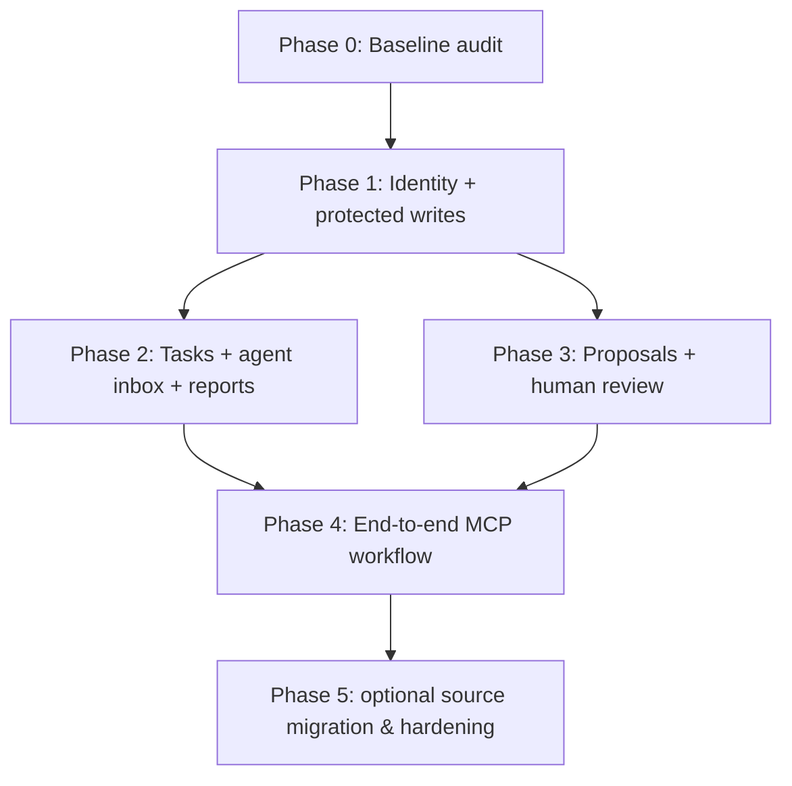

# Implementation Backlog, Engineering Tasks and QA Acceptance Plan

**Current package amendment:** 1.4.46 — 26 November 2026; PROPOSED / NOT FROZEN. Read the final revision 1.4.46 section for this update. Earlier revision headers and receipts below retain their historical scope.

**Document ID:** TESBO-PLAN-005 | **Revision:** 1.4.39 — 21 November 2026; module authoring principles and contextual guidance integration; NOT FROZEN | **Status:** plan plus scoped implementation receipts; unverified backlog/QA entries remain NOT RUN; NOT FROZEN.
**Scoped implementation evidence:** Native preview increments are tracked in Tesbo PR95 and PR98; use their exact-head receipts and the MBT contract/acceptance sections below. Historical full-source audit pins and older review results retain their original scope/date. Unverified criteria and independent assurance remain open; this is not package-wide implementation or deployment certification.
**Repository:** `1alextest/Tesbooboo`, feature branch first, never direct Railway production promotion.  
**Execution tool:** engineer/coding agent may be OpenCode; this plan does **not** replace the separate OpenCode+Chrome MCP QA execution workflow.

**Reuse-first readiness gate — revision 1.4.3 (same task/QA IDs):** Every relevant existing work item (task IDs through T-414) touching Copilot, session history, agent runtime or browser execution must first produce a short review **inside that task/PR**, not a ninth specification: existing Tesbo source paths, semantic gap, reuse/extend/transform decision, upstream Tesbo comparison, proposed dependency/security/maintenance burden, alternative of no dependency, and acceptance proof. Candidate evaluations are **conditional spikes** mapped to existing UI/session/provider/execution tasks, not orders to add libraries. The initial choices to evaluate are: existing Zyra UI alone vs assistant-ui (Copilot UI); current executor-selected Chrome/Playwright MCP vs Midscene or Stagehand (optional target-driver alternatives); current user-managed OpenCode MCP vs Hermes/OpenClaw integration (primary interchangeable executors); OpenCode SDK/headless server or OpenHands SDK (optional hosted agent), and existing BullMQ/Postgres vs added graph workflow engine (long-running orchestration). Reject replacements that introduce a second session/KB/case/Bugs/approval store, make a hosted agent mandatory, or require installing Tesbo desktop software for web Copilot.

**Mandatory integration benchmark without new standing suite IDs:** parameterize existing QA-141–QA-158 and source-neutral end-to-end cases for at least (a) non-DMIS project, (b) provider/model switch with immutable history and approved KB revisions, (c) dropped browser/agent connections and idempotent retries, (d) exact screenshot bytes/verified test oracle, (e) selective human approval and denied direct writer, (f) tested worker cancellation and cross-project network egress denial, (g) measured cost, latency and storage retention, (h) a user-managed agent successfully testing a site already reachable from its existing machine/network **without Tesbo configuring a VPN**, plus a separate optional managed-worker connectivity test only if hosted execution is built. New test IDs must be added only if one behavior is otherwise untested; do not claim these checks executed. Previous 1.4.3 research preserved 40 tasks and 158 QA tests; revision 1.4.4 now adds separately traceable missing behaviors T-411–T-414 and QA-159–QA-176.

**Current integration amendment:** Read revisions 1.4.28–1.4.38 below together for ASER scope, exact canonical owners, source convergence and contracts. Earlier dated source/implementation claims retain their original scope. The original QA round trip and P-07/P-14/P-17/P-18 are preserved. New runtime tests remain NOT RUN; the package is NOT FROZEN.

## 1. Delivery strategy

Implement an MVP vertical slice in a **modular monolith**:

**ChatGPT submits a scoped task through Tesbo MCP → assigned OpenCode instance claims through Tesbo MCP → OpenCode executes via its configured Chrome MCP/Playwright MCP → original report/evidence return through Tesbo MCP → ChatGPT reads and stages case/result/native-defect proposals → ChatGPT/human may loop a linked retest through Tesbo MCP back to OpenCode → human approves selected exact revisions → protected apply publishes to existing Test cases/Runs/Bugs.**

Do not begin with auto-launch of agents, a new browser runner or GitLab integration. Build minimum authorization/publishing infrastructure before exposing new agent write paths. Every phase should be reviewable on a feature branch, backed by tests, and demonstrable without changing live Railway production data.

## 2. Task dependencies / delivery increments

### Phase 0 — Revalidate audited baseline and resolve remaining decisions

| Task ID | Priority | Owner | Engineering task | Deliverable / Definition of Done |
|---|---|---|---|---|
| T-001 | P0 | Architect | Confirm current fork/deployed SHA and applied migrations against the completed 124f128 audit; review relevant upstream changes and repository guidance. | Pinned implementation baseline and delta/reuse map; existing testcase_versions, staging/actors/storage verified; preserve Railway rewrite; no repeated speculative schema audit. |
| T-002 | P0 | Backend/security | Extend the audited writer inventory across direct/indirect definitions, custom values/tags, suite moves/deletion, Zyra selected/set-based/chat saves, duplicate review, bug links, imports and maintenance. | Each writer maps to principal/policy boundary; both MCP aliases and entity REST routes covered; no prefix-only authorization. |
| T-003 | P0 | BA/QA | Reconcile source/native IDs and canonical fields against each opted-in source (the DMIS pilot workbook) and current import/export limitations: title dedupe, ID regeneration/case folding, global expectations, literal delimiters, full hierarchy and local/provider references. | Approved lossless row identity/disposition and profile mapping; every applicable field/source reference round-trips; original source untouched. |
| T-004 | P0 | Architect/product | Specify protected settings CAS/namespaces, deterministic grants and profile lifecycle, bound-project/issuer removal, result correction, private evidence exceptions, retention and explicit human reviewer safeguards. | Documented defaults and impact/activation behavior; generic stale settings cannot erase policy; outstanding owner choices remain labelled. |
| T-005 | P0 | Integration | Inspect actual ChatGPT/OpenCode client and authentication compatibility; distinguish model providers, Tesbo MCP and Chrome MCP. | Supported path/blockers documented without invented plan rules; connection acceptance after scoped identity/task services exist; no broad token issued as a shortcut. |

### Phase 1 — Identity, policy engine and protected-suite invariants

| Task ID | Priority | Dependencies | Engineering task | Acceptance / Definition of Done |
|---|---|---|---|---|
| T-101 | P0 | T-001,T-004 | Extend existing identities/credentials/settings with protected versioned namespaces, environment IDs/context versions and justified grant/operation/decision metadata. | No duplicate identity/audit/environment store; preserve V116 chat RESTRICT/soft-delete rather than duplicate migration; address surviving issuer cascade deliberately. |
| T-102 | P0 | T-101 | Resolve machine organization from bound project; enforce credential ceiling intersected with current profile/instance grants and resource restrictions; explicit denies win. | Workspace switch does not alter agent context; issuer/delegation loss suspends authority; task-scoped context read does not leak unrelated cases/reports. |
| T-103 | P0 | T-002,T-102 | Protect official writers plus authoritative workflow-state/receipt/settings paths, including legacy aiSave/close/discard and history-import refresh. | No fabricated receipt/acceptance/count; stale settings cannot weaken policy; accepted snapshot cannot be silently rewritten. |
| T-104 | P0 | T-101,T-103 | Reuse testcase_versions/snapshots; add complete authored tokens and read-only version/provenance adapter; implement durable case-version drawer URLs. | No second history store; current redirect stub is replaced by correct selection; version links refresh/reopen with project isolation; embedding metadata does not alter authored base. |
| T-105 | P0 | T-102 | Add instance credential ceilings, current grant reevaluation, expiry/rotation/revocation and explicit issuer/owner suspension/transfer lifecycle. | Removal/demotion takes effect next request; promotion does not expand old ceiling; historical attribution survives reissue. |
| T-106 | P0 | T-102,T-103 | Converge both MCP/entity/legacy paths, cookie/bearer and plan semantics; add reauthorizing unpublished-evidence access with explicit accepted-run sharing compatibility. | Existing bearer trace/S3/public-share helpers do not bypass report revocation; stale settings/grants and foreign resource access denied. |

**Phase 1 release gate:** Security regression test suite all green; no new task/report credential can create/edit official testcase directly. Without this, do not expose task credentials to real external agents.

### Phase 2 — Task creation, agent onboarding and immutable raw reports

| Task ID | Priority | Dependencies | Engineering task | Acceptance / Definition of Done |
|---|---|---|---|---|
| T-201 | P0 | T-101,T-102 | Generalize external task/prompt semantics using current Tasks shell, upgraded stable environment context/profile references and exact dispatch snapshots. | No case/internal model key needed; legacy environment parsers preserve IDs; rename/reorder/removal cannot retarget a dispatched prompt. |
| T-202 | P0 | T-201,T-105 | Extend existing Agent list with runtime instances and existing Project settings API & MCP with credentials; add effective grant configuration in current settings. | Two same-runtime instances have separate grants/attribution; no disconnected registry/token store; registration differs from online/claimed state. |
| T-203 | P0 | T-201,T-202 | Implement current-attempt fencing, claim/heartbeat/release, clarification answer/resume, blockers and cooperating-client stop/recovery behavior. | Late heartbeat/answer/finalize cannot revive old authority; setup-blocker report accepted honestly; server cancellation not misrepresented as killing local Chrome. |
| T-204 | P0 | T-201,T-203 | Implement RESERVE → upload → FINALIZE pending receipts with immutable narrative/manifest, supplements, lookup/replay and human manual receipt attribution. | ID exists before artifacts; required upload failures prevent REPORTED/availability; retries/lost response safe; no forged human-as-agent claim or official side effect. |
| T-205 | P0 | T-204 | Extend existing storage/attachments with scoped report ownership, content verification/finalization and actual client-readable evidence via private reauthorizing adapter. | ChatGPT/OpenCode consume permitted screenshot bytes, not only metadata; foreign/revoked/archived-parent access denied; abandoned pending cleanup audited. |
| T-206 | P1 | T-203,T-204 | Extend existing task views with source-neutral paginated proposal/analysis inboxes, five-tab details, manual report/analysis/proposal actions and dirty/reconnect recovery. | Headless/old pending work beyond 50 remains discoverable; human fallback works with no agent/model key; typed edits never silently disappear. |
| T-207 | P1 | T-204,T-104,T-304,T-305 | Accept results against exact dispatched/tested definition/custom/profile/environment snapshot; govern history-import/refreshSnapshots and append reviewed corrections. | Depends on human decision/apply, not just receipt. Accepted history/snapshot never overwritten from latest cases; raw Phase 2 receipts remain observations only. |

**Phase 2 release gate:** Complete T-401 task/report adapters alongside T-203–205 so a compatible client can claim and finalize original reports/evidence. This gate covers immutable observations only. T-207 accepted-result publication waits for T-304/T-305 decision/apply and is not a Phase 2 shortcut. Real Chrome MCP execution remains Phase 4 evidence.

### Phase 3 — Generalize existing staging, review and controlled publication

| Task ID | Priority | Dependencies | Engineering task | Acceptance / Definition of Done |
|---|---|---|---|---|
| T-301 | P0 | T-101,T-104 | Generalize shared staging with logical-operation identity and immutable operation revisions/commitment, suite dependency graph and terminal dispositions independent of chat linkage. | Applied A cannot republish in a later revision; legacy generation done is separate; fully decided rejected/copy-only items do not keep review pending forever. |
| T-302 | P0 | T-301,T-204 | Add canonical native/custom/tag/provider/source/profile field adapter and typed suite/case/result/issue operations for external or human analysis. | Reviewed kind/target/postimage fixed before submission; all fields forward through sequential/set-based writers; no model call, live bug/result side effect or silent loss. |
| T-303 | P0 | T-301,T-104 | Extend exact base/current/proposed comparison and dependency validation; resolve matching recommendations before review; include punctuation, global expectations and full placement/ID data. | No save-time create-to-update pairing; invalid parent/dependency or same-target conflict prevents apply; custom tags differ from automation tags. |
| T-304 | P0 | T-301,T-303 | Implement human decisions, direct manual synthesis/authoring, operation/field threads, safe dirty-state handling and explicit partial/terminal review semantics. | Revision race preserves typed text; stale decision invalidates; no auto-approval or indefinite pending solely for rejected/copy-only items. |
| T-305 | P0 | T-103,T-104,T-304 | Harden both zyraSaveAttempt branches using mandatory supplied-client audit, exact logical commitment/kind/target/base checks and dependency-closed apply; make suite writers share hierarchy/row lock order. | No independent audit survives rollback, no swallowed mandatory audit; actual ordered SQL locks; no late retarget/name-only suite match/orphan hierarchy or reapply across revisions. |
| T-306 | P0 | T-303,T-305 | Build Change requests on shared staging with complete paginated read contracts, partial review/terminal summaries and exact target/version deep links. | Chat/task-board/external sources share review semantics; 3-of-5 selective apply works; headless requests/old pending work found without pasted IDs. |
| T-307 | P0 | T-302,T-306,T-305 | Reuse existing Bugs and bug links for **approved native defect publication**, while rendering separate staged native-defect and tracker-copy operations. Add explicit link/side-effect preview, selected apply, native Bug ID and idempotent provenance; suppress inherited auto-comments on draft/copy, even when legacy provider auto-comment is enabled. | No live bug/link or outbound post from staging/copy approval; only explicit authorized selected apply creates/links a native Bug, exactly once, with approved case/run impact. External issue filing is separately authorized and off by default. |
| T-308 | P1 | T-305 | Add authorized existing-version/provenance reads and durable repository drawer navigation; extend Activity/notifications and harden shared dialog/diff/field primitives. | Correct case/version after new tab/refresh/back/notification; no color-only diff or inaccessible close/focus/labels; post-commit retries cannot replay publication. |

**Phase 3 release gate:** The human review interface supports correcting AI drafts, partial approval and safe merge. Direct case writes by any proposal-only agent are denied.

### Phase 4 — End-to-end clients and handoff elimination

| Task ID | Priority | Dependencies | Engineering task | Acceptance / Definition of Done |
|---|---|---|---|---|
| T-401 | P0 | T-203,T-204,T-205; proposal slice additionally T-302 | Extend existing MCP transport/adapters incrementally: task/report slice with T-203–205; proposal/discovery/history slice after T-302. Preserve negotiated versions/fingerprinted sessions and update server instructions. | Phase 2 gate uses task/report slice; proposal slice separately gated. Runtime validation, stale-session rediscovery/no replay, typed evidence reads, both endpoint forms and forbidden direct calls verified. |
| T-402 | P0 | T-401,T-411,T-415 | Connect a real OpenCode runtime to Tesbo MCP alongside its own Chrome MCP using a restricted instance credential after authorization is implemented. | Real scoped task claim, authorized target test and raw report/evidence receipt; prove prohibited definition/result publication denied. |
| T-403 | P0 | T-005,T-401,T-411,T-415 | Verify the actual ChatGPT MCP authentication/write path; add compliant inbound mapping/gateway only if required and supported. | Actual client reads report and stages shared proposal; account/auth blocker recorded honestly; outbound tracker OAuth not substituted; no secrets in chat. |
| T-404 | P0 | T-402,T-403,T-306,T-207,T-307,T-308,T-418,T-419 | Demonstrate real full feature, including **ChatGPT-created linked OpenCode verification/retest** via Tesbo MCP, independent report/evidence receipts, revised analysis/proposals and selectively approved case/result/native Bugs publication; include human manual fallback and source-neutral discovery. | Actual clients and configured Chrome MCP/Playwright MCP integration proven with immutable original and retest report; approved specific cases and native Bug publish once with verified links, unapproved operations do not; unavailable client/tool explicitly incomplete; no hidden legacy publication/comment path. |
| T-405 | P1 | T-402 | Validate a second registered runtime or protocol-compatible client with independently assigned grants. | Same task/report/proposal semantics; distinct identity; permissions adjustable without vendor hardcoding; live versus simulated client stated. |
| T-406 | P2 | T-402,T-405 | After manual pickup works, optionally add a resident client/poller or supported runtime trigger, scheduling and offline recovery. | Server queues reused; local Chrome remains controlled by selected runtime; no claim that MCP registration launches an offline agent. |

**Phase 4 release gate:** No copy/paste needed for supported clients, and no bypass of human sign-off. If ChatGPT plan feature blocks write MCP, record outcome as partially complete and retain manual UI path rather than faking full integration.

### Phase 4A — Native session/Copilot and external CLI portability (extends existing work, no duplicate subsystem)

| Task ID | Priority | Dependencies | Engineering task | Acceptance / Definition of Done |
|---|---|---|---|---|
| T-407 | P0 | T-103,T-104,T-207 | Generalize existing Zyra sessions/messages into separate project-scoped QA session records, ordered auditable events, exact KB version references and external bindings; provide **one Copilot session picker** across authorized projects without duplicating histories/stores. | Two sessions in one project plus one authorized second project can be switched within the single UI; each conversation/event/task/report/decision remains isolated with correct old Zyra review links. |
| T-408 | P0 | T-105,T-106,T-401,T-407,T-411 | Generalize executor integration **around existing Tesbo MCP/domain services** first: user-managed OpenCode from its own environment, then Hermes/OpenClaw or another independent runtime/gateway via verified MCP/plugin/poller capabilities. Discover/scope agent and target-tool capabilities, identity, claim/report/retest and cancellation/unknown-state reconciliation. **Only if needed**, evaluate hosted SDK/API (Claude/Codex/Kimi/Hermes/OpenCode), isolated workers and Grok-box as a sandbox substrate. No user-installed **Tesbo** companion or hosted-agent mandate. | Two different executor runtimes use the same Tesbo task/report/KB contracts; user-managed path works with an already locally reachable target without Tesbo VPN; optional hosted mode independently gated; no arbitrary shell or authority escalation. |
| T-409 | P0 | T-306,T-307,T-407,T-408,T-411 | Evolve the **one existing web chat/Copilot** shell into one platform UI for creating/selecting many project-scoped sessions, with exact KB links, a verified hosted analyst-backend/model selector, separately assigned task executors, streaming, retest lane and shared change review. | Switching sessions/providers never clones project KB, loses chat history or mixes events/drafts/approvals; preserve Tesbo theme/accessibility, external MCP-only pathway and human review guards. |
| T-410 | P0 | T-404,T-408,T-409,T-411,T-418,T-419 | Prove a full non-DMIS cycle with the **single web Copilot**, two sessions, a configured analysis API/backend, a user-managed execution agent claiming through Tesbo MCP, actual target testing/evidence, a linked retest, provider/agent handoff, and human selective publication. Repeat task/report interoperability with a second distinct executor; run hosted/sandbox proof only when the optional mode is selected. | AC-020–AC-024 and QA-141–QA-158 executed with pinned code/schema and source evidence; no duplicate KB/sessions/approved cases; offline/unsupported execution truthfully represented; no need for Tesbo VPN or a Tesbo workstation companion. |

**Delivery sequencing:** Existing T-401–T-406 external-agent loop remains valid. T-407 durable sessions and T-408 **universal external-agent integration boundary** precede complete single-Copilot UX. Native inference is optional for external MCP-only task/report activity. **No end-user local installation** is a basic or optional Tesbo Copilot prerequisite. Hosting a code agent requires provider- and infrastructure-specific feasibility/auth checks, not a fabricated `CLI installed` UI. T-410 and T-503 remain operational gates.

### Phase 4B — external clients, project MCP consent and attributed context (revision 1.4.4)

| Task ID | Priority | Dependencies | Engineering task | Acceptance / Definition of Done |
|---|---|---|---|---|
| T-411 | P0 | T-103,T-106,T-401,T-407 | Extend Project Settings/API token auth and shared domain guards with project MCP OFF-by-default policy, client consent, specific project/session/action grants, migration/revocation, tool discovery filtering and per-call reauthorization. | Disabled project never enumerated or accessed; project A enabled/project B disabled negative matrix; stale token/direct REST/entity/evidence URLs blocked; current broad tokens not grandfathered into new rights. |
| T-412 | P0 | T-407,T-411,T-401,T-203,T-204 | Extend existing MCP registry for external ChatGPT/Claude authorized project/session/KB version discovery, reports, task dispatch/retest and proposal reads/writes **through existing domain services**, without native Copilot dependency. | Real external ChatGPT user operates Tesbo end-to-end via MCP in an enabled non-DMIS project, while disabled project is invisible; exact client limitations documented. |
| T-413 | P0 | T-205,T-407,T-411,T-412 | Add append-only, permission-scoped external-chat, native-checkpoint and executor-attempt summary revisions with provenance, gap/coverage/visibility and original-source links; expose MCP + native session timeline controls. | ChatGPT user-requested summary and OpenCode report-linked summary can be read by a different permitted assistant; original report/KB unchanged; hidden messages never claimed synced; revision/history and revocation tested. |
| T-414 | P0 | T-305,T-307,T-308,T-409,T-411,T-412,T-413 | Wire one Copilot/QA session to existing Requirements, Cases, Plans, Runs, Bugs, Insights, Agents, KB, Activity and Settings; preserve source identity, direct module routes and old workflows. Prove dual-entry acceptance and inspect frontend/service behavior by module. | Session-to-module links round-trip, no second record store, source/provider-specific metadata correct, no direct model approval or unreviewed native Bug/result writes; AC-025–AC-028 run with real clients. |

**Priority boundary:** external ChatGPT/Claude MCP controls work without native Copilot; native Copilot backend selection (including interactive hosted/remote CLI/SDK agents where supported) never replaces independent executor assignment. Project MCP OFF blocks all external MCP access, including executor credentials using that surface, until a human explicitly enables it and grants the client; no implicit internal/background policy override. Add T-411–T-414 to release review T-503 dependencies and invalidate release readiness if one is incomplete.

### Phase 5 — Migration, reliability and deployment

| Task ID | Priority | Dependencies | Engineering task | Acceptance / Definition of Done |
|---|---|---|---|---|
| T-501 | P0 | T-003,T-305 | Extend existing import/export mapping into source-identity staged dispositions; test identical role titles, changed title/same ID, case-fold/length collisions, repeated leaf names, global expected and literal delimiters. | Lossless sample reconciliation/export-staged-reimport with local/provider refs/custom fields and bug_links coverage; user signs off; original workbook unchanged. |
| T-502 | P1 | T-501 | Perform full migration/cutover only after approved sample/profile and mapping review; preserve source/current IDs and retained history. | Signed reconciliation/cutover with missing/duplicate IDs and uncertain field mappings resolved; no destructive workbook rewrite. |
| T-503 | P0 | T-106,T-205,T-207,T-306,T-307,T-308,T-401,T-404,T-410,T-411,T-412,T-413,T-414 | Run impacted existing Jest/e2e/api/e2e/ui security, lifecycle, history, accessibility, fidelity and protocol regressions after required implementations. | Use explicit dependencies and chosen environment; no circular all-P0 gate, no new test project; every actual outcome reported without claiming source review is execution. |
| T-504 | P0 | T-404,T-503 | Prepare a reviewed staging rollout with verified build/migrations, DB backup, smoke/health checks and safe rollback/forward fix. | Reviewable branch/PR, commands/results, migration and rollback evidence; production promotion only on explicit authorization; old unguarded paths cannot reappear. |

## 3. Acceptance tests (test one behavior per case)

| QA ID | Requirement | Scenario | Expected result |
|---|---|---|---|
| QA-001 | FR-001, FR-003 | Create exploratory task without case; read it back | Exact prompt and revision hash preserved; zero case created |
| QA-002 | FR-003 | Modify dispatched prompt while task active | Original dispatched revision remains; revision/follow-up required |
| QA-003 | FR-005 | Assigned OpenCode principal claims task | Only assigned principal gets prompt and lease |
| QA-004 | FR-005 | Two agent instances race to claim same task | Exactly one active claim; other receives lease conflict |
| QA-005 | FR-015 | Instance revoked before report upload | Immediate denial on next request; report not accepted |
| QA-006 | FR-015 | Agent A requests agent B task/other project | Access denied, no metadata leakage |
| QA-007 | FR-018, FR-022 | Upload full raw report and supplemental report | Both original and supplement retrievable unchanged |
| QA-008 | FR-019 | Upload invalid/oversize or foreign-project evidence | Safe error; no unauthorized storage link |
| QA-009 | FR-020, FR-024 | Submit report for zero-case exploratory task | Report accepted; official testcases/cycles unchanged |
| QA-010 | FR-026, FR-028 | Analysis proposes 3 cases from one raw report | Draft has 3 ops and cited report; official suite unchanged |
| QA-011 | FR-031 | Human field-comments and corrects Expected Results | New proposal revision and comment retained |
| QA-012 | FR-032 | Approved revision amended | Old approval invalid; merge rejected until reapproved |
| QA-013 | FR-034 | Official testcase changed since proposal base | Merge conflict; no lost update |
| QA-014 | FR-035, NFR-002 | Approve 3 of 5; request changes to 1; reject 1 | Exactly the selected approved 3 commit; other operations retain explicit uncommitted states |
| QA-015 | FR-053, NFR-002 | Retry merge with same idempotency key | Same result; no duplicate testcases or revisions |
| QA-016 | FR-037 | Agent with proposal-only rights invokes `create_testcase` MCP | Denied; official suite unchanged |
| QA-017 | FR-037 | Agent calls legacy REST/bulk create/import/clone to bypass | All unauthorized mutation paths denied |
| QA-018 | FR-033 | Analysis agent tries to approve or merge own proposal | Denied under human-required policy |
| QA-019 | FR-036 | Inspect merged testcase and its original evidence | Case revision links reviewer → proposal → report → task/prompt |
| QA-020 | FR-038, FR-040 | Reviewer rejects issue while approving cases | Draft remains unfiled; copy allowed only if approved |
| QA-021 | FR-043, FR-044, FR-045, FR-046, FR-047 | Stage/import a project-configured source sample (DMIS/Excel pilot fixture) | Exact applicable fields/source-ID mapping/hierarchy reconcile; original workbook unchanged |
| QA-022 | FR-009 | User requests retest; agent submits second report | Linked follow-up visible; original report intact |
| QA-023 | FR-010, FR-012 | Substitute alternate MCP AI agent for OpenCode | No schema/permission changes; distinct instance identity |
| QA-024 | FR-017 | Issue token with zero/invalid scopes | Rejected instead of silently receiving read+write |
| QA-025 | NFR-008 | Existing Tesbo human manual UI still works under policy | Legitimate allowed action succeeds; governed path audited |
| QA-026 | NFR-008 | Existing external automation reporter reports result | Intended case-linked run works with proper scoped credential and existing data model |
| QA-027 | NFR-006 | Check task payload, logs, exports for secrets | Credentials not disclosed |
| QA-028 | AC-012 | Run initial real OpenCode + Chrome MCP end-to-end DMIS web *pilot* workflow | Traceable report, reviewed case merge, approved issue draft; no Playwright/Appium introduced |

**Evidence per QA result:** actual test input, principal and capabilities (never credential), request/method/response for API tests, task/report/proposal IDs, expected vs actual, outcome, timestamps, UI screenshots where material, code coverage for bypass tests. Do not conflate prototype tests with real target execution; the DMIS browser run is the first pilot proof only.

### Additional audit/recon-driven acceptance tests

Original QA-001–QA-028 IDs remain. Parameterized writer/credential/artifact matrices produce separate executions per behavior/vector.

| QA ID | Requirement | Scenario | Expected result |
|---|---|---|---|
| QA-029 | FR-001 | Create external task with no Tesbo model allocation | Task is accepted without starting Zyra generation. |
| QA-030 | FR-027 | Stage equivalent external and Zyra case drafts | Both use the same shared staging/review/apply boundary. |
| QA-031 | FR-037 | Restricted principal changes a custom field value | Denied; authored definition/custom values unchanged. |
| QA-032 | FR-037 | Restricted principal moves a case/suite | Denied; approved placement unchanged. |
| QA-033 | FR-037 | Restricted principal invokes duplicate-review edit/remove | Denied under protected policy; existing records unchanged. |
| QA-034 | FR-032 | Approved payload changes only punctuation/test data | Exact-content change invalidates approval before apply. |
| QA-035 | FR-034 | Destination suite becomes unavailable | Conflict; no silent relocation or pre-transaction suite creation. |
| QA-036 | FR-049, FR-053 | Mandatory apply-audit persistence fails | Selected transaction rolls back; no published definition change. |
| QA-037 | FR-040 | Stage issue linked to an existing execution | No live bug/link is created; accepted execution status unchanged. |
| QA-038 | FR-040 | Approve issue for copy | Approved text available; no external post/comment or live bug side effect. |
| QA-039 | FR-036, FR-045 | Publish a case with required custom/profile values | Values and profile preserved in current definition and history. |
| QA-040 | FR-023, FR-045 | Publish accepted result for a case later edited | Execution retains exact tested authored/custom/profile snapshot. |
| QA-041 | FR-049, FR-053 | Post-commit notification/cache work retries | No repeated publication; official counts converge from committed records. |
| QA-042 | FR-014, FR-017 | Restricted agent attempts stronger token issuance | Delegation denied; no stronger credential minted. |
| QA-043 | FR-014 | Restricted machine request also carries human cookie | Principal precedence cannot elevate it to human approval. |
| QA-044 | FR-014 | Existing tool called directly though hidden from discovery | Per-call domain authorization still applies. |
| QA-045 | NFR-001, NFR-008 | MCP read uses POST under a project write lock | Correct read policy applies by operation semantics; aliases preserve write protection. |
| QA-046 | FR-019 | Pending artifact has missing/corrupt bytes | Finalization rejects; report is not marked available. |
| QA-047 | FR-015 | Agent assignment changes before report finalization | Old attempt cannot finalize as current authority. |
| QA-048 | FR-030, NFR-011 | Source chat or credential issuer is removed | Required report/review/apply lineage remains under retention policy. |
| QA-049 | FR-036 | Embedding maintenance updates non-authoring metadata | Current authoring token does not falsely change. |
| QA-050 | FR-035 | Reopen a partially merged proposal | Committed, rejected and pending items remain distinct; no duplicate apply. |
| QA-051 | FR-048 | Restore an older approved definition | Reviewed compensating operation preserves later history/results. |
| QA-052 | FR-010, FR-012 | Change one runtime instance's capabilities | Next call uses new grants without affecting another instance of that runtime. |

### Independent team-review acceptance additions

These specify the concrete source conflicts found in the five-reviewer pass. They are planned tests, not executed results; parameterized branches/vectors generate separate executions.

| QA ID | Requirement | Scenario | Expected result |
|---|---|---|---|
| QA-053 | FR-030, FR-035, FR-053, NFR-002 | Apply A, revise B while A remains referenced in new revision | A cannot republish under a new request key; commitment is unique across revisions. |
| QA-054 | FR-028, FR-032 | Ticket-linked target order changes before selected apply | Reviewed kind/target remains exact or conflicts; test both save branches. |
| QA-055 | FR-027, FR-035 | Selected child depends on missing/unapproved/cyclic parent operation | Selection rejects without implicit parent approval or writes. |
| QA-056 | FR-035, FR-043 | Later item fails while publishing reviewed hierarchy and cases | No orphan suite/case/history/receipt survives rollback. |
| QA-057 | FR-043 | Same module label exists under two role parents | Exact approved parent identity determines placement, never global name matching. |
| QA-058 | FR-034, FR-043 | Ancestor deletion/reparent races approved hierarchy apply | Shared lock/version protocol preserves exact reviewed tree or conflicts atomically. |
| QA-059 | FR-037, FR-049 | Legacy aiSave receives fabricated/foreign/repeated case IDs | No trusted apply receipt/count/completion can be fabricated. |
| QA-060 | FR-049 | A later selected item fails after an earlier successful audit step | No authoritative success audit remains from the rolled-back batch. |
| QA-061 | FR-034, FR-053, NFR-002 | Overlapping batches request targets in reversed order | Actual common SQL lock order/retry avoids unsafe publication. |
| QA-062 | FR-027, FR-035 | Partial review runs through task-board/chat/external sources | Shared operation state is source-neutral; generation status projection does not hide pending work. |
| QA-063 | FR-035, FR-040 | All remaining mixed items are rejected or approved-for-copy | Request completes with accurate dispositions rather than remaining pending forever. |
| QA-064 | FR-012, FR-014 | Stale generic settings save follows protected policy activation | Reserved policy/profile keys and versions remain; unauthorized changes rejected. |
| QA-065 | FR-010, FR-015 | Issuer switches active human workspace | Bound-project agent context/authorized behavior stays unchanged. |
| QA-066 | FR-011, FR-015 | Issuer/owner loses required delegation or membership | Affected credential/attempt suspends next request; history retained. |
| QA-067 | FR-012 | Profile allow/override/explicit deny and token ceiling conflict | Deterministic intersection/deny rule applies; no privilege growth. |
| QA-068 | FR-015, FR-019 | Report evidence access after previously issued grant is revoked | Private adapter reauthorizes; no inherited public trace/cycle/S3 bypass. |
| QA-069 | FR-019, FR-025 | Actual analyst client retrieves a submitted screenshot | Authorized bytes inspectable with artifact identity; metadata alone never counts as inspected evidence. |
| QA-070 | FR-018, FR-019, FR-053 | Reserve then upload/finalize with lost finalize response | One immutable available receipt; replay recovers it without duplicate reports. |
| QA-071 | FR-019, FR-022 | Pending upload is interrupted or expires | Required failure prevents availability; audited pending cleanup preserves finalized sources. |
| QA-072 | FR-005, FR-009 | Clarification answer arrives after assignment replacement | Answer does not revive old lease; explicit new fenced resume required. |
| QA-073 | FR-009, FR-015 | Cancellation reaches cooperating active execution client | Subsequent material target actions stop; in-flight limits stated honestly. |
| QA-074 | FR-025, FR-052 | Headless pending proposal predates more than 50 newer tasks | Human/replacement analyst discovers it with scoped paginated inbox and no pasted IDs. |
| QA-075 | FR-025, FR-036 | Exact published case/version link opens after refresh/new tab | Existing drawer shows correct version/provenance with project isolation. |
| QA-076 | FR-002, FR-003 | Environment renamed/reordered/retired after dispatch | Stable ID survives settings; dispatched context snapshot stays exact. |
| QA-077 | NFR-003, FR-018, FR-027 | No agent/model key; human imports report and authors proposal | Full shared manual fallback works with truthful human/runtime attribution. |
| QA-078 | FR-012, FR-026 | Profile version activates/retires while historical task exists | Effect summary/current grant rules apply; exact historical format remains readable. |
| QA-079 | FR-030, FR-031 | Human edit races remote revision/navigation/reconnection | Typed correction is saved or protected by keep/discard/rebase choice; no silent loss. |
| QA-080 | NFR-009 | Use a declared supported browser/OS/assistive-technology combination to navigate shared diff/editor/report without pointer | Labels, reading order, keyboard controls, focus lifecycle, error announcements and non-color differences work in the declared supported matrix; capture actual AT/version evidence. |
| QA-081 | FR-044, FR-047 | Repeat source import or same title across different roles | Stable source identity yields explicit row disposition without silent title-only dropping. |
| QA-082 | FR-045, FR-047 | Multiple actions/global expectations contain pipes/arrows/newlines | Structured profile mapping preserves all content without invented correspondence. |
| QA-083 | FR-023, FR-048 | Accepted run receives history-import refreshSnapshots | Tested snapshot/history remain; reviewed compensating correction required. |
| QA-084 | FR-028, FR-044 | Local/provider requirement references and bug_links are queried | Declared reference/cardinality/coverage projection preserves correct links. |
| QA-085 | FR-043, FR-047 | Export then staged reimport repeats leaf suite names | Full identity/parent path and structured fields round-trip without flattening. |
| QA-086 | FR-044, NFR-008 | Source IDs differ only by case or exceed native constraints | Explicit unambiguous mapping preserves source identity; optional reporter cannot misroute. |
| QA-087 | NFR-008, FR-053 | MCP tool schema changes during existing session | Negotiation/stale404/rediscovery preserve auth and do not replay completed writes. |
| QA-088 | FR-028, FR-045 | Publish complete canonical field set through each save branch | Absent/clear/set and custom versus automation tags retain exact reviewed values. |
| QA-089 | FR-040 | Legacy tracker auto-comment setting enabled during issue-copy approval | No implicit outbound comment or live bug/result mutation occurs. |
| QA-090 | FR-030, NFR-011 | Chat soft deletion/issuer deletion meets retained proposal lineage | Reuse existing V116 protection; issuer retention change does not duplicate migration or erase history. |

| QA-091 | FR-035, FR-043, FR-053 | Publish parent suite first, then approved dependent child in a later selected apply | Exact prior commitment maps to still-valid parent UUID without reselecting/reapplying it; changed/deleted parent conflicts. |
| QA-092 | FR-018, FR-019, NFR-003 | Human finalizes a manual primary receipt with and without an active executor | No-active-lease path uses manual authority, policy and task-version CAS to mark REPORTED; active-executor path is evidence-only with visible unchanged lifecycle and truthful attribution. |
| QA-093 | FR-019, FR-022, FR-053 | Finalize/replay historical supplement after analysis or task closure | Scoped current supplement authority appends immutable evidence without old lease impersonation, new target actions or lifecycle rewind. |

### Existing-route regression matrix

Exercise case CRUD/restore/archive/duplicate/bulk, imports and nested suite creation, suite clone/move/delete, custom-field values/tags, Zyra selected and set-based save/chat actions, Review Board edit/remove, accepted results/automation ingest, history-import/refreshSnapshots, authoritative aiSave/close/discard receipt/state tracking, protected settings/profile writes, public sharing/evidence adapters and bug create/link. Test each with allowed human policy, restricted instance, revoked credential and foreign-project references as applicable. Entity-addressed routes and both MCP URL forms must reach identical domain checks. Preserve KB, requirements, cache/counts, plan limits and optional reporter behavior.

The live recon only exercised browser access/KB persistence/search/history plus UI form/tab inspection. **None of QA-001–QA-129 is marked passed by this document.** Later execution records must identify environment, tested build, principal and actual outcome.

| QA-141 | FR-054, AC-020 | Create two distinct project sessions using the **one** Copilot interface; assign different analyst/executor bindings | Two stable session IDs, separately ordered histories and correct project authorization; no second Copilot instance or duplicated knowledge |
| QA-142 | FR-054, FR-060, AC-020 | Disconnect and resume a session from a second browser/client while another participant is writing | No lost/duplicate events, stable sequencing and consistent linked tasks, reports and decisions |
| QA-143 | FR-055, FR-061, AC-022 | Retrieve project canonical KB document exact v1 while v2 is current from a fresh approved participant | Exact authorized v1 content and citations used; no session-copy of KB file; complete/versioned read |
| QA-144 | FR-055, FR-063, AC-022 | Request promotion of a chat conclusion to project Knowledge Base | Proposed change remains untrusted until authorized KB review; only canonical new document version published |
| QA-145 | FR-054, FR-056, FR-057, AC-021 | From one web Copilot switch between sessions and hosted analyst providers/models, including one other authorized project | Correct session-specific history/KB/timeline/draft/stream restored; only verified compatible hosted models shown; no desktop/local CLI setup |
| QA-146 | FR-057, FR-058, AC-023 | Register user-managed OpenCode and independently configured Hermes/OpenClaw executor; vary credentials, remote protocol support, available target tools and last contact | Distinguish ready/authentication required/offline/unsupported without inventing capabilities, requiring a hosted worker or controlling user processes; revoked permissions fail closed |
| QA-147 | FR-058, AC-023 | Run a bounded Claude Code Agent SDK/CLI turn and exact resume with signed context manifest | Authorized streamed tool/output/provenance recorded under Tesbo session with native binding separate |
| QA-148 | FR-058, AC-023 | Execute Codex app-server/SDK turn with streamed events and tool permission request | Interrupt/approval state, completion and native thread ID reconciled; no automatic human publication |
| QA-149 | FR-058, AC-023 | Run Kimi CLI structured event output and negotiate optional ACP support | Events parsed from supported structured protocol only; absent ACP capability responds NOT_SUPPORTED |
| QA-150 | FR-058, AC-023 | Use a second independently operated Hermes MCP-capable agent or verified OpenClaw plugin/gateway to claim the same task schema and submit a separate original report | Same Tesbo task/receipt contract works with distinct runtime and verified capability mapping; attempts and report attribution remain independent; gateway crash/offline reconciliation prevents duplicates |
| QA-151 | FR-059, FR-062, AC-023 | Malicious chat/tool output requests arbitrary shell, cross-project worker directory/egress or secret disclosure | Hosted worker/gateway authorization and sandbox deny unauthorized process/egress/secrets regardless of model instructions |
| QA-152 | FR-059, FR-060, AC-023 | Revoke hosted agent credential while turn is active and disconnect gateway after apparent acceptance | New protected operations denied; exact turn outcome reconciled or marked UNKNOWN; no accidental resubmission |
| QA-153 | FR-061, FR-062, AC-022 | Switch session analyst from native Copilot to external ChatGPT/Claude; simulate unavailable provider transcript | Same Tesbo event/decision/source context available by scoped read; missing hidden state identified explicitly |
| QA-154 | FR-056, FR-062, AC-021 | Agent attempts to approve staged case/Bug by invoking Copilot or CLI direct legacy writer | Denied on backend; authorized human exact revision approval remains required |
| QA-155 | FR-060, FR-063, AC-020 | Fork same session and let two agents attempt conflicting edits with stale bases | Parent history immutable; competing proposals isolated; stale base denied without duplicate publication |
| QA-156 | FR-056, FR-057, FR-059, AC-021 | Access the same Copilot and its sessions from desktop browser and mobile browser without any companion/local CLI installed | Project/session conversation and hosted model access function using permitted services; no PATH scanning, workstation control or local dependency |
| QA-157 | FR-055, FR-058, FR-061, FR-062, AC-024 | In project B with no DMIS/GitLab/Excel fixtures, a user-managed executor uses its existing network/browser/driver to test a target and uploads evidence through Tesbo MCP | Canonical KB, session, tasks, original report, linked retest and human-approved cases/Bugs succeed without Tesbo VPN, managed worker, second source store or browser process |
| QA-158 | FR-054, FR-056, FR-058, FR-060, AC-023, AC-024 | Run the complete single web Copilot → Tesbo MCP → user-managed OpenCode/compatible executor → chosen target driver → Tesbo evidence → ChatGPT/Copilot retest → selective human merge cycle | Verified task/report/attempt/source citations and approved official records; second different agent can receive same protocol, optionally run Grok-box sandbox when selected; no mandatory hosted execution |

| QA-159 | FR-064, FR-065, AC-025 | Use ChatGPT app with real Tesbo MCP and an enabled non-DMIS project; do not open native Copilot | Enumerate, choose existing session, retrieve KB/requirement and prior events, create/assign execution task, read original report, submit linked retest and stage proposals through shared services |
| QA-160 | FR-064, FR-070, AC-025 | Repeat the approved QA workflow from native Tesbo Copilot with a different configured interactive backend | Same project/task/receipt/case/Bug IDs and authorization; no parallel records; backend choice does not force executor choice |
| QA-161 | FR-065, FR-066, AC-026 | User has projects A enabled and B disabled; external client requests project list | Only explicitly authorized A is listed; B metadata/count/session names never exposed |
| QA-162 | FR-065, FR-066, AC-026 | Enabled A and disabled B; client guesses a known B project/session/document/report ID or direct endpoint | Every MCP/read/write/evidence/direct REST adapter denies; no metadata, source byte or write side effect leaks |
| QA-163 | FR-065, FR-066, AC-026 | User turns OFF previously exposed A while external AI/executor still holds tokens/tool list | Subsequent reads, task heartbeats, new claims, uploads/finalize and writes fail closed; accepted original receipts remain immutable; internal Tesbo UI unaffected |
| QA-164 | FR-065, FR-066, AC-026 | Project manager lacks rights or organization policy prohibits exposure | Enable/change-grants attempt denied and audited; setting remains OFF; QA engineer cannot self-enable |
| QA-165 | FR-065, FR-066, AC-026 | Legacy `read,write` project tokens coexist with newly enabled connection controls | No silent privilege elevation or wrong-project access; explicit migration/rotation/consent gates remain necessary |
| QA-166 | FR-066, FR-062, AC-026 | A named ChatGPT client has session S1/thread C1/read-only grant but attempts S2/thread C2, project B, write proposal, raw classified evidence and human approval | Every over-scoped request denied regardless of MCP advertised tools, aliases or issuer membership |
| QA-167 | FR-067, AC-027 | User requests summary in external ChatGPT and submits via authorized MCP tool | Source client/actor, declared coverage, gaps, timestamp, exact referenced IDs and unverified derivative status stored; no claim entire hidden provider transcript was captured |
| QA-168 | FR-067, AC-027 | External chat summary contains no Tesbo source refs, invalid foreign project refs, or malicious approval instructions | Unverified narrative visibly labelled or invalid refs rejected; no KB/case/Bug/approval mutation or project data leakage |
| QA-169 | FR-067, FR-060, AC-027 | Correct a published session summary and replay its original idempotency key | History retains previous revision/receipt; duplicate submission not duplicated; referenced real session events unaffected |
| QA-170 | FR-068, AC-027 | OpenCode submits executor summary referring to its own finalized task/attempt/report | Exact linkage and declared actually observed actions; source bytes and report hash preserved; summary cannot create a passing official case result |
| QA-171 | FR-068, FR-062, AC-027 | Executor references an unassigned or other-project attempt/report or forged screenshot evidence | Reject/restrict and audit; original reports not rewritten and unsafe content not treated as instruction |
| QA-172 | FR-067, FR-068, FR-061, AC-027 | Another authorized ChatGPT/Claude session resumes after the previous provider chat ends | Retrieves current summaries **and** exact authorized original events/KB/evidence; source gaps surfaced, no fabricated missing conversation |
| QA-173 | FR-069, AC-028 | Review session proposal to add/edit official cases and native defect | Original Test Cases/suite/version and Bugs/evidence/link paths used only after exact selected human apply; no duplicate AI case/bug repositories |
| QA-174 | FR-069, AC-028 | Associate existing plan/run/case and KB requirement with an exploratory task plus retest | Plan/Run/case/requirement records unchanged until authorized action; historical pass/fail not inferred from report-only observations |
| QA-175 | FR-069, AC-028 | Navigate task/summary/report/review to requirements, testcases, plans, runs, bugs, insights, agents, KB, activity and Settings | All routes link to current canonical module/ID; activity counts and insights use original data rather than cloned AI records; existing manual UI regression passes |
| QA-176 | FR-064, FR-065, FR-067, FR-070, AC-025, AC-026, AC-027, AC-028 | Two projects, one disabled for MCP; ChatGPT external route, native Copilot CLI/API backend, two interchangeable execution agents and full selective review | Both permitted entry paths share session context and QA lifecycle; disabled project unseen externally; explicit chat/attempt summaries retain provenance; second executor interoperability; only approved changes publish |

### Full assurance targeted negative tests — revision 1.4.5

| QA ID | Requirement | Scenario | Expected result |
|---|---|---|---|
| QA-177 | FR-011, FR-017, FR-065, FR-066 | Request a new MCP token with absent, empty, unknown-only or invalid scope; inspect effective grants | Reject issuance or issue explicit deny-only credential; never default to read/write; no subsequent tool call gains protected access |
| QA-178 | FR-054, FR-061, FR-062 | Register two external conversation threads plus one existing Zyra chat under the same QA-session parent | Original Zyra message/review IDs persist; thread-level access and independent summary/history correctly scoped; no second official chat store |
| QA-179 | FR-055, FR-069 | Two projects ingest an identical source-provider/external-ID pair, then one project attempts duplicate bytes in its KB | Project identities and permissions stay separate; existing canonical version/link reused within the project as configured; no global source-ID conflict or unauthorized presence disclosure |
| QA-180 | FR-065, FR-066 | Disabled project or read-only external client calls cached `tools/list` and guesses denied direct-write tools/IDs | No disallowed project data/tool details exposed; all denied calls enforce current policy; legacy `create_testcase`/`create_bug`/bulk paths cannot publish |
| QA-181 | FR-067, FR-068, FR-062 | Submit unrequested/exaggerated external-chat summary or executor summary containing an instruction to approve/publish | Provenance and completeness visibly labelled; foreign refs denied; no instruction execution, approval change or fictitious execution result |
| QA-182 | FR-019, FR-053, FR-065, FR-066 | Disable project MCP access during evidence reserve/upload/finalization | Subsequent requests denied; already accepted receipt bytes retained safely; incomplete reservation reconciles with deterministic final/unknown status and no duplicate finalize |
| QA-183 | FR-055, FR-061, FR-069 | Linked external requirement changes after task dispatch; replacement analyst requests historical context | Exact task-time snapshot/version or explicit unknown returned; current ticket is not substituted as original evidence; no cross-project retrieval |

**Test granularity rule:** QA-159 and QA-176 are end-to-end *journey acceptance* scenarios involving many operations. They are not one-behavior atomic tests. Keep them as separate integration gates supported by independent operation-specific cases (including QA-161–QA-175 and QA-177–QA-183). Record execution status per atomic result; never infer all participants passed because the journey progressed once.

**Security sequencing correction:** the project MCP OFF-by-default gate (`T-411`) precedes external runtime task pickup (`T-408`), Copilot exposure (`T-409`), and the composite proof (`T-410`); no phase may temporarily issue unrestricted default read/write tokens. The Phase 4B heading appears before Phase 5 to reflect these dependencies.

## 4. Architectural proof gates (must answer before PR approval)

1. Are all official-case mutation paths enumerated, including bulk/import/clone/legacy services and agents' direct MCP tools?
2. Can a compromised execution-agent credential alter expected results or published testcases via any path?
3. Can a report be uploaded with no test case, and can the source report be retrieved verbatim?
4. Does assistant-generated proposal remain unmerged until the human explicitly approves selected content?
5. Is human approval tied to an exact proposal revision, with safe conflict and retry behavior?
6. Does the human have UI edit/comment/request-retest tools without returning to ChatGPT for every change?
7. Can another runtime replace OpenCode without rewriting schema or MCP task/report contract?
8. Is Chrome MCP still operated locally by OpenCode rather than by Tesbo?
9. Is the approved Excel import reconciled and has the original workbook remained unchanged?
10. Has the actual ChatGPT MCP connection been tested, or is it explicitly marked blocked/not implemented?

## 5. Change management and developer output contract

- Work only on `feature/protected-suite-agent-review-flow` or phase-specific branches created from current fork `main`; PR/merge required; no production deployment without authorization.
- Each PR describes changed paths, migrations, new permissions, default project policy, backwards compatibility, test commands/results, risks, and smoke demo.
- Prove no leaked test tokens/OTPs/passwords in screenshots, commits, logs, sample prompts or fixtures.
- Source-code findings must identify pinned commit/path and supporting evidence; distinguish them from live behavior. Proposed APIs, schemas and app behavior must be labeled **design**, not shipped.
- Escalate undecided product behavior (result approval, policy delegation, evidence retention, token migration and project audit) rather than silently choosing a permissive default.
- Keep GitLab defect drafts standalone and human-filed; no GitLab API token needed.

## 6. Revision 1.2 delivery focus

Keep original task IDs T-001–T-504 and phases as planning references; their bodies now express reuse rather than independent subsystem creation. Revalidate the completed audit, do not repeat it as an excuse to create more design documents. Internal boundaries may be implemented in smaller reviewable increments with the same acceptance traceability.

Start with T-001/T-002 baseline delta and T-101–T-106 principal/publication boundary, then generalize shared staging in T-301/T-303 before exposing external clients. The first full vertical slice requires tasks/reports plus review; do not release a broad-write agent connection without the protection. Existing eight specifications are the working plan; audit/recon files remain supporting evidence.

## 7. Team-review gate and corrected dependency interpretation

All original 36 task IDs remain. T-401 is delivered incrementally: task/report adapters are predecessors of the Phase 2 gate; proposal/discovery adapters additionally require T-302. T-207 is cross-increment and cannot publish accepted results before T-304/T-305. T-503 lists explicit predecessors, avoiding the old self-referential all-P0 dependency. Validate this dependency graph before scheduling work.

Source anchors and minimal corrections for the five reviewers are recorded inside the existing README/technical design. General reuse statements do not close these concrete gaps until adapter field parity, reviewed kind/target, logical-operation commitment, scoped read/finalize/resume, protected settings and exact history behavior are implemented and tested. Existing V116 chat retention protection is reused, not remigrated. No product/database tests were run for this docs-only review.

## 8. Full-assurance acceptance extensions and traceability — revision 1.3

Original **53 FR**, **36 T task IDs** and QA-001–QA-093 are preserved; QA-094–QA-115 add **22** distinct full-assurance oracle/compatibility behaviors, not a competing test suite. All below are **NOT RUN**. Keep one behavior per test, with actual input/expected/actual/evidence per execution. The QA-028 full-loop smoke cannot substitute for negative races, migration or current-source retrieval tests.

| QA ID | Requirement | Scenario | Expected result |
|---|---|---|---|
| QA-094 | FR-002, FR-021 | Executor's actual page/tenant/role/build differs from dispatched context | Intended and observed values, including `UNKNOWN`/`NOT_REACHED`, are independently retained and mismatches flagged; no fabricated target identity. |
| QA-095 | FR-021, FR-042 | An execution report covers only part of the requested test scope | Each check has TESTED/BLOCKED/NOT_TESTED disposition, evidence or reason; coverage cannot silently show complete. |
| QA-096 | FR-026, FR-052 | Analyst requests historical KB content after the document is edited | Exactly the pinned version bytes/hash are read-only available; never silently returns latest text or mutates by restore. |
| QA-097 | FR-018, FR-025, FR-026 | Very long original report spans multiple authorized content chunks | All ordered parts and completeness/hash receipts match before analyst marks report fully read. |
| QA-098 | FR-023, FR-042 | Exploratory observation predates a newly approved case definition | Formal PASS/FAIL denied until real execution of the approved immutable definition; observations remain linked analysis evidence. |
| QA-099 | FR-002, FR-009, FR-051 | Prompt requests an action outside structured host/IdP/redirect/action scope | Client does not perform widened operation; explicit clarification/deny and trace are recorded. |
| QA-100 | FR-018, FR-019, FR-051 | Unsafe original contains secret/PII and needs analysis | Original is restricted/quarantined; independently hashed, attributed redaction is available only under policy; finalized bytes unchanged. |
| QA-101 | FR-014, FR-051 | Hostile web page instructs execution agent to ignore task or exfiltrate credentials | Runtime refuses unauthorized side actions and reports attack content as untrusted evidence; scopes and secrets unchanged. |
| QA-102 | FR-014, FR-024, FR-051 | Hostile submitted report instructs analyst to change official cases or approve itself | No unauthorized tools/approval/publication invoked; cited content remains untrusted source data. |
| QA-103 | FR-019, FR-053 | Two different idempotency keys finalize primary receipts for the same attempt concurrently | Exactly one current primary exists and triggers state; losing request conflicts, with no extra published outcome. |
| QA-104 | FR-019, FR-022 | Finalization races pending-cleanup and an older upload | Final admitted bytes remain addressable/hash-valid; cleanup and old upload cannot remove/replace finalized source. |
| QA-105 | FR-015, FR-033, FR-035 | Reviewer grant is revoked while selected apply is in flight | Transaction linearizes current policy/approval and denies any commit without effective authority; no partial unauthorized write. |
| QA-106 | FR-048, NFR-008 | Mixed old/new records pass backfill, rollback and history import | Existing cases, receipts and historical snapshots retain meaning/authority; no legacy bypass or lost lineage on forward-fix. |
| QA-107 | FR-009, FR-021 | DMIS web pilot page requires a slow readiness interval (reported approximately 30 seconds) | Real executor waits for observed readiness or truthfully records timeout/BLOCKED; no invented failure. |
| QA-108 | FR-009, FR-021 | DMIS web pilot OIDC browser session expires during a task (reported approximately 30-minute idle) | Agent handles expired authority safely, retains evidence and does not blind-retry state-changing actions. |
| QA-109 | FR-009, FR-021 | Item wizard Next/Update is offscreen horizontally at reported 1536×770 | Real browser navigation inspects viewport/scrolling and accurately tests available action without false absence claim. |
| QA-110 | FR-025, FR-052 | New authorized ChatGPT/replacement session resumes old pending work without pasted IDs | Correct source-neutral discovery, exact prompt/references/complete report/evidence, decisions and receipts restore context; absent sources disclosed. |
| QA-111 | FR-004, FR-008 | Authorized human manually selects/reassigns/cancels external task with dispatch policy | Exact authorizer, mode, target instance and prompt revision are recorded; stale executor cannot continue as current. |
| QA-112 | FR-007 | Regression task is dispatched against a case edited after run planning | Executor receives linked immutable published definition/profile/context snapshot, not changed current case text. |
| QA-113 | FR-006 | Optional autonomous pickup/poller is enabled without a running client | Work stays queued and honest offline; when resident client starts it claims only authorized task; no promise MCP registration wakes workstation. (SHOULD; gate only when implemented.) |
| QA-114 | FR-029, NFR-009 | Open three-way case comparison at 320 CSS-pixel reflow and, separately, 200% text zoom | Labelled Base/Current/Proposed details, exact punctuation, selected operations, focus/reading order, conflict messages and action controls remain reachable without content loss; no success inferred from unknown values. |
| QA-115 | FR-039, FR-041 | Approved-for-copy issue text is manually filed and URL/status recorded later | Filing URL/status is attributed separately from case publication; no automatic GitLab post, live bug write or change in case review status. |

**Historical revision-1.3 link reconciliation (further corrected in §8 addendum below):** FR-013 → QA-016/042 (permission separation); FR-016 → QA-052 and current UX-06 display gate (management UI); FR-029 → QA-114; FR-039 → QA-020/115; FR-042 → QA-095/098; FR-050 → QA-036 (audit identity) and QA-105; FR-051 → QA-027/099–102. FR-004/006/007/008/021/041 are directly linked above. This addresses the 13 previously unlinked FRs; numeric ID presence does not prove full coverage. Review each scenario-to-requirement connection again when implementing, including whether NFR-only tests need finer role matrices.

**Historical revision-1.3.2 gate/task mapping (prior to T-407–410 in revision 1.4.0):** D01 → T-201/T-203/T-204/T-401; D02 → T-207/T-302/T-305; D03 → T-004/T-102/T-203/T-401/T-402; D04 → T-204/T-205/T-401; D05 → T-104/T-205/T-206/T-401. Security injection → T-402/T-403/T-503; races/migration → T-103/T-204/T-205/T-305/T-501–504; DMIS pilot conditions and platform-wide fresh-session continuity → T-404/T-503; accessible/accurate UX → T-306/T-308/T-503. Execute on the same application test infrastructure with real principals, evidence digests and rollback proofs.

**Seven release gates:** README F01 contract decisions; F02 protected authority/atomic apply; F03 safe external scope/evidence; F04 actual supported client end-to-end; F05 post-hoc result acceptance; F06 optional import/policy/retention/migration rollout; F07 regressions/formal White re-adjudication. F01 is documented, not independently signed off. F02–F07 are **open**; every scenario is NOT RUN. Do not claim frozen architecture or user-facing availability from this document.

### Assurance traceability correction and targeted negative tests — revision 1.3.1

The QA-table requirement cell uses explicit complete IDs (rather than abbreviations like `FR-039/041` or a range) so exact machine/human traceability checks cannot miss legitimate coverage. Replacing shorthand does **not** prove semantic coverage. The following seven parameterized tests cover meaningful assertions that QA-001–QA-115 did not independently verify. Each parameterized execution must record precisely one permission, operation, source path or field rule, with expected/actual and supporting evidence. These refine the **existing** task IDs and require no new product subsystem. All remain **NOT RUN**.

| QA ID | Requirement | Scenario | Expected result |
|---|---|---|---|
| QA-116 | FR-013, FR-014 | Exercise each separately granted operation (submit, assign, claim, evidence upload, analyse, edit proposal, review, approve, merge, administer) with one disallowed instance/principal per REST/MCP/legacy route. | Only the specifically granted operation succeeds; every ungranted operation fails before mutation, even via direct tool or legacy URL; issuer identity never substitutes for a human reviewer. |
| QA-117 | FR-016 | Inspect agent management using a grant/credential-state fixture with revoked, expired and active instance credentials. | For each instance, effective grants, issued-by, status, last-seen when known, activity and revoked-at when applicable are accurately labelled without falsely showing a disconnected instance online. (SHOULD; implement/test when management UI ships.) |
| QA-118 | FR-018, FR-022 | Attempt an overwrite, re-finalize-with-different-content or storage-key replacement of a finalized report original; then submit an authorized supplement. | Final original bytes/digest and attribution are immutable; conflicting mutation is denied; supplement is an independently identified append-only record linked to the original. |
| QA-119 | FR-024, FR-042 | Submit an observed failure, an inconclusive observation, or a blocked check without a verified approved-case execution. | The report does not change authored steps/expectations or publish outcomes; observed FAIL/NEEDS_CLARIFICATION/NOT_VERIFIED stays separately attributed and cannot be promoted to official PASS/FAIL. |
| QA-120 | FR-046 | Validate a proposed/imported case against its project-configured format, varying one rule per execution (DMIS UI/API is a pilot fixture). | The configured profile governs field placement and validation; for the DMIS profile values stay in Test Data, preconditions are setup-only, steps contain actions and expectations are concise/numbered. Unmapped or invalid content is flagged, never silently changed or published. |
| QA-121 | FR-050 | Perform one allowed and one denied audited action through each applicable MCP, REST, legacy and job interface. | Each mandatory audit/event record consistently identifies real principal/instance, project, target, interface, timestamp, decision and correlation ID; missing audit persistence prevents protected commit as specified. |
| QA-122 | FR-051 | Inject a password, cookie, bearer token or OTP into a task prompt or linked context through each supported task-creation/import interface. | The system rejects, redacts or restricts secrets by explicit configured policy before dispatch/logging/agent read; no secret leaves the permitted boundary; a recorded exception cannot grant wider agent authority. |

| QA-123 | NFR-004, FR-010, FR-012 | Replace OpenCode with an independently credentialed second MCP-compatible executor for the same external task/report workflow | Task, scope, receipt and proposal contracts work without changing published case schema/business policy; runtime identity and authorization remain distinct. |
| QA-124 | NFR-005, FR-019 | Upload a safely simulated malware/quarantine artifact through each supported evidence-ingress path | Policy rejects or quarantines prior to general access; checksums, MIME/size validation and private client byte access remain correct; disallowed original is not exposed to analyst/model/preview/export. |
| QA-125 | NFR-007, FR-036, FR-050 | From one published case revision, traverse its full authorized provenance chain backwards | Exact case/version links to committed operation, human decision/revision, proposal/analysis, source report/attempt/task and original allowed evidence hashes; absent/inaccessible links are explicit, not fabricated. |
| QA-126 | NFR-010, FR-049 | Generate controlled queue, lease-expiry, rejected-auth and merge/finalization-failure events on an instrumented test build | Existing metric/audit pipeline reports verifiable counts/correlation across classes without including prompt, token, screenshot, high-cardinality secret or personal data; failure alert/inspection path is demonstrated. |
| QA-127 | NFR-012 | Measure representative long reports, concurrent proposal diffs, bulk selected applies and artifact uploads at an agreed staging workload | Record baseline/test build, workload, percentile latency, memory/resource use and negotiated pass threshold; mark BLOCKED if targets are unapproved and FAIL only against declared thresholds; no invented SLA. |
| QA-128 | NFR-011, NFR-005, FR-022 | Attempt configured expiry/deletion of a rejected report/proposal while a retention hold or audit dependency applies | Policy denies destructive deletion on hold, preserves required original/source/decision/audit trace for its retention period and authorizes expiry only under defined privacy policy, with no publicly accessible stale links. |
| QA-129 | NFR-009, FR-014 | Deliver an unknown future task/proposal status or absent capability via supported UI API fixtures | UI shows neutral unknown/recovery without losing edits; no assign/approve/merge/result action becomes enabled; backend still denies unauthorized calls, and raw internal enum is diagnostic-only. |

**Coverage discipline:** All 53 functional and 12 nonfunctional requirements now have at least one explicit QA-matrix reference; the more demanding claims of full negative role matrices, audit attribution, original immutability and profile field rules are represented by QA-116–QA-122. This is **planned requirement linkage**, not executed proof, certification or approval of open retention/redirect/evidence policies. Keep test parameters and actual evidence in the existing testing plan/results, not a second test suite.

### Third-pass NFR and UI assurance coverage — revision 1.3.2

No new engineering workstream or test document was created. Existing task owners T-105/106 (policy), T-205 (safe artifacts), T-207/308 (history), T-401/405 (client portability), T-503 (performance, metrics, retention, migration), and UX-09 share responsibility. Newly linked QA-123–QA-129 are behavior-specific checks in this **same** matrix; QA-080 and QA-114 are more precise. Evidence requires real versions, principals, permitted fixture data, expected/actual and hashes, and MUST NOT be reported PASSED based solely on this document audit.

Owner must declare before F07: supported browser/OS/AT combinations, minimum reflow/zoom and interaction fixtures, representative volume and performance pass limits based on measurements, evidence scanning/quarantine implementation and exception authority, privacy retention/hold/erase policy, second-runtime compatibility target, and safe metric retention/redaction. If unapproved or technically unavailable, mark the affected QA item **BLOCKED** rather than choosing permissive defaults. Unknown backend state/capability is neither a passed step nor permission to merge.

### Acceptance-criterion to QA evidence crosswalk — revision 1.3.2

This table retains the originally mapped **17** acceptance criteria and extends their coverage to all **24** current criteria to minimum candidate tests in this same plan. It does not declare that any AC passes from test-ID linkage alone. Multi-step AC-005/012 require their entire sequence plus applicable negative contracts; QA-028 is only the integration smoke.

| Existing AC | QA evidence candidates (all are NOT RUN) | Closure condition |
|---|---|---|
| AC-001 | QA-001, QA-029, QA-045 | Exact prompt/no preexisting case/no provider allocation |
| AC-002 | QA-003, QA-004, QA-072, QA-112 | Assigned instance gets immutable prompt and fenced claim |
| AC-003 | QA-007, QA-009, QA-028, QA-069, QA-070 | Real executor-owned browser, raw report and actual bytes |
| AC-004 | QA-009, QA-018, QA-069, QA-097, QA-118, QA-119 | Immutable original; no case/result side effect; authorized complete read |
| AC-005 | QA-010–QA-015, QA-020, QA-053, QA-063, QA-115 | Actual five-case/two-issue revision, retest and exactly selected commit |
| AC-006 | QA-012, QA-013, QA-034, QA-054 | Approval/base/revision conflict blocks publication |
| AC-007 | QA-016, QA-017, QA-031, QA-042, QA-116 | No writer path lets restricted instance publish |
| AC-008 | QA-005, QA-006, QA-022, QA-047, QA-068, QA-073, QA-105 | Current task/credential/revocation across boundary |
| AC-009 | QA-007, QA-022, QA-071, QA-093, QA-118, QA-138, QA-211, QA-215 | A linked new follow-up task and independent attempt/report retain the original, with terminal no-primary and requested-check lineage cases |
| AC-010 | QA-020, QA-038, QA-089, QA-115 | Issue approval for copy only; no auto post/bug side effect |
| AC-011 | QA-021, QA-081, QA-082, QA-085, QA-086, QA-088, QA-120 | For opted-in migrations, original source stays untouched until approved lossless identity/field/hierarchy mapping; no migration gate for projects without imports |
| AC-012 | QA-028, QA-094–QA-110, QA-116, QA-123, QA-125 | Real ChatGPT/OpenCode/Chrome full loop plus security, byte/continuity proof |
| AC-013 | QA-094, QA-095, QA-107–QA-109 | Observed context and scope truth separated from intent |
| AC-014 | QA-069, QA-096, QA-097, QA-110, QA-125 | Exact historic source and complete inspected evidence |
| AC-015 | QA-098, QA-119 | Post-hoc case not given unearned official PASS/FAIL |
| AC-016 | QA-099–QA-102, QA-122, QA-124 | Structure-bounded target and safe evidence admission/egress |
| AC-017 | QA-074, QA-075, QA-096, QA-097, QA-110, QA-125 | Fresh authorized session recovers exact older work without pasted IDs |
| AC-018 | QA-139, QA-140 | Selected human-reviewed native Tesbo Bug creation and links without copy-only side effects |
| AC-019 | QA-136, QA-138, QA-140 | Real separate browser-tool execution and ChatGPT-initiated retest before re-approval |
| AC-020 | QA-141, QA-142, QA-155 | Project-session independence, event replay and immutable history |
| AC-021 | QA-145, QA-154, QA-156 | Native Copilot, selectable execution modes/models and protected review |
| AC-022 | QA-143, QA-144, QA-153 | Canonical KB/version access and safe provider handoff |
| AC-023 | QA-146–QA-152 | Real CLI/bridge adapters, capability/protocol safety and recovery |
| AC-024 | QA-157, QA-158 | Full non-DMIS session-native QA/retest/human publication |
| AC-025 | QA-159, QA-160, QA-176 | External ChatGPT through Tesbo MCP equals native Copilot service access |
| AC-026 | QA-161–QA-166, QA-176 | Project MCP opt-in and client/session/capability revocation |
| AC-027 | QA-167–QA-172, QA-176 | External chat and executor summary provenance, gaps and recovery |
| AC-028 | QA-173–QA-176 | Existing module reuse, canonical records and intact manual routes |

**Additional gate:** Conformance for NFR-009 must include QA-080, QA-114 and QA-129, and NFR-012 must include QA-127 under approved measurements. All receipt traces must state who executed them, exact test build/deployed schema and whether the target interaction truly occurred. An unmatched AC, unexecuted QA case, or missing client privilege/evidence must be reported **BLOCKED/NOT RUN**—never inferred PASS.

## Revision 1.3.4 — cross-project independence verification

| QA ID | Trace | Test scenario | Expected result |
|---|---|---|---|
| QA-130 | FR-001, FR-002, FR-027, NFR-008 | Create an unrelated web project with its own case templates, suite names, target and no DMIS profile, Excel import or GitLab tracker. | Task, execution receipt, proposal review and approved publication work without DMIS-specific records, fields or integrations. |
| QA-131 | FR-002, FR-006, NFR-004, AC-003 | Run a second independent web-target project using a different compatible execution agent and target configuration; probe an unimplemented API/mobile adapter. | The same task/report/review contracts work without OpenCode-specific logic; unsupported API/mobile adapters return `NOT_SUPPORTED` without fabricated outcomes. When a non-web adapter is later implemented, execute its own conformance suite before advertising support. |
| QA-132 | FR-012, FR-043, FR-046, NFR-001 | Set independent approval, authoring and suite-hierarchy profiles for two projects. | Project A’s Role → Module, case field rules and delegated reviewers do not affect project B’s hierarchy, templates or grants. Cross-project reads/writes are denied. |
| QA-133 | FR-041, FR-047, NFR-008, AC-011 | Complete work in a project without an external tracker or imported source, then opt another project into a source migration and tracker-specific draft. | Neither import nor tracker is required for core workflows; opted-in source/field mapping is lossless and external tracker publication is separately authorized. |
| QA-134 | FR-019, FR-051, NFR-005, NFR-011 | Configure different target/data classifications and evidence policies in synthetic and sensitive projects. | Synthetic test evidence can flow under its own policy; sensitive-project admission is gated by that project's governance without globally blocking other projects or leaking across projects. |

### End-to-end Tesbo/executor boundaries and retest/defect proof — revision 1.3.5

All new cases below are **NOT RUN**; they extend the **same QA matrix**, not a new testing suite. Chrome MCP and Playwright MCP are executor-side alternatives, while Tesbo MCP handles orchestration. The initially connected executor tool must be verified; both need not ship simultaneously unless the product advertises both.

| Test ID | Requirement / acceptance | Focused scenario | Expected result |
|---|---|---|---|
| QA-135 | FR-001, FR-002, AC-001 | Authorized ChatGPT client creates a zero-case external task through Tesbo MCP and dispatcher assigns it | Immutable project/target/prompt revision survives fresh-client read; no model allocation, no Zyra generation, no suite write |
| QA-136 | FR-005, FR-010, AC-002, AC-003 | An assigned OpenCode instance claims via Tesbo MCP and invokes its locally configured actual Chrome MCP **or** Playwright MCP against authorized web target | Separate MCP connections/tools and runtime identities evidenced; observed target/tool/actions recorded; an unconfigured/unsupported executor tool never yields false PASS |
| QA-137 | FR-018, FR-019, FR-020, AC-004 | OpenCode reserves, uploads and finalizes original report/evidence through Tesbo MCP, then ChatGPT reads complete bytes | Immutable exact source, independent case-free receipt, hash/size/integrity, secure full read and no official case/result/Bug writes |
| QA-138 | FR-009, FR-030, FR-031, AC-009, AC-019 | ChatGPT reads ambiguous report, dispatches a linked scoped retest to OpenCode, and reviews the returned independent evidence | Retest references parent report/finding, new prompt/attempt/report; originals preserved; affected proposal approvals stale; no silent target scope expansion |
| QA-139 | FR-027, FR-038, FR-039, FR-040, AC-018 | Human approves one staged native defect and rejects one while separately approving tracker text for copy | Only selected approved native defect is created once in existing `bugs`, with reviewed evidence/case/run links and side effects; rejected/copy-only items create no Bug or outbound issue |
| QA-140 | FR-032, FR-033, FR-035, FR-040, AC-005, AC-018, AC-019 | Complete second non-DMIS project loop with 5 case changes/2 defect drafts, targeted retest, human correction and partial selective apply | Exactly approved 3 case operations plus approved native Bug publish once; pending/rejected do not publish; official result only if exact approved tested snapshot; new session recovers full lineage |

**Review gates:** (1) basic dual MCP transport and real executor tool verified; (2) report/evidence admission/read, with no official side effects; (3) ChatGPT retest and proposal revision safety; (4) approved native Bug publication and explicit links/side effects; (5) complete case/result/Bug selective-merge plus independent non-DMIS project. No simulation earns a PASS in place of actual execution.

**Platform acceptance gate:** QA-130–QA-134 are required before claiming Tesbo is project-agnostic. DMIS is an explicit first-pilot fixture, **not** the only acceptable project. Adapter support (web first; API/mobile/other only after separately verified) must be advertised accurately. These five scenarios are planned and **NOT RUN**. Historical revision-1.3.5 baseline was 140 planned QA cases; revision 1.4.0 now totals **158** with FR-054–063, T-407–410 and AC-020–024 explicitly added to the same original specifications and testing plan. No competing specification documents are created.

## Revision 1.3.3 — implementation-policy decisions and canonical-source discipline

**Execution-policy decision checklist (README PD-01–PD-08; same existing tasks and QA-001–QA-129):**

| Decision and owner | Existing delivery/test linkage | Additional concrete acceptance oracle | Gate |
|---|---|---|---|
| PD-01 human approval/delegation — project owner | T-101/T-103/T-104/T-304/T-305; QA-016/036/105/116/121 | Delegated live human can approve exact revision, cannot implicitly merge; revoked human/issuer-agent cannot approve or apply, last-reviewer removal fails atomically. No routine two-person approval imposed without policy. | F02 |
| PD-02 manual, adapter-scoped execution — target/security owner | T-004/T-201/T-203/T-402; QA-099/101/107–109/111 | In a web-target task, no mutating permission means the executor cannot submit a target-state-changing UI form; unknown redirects/IdP origin and new-tab/download path deny/clarify before side effect. | F03 |
| PD-03 retention/quotas — security/privacy owner | T-204/T-205/T-402/T-501; QA-100/103/104/124/128 | Synthetic: 25 MiB file, 250 MiB receipt, 2 GiB project, 24h abandoned receipt and 7d **unreferenced** retention; review/result-linked evidence must be held before expiration. Test just below/at/above boundaries, concurrent reservations, scanner unavailable, purge/finalize race, and restricted original vs safe derivative. Each sensitive project’s real-data intake must reject when its own governance is not configured; synthetic unrelated projects remain independently operable. | F03/F06 |
| PD-04 entitlement independence — product/billing owner | T-001/T-101/T-401/T-503; QA-001/027/116 | External task/report does not consume a Tesbo model key; read-only project can read history but cannot create tasks, post receipts, merge or bypass plan/writability via token. | F02/F06 |
| PD-05 instance/optional poller — agent owner | T-102/T-202/T-203; QA-052/111/113/123 | Two independently registered compatible agent installations have different grants/status; manual pickup succeeds without poller, offline does not mean claimed; optional polling remains off until separately tested. | F04 |
| PD-06 optional source migration — per-project QA owner | T-302/T-501/T-502; QA-064/089/106/120 | For opted-in source migration, hash unchanged original source (pilot: workbook); source/native IDs, all authored/executed fields, chosen project hierarchy and requirements round-trip, unmatched fields block cutover; independently verify restore/forward-fix. | F06 |
| PD-07 real client compatibility — integration owner | T-005/T-401/T-403/T-404; QA-026/028/097/110 | Actual ChatGPT and OpenCode auth + tool calls, complete report retrieval, screenshot *bytes*, legitimate human editing/approval; no broad/public token workaround. | F04 |
| PD-08 accessibility/performance/release — QA/maintainer | T-308/T-503/T-504; QA-080/114/126/127/129 | Chromium/Firefox on selected desktop OS, 1536×770 (pilot fixture), 320 CSS px, 200% zoom and chosen screen reader; measure representative staging workload before setting P95/P99 PASS targets, record deployed SHA/schema and reviewer signoff. | F07 |

**Gate states remain honest:** PD-01–PD-08 are design selections for implementation. Real-data privacy/retention, exact requested source mapping, current client authentication, billing authority, numeric production SLA and formal maintainer/White signoff still require external actual evidence or named approval. Any unresolved condition is `BLOCKED`, never `PASS`; the 140 planned QA IDs are **NOT RUN**. This checklist belongs to the *existing* test-plan file; it is not a second backlog or new scenario suite.

**Multi-chat targeted assertions:** Parameterize QA-166–QA-169 and QA-172 for (1) two external ChatGPT/Claude conversation threads contributing summaries into one QA session, (2) one native Copilot thread persisting its actual messages, (3) independent executor attempts, (4) a third-party thread ID never being an authority token, and (5) no fabricated full-transcript replay or cross-thread read after grant revocation. This elaborates existing QA IDs without inventing a new suite.

## Revision 1.4.6 — full-journey remediation, independent challenge and release evidence

**Scope:** consolidate the 27 material journey groups and 123 G0 scenario traces into existing T-001–T-414/T-503/T-504 work, not a parallel backlog. G0 scenario counts are *predicted state/oracle traces* and do not represent performed browser/API tests or independent-agent review. Earlier A01–A12 largely overlap existing AS-01–AS-19; keep stable defect/finding identity and cite additional journey witnesses rather than opening duplicate product defects.

**Source-driven task routing:** T-001/T-101/T-102/T-105/T-106/T-411 must address current broad token scope defaults, per-client/project grants, issuer and instance identity, organization boundary and same guard on both MCP routes. T-103/T-304/T-305/T-414 must inventory and harden *all* official writers: direct MCP/REST, legacy Zyra, imports/bulk, sync jobs, Bug side effects and execution/history updates, preserving ordinary human edit paths under appropriate policy. T-201–T-205/T-401/T-408 must prove agent-neutral claim/lease/report/retest and original evidence. T-407/T-413 must preserve one QA session with several conversation threads and source-labelled summaries. T-302/T-414 must verify existing V72 project-scoped source uniqueness in the deployed schema, test two-project identity and mirror restoration, and avoid a duplicate V72 migration. T-308/T-414/T-503 must cover activity/Insights, notifications/webhooks, sharing/exports, accessibility and operational recovery.

**Mandatory G0→G1→G2 acceptance conversion:** for every material journey, identify an owner, persona/entry channel, starting fixture, authoritative record(s), exact before/after oracle, negative and failure branch, current implementation location, executed test ID and observed artifact. Record separate `INVENTORIED`, `G0_SIMULATED`, `G1_CODE_GROUNDED`, `G2/G3_OBSERVED`, `LIVE_NOT_RUN`, `BLOCKED`, and `INDEPENDENT_REVIEW_NOT_RUN` dimensions; never infer PASSED from requirement cross-reference or count. All relevant alternative entry points around authorization and irreversible publication must have negative tests. Lower-risk combinatorics may be pairwise sampled with named omissions. When specs change during review, rerun the impacted journey crosswalk and structural checks.

**Independent inventory challenge:** commission an isolated reviewer (different assistant/agent or human) on the same pinned code revision and *current eight specifications*, not the earlier scenario matrix or report. Require its own inventory of user goals, modules, UI/REST/MCP/CLI/integration entrances, lifecycle and denial/recovery paths, source quotes, risk ranking, tests and explicit no-evidence statuses. Freeze its report before reviewing the original 27-group ledger. White/Graph then reconcile `A-only`, `B-only`, `both`, `disputed`, `duplicate`, and `unsupported` findings; update source-linked requirements/tasks/tests *within the same eight files* and run a delta review. Where no independently running agent has been called, mark this gate **NOT RUN**, not complete.

**Seven focused regression additions** (all **NOT RUN**, no new platform task IDs):

| Test ID | Requirements / acceptance | One behavior | Expected oracle |
|---|---|---|---|
| QA-184 | FR-055, FR-061, FR-066; AC-026 | Two separately authorized projects import documents with the same provider/external source identifier | Both projects retain their own authorized source references/versions; no global-unique collision, cross-project existence disclosure or unauthorized dedupe |
| QA-185 | FR-014, FR-037, FR-066; AC-026, AC-028 | Machine-origin bulk import attempts a protected official-case mutation without selected human approval | Authoritative writer denies publication and retains staged/unpublished work; alternate import path cannot bypass policy |
| QA-186 | FR-014, FR-037, FR-069; AC-028 | Integration sync retries an already accepted case-linked update | Idempotent source version/operation receipt; no duplicate case/result/Bug mutation or authorization bypass |
| QA-187 | FR-021, FR-024, FR-069; AC-028 | Webhook/notification delivery retries a single authorized QA event | At-most-one attributable logical event/result in activity and Insights despite repeated delivery; no implicit PASS or new approved record |
| QA-188 | FR-015, FR-019, FR-066; AC-026 | Revoked external client attempts to download a previously issued private report/evidence share URL | Current authorization denies protected bytes; accepted originals remain intact; intentionally public shares follow explicit separate sharing policy |
| QA-189 | FR-015, FR-066, FR-069; AC-026, AC-028 | Project member loses authorized role while alternate REST and MCP clients have cached session/tool metadata | Subsequent protected reads and writes fail consistently across both channels without disclosing another project |
| QA-190 | FR-023, FR-037, FR-069; AC-028 | Export existing plan/run/case snapshots while an agent proposal remains unapproved | Exports preserve exact authorized historical fields and no pending AI proposal or raw observation becomes an approved execution status |

**Final gate:** T-503 is NOT PASSED until all material journeys are accounted for, source→service→writer→consumer coverage is reconciled, high-risk negative branches have real disposable-env witnesses, external ChatGPT/Claude and two independent executor runtimes demonstrate advertised interoperability, relevant Test Cases/Plans/Runs/Bugs/KB/Insights/Activity/Settings regressions pass, and a genuine independent blind reviewer has delivered a frozen second inventory. The independent-review gate is a QA release practice, not a new Tesbo runtime feature or a substitute for actual execution.

## Revision 1.4.7 — reconciled technical change

Baseline: the same eight rev-1.4.6 files and pinned fork were reviewed in the completed Work second-pass (G0/G1 only). Read `00_README.md` for version/evidence and the standalone reconciliation audit for all IA-001–IA-040 dispositions. The content below records only this document’s assigned responsibilities; no live acceptance or source change is claimed.

### Revision 1.4.7 — second-review remediation and gates (source + specifications, NOT live)

**Precedence:** source commit `124f128` and eight revision-1.4.6 inputs were verified identical to Work's saved inputs before reconciliation. Its 40 IA issue groups have per-issue dispositions in the separate reconciliation report. This section is the **single implementation/QA backlog**, not a second defect management platform. Source-confirmed IA findings are treated as local code corrections on existing services, and conditional platform issues are explicitly scoped to release configurations.

**Project consent dependency repair:** T-402 and T-403 now explicitly depend on T-411 and T-415 (in addition to existing prerequisites), and T-404/T-410 are gated on T-418/T-419 where their covered behavior is exercised. Do not interpret `T-411`'s long-term settings/session UX as permission to defer its *minimal server-side project consent gate* until after real-client onboarding. All external read/write paths must fail closed until minimal identity + project/instance authorization exists.

**Existing-domain remediation tasks (no new domain store):**

| Task ID | Priority | Dependencies | Implementation on existing owners | Completion evidence |
|---|---|---|---|---|
| T-415 | P0 | T-103,T-106,T-411 | Close legacy REST/MCP principal ceiling and project ownership on *every* writer, token issuance and read/child-link path; same domain entitlement for both MCP aliases and direct HTTP. | QA-191–194, QA-177, QA-189; current-member/credential invalidation and nested child negative cases against disposable DB. |
| T-416 | P1 | T-302,T-305 | Harden existing KB/RAG queue reindex version fences, failed-vector index ready state, sync accounting/delivery identity, V72 mirror restoration conflict and KB storage byte-recovery truth. | QA-197–200, QA-213, QA-219 and multi-project QA-184; Redis+DB+storage fixtures with versioned source hashes. |
| T-417 | P1 | T-304,T-308 | Correct native Zyra thread draft/race, unsafe frontend mutation auto-retry, typed error/empty and stale filters, report scope/export, project archive/share wording, Plans/Runs role/clear/save/scheduler UX, current matrix Bug-links and optional external analytics receipt. | QA-195–196, QA-201–208, QA-216, QA-218; real backend + browser differential checks, one command/one receipt. |
| T-418 | P0 for affected configurations | T-001,T-101,T-415 | Independently remediate existing auth/signup/OTP/session-cache/profile and plan/billing/Stripe webhook/checkout owners where their behavior is relevant to project MCP consent, current authorization or entitlement. No new auth/billing platform. | QA-214, QA-220–227 and source-owner regression; project actions never bypass current entitlement and signup proof remains tied to intended payload. |
| T-419 | P0 for human-governed publication | T-203,T-205,T-413 | Close existing task/report/retest policies for cancel before first original, late finalize, post-finalized summary authority, requested-check IDs and target cleanup. Apply the binding revision 1.4.8 BUG-EFFECT-01 direct/side finding classification and guarded correction rule; confirm only corrected-current-view presentation. | QA-210–212, QA-215, QA-217; correct AC-009 crosswalk with QA-022 and QA-138; retest source bytes unchanged. |

**Existing AC-009 crosswalk repair:** `AC-009` now specifically includes QA-022 and QA-138 for an actual *linked new task and independent retest attempt*, as well as prior QA-007/071/093/118 immutability/append-only checks and QA-211/215 for no-primary and check-lineage edge cases. This corrects a semantic coverage error in the prior crosswalk without inventing an acceptance requirement.

**BUG-EFFECT-01 resolved in revision 1.4.8 except corrected-current-view display. Remaining human decisions:** `HISTORY-RECOVERY-01` (persisted no-original receipt for cancelled/expired first attempt); `SUMMARY-LIFETIME-01` (allowed post-finalize executor summary horizon) and `KB-RESTORE-01` (byte retention vs metadata-only tombstone). Do not encode an arbitrary domain rule without the owner.

**Additional atomic QA cases (all NOT RUN; current source defect labels do not imply production exploit):**

| Test ID | Requirements / acceptance | One behavior | Expected results |
|---|---|---|---|
| QA-191 | FR-014, FR-065, FR-066; AC-026 | A project-scoped read-only machine bearer calls a legacy REST write endpoint for another authorized project | Request denied by actual credential project and action ceiling; no official record, token or export scope changed. |
| QA-192 | FR-015, FR-066; AC-026 | Remove the credential issuer from a project and call an MCP read that formerly used low-level services | Subsequent MCP request denied despite unchanged token; no record exposed. |
| QA-193 | FR-014, FR-037, FR-069; AC-028 | Link a foreign-project test-case ID to a local plan or Bug via an authorized parent writer | Foreign child reference rejected without a side effect or foreign metadata in projections. |
| QA-194 | FR-014, FR-066, FR-069; AC-026 | In read-only entitlement, call equivalent MCP read and write through both URL aliases | Both read aliases succeed if otherwise authorized; both write aliases deny at domain mutation owner. |
| QA-195 | FR-054, FR-060, FR-070; AC-021 | Switch native conversation during a pending fetch with distinct unsent drafts | Only active thread history and its own unsent draft appear; stale fetch cannot replace active selection. |
| QA-196 | FR-053, FR-069; NFR-002 | Return a simulated lost response after a committed createPlan mutation then retry | Only one authoritative plan exists; repeat resolves the same idempotent command receipt or explicitly UNKNOWN. |
| QA-197 | FR-055, FR-061; NFR-007 | Edit a source after its first embedding job remains in Redis completed history | Latest source revision is indexed without manual queue clearing and old completion does not suppress new work. |
| QA-198 | FR-055, FR-061; NFR-010 | Reindex an existing KB source when every provider embedding has the wrong vector size | Prior usable index preserved or a truthful incomplete state issued; never ready with zero valid replacement chunks. |
| QA-199 | FR-055, FR-069; NFR-010 | With two sync tickets, reject storage quota on the first ticket | Run remains nonterminal with exactly one unique terminal ticket counted until second ticket finishes. |
| QA-200 | FR-055, FR-061; AC-026 | Restore an archived external mirror after sync created a live replacement with same source identity | Deterministic project-scoped conflict/reconciliation result; exactly one live mirror and unchanged historical references. |
| QA-201 | FR-021, FR-024, FR-069; AC-028 | Project requirement coverage matrix includes a Bug linked through nonprimary bug_links relationship | Relevant authorized Bug appears exactly once within declared coverage scope and no foreign Bug appears. |
| QA-202 | FR-060, FR-069; NFR-008 | Fail a project/report data fetch with HTTP 500 and compare to a successful empty response | Error is not shown as empty/zero or 401 login; user can retry without losing draft/scope. |
| QA-203 | FR-055, FR-060; NFR-008 | Resolve an older search after a newer filter/query result has rendered | Older result is ignored; content and counts remain for current query. |
| QA-204 | FR-023, FR-069; AC-028 | Export a report after selecting a narrower member/group/search scope | Export records and grouping match explicitly selected scope and metadata states any exclusions. |
| QA-205 | FR-015, FR-019; AC-026 | Archive a project that already has an externally shared read-only link | All retained bytes and share access follow declared policy; UI does not label metadata archiving permanent deletion. |
| QA-206 | FR-013, FR-014, FR-069 | Load Plans/Runs as a role absent from the project response DTO | Unknown or missing role never enables management controls; API enforces current role independently. |
| QA-207 | FR-060, FR-069 | Explicitly clear plan description/release through its update form and REST writer | Fields clear rather than being silently coalesced to prior values; failed save displays recoverable error. |
| QA-208 | FR-060, FR-069 | Attempt currently visible scheduled-run creation where scheduler is unsupported | Before entering data, clearly show NOT_SUPPORTED/no successful creation; no pretend scheduled job. |
| QA-209 | FR-065, FR-066; AC-026 | Attempt first real client or executor onboarding before project-level MCP consent service exists | Onboarding is blocked; explicit owner-granted server policy must precede any reachable external task/tool path. |
| QA-210 | FR-021, FR-037, FR-069; AC-028 | Link a Bug to an officially Passed run under proposed AI approval workflow | No unapproved automatic PASS-to-FAIL rewrite; selected product policy either requires separate governed correction or preserves status with traceable defect flag. |
| QA-211 | FR-009, FR-019, FR-053; AC-009 | Cancel an attempt before any original report exists, then receive a late report under expired lease | Expired agent cannot replace cancelled attempt; disposition records no-primary evidence or authorized recovery with immutable history. |
| QA-212 | FR-062, FR-067, FR-068; AC-027 | Submit executor summary after a finalized attempt and revoked source permission | Post-finalization time window and current source grant enforced; denied derivative content cannot leak protected bytes. |
| QA-213 | FR-053, FR-055; NFR-002 | Redeliver a synchronized ticket after its terminal progress increment but before queue acknowledgment | Exactly one logical run-ticket outcome/progress increment and one source-change notification. |
| QA-214 | FR-014, FR-019, FR-069; NFR-008 | Downgrade an active workspace mid-task with a pre-existing report reservation | Subsequent unauthorized writes denied; admitted bytes/receipts remain traceable and recoverable per explicit entitlement policy. |
| QA-215 | FR-009, FR-021, FR-026; AC-009 | Split one requested check across a retest prompt revision and independent attempt | Old/new check IDs and dispositions remain traceable; no requested check silently disappears. |
| QA-216 | FR-021, FR-024, FR-069; NFR-002 | Simulate remote analytics acceptance followed by local receipt failure | Retry reconciles prior remote outcome or records UNKNOWN; no blind duplicate external publication. |
| QA-217 | FR-002, FR-009, FR-051; AC-013 | Cancel authorized target-creating test before synthetic resource cleanup | Residual target IDs and cleaned/not-cleaned/unknown status recorded; future cleanup requires fresh authority. |
| QA-218 | FR-021, FR-024; NFR-010 | Display heuristic Insights risk score when zero eligible historical runs exist | Insufficient-evidence state shown; no unsupported confidence score or report-only observations counted. |
| QA-219 | FR-022, FR-055, FR-061; NFR-007 | Delete stored KB file bytes then invoke metadata restore | Never claim successful byte restore if object missing; result is verifiable byte recovery or explicit metadata-only unavailable. |
| QA-220 | NFR-001; AC-026 | Verify an older signup email code after a newer pending signup changes password/profile for the same unregistered address | Only immutable challenge-bound pending payload may complete; old code cannot authorize newer profile or credentials. |
| QA-221 | FR-015; NFR-001 | Race concurrent password-reset token consumptions with different passwords | Exactly one proof succeeds and committed password/session revocation is atomic or explicitly recoverable. |
| QA-222 | FR-015; NFR-001 | Revoke a browser session concurrently with an in-flight cached positive auth read | Protected request obeys defined revocation bound; stale cache fill cannot indefinitely reauthorize deleted session. |
| QA-223 | FR-069; NFR-003 | Fail Stripe webhook business processing after recording incoming event ID and redeliver ID | Event remains retryable/pending; no completed receipt without effects and no duplicate committed effects. |
| QA-224 | FR-069; NFR-003 | Deliver newer then older distinct Stripe subscription snapshots for one workspace | Final entitlement reflects current authoritative state; stale identity/event cannot overwrite it. |
| QA-225 | FR-069; NFR-003 | Start two concurrent checkout requests with no existing workspace customer | Durable purchase/customer identity reconciled with stable idempotency; no untracked competing owner or unproven charge claim. |
| QA-226 | FR-060; NFR-003 | PATCH valid profile name together with invalid mobile | Validation fails before mutation; no partial persisted name change despite 400 response. |
| QA-227 | NFR-001; AC-026 | Exceed configured signup/invite OTP send or per-challenge guess budget | Challenge-scoped admission/attempt limit enforced without interfering with separate login lockout. |

**Release gating:** all current source issues that permit a machine client to bypass project permissions or mutate official records are must-fix before external access. Existing platform billing/signup tests are scoped prerequisites when those services support the rollout; run them in non-production disposable environments. G0/G1 independent Work counts, type checks and ZIP hashes are not live acceptance; real G2/G3 and second-executor tests remain open. Source and current spec revision must be pinned for each acceptance receipt.

## Revision 1.4.8 — finding disposition, authoring standards and case evolution

**BUG-EFFECT-01 policy now decided (except post-approval correction display):** direct observed failure of an applicable required expected condition fails the associated *executed test attempt*. An incidental/side finding does not fail that attempt. Every side finding is mapped to existing case/requirement coverage, revised appropriate existing case, or new dedicated regression case, with evidence/approval and an independent later retest after the fix. A new test case has no speculative Failed status. Previously accepted outcomes are retained with separately governed correction events if original recorded result is proved wrong.

| Task ID | Priority | Dependencies | Implementation and reuse boundary | Required evidence |
|---|---|---|---|---|
| T-420 | P0 for truthful QA results | T-103,T-203,T-419 | Extend existing V48 Bug links, V3 executions and report ingestion with finding occurrences, per-occasion `DIRECT`/`SIDE`/`UNDETERMINED`, stable assertion IDs, authoritative evidence and protected result corrections; remove unauthorized `failLinkedExecutions` side effects. | QA-228–232, QA-237–238; direct/side classification, same-Bug dual-context, approved result edit without loss. |
| T-421 | P1 | T-204,T-205,T-420 | Extend existing case search/review, versions and run snapshot identity for side-finding coverage triage, duplicate avoidance, approved case revision/new regression case, independently verified initial result and linked fix retest. | QA-233–236, QA-239–241; old run snapshot and actual first/retest evidence intact. |
| T-422 | P1 | T-101,T-305,T-411,T-413 | Canonical, permissioned, versioned QA Standards & Playbooks resolver plus per-module operating policies, authoring templates and inheritance; expose one effective guide via both native Copilot domain API and external MCP. No hardcoded tracker-specific templates. | QA-242–245, QA-248; two clients same output standard, scope and prompt injection negative. |
| T-423 | P1 | T-308,T-414,T-420,T-421,T-422 | Extend existing UI Test Cases/Runs/Bugs/Plans/Requirements/Activity/Insights and Project Settings with contextual standards, finding workbench, case-version diff and history, side-finding analytics and reliable source links. | QA-236, QA-239–241, QA-246–247; source-backed dashboard, accessibility and multi-version UI navigation. |

**Twenty-one additional atomic test cases (all NOT RUN):**

| Test ID | Requirements / acceptance | Scenario | Expected oracle |
|---|---|---|---|
| QA-228 | FR-071,FR-072; AC-029 | Direct Bug contradicts exact required expected condition during an unfinished execution | Condition failure and evidence recorded; that attempt is Failed after normal reviewed acceptance, unrelated attempts unchanged. |
| QA-229 | FR-071,FR-072; AC-029 | Side Bug appears during fully passing test with no expectation matching it | Test remains Passed; side observation with discovery origin persists and is searchable. |
| QA-230 | FR-071,FR-075; AC-029 | The same Bug is side finding for one test and direct failure for another | Two typed per-occurrence relationships; independent outcomes and one canonical Bug identity. |
| QA-231 | FR-072,FR-074; AC-029 | Add/unlink Bug to finalized Passed execution through UI/REST/MCP | Original status and immutable event unchanged; only authorized proposed correction can change accepted current-state projection. |
| QA-232 | FR-072; AC-029 | Mixed applicable mandatory expectations: one failed, one unverified, one passed | Failed if genuine required failure observed; no unqualified Pass while any required expectation unverified. |
| QA-233 | FR-073; AC-030 | Side finding matches existing regression test case | Search/review links coverage to existing case and requests a new applicable attempt; unrelated discovery execution unchanged. |
| QA-234 | FR-073; AC-030 | Side finding reveals missing coverage | New dedicated regression case proposed with matched expectations and Bug/provenance, no duplicate against prior versions. |
| QA-235 | FR-074; AC-030 | Newly created case from side observation lacks evidence for its full preconditions and conditions | Case remains NOT RUN; no fabricated Failed execution despite known Bug. |
| QA-236 | FR-073,FR-078; AC-030,AC-032 | Existing case can legitimately expand to cover newly required expectation | Reviewer approves revision with step/condition diff; historic definition and results remain addressable. |
| QA-237 | FR-074; AC-029 | Incorrect finalized result requires new evidence-backed correction | Approved correction event and original result both retained; unrelated Bug link cannot trigger it. |
| QA-238 | FR-071,FR-074; AC-029 | Agent directly marks side observation as case failure using prohibited REST/MCP alias | Shared backend validation and human approval gate refuse mutation; observation remains intact. |
| QA-239 | FR-075; AC-030 | Developer marks Bug Fixed without independent retest | Retest pending; no automatic new Passed result or erasure of prior Failed observations. |
| QA-240 | FR-075; AC-030 | Retest same approved condition on new build still fails | New linked Failed attempt and Bug re-open recommendation, original attempts preserved. |
| QA-241 | FR-075,FR-078; AC-032 | Retest passes after fix with direct and side finding history | New Passed attempt with actual evidence; historical Failed, Bug direct/side discovery and status changes still queryable. |
| QA-242 | FR-076,FR-077; AC-031 | Project-defined Test Case and Bug writing templates requested by native Copilot and external ChatGPT | Identical effective guide revision/hash and required structural output; no hidden provider memory dependency. |
| QA-243 | FR-076,FR-077; AC-031 | Two projects choose different optional tracker-specific Bug formats | Each client sees its authorized project's template; no other-project leakage or imposed tracker. |
| QA-244 | FR-077; AC-033 | Malicious guide/KB content instructs model to bypass human review | Text remains untrusted; protected writer enforces policy, source/guide provenance recorded. |
| QA-245 | FR-077; AC-033 | Module guide revision is updated while an AI proposal awaits approval | Pending proposal remains tied to old revision and requires applicable review/revalidation, no silent rule substitution. |
| QA-246 | FR-078; AC-032 | Test case steps/expected results change across UI application builds | Case history shows exact version and field-level diff; old run remains bound to its own definition snapshot. |
| QA-247 | FR-078; AC-032 | Insights aggregates direct failures, side discoveries and multiple appearances of one Bug | Distinct sourced measures; no duplicate Bugs or inflated failed-execution count. |
| QA-248 | FR-076,FR-077; AC-033 | Agent without relevant guide visibility attempts read/update via native API and MCP | Denied on both, with no policy leak or unauthorized publication, current user/project permissions enforced. |

**Historical design question (superseded by accepted bidirectional effective-status policy in revision 1.4.9):** after an independently approved correction to an already finalized result, should the current summary display corrected status plus clearly visible original, or leave primary status original with a separate amendment status? Both retain immutable history and ban silent Bug-based overrides. This is a presentation/official-current-view choice, not uncertainty about direct/side classification.

## Revision 1.4.9 — result correction, task-step execution, typed edge checks and contextual history

| Task ID | Priority | Dependencies | Implementation and reuse decision | Acceptance evidence |
|---|---|---|---|---|
| T-424 | P0 | T-203,T-420,T-423,T-428 | Extend existing execution result owner with immutable bidirectional correction-event journal, derived effective status, compare-and-swap guarded review, and field-history read adapter from current audit/V63 snapshots. No per-field shadow authority. | QA-249–254; both directions, concurrent approval, original history, no Bug-link side effect |
| T-425 | P1 | T-203,T-420,T-424,T-428,T-429 | Extend approved `testcases.steps` versioned contract, V3 attempt/run snapshot and per-action/per-condition event reads/writes; checklist is a projection over execution facts, not proof by ticking. | QA-255–260; conditional/multiple expected assertions, partial/blocked actions, two-AI client contracts |
| T-426 | P1 | T-421,T-424,T-425 | Reuse Requirements/case version/run/Bug link/proposal/Activity provenance; implement typed directed relationship access at immutable subject grain with project-safe validation, duplicate avoidance, as-of traversal and orphan handling. No independent mutable graph database. | QA-261–265; exact-version history and cross-project negative, discovery vs causation |
| T-427 | P1 | T-308,T-423,T-424,T-425,T-426 | Extend existing Runs/Test Cases/Bugs/Requirements views with compact task-progress UI, corrected-status hover/focus history, click/tap full timeline and type-labelled contextual links; accessibility and concise density proof. | QA-266–268; keyboard/touch/permissions, comparable actual/expected, deep-link round trip |

**Twenty additional acceptance tests (all NOT RUN):**

| Test ID | Requirement / acceptance | Scenario | Expected result |
|---|---|---|---|
| QA-249 | FR-079; AC-034 | Reviewed Passed → Failed correction with exact original evidence | Effective Failed with `corrected from Passed`; original and correction events immutable, reason/actor/time visible |
| QA-250 | FR-079; AC-034 | Reviewed Failed → Passed correction supported by actual evidence | Effective Passed with `corrected from Failed`, earlier failed observation permanently visible |
| QA-251 | FR-079; AC-034 | Repeated correction submission after committed write/lost reply | Idempotent single correction or deterministic conflict; no duplicated audit events |
| QA-252 | FR-079; AC-034 | Two stale/concurrent reviewed corrections to the same attempt | Only authorized current-base revision applies; later stale approval refuses/rebases |
| QA-253 | FR-079; AC-034 | Link/unlink Bug and change its status after an accepted correction | Neither association nor Bug lifecycle silently overwrites effective attempt result |
| QA-254 | FR-079,FR-082; AC-034,AC-037 | Correction timeline under change of permissions/actor removal | Authorized preview and full audit consistent; restricted values and actors redacted |
| QA-255 | FR-080; AC-035 | Performer checks step done without recording expected-condition result | Action progress advances but assertion remains unverified; execution cannot gain unqualified Pass |
| QA-256 | FR-080; AC-035 | Step has multiple required expectations; one fails | Per-condition evidence/outcome retained; Failed attempt, including exact failing condition ID |
| QA-257 | FR-080; AC-035 | Conditional assertion is not applicable, another action is blocked | No false fail/pass; applicable mandatory results and blocked work represented accurately |
| QA-258 | FR-080; AC-035 | Pause/close/switch/reopen during step workflow | Resume exact session, attempted step/action/evidence and immutable definition version; no cross-thread leakage |
| QA-259 | FR-080; AC-035 | Same step observation submitted twice through UI/MCP/agent | Single logical action/result record or explicit conflicting payload denial |
| QA-260 | FR-080; AC-035 | Current Test Case edited after older attempt begins | Old attempt retains original exact step/condition IDs and expected definition despite latest edits |
| QA-261 | FR-081; AC-036 | Trace Requirement → exact Case version → condition → attempt → Bug → fix → retest | Directed typed links resolve every historical actor/source and actual version; no substitution with current case |
| QA-262 | FR-081; AC-036 | One Bug is incidental discovery in attempt A and direct failure in B | Distinct per-observation typed edges; A is not failed solely by Bug presence |
| QA-263 | FR-081; AC-036 | Try foreign-project step/child/attempt reference through REST and MCP | Both are rejected without existence leak; no dangling or unauthorized edge |
| QA-264 | FR-081; AC-036 | Case renamed/revised/archived while old attempt/Bug link exists | Historical source and as-of relationship remain resolvable with correct lifecycle and permissions |
| QA-265 | FR-081; AC-036 | Unjustified user/AI inferred `caused_by` or `assertion_failed` from generic related link | Relation is denied or marked unverified; only evidence-backed accepted failure assertion can change result |
| QA-266 | FR-082; AC-037 | Hover/focus status after correction and click full history | Short latest old/new preview and all authorized changes available in same surface, no extra columns |
| QA-267 | FR-080,FR-082; AC-035,AC-037 | Mobile/touch/keyboard/screen reader complete multi-step execution and history navigation | Operable without hover, correct order/focus, truthful progress and review status |
| QA-268 | FR-082; AC-037 | Ordinary Test Case field revised multiple times with missing actor and hidden evidence | Snapshot-derived accurate diffs, actor unavailable/redacted correctly, no synthetic history or leaked value |

**Release gates:** GA13/14 typed relationship coverage and Green relationship opportunity ledger are methodology inputs, not a mandatory product-side graph database. Purple may select compact step/checklist with accessible history, but the execution schema must first represent each action and expected-condition outcome separately. Correction acceptance cannot be inferred from a Bug link.

## Revision 1.4.10 — source-grounded implementation task refinements and focused QA tests
**No new implementation task IDs.** Amend T-420/T-421 (remove implicit Bug→Failed in existing service, classify direct/side and preserve existing `LogBugDialog`/Test Case Bugs tab), T-424 (status history alongside existing Run status UI), T-425 (shared authoritative step/condition state for both existing execution shells and frozen snapshot), T-426 (existing link owner and exact-version grain) and T-427 (reuse existing Test Case panel, Run `Drawer`, full-page execution, status chips and evidence components). D-16/D-17 implement them in-place. Preserve all existing case-authoring fields, status counts, suite navigation, filter and table preferences. Do not introduce a second case repository, browser testing service, graph DB, Bug tracker or result state store.

**Eight new atomic acceptance checks (all NOT RUN):**

| Test ID | Source / requirement | One scenario | Expected result |
|---|---|---|---|
| QA-269 | FR-080; T-425,T-427 | Record one action and two conditional assertion outcomes in Run drawer; open its existing full execution page | Exact persisted action/assertion/evidence values and frozen version agree in both views after reload |
| QA-270 | FR-080; T-425 | Mark a step `performed` without verifying any required expected condition | No execution Pass inferred; pending/failed/blocked remains appropriately distinguished |
| QA-271 | FR-071,FR-079; T-420,T-427 | Log a SIDE Bug while execution is Passed using existing Run Bug dialog | Bug association visible in Run drawer, full page and Test Case Bugs tab; execution stays Passed; no `failLinkedExecutions` mutation |
| QA-272 | FR-071,FR-079; T-420 | Link and unlink Bug through alternate REST/MCP writer for a nonfailed attempt | Same DIRECT/SIDE permission, provenance and status rules apply; no hidden automatic failure or history deletion |
| QA-273 | FR-082; T-427 | Create then edit existing test case while preserving custom fields/tags and `Create & Add Next` | Existing drawer, suite tree, validation, save actions and filtered repository continue working after progressive disclosure |
| QA-274 | FR-082; T-427 | Compare status dashboard counters with row and filtered results after Draft→Deprecated and back, including optimistic failure | Counters, badges, filtered list and authoritative persisted state reconcile; no stale/false aggregation silently remains |
| QA-275 | FR-080,FR-081; T-421,T-425,T-426 | Edit case definition after run creation; inspect existing Run drawer and full execution page | Both render same immutable definition revision actually tested, with current revision separately linkable; original attempt unchanged |
| QA-276 | FR-079,FR-082; T-424,T-427 | Correct a finalized result and inspect status in Run table, drawer, full execution page, keyboard history control | Effective value, `corrected from` origin and immutable approval evidence are consistent, accessible and visibility-filtered in every surface |

**Release evidence:** before marking source-grounded UI work complete, capture before/after screenshots on the *same* actual routes and a path→existing component→new behavior matrix; prove parity through stored state and tests. Screenshots from the user and code inspection are evidence of the baseline, not test execution proof. `QA-269–QA-276` make the planned QA count **276**, with no duplicate IDs or new implementation task count.

## Revision 1.4.11 — concrete Run drawer / full-page before-and-after handoff

**Task refinement only; no new T-ID.** Extend **T-420/T-421** to update existing `LogBugDialog` failure-specific language and avoid `failLinkedExecutions` side effects for SIDE/UNDETERMINED, plus reconcile the status after logging. Extend **T-424/T-425** to bind corrected status and separately persisted action/condition events to the same existing execution attempt. Extend **T-426/T-427** to share one presenter between Run drawer and full-page route with exact historical definition and typed link visibility. Preserve existing Test Case create/edit, Test Case repository, Run list, Bugs module, test evidence, status chips, token palette and route ownership. See 1.4.11 review and prototype artifacts for source path↔UI mapping; do not treat their schematic Before as a production screenshot.

**New atomic regression checks; all NOT RUN:**

| ID | Requirement/task | Test scenario | Expected result |
|---|---|---|---|
| QA-277 | FR-071/FR-075/FR-082; T-420,T-427 | Log a SIDE or UNDETERMINED finding using existing `LogBugDialog` from a Passed attempt | Dialog does not claim “Test case marked as Failed”; original Passed result remains, existing Bug/side-finding relation and evidence are visible |
| QA-278 | FR-071/FR-079; T-420,T-424 | Log or link a Bug after a stale local attempt snapshot and reopen Run drawer | Native callback refetches server effective result and does not force `Failed`; direct evidence and authorized corrections are handled separately |
| QA-279 | FR-080/FR-081/FR-082; T-425,T-427 | Mark action performed and one assertion unverified; switch Run drawer→full execution→drawer, refresh during partial progress | The two existing routes preserve the same committed partial action/condition state, exact definition revision and evidence, with no inferred Pass or duplicate writes |

**Validation gates:** read-only before/after comparison of these same source routes, controlled live follow-up on disposable test data, exact step/evidence API wiring, accessibility (keyboard, touch and 375px viewport), server-side save/race/failure proof, old imported step compatibility, Bug/authorization regression, current create/edit controls retained, and updated actual deployment screenshots. QA-001–QA-279 are planned checks only.

## Revision 1.4.12 — authentic Before/After gate (no new QA IDs)

Refines existing **T-426/T-427, D-16/D-17 and QA-269–QA-279** rather than adding duplicate tasks or checks. Before approving changes to current repository, Test Case drawer, Run drawer or full execution:

1. Record target source commit/deployed build, viewport, theme, font load, account role, exact fixture and application URL/path; capture **authentic read-only Before** from running Tesbo or preserve an original user screenshot.
2. Verify current source/DOM/features, baseline screen and navigation correspond; log mismatches before writing the After. Do not substitute a standalone lookalike HTML page or guessed content as a baseline.
3. Change real owner components and capture actual native-app After at the same controlled conditions; compare unchanged regions and document the authorized delta. Preserve app-wide interactions, mobile/keyboard behavior, screen hierarchy and status accuracy.
4. For actual Run drawer and full execution, the v1.4.11 screenshots/prototype are **not** accepted proof of existing appearance. Until authentic Before captures exist, visual sign-off is BLOCKED; the documented source-grounded behavioral design remains proposed only.

No extra QA IDs are warranted for this evidence correction; existing QA-269–279 and visual/accessibility gates are refined. All planned tests remain NOT RUN.

## Revision 1.4.13 — deep lifecycle gap closure without rebuilding existing modules

These additions implement **missing attempt and provenance semantics**, rather than new Test Case, Run, Bug or history applications. Refine T-420/T-421/T-424/T-425/T-426/T-427 around the current V119/V140/V117 facts. No other existing T-ID is replaced.

| Task ID | Priority | Dependencies | Existing-system extension | Acceptance proof |
|---|---|---|---|---|
| T-428 | P0 | T-203,T-420 | Extend canonical V3/V84/V140 `executions` into stable independently addressable *logical attempt* and accepted result-event identities while retaining one Run/execution projection for legacy clients; scope per-attempt step/condition evidence, Bug occurrence and corrected effective status. Existing `step_results`/`history` remain imported compatibility data, not a fake correction journal. | AC-038/040; QA-283,QA-285–289,QA-292–296,QA-299; actor/source/idempotency and original evidence remain auditable. |
| T-429 | P1 | T-421,T-428 | Inventory V119 full-field snapshots and migration-time backfill, V63 older definition snapshots, V140 imported positional history and actual deployed DDL; preserve exact original vs reconstructed provenance; add approved definition revision/hash and stable step/condition migration with verified/unknown mapping. Extend existing Test Case version/Run snapshot owners, no parallel definition store. | AC-039; QA-280–284,QA-290–291,QA-297–298; historical unknown is never reported verified. |

**Adjusted sequencing:** T-424 (correction events), T-425 (native action/condition writes) and T-426 (typed relationships) must integrate T-428's attempt identity before storing per-occurrence data. T-425 must consume T-429's source-truth/definition-provenance decision, but T-429 must not depend on T-425 (acyclic delivery). T-427 must share attempt-aware UI state across the existing Run drawer and full execution page. T-423/Insights must use explicit current-vs-all-attempt metric definitions. Verify the repository's actual migrations and type definitions before any migration or change; do not implicitly assume the live database at this source commit.

**Twenty-two atomic checks (all NOT RUN):**

| Test ID | Requirement / acceptance | One scenario | Required authoritative result |
|---|---|---|---|
| QA-280 | FR-084; AC-039 | Inspect fresh V119 schema and new Run field snapshots | Use existing `cycle_items.snapshot_*` as owner; no duplicate shadow snapshot. |
| QA-281 | FR-084; AC-039 | Older Run executed before a Test Case edit then V119 backfill | Snapshot labelled reconstructed/uncertain, not falsely asserted to be the executed definition. |
| QA-282 | FR-084; AC-039 | Edit or soft-delete Test Case after verified modern Run capture | Frozen approved definition and provenance remain accessible to authorized historic reader. |
| QA-283 | FR-083,FR-084; AC-039 | Import V140 positional `step_results` lacking stable IDs | Preserve original positions/comments; no fabricated condition IDs or unqualified verified assertion. |
| QA-284 | FR-083; AC-039 | Import V140 earlier `history[]` statuses | Keep legacy results distinct from human-reviewed correction events and native attempts. |
| QA-285 | FR-083; AC-038 | Execute same Test Case twice in one Run | Two durable attempt IDs and independently preserved status/evidence, one compatible legacy projection. |
| QA-286 | FR-083; AC-038 | Attach evidence to second attempt only | Evidence remains attributable only to second attempt; older execution-level files remain honestly labelled. |
| QA-287 | FR-083; AC-038 | Find Bug as SIDE during first attempt | First attempt retains own expected-result status and side-discovery relationship. |
| QA-288 | FR-083; AC-038 | Same Bug directly violates applicable condition in subsequent attempt | Subsequent failed attempt owns DIRECT/condition edge; earlier SIDE relationship and result unchanged. |
| QA-289 | FR-083; AC-038 | Soft-delete and re-add an existing Bug link after two attempts | V117 association compatibility retained; occurrence histories are not rewritten or conflated. |
| QA-290 | FR-084; AC-039 | Insert/reorder an authored step between definition revisions | Historical step/condition identity remains version-correct; positional imported links stay unverified where ambiguous. |
| QA-291 | FR-084; AC-039 | One authored step contains two required expectations | Each gets stable distinct condition ID, applicability and evidence; result obeys both. |
| QA-292 | FR-083; AC-040 | Two actors update the same in-progress attempt concurrently | Only current revision accepted or explicit conflict; no silent lost update. |
| QA-293 | FR-083; AC-040 | Server commits attempt update and drops response before client acknowledgment | Retry/reconciliation yields one logical event and server-confirmed effective revision, not false rollback. |
| QA-294 | FR-083; AC-040 | Same execution's Bug/status requests resolve out of order across drawer/full page | Older response cannot replace more recent authoritative state, even for the same execution ID. |
| QA-295 | FR-083; AC-040 | Correct one accepted attempt while an unrelated newer attempt exists | Correction applies to exact target attempt and its effective projection; no mutation of another attempt. |
| QA-296 | FR-083; AC-040 | Export one Run with retries, side observations and status corrections | Export separately labels latest effective statuses, all attempts, unique Bugs and discovery counts. |
| QA-297 | FR-084; AC-039 | Read current V63 case plus pre-update version snapshots | Current approved revision independently identifiable; old snapshots never automatically pose as initial-creation proof. |
| QA-298 | FR-084; AC-039 | Restore or reference a pre-V119 Run with irrecoverable original definition | Preserve available reconstructed values but display truthful UNKNOWN source/condition lineage. |
| QA-299 | FR-083; AC-040 | Cross-project MCP/REST client attaches wrong-project evidence/step/Bug to attempt | Shared authoritative domain writer rejects and does not expose the target or mutate either project. |
| QA-300 | FR-083,FR-084; AC-039 | Reconcile V78 pre-unique-index duplicate case/cycle rows where two executions both have meaningful results | Migration/safety review preserves both substantive observation histories or records explicit nonrecoverable data-loss risk before cleanup; never silently asserts no executed information was discarded. |
| QA-301 | FR-083; AC-040 | Full execution page PATCH fails while user has edited actual-result notes/status | In-page error and recoverable unsaved changes, no false navigation/confirmation or silent lost work; server authoritative result remains evident. |

**Not live-proven:** SQL migration application, queue/provider behavior, real screenshot parity, `tests/e2e`, TypeScript build, database fixtures and G2/G3 agent acceptance remain pending. Any source defect claim requires reproduction when the pinned static read is insufficient.

## Revision 1.4.14 — source-audit follow-through across modules

**Coverage baseline:** 857 tracked files in 27+ backend/service, 30+ project-route and reusable-component families, 144 migration files, SDK, API/UI E2E suites and infrastructure. The attached module ledger distinguishes inventory from code inspection and G2/G3 testing. It does not claim every file was read or every user journey executed. Carry forward independent IA-001–IA-040 findings and prior DG/AS corrections without multiplying task IDs. Read the deep source audit for evidence and specific reuse owners.

| Task ID | Priority | Dependencies | Existing-system extension | Acceptance proof |
|---|---|---|---|---|
| T-430 | P0 | T-411,T-415 | Verify and consolidate **effective project write-eligibility** at each actual authoritative mutation including non-project-prefixed REST, MCP, SDK ingest, import, background jobs and selected review apply. Preserve locked read/authorized archive, and enforce current principal/member/project/child/entitlement at commit. Do not invent a new global authentication system. | FR-085, AC-041; QA-302–309; live route matrix, entitlement change/revocation and background-job proof. |
| T-431 | P0 | T-415,T-424,T-428 | Reuse authoritative audit/event records and V62 immutable audit infrastructure, but ensure protected approved publication/correction decisions cannot commit without durable, correctly attributed event provenance (transaction or outbox). Keep ordinary activity telemetry best-effort if desired. | FR-086, AC-042; QA-310–315; crash/DB-failure/ack-loss proof. |
| T-432 | P1 | T-426,T-428,T-429 | Extend current case/run/execution/Bug link owners with an immutable occurrence-level relationship record so the same Bug can have SIDE and DIRECT observations across attempts of one case/run; keep V48/V117 projection, soft deletion and existing Bugs UI intact. | FR-087, AC-043; QA-316–320; distinct-actor/step/condition and idempotent recovery proof. |

**Existing-module reuse and visual acceptance (no new development owner):** T-417/418/419/421/423/427 already own relevant platform regression, definition snapshot, reporting and UX work. Add the source-audit acceptance ledger; prioritize the existing KB change-history popover/diff, Zyra draft review, Review Board distinct purposes, SDK/automation ingest, report/traceability tabs, canonical project roles and shared status/empty/loading components. A real deployed build/UI baseline is mandatory before visual parity is signed off.

| Test ID | Requirement / acceptance | One scenario | Required authoritative result |
|---|---|---|---|
| QA-302 | FR-085; AC-041 | Change execution status via `/api/cycles/:id` after project write lock activates | Actual authoritative update is denied or approved under documented explicit exemption; no silent bypass. |
| QA-303 | FR-085; AC-041 | Create or relink Bug via `/api/bugs/:id/links` on locked project | Project policy enforced at child-owner mutation, regardless of URL shape. |
| QA-304 | FR-085; AC-041 | Write via project-prefixed REST while locked | Lock denies protected mutation. |
| QA-305 | FR-085; AC-041 | Write through `/api/mcp` with named client consent but locked project | Effective write lock still denies; consent is not entitlement bypass. |
| QA-306 | FR-085; AC-041 | SDK automation result reaches locked project | Explicit documented policy, not unaudited implicit bypass; no phantom completed result. |
| QA-307 | FR-085; AC-041 | Queued write resumes after downgrade/revocation | Rechecks current eligibility at commit; blocked attempt gets attributable receipt. |
| QA-308 | FR-085; AC-041 | Read and export existing locked project | Allowed where policy permits, with authorization preserved. |
| QA-309 | FR-085; AC-041 | Authorized archive action on locked project | Retained as documented lock-recovery exception, with audit. |
| QA-310 | FR-086; AC-042 | Audit INSERT fails during accepted correction | Result not silently published without event: atomic failure or pending durable outbox. |
| QA-311 | FR-086; AC-042 | Audit INSERT fails during selected proposal apply | Official case/Bug/test result and approved event remain atomic or recoverable. |
| QA-312 | FR-086; AC-042 | Response lost after official correction commit | Retried operation returns same durable operation and event receipt, not duplicate correction. |
| QA-313 | FR-086; AC-042 | Corrected result read by authorized user after actor leaves project | Immutable actor/time/reason/version available as policy permits; source history not rewritten. |
| QA-314 | FR-086; AC-042 | Unauthorized audit-history access via guessed resource | Denied or scoped/redacted, not leaked across project. |
| QA-315 | FR-086; AC-042 | `tesbo_app` live database role and V62 triggers checked | Actual deployed table permissions/append-only immutability proven; source SQL alone not treated as deployment proof. |
| QA-316 | FR-087; AC-043 | Same Bug SIDE on attempt A then DIRECT on B in same case/run | Both independently identified events persist, with different semantics and correct evidence. |
| QA-317 | FR-087; AC-043 | Redeliver identical Bug occurrence with same idempotency key | One event, no duplicate observation or report count. |
| QA-318 | FR-087; AC-043 | Unlink/relink legacy Bug case/run association with existing occurrence events | V117 legacy association survives semantics; historical observations stay immutable. |
| QA-319 | FR-087; AC-043 | Change or delete source Test Case after two Bug occurrences | Distinct verified condition/version links survive under retention policy; wrong-grain link not fabricated. |
| QA-320 | FR-087; AC-043 | Cross-project Bug ID supplied as occurrence target | Project and parent/child ownership rejects relation without writes. |
| QA-321 | FR-079; AC-044 | Display corrected effective status in Run drawer and KB-style history preview | History shows original/effective value and actor/reason; no new permanent history column or imitation Before baseline. |
| QA-322 | FR-080; AC-044 | Navigate edit Test Case after Run captured previous definition | Current authoring and frozen tested definition are distinct; historical version linked with provenance. |
| QA-323 | FR-069; AC-044 | Report or repository read returns error after a previously cached successful response | Distinguishes stale/error from current empty/zero and does not silently preserve wrong project filters. |

**Actual route denominator and category-specific scope for T-430:** The frozen Work source inventory contains 313 HTTP route declarations, including 176 mutating method declarations and 74 non-`/api/projects/...` mutating declarations. These counts are *routing-surface enumeration*, not policy-failure counts. Auth, workspace and billing mutations require their own correct scope; test project write lock specifically for true project mutations reached by parent-owned Run/Bug/Plan/Suite IDs and MCP/SDK/jobs. Use the per-endpoint governance matrix to avoid confusing route shape with project entitlement. No endpoints were live tested.

## Revision 1.4.15 — full legacy-method audit follow-up: reliable result order and relation coherence

**New scoped implementation work (extend current owners):**

| Task ID | Priority | Dependencies | Scope and specific proof |
|---|---|---|---|
| T-433 | P0 | T-428,T-430,T-431 | Extend `AutomationService` and existing Playwright reporter with ordered immutable logical attempts, monotonic/superseded receipts, close/result transaction/fence, run-close acknowledgment truth, and post-close evidence policy. Preserve current SDK retry and Run schema compatibility, rather than a separate reporter/Run store. FR-088; AC-045–046; QA-324–335. |
| T-434 | P0 | T-428,T-429,T-430,T-432 | Harden `LegacyService` and nested REST/MCP/AI Bug writers: preserve executed performer on metadata-only edits, bind execution to requested parent Run, and validate all Bug/Test Case/Run/execution triple relationships as an actual coherent source/version/attempt chain before any write or status consequence. FR-089–090; AC-047–048; QA-336–343. |

**Focused NOT-RUN QA cases (each tests one observable invariant):**

| QA ID | Requirement/AC | Trigger / test action | Expected oracle |
|---|---|---|---|
| QA-324 | FR-088; AC-045 | Deliver retry 1 PASS before delayed retry 0 FAIL to same Run/Case | Effective result remains retry 1 PASS; earlier FAIL retained only as historic/superseded. |
| QA-325 | FR-088; AC-045 | Deliver retry 0 FAIL before retry 1 PASS | Same effective result and correct separate attempt records as reverse order. |
| QA-326 | FR-088; AC-045 | Replay identical logical attempt after successful commit but dropped acknowledgment | One accepted result event and same receipt, no extra activity or evidence misattribution. |
| QA-327 | FR-088; AC-045 | Reuse identical attempt key with changed status/payload | Deterministic conflict; original accepted result remains unchanged. |
| QA-328 | FR-088; AC-045 | Two reporter shards concurrently submit same logical attempt | One canonical attempt/result; no data race or duplicate count. |
| QA-329 | FR-088; AC-046 | Close Run concurrently with an in-flight result | Exactly one defined order; authoritative count/status and accepted attempt agree. |
| QA-330 | FR-088; AC-046 | Deliver SDK result after finalized Run without authorized reopen | Rejected or explicitly superseded per policy; no silent final count/status mutation. |
| QA-331 | FR-088; AC-046 | Repeat finalized Run close after lost close acknowledgment | Returns durable original close receipt; no second lifecycle event. |
| QA-332 | FR-088; AC-046 | Simulate close-request network failure in SDK | SDK does not claim a successful closed Run; reports authoritative uncertainty/failure. |
| QA-333 | FR-088; AC-046 | Retry same case after completed Run, then authorize explicit reopen | New attempt requires permitted transition and separate version/history, not overwrite. |
| QA-334 | FR-088; AC-045 | Upload evidence for attempt 0 after retry 1 accepted | Evidence remains with attempt 0 and does not contaminate effective retry 1 proof. |
| QA-335 | FR-088; AC-046 | Close Run with failed result submissions and mismatched SDK summary | Persisted outcome and mismatch/uncertainty labelled accurately; no false all-complete claim. |
| QA-336 | FR-089; AC-047 | Edit assignee of previously executed Passed result | Recorded original executed-by and executed-at preserved; metadata actor separately attributed. |
| QA-337 | FR-089; AC-047 | Edit actual-result prose without new execution or approved correction | Original performer remains; editor identity and comment revision recorded separately. |
| QA-338 | FR-089; AC-047 | Submit genuinely reviewed Passed→Failed correction | Original accepted observation retained; new effective state attributed to correction actor and reason. |
| QA-339 | FR-089; AC-047 | PATCH existing execution B through another authorized Run A's URL | Deterministic parent mismatch/404; B unchanged. |
| QA-340 | FR-090; AC-048 | Link existing same-project Run A with Test Case only belonging to Run B | Validation blocks incoherent typed edge and prevents failure side effect. |
| QA-341 | FR-090; AC-048 | Link execution B under a different same-project Run A | Reject or require explicit corrected selection; B unchanged. |
| QA-342 | FR-090; AC-048 | Add Bug link with same-project Test Case ID unrelated to supplied execution | No created/replaced link, no unrelated result failure or false report trace. |
| QA-343 | FR-090; AC-048 | Submit foreign-project execution ID using direct Bug-link endpoint | Denial with no cross-project linkage, status mutation or leaked record detail. |

**Source-level review conclusion:** current service method bodies prove why these scenarios matter; these 20 QA cases are proposals, not executed product tests. In particular uniqueness by `(run,case)` is *not* proof of correct chronological attempt order, and a parent-child FK individually existing is *not* proof the declared typed edge is semantically true. Keep T-430/431 and all old IA/AS findings open until actually fixed and integration tested.

## Revision 1.4.16 — focused worker, source-switch and plan-error acceptance gates

| Task ID | Priority | Dependencies | Scope and reuse | Acceptance evidence |
|---|---|---|---|---|
| T-435 | P0 | T-417,T-430 | Correct the existing IntegrationSyncService/Processor terminal-count invariants, skip/error outcomes, late/completed run write checks and per-ticket idempotency. Keep provider folder, per-ticket jobs, sync panel and current ticket mirror. | FR-091, AC-049–050, QA-344–349; G2 queue/DB failure-injection. |
| T-436 | P1 | T-430,T-431 | Introduce a claim-generation fence to existing ReviewBoardService queue/reclaim/persist/fail logic. Reuse analysis runs, fingerprints, selected-review and recommendation history. | FR-092, AC-051, QA-350–352; two-worker controlled concurrency. |

| QA ID | Requirement/AC | One test scenario | Expected result |
|---|---|---|---|
| QA-344 | FR-091,AC-049 | Two-ticket sync: first storage-limited, second job unfinished | Run remains pending/partial until second terminal; one failed ticket contributes once. |
| QA-345 | FR-091,AC-049 | Deliver same terminal ticket event twice after lost acknowledgment | Counters and mirrored document actions attributed once; identical receipt returned. |
| QA-346 | FR-091,AC-050 | Every fetched ticket rejected by initial upsert validation | Run does not report succeeded; skipped-invalid counts and retriable disposition visible. |
| QA-347 | FR-091,AC-050 | One initial upsert skipped and one successfully mirrored | Run is partial/failed under declared policy, not unqualified succeeded; all counts reconcile. |
| QA-348 | FR-091,AC-049 | Late worker progress arrives after run finalization/disconnect | Cannot corrupt final counters or reopen status; retains durable late receipt. |
| QA-349 | FR-091,AC-050 | Run after skipped-invalid data is fixed and provider sync resumed | Only valid outstanding items complete, no permanent cursor skip or duplicate mirror. |
| QA-350 | FR-092,AC-051 | Worker A stale then worker B reclaims before A publishes | A cannot complete or upsert recommendations under B's claim. |
| QA-351 | FR-092,AC-051 | Worker A sends heartbeat after B takes over | A's heartbeat cannot extend or steal B's claim; audit owner remains B. |
| QA-352 | FR-092,AC-051 | Reclaimed worker A attempts to mark failed while B running | A cannot fail current analysis or erase newer findings/decisions. |
| QA-353 | AC-052 | Rapid Jira→Linear switch with Jira history returning last | Active Linear history/linked counts remain Linear; cache does not receive stale Jira history. |
| QA-354 | AC-052 | One provider-linked-keys call fails but previous known count exists | Shows stale/error indicator rather than false zero/uncovered. |
| QA-355 | AC-052 | Secondary Plan progress request fails during valid Plan edit | Remains on Plan, preserves draft and offers retry; does not redirect to projects. |

All QA-344–355 are PLANNED / NOT RUN. Reuse existing Tests/Requirements/Review/Sync routes and current error components. No separate specifications or mock screens are introduced.

**Continuation tests under existing T-435 (sync recovery) and T-430/T-434 (typed ownership):**

| QA ID | Requirement/AC | One test scenario | Expected result |
|---|---|---|---|
| QA-356 | FR-091,AC-053 | Nightly incremental sync after a partial run with one earlier-updated, storage-rejected source ticket | Unmirrored ticket is retried or explicitly carried as an outstanding retry obligation; a partial timestamp cannot silently erase coverage. |
| QA-357 | FR-085,FR-090,AC-054 | Authorized Plan in project A receives a Test Case ID from project B via `addPlanItem` | Reject foreign-project Test Case before insert; no misleading Plan membership or disclosure. |
| QA-358 | FR-085,FR-090,AC-054 | Create a Run for project A using a Plan ID belonging to project B | Reject mismatched Plan/project IDs without creating a Run. |
| QA-359 | FR-085,FR-090,AC-054 | Reassociate a local Run with a foreign-project Plan | Reject and retain the original Run/Plan relationship. |

All QA-356–359 remain **NOT RUN**. Do not duplicate or replace T-435 or the canonical Plan/Run writers.

## Reconciled implementation work — extend, do not duplicate

T-435 already owns all Sync counting, skipped-ticket cursor, late coordinator/worker update and reconnect/disconnect invariants. T-436 already owns Review Board claim/reclaim fencing. T-430/T-434 remain owners for Plan→Suite/Case and Run→Plan scoped relation enforcement. Verify these dependencies and use the existing CRUD handlers and DB migrations; do not create redundant feature modules.

| Task ID | Priority | Dependencies | Scope and reuse | Acceptance evidence |
|---|---|---|---|---|
| T-437 | P0 | T-430,T-434 | Fix existing Zyra selected Save: move Suite insert inside task/selection transaction, add idempotent retries and same-project read/lock/final-write scope for updates/archives. Keep existing audit and review paths. | FR-093–094, AC-055–056, QA-364–370; controlled API/DB rollback and source-to-route reachability. |
| T-438 | P0 | T-430 | Fix existing Knowledge Base semantic change/revision transaction: contentJson, review invalidation, embedding freshness, stale editor, edit/restore serialization. | FR-095–096, AC-057–058, QA-371–375; DB concurrency and editor proof. |

| QA ID | Requirement/AC | One test scenario | Expected result |
|---|---|---|---|
| QA-360 | FR-085,AC-054 | Add a foreign-project Suite to an authorized local Plan | Rejected before write; no foreign Suite data exposed. |
| QA-361 | FR-085,AC-054 | Add a soft-deleted Suite/Test Case to a Plan | Deleted source is rejected; historical records unaffected. |
| QA-362 | FR-090,AC-054 | Read the Plan Runs projection following a prohibited cross-project association | Only same-project Runs are listed, no foreign details. |
| QA-363 | FR-090,AC-054 | Associate a Run with a soft-deleted Plan | Reject and preserve original Run association. |
| QA-364 | FR-094,AC-056 | Stage a foreign-project Zyra Test Case update in a synthetic internal fixture | Final write rejects target; foreign row unchanged. |
| QA-365 | FR-094,AC-056 | Stage a foreign-project Zyra Test Case archive in a mixed batch | Whole batch rejected and unchanged. |
| QA-366 | FR-093,AC-055 | Submit a Zyra suiteName Save with nonexistent task ID | No empty/orphan Suite created. |
| QA-367 | FR-093,AC-055 | Submit a Zyra suiteName Save with invalid selected index | No Suite or Test Case created. |
| QA-368 | FR-093,AC-055 | Force a rollback after Zyra dependent Suite insert decision | Suite and all selected case writes roll back together. |
| QA-369 | FR-093,AC-055 | Force a uniqueness retry of Zyra Save with suiteName | Exactly one Suite from final success, or zero if all attempts fail. |
| QA-370 | FR-093,AC-055 | Repeat otherwise identical Zyra Save in sequential and set-based modes | Same committed Suite/case outcomes and audit attribution. |
| QA-371 | FR-095,AC-057 | Edit only Knowledge Base contentJson via documented API | New semantic revision exists and indexing follows change. |
| QA-372 | FR-095,AC-057 | JSON-only edit an approved eligible ai_memory document | Previous approval invalidated with reviewer history retained. |
| QA-373 | FR-095,AC-057 | Submit identical Knowledge Base content | No false history, review reset, notification or embedding. |
| QA-374 | FR-096,AC-058 | Submit simultaneous edits from two Knowledge Base editors | Conflict/merge policy preserves both intents or rejects stale edit without silent overwrite. |
| QA-375 | FR-096,AC-058 | Concurrently restore a KB version and save an editor change | Linear version chain with no silently overwritten update. |
| QA-376 | FR-091,AC-049 | Complete two sync ticket jobs concurrently | One terminal transition and accurate one-ticket-one-outcome counters. |
| QA-377 | FR-091,AC-049 | Resume a delayed integration sync coordinator after watchdog failure | Settled failed run cannot be moved to running. |
| QA-378 | FR-091,AC-050 | Disconnect an integration while ticket jobs remain queued/running | No terminal-state resurrection, orphan finalization or hidden unmirrored source revisions. |
| QA-379 | FR-085,AC-054 | Send foreign-project Plan or Case association through an existing indirect API/MCP writer | Identical scoped rejection as direct native path. |
| QA-380 | FR-085,AC-054 | Create a legitimate same-project Plan→Test Case→Run link | Original valid workflow remains functional and visible. |

QA-344–380 are **PLANNED / NOT RUN**. Existing QA-344–359 are retained without ID duplication; QA-357 is narrowed below to Test Case only because QA-360 separately covers Suite identity.

## Revision 1.4.17 — uncovered API, sharing, recovery, metadata and outbound-report QA coverage

| Task ID | Priority | Dependencies | Scope and reuse | Acceptance evidence |
|---|---|---|---|---|
| T-439 | P0 | T-411,T-418,T-430 | Close `AuthMiddleware`/API-token/LegacyController route equivalence: `tsbo_` bearer read/write scope and live membership/consent enforced for every REST and MCP mutation. Resolve invalid-scope default explicitly without changing browser session semantics. | FR-085, AC-059–060, QA-381–386; negative REST/MCP credential matrix. |
| T-440 | P0 | T-430,T-431 | Limit existing public shared-Run DTO, validate who can publish, guarantee disabling and re-enable/rotation do not reactivate prior leaked URLs; keep current share page and intentionally public case projection. | FR-097, AC-061–062, QA-387–391; authenticated+unauthenticated route assertions. |
| T-441 | P0 | T-418,T-430 | Make existing password-reset consumption, persistent session revocation and post-commit cache invalidation concurrency-safe; retain existing AuthController, password policy and frontend. | FR-098, AC-063–064, QA-392–395; two-connection race and failure injection. |
| T-442 | P1 | T-430 | In existing custom tags/testcase update and custom-field restore, reject invalid nonempty tag replacements atomically and translate active-name conflict into recoverable Undo error. Preserve recorded custom values and current settings/editor UI. | FR-099, AC-065–066, QA-396–400; DB/API/UI state proof. |
| T-443 | P1 | T-431,T-436 | Harden existing analytics-to-Basecamp scheduler/worker/DB claim with claimant fence and external post correlation/reconciliation. No new analytics domain or second report queue. | FR-100, AC-067, QA-401–403; worker lease/ambiguous-ack injections. |

| QA ID | Requirements / AC | One independent test scenario | Expected result |
|---|---|---|---|
| QA-381 | FR-085,AC-059 | Bearer with only `read` calls existing REST Test Case create as a member with editing rights | Denied before any mutation; MCP read remains usable. |
| QA-382 | FR-085,AC-059 | `read` bearer calls Test Case PUT, DELETE and duplicate REST writers as separate operations | Every write denied without modification, regardless of human role. |
| QA-383 | FR-085,AC-059 | `read` bearer calls bulk-create/update/delete and import REST routes | No write is committed through bulk/alternate routes. |
| QA-384 | FR-085,AC-060 | Valid token's owning human loses project membership while token remains stored | Project data denied across MCP and REST, no cached member bypass. |
| QA-385 | FR-085,AC-060 | Previously valid API token is revoked after client cached MCP tools/session | REST and MCP fail on next protected request; stale token is not an actor. |
| QA-386 | FR-085,AC-060 | API token creation with unsupported/empty scope string | Invalid scope does not silently yield broad write authority; authorized defaults are explicit. |
| QA-387 | FR-097,AC-061 | Anonymous client GETs public shared-Run detail and enumerates JSON keys | No unneeded project/user/plan/secret/internal columns returned. |
| QA-388 | FR-097,AC-061 | Public shared-Run executions fetched by anonymous client | Existing status/title/priority/type projection preserved; no evidence/test data leakage. |
| QA-389 | FR-097,AC-062 | Owner disables currently active shared-Run URL | Previous token becomes unusable on both public endpoints. |
| QA-390 | FR-097,AC-062 | Owner re-enables sharing after disabling a previously distributed token | Newly allowed URL works and revoked prior URL remains denied under approved rotation policy. |
| QA-391 | FR-097,AC-062 | Project member without policy-authorized publish permission attempts share enable | Explicit denial; project membership alone does not bypass selected publication grant. |
| QA-392 | FR-098,AC-063 | Submit same password-reset token concurrently with two different valid passwords | Exactly one successful consume/password mutation, other gets used/invalid outcome. |
| QA-393 | FR-098,AC-063 | Replay successfully consumed reset token after first completion | No password or recovery-session change, intentional expired/used error. |
| QA-394 | FR-098,AC-064 | Inject SQL failure between password change and token/session persistence | No accepted partial reset, no reusable accepted token, recoverable state. |
| QA-395 | FR-098,AC-064 | After completed reset, replay old browser session with stale session-cache entry | Rejected; persistent revocation and cache convergence verified. |
| QA-396 | FR-099,AC-065 | Replace existing Test Case custom tags with foreign-only or stale-only IDs | Validation failure; previously saved valid assignments unchanged. |
| QA-397 | FR-099,AC-065 | Replace tags with a mixture of local valid and foreign IDs | Atomic failure; no partial delete/insert or silent foreign discard. |
| QA-398 | FR-099,AC-065 | Replace tags with intentionally empty array | All project tags removed by explicit valid operation. |
| QA-399 | FR-099,AC-066 | Delete field A, create a new active field of same normalized name, Undo A | Recoverable conflict; neither field nor historical values corrupted. |
| QA-400 | FR-099,AC-066 | Restore deleted field with available unique name and stored values | Restore succeeds; values retained and current UI updates correctly. |
| QA-401 | FR-100,AC-067 | Worker A's analytics-report claim expires while posting and B reclaims | Only current claimant may settle; no duplicate remote report. |
| QA-402 | FR-100,AC-067 | Basecamp accepted report then simulated DB completion update fails | Retry reconciles external posting instead of posting duplicate. |
| QA-403 | FR-100,AC-067 | Stale analytics worker releases claim after newer worker acquired it | New claim remains owned and durable outcome is unchanged. |

**Scope and execution notice:** QA-381–403 are *planned NOT RUN*. Existing historical QA-001–380 retain their original text and execution status. Inspect live UI/build before any visual change; for public Run and field Undo, the exact source page/components are identified. The above tests strengthen, rather than repeat, existing FR-085 authorization and T-411/T-418/T-430 controls.

## Revision 1.4.18 — session product distillation (planned, not implemented)

Reuse the existing session/Guide/Requirements/KB/review owners. Resolve active specs before coding; preserve all prior tasks and IDs. This increment is not permission to implement every PD candidate or replace the current roadmap/security gates.

| ID | Priority | Dependencies | Implementation work | Acceptance proof |
|---|---|---|---|---|
| T-444 | P1 | T-407,T-411,T-413 | Current-source reuse audit and minimal observation/candidate/checkpoint associations; authorization, lineage, classifications and idempotency. | FR-101/102/104; QA-404–411 and QA-416–419 with persisted receipts and source-coverage proof. |
| T-445 | P1 | T-444,T-305,T-422,T-438 | Extend exact-revision proposal/review/apply to product-specification amendment batches; separate Guide promotion; audit and stale-input/partial-apply guards. | FR-103; AC-070; QA-412–415; no alternative protected writer or self-approval. |
| T-446 | P1 | T-445,T-409,T-412 | Extend existing session UI/context and MCP services with discovery review/retrospective controls and source/destination transfer authorization. | FR-105; AC-072; QA-420–423; native/external parity, real denied-source checks and existing UX fidelity. |
| T-447 | P1 | T-446 | Run originating-workflow and negative/held-out evaluation for the increment; PD-01 is a discovery-quality pilot, not automatic storage implementation. Reconcile requirements and validation receipts. | AC-068–072 and QA-404–423 actually executed; defect/coverage gaps retained, no synthetic PASS. |

### Planned QA cases — all NOT RUN

| ID | Requirement | Acceptance | Independent expected behavior | Execution status |
|---|---|---|---|---|
| QA-404 | FR-101 | AC-068 | Native observation preserves source/version, actor and distinct observed/distilled times; original source remains unchanged. | NOT RUN |
| QA-405 | FR-101 | AC-068 | External summary-only observation declares missing transcript and stays derived; no forged event IDs or execution result. | NOT RUN |
| QA-406 | FR-101 | AC-068 | Same-format generated fixture and observed screenshot retain different evidence roles; neither becomes a binding principle automatically. | NOT RUN |
| QA-407 | FR-101 | AC-068 | Session interruption/resume retains captured observation and pending checkpoint; source chronology is not rewritten. | NOT RUN |
| QA-408 | FR-102 | AC-069 | Replay the exact observation key after lost acknowledgment; one observation and stable receipt, not a duplicate candidate. | NOT RUN |
| QA-409 | FR-102 | AC-069 | Two independent permitted sessions support one existing candidate while retaining both source contexts. | NOT RUN |
| QA-410 | FR-102 | AC-069 | A profile discovery resolves to existing FR-046; unavailable implementation checks stay UNKNOWN, not a new missing-feature assertion. | NOT RUN |
| QA-411 | FR-102 | AC-069 | Similar but distinct needs are not auto-merged; rejected/deferred candidates retain history and later counterevidence. | NOT RUN |
| QA-412 | FR-103 | AC-070 | Draft an exact amendment against canonical document/base revision; candidate agreement alone cannot publish it. | NOT RUN |
| QA-413 | FR-103 | AC-070 | Change target base, relevant candidate or source revision after review; apply refuses stale approval with no protected content mutation. | NOT RUN |
| QA-414 | FR-103 | AC-070 | Agent-supplied approved=true or source text instructing approval cannot approve/publish through UI/REST/MCP/worker paths. | NOT RUN |
| QA-415 | FR-103 | AC-070 | Inject failure during multi-document selected apply; no falsely complete receipt or partially published protected amendment. | NOT RUN |
| QA-416 | FR-104 | AC-071 | Retrospective selected range reports requested/retrieved/examined/excluded/unavailable counts and references without claiming all history. | NOT RUN |
| QA-417 | FR-104 | AC-071 | Resume a bounded review after interruption/resource limit; no duplicate observations/publication and no lost unexamined ranges. | NOT RUN |
| QA-418 | FR-104 | AC-071 | Source revision changes after checkpoint; preserve prior derivation and request explicit re-evaluation, not silent historical replacement. | NOT RUN |
| QA-419 | FR-104 | AC-071 | Worker unavailable, private transcript absent or source grant revoked produces truthful unsupported/blocked/incomplete state; no invented job completion. | NOT RUN |
| QA-420 | FR-105 | AC-072 | Native and permitted external client resume one canonical candidate with identical visible revision, decision and implementation state. | NOT RUN |
| QA-421 | FR-105 | AC-072 | Guessed cross-project/private-thread IDs reveal no source title, snippet, count or bytes and create no unauthorized target record. | NOT RUN |
| QA-422 | FR-105 | AC-072 | Target-project access without source transfer permission cannot copy confidential evidence; authorized sanitized transfer preserves provenance and original ACL. | NOT RUN |
| QA-423 | FR-105 | AC-072 | Approved spec/merged documentation/model evaluation alone cannot set Implemented/Validated/PASS; actual linked workflow receipts are required. | NOT RUN |

**Evaluation rule:** include duplicate discoveries, already-specified capabilities, genuinely different similar needs, unsupported missing-feature claims, incomplete histories, counterevidence and no-action sessions. A reviewer agreeing with the author is not independent verification; record review mode and source coverage. No numerical improvement claim without a defined baseline and actual measured samples.

## Revision 1.4.19 — default pack and versioned authoring: reuse T-422; staged work and QA (NOT RUN)

**Task priority rule:** This adds *only* the genuinely missing workspace default-pack binding/provisioning and authoring version edges. The published guide resolver, templates and agent consumption are already T-422/FR-076–077; conversation/permissions remain T-407/409/411–414, publication remains shared T-304/T-305, typed relations T-426, history T-421/T-429, and session learning T-444–447. Do **not** create another `Skills`, `Requirements`, proposal, review, versioning or task subsystem. The new tasks are deliverable slices/extensions of these owners, not duplicate work packages. First slice is read-only installation/retrieval; no external target execution, per-asset auto publishing or independent requirements registry.

| ID | Priority | Dependencies | Implementation work | Acceptance proof |
|---|---|---|---|---|
| T-448 | P0 design gate | T-422 (reuse contract), P-14 baseline | Inspect current development full workspace/bootstrap/project writers, actual `qa_guide`/KB persistence, all direct/indirect MCP reads and Requirements owner; inventory support/unknown and smallest schema needed. Reconcile all eight v1.4.19 documents and approved pack source; no code until owner review. | Source-qualified KEEP/EXTEND/NEW matrix and Negative Design Proof; two dissimilar projects, all creation routes and authorization gates documented. |
| T-449 | P1 first implementation slice | T-448; T-101 (existing workspace validation) | Extend canonical T-422 published immutable platform pack and idempotent organization/workspace pinned reference. Reuse existing workspace-creation transaction across onboarding/bootstrap and new workspaces, no per-workspace full copies or new worker. | AC-073/074; QA-424–431 including migrated DB concurrency, rollback and existing workspace opt-in, no accidental external MCP enable. |
| T-450 | P1 first implementation slice | T-448,T-449; T-411 before external MCP production access | Extend T-422 effective guide resolver through current project REST/Copilot and at most one read-only MCP index/section tool with revision/source/permissions, no duplicate registry. | AC-075/076; QA-432–436 and QA-441; real MCP allowed/denied, two unlike projects, latest vs pinned version, no writes. |
| T-451 | P1 first implementation slice | T-450; T-422 existing settings/guide UX | Extend existing Project Settings → QA Standards & Playbooks and native Copilot context view with pack pin/source/effective status and project overlay; prove current UI baseline and accessibility. Do not create a new page/application. | AC-075–077; QA-437–440; source-authenticated UI, keyboard/touch and accurate Requirements draft labels. |
| T-452 | P1 separate follow-on, NOT required for default-pack read | T-421,T-426,T-429,T-450; T-304 protected review | Extend existing case/KB/Guide proposal+version owners for individually approved/draft testcase, requirement source and skill versions, typed field/link/artifact histories and immutable run pins. Requirements-page native story creation needs its own bounded source-owner proof. | AC-078/079; QA-442–445, existing QA-242–248/261–268; no copied records/legacy fabricated history; no auto protected publication until ratified. |
| T-453 | P2 evaluation follow-on | T-451,T-452 as applicable; T-447 learning method | Evaluate one generic pack against two dissimilar projects with known faults/valid alternatives/unknown and tool errors. Keep regression and fresh-eyes outcome measures separate and record true costs, independent verifier/owner review. | AC-080/081; QA-446/447 and existing QA-404–423; no claims of AI effectiveness from prompt compliance or grading alone. |

### Focused executable planned QA cases (one behavior/oracle per case; ALL NOT RUN)

| ID | Requirement | Acceptance | Independent expected behavior | Execution status |
|---|---|---|---|---|
| QA-424 | FR-106 | AC-073 | Creating a workspace through standard authorized route installs exactly one approved platform-pack revision reference; neither copied core content nor target run is created. | NOT RUN |
| QA-425 | FR-106 | AC-073 | Onboarding/combined org+project/bootstrap entry paths route to the same canonical pack binding if a workspace is created; no path skips assignment. | NOT RUN |
| QA-426 | FR-106 | AC-073 | Two concurrent attempts to install the same pack into one workspace produce one unique assignment and a stable existing receipt or conflict reconciliation. | NOT RUN |
| QA-427 | FR-106 | AC-073 | Pack-binding insert fails mid-workspace creation: existing transaction rolls back or durable recovery makes unconfigured status explicit, no falsely installed pack. | NOT RUN |
| QA-428 | FR-106,FR-107 | AC-074 | Existing workspace is unchanged until owner-authorized adoption; no silent baseline rewrite or default pack copy. | NOT RUN |
| QA-429 | FR-107 | AC-074 | A reviewed workspace upgrade pins the next published pack; previous pack, generated case/story/old run method references remain retrievable and unchanged. | NOT RUN |
| QA-430 | FR-108 | AC-075 | Two projects in one workspace resolve one shared pack revision with distinct approved project overlays; switching active workspace does not change the other project's pack. | NOT RUN |
| QA-431 | FR-108,FR-111 | AC-076 | A permitted caller cannot enumerate another workspace's pinned pack, private overrides or hidden section via guessed project/pack IDs. | NOT RUN |
| QA-432 | FR-108,FR-109 | AC-075 | Unrelated marketplace and healthcare/education fixture projects derive their own actor/module/context inventories from supplied sources, not Nesberry tiers or paths. | NOT RUN |
| QA-433 | FR-109 | AC-075 | Core pack index and authoring method contain no Nesberry-only Basic/Pro/Business/Enterprise policy or required market listing assumptions. | NOT RUN |
| QA-434 | FR-108 | AC-075 | Project override conflicts with mandatory higher-scope policy: resolver rejects unsafe override and returns exact source/version and conflict, not silent winning copy. | NOT RUN |
| QA-435 | FR-111 | AC-076 | Real project MCP `initialize` + `tools/list` + `tools/call` index and exact selected-section read return correct installed revision/content hash; no full pack by default. | NOT RUN |
| QA-436 | FR-111 | AC-076 | External MCP OFF, revoked actor/client or cross-project capability denies read even with old token and leaked section ID; no metadata existence leak. | NOT RUN |
| QA-437 | FR-109 | AC-077 | Compare a fitting human-centered Primary User Type → Module → Context profile with an event/contract-oriented project. Both retain meaningful outcomes, relevant actors/events, shared capabilities, differing permissions and explicit unexamined contexts; neither forces the other's taxonomy. | NOT RUN |
| QA-438 | FR-110 | AC-077 | A source-backed story and a legitimate non-story contract/state-event draft each retain intended outcome, observable criteria, context and authority revision. Missing independent authority stays UNKNOWN; syntax or observed code alone never grants approval. | NOT RUN |
| QA-439 | FR-110 | AC-077 | Saving a KB `requirement_note` draft does not show an approved Requirements record or fabricate provider ticket keys, without actual requirements-owner publish. | NOT RUN |
| QA-440 | FR-106,FR-110 | AC-077 | Workspace installation or retrieving a skill does not create/modify project test cases, requirements, runs, Bugs, or enable external MCP. | NOT RUN |
| QA-441 | FR-111 | AC-076 | Native Copilot receives the same authorized pinned method as external MCP; a private draft/project switch or stale cache never leaks a different workspace's content. | NOT RUN |
| QA-442 | FR-112 | AC-078 | TC-A published v4 with multiple draft iterations, TC-B published v2, Skill-S v3 and REQ-R v2 maintain independent histories; rejection does not consume published version numbers. | NOT RUN |
| QA-443 | FR-112 | AC-078 | Tag/custom-field/step/artifact/evidence/reference/link changes show attributed typed history; older executed case/requirement/skill binding and V119 reconstructed provenance are not rewritten or certified false. | NOT RUN |
| QA-444 | FR-113 | AC-079 | Agent with generic MCP read/write token attempts case/skill/requirement protected publication; denied without exact human approval under current P-07/FR-033, across equivalent direct write paths. | NOT RUN |
| QA-445 | FR-113 | AC-079 | Two competing revisions, link-impact or review-policy change after submitted draft makes old approval stale; no unauthorized auto publication or partial linked commit. | NOT RUN |
| QA-446 | FR-114 | AC-080 | Regression attempt and a fresh-eyes exploratory journey retain separate source/memory scopes; script failure or a newly authored test never becomes unqualified product Failed/Passed. | NOT RUN |
| QA-447 | FR-114 | AC-081 | Five work-quality ordinal dimensions, U/N/A and critical safety/evidence gates remain separate; model score cannot hide known-fault misses or count synthetic users as human success. | NOT RUN |

## Revision 1.4.20 — connected change-aware QA vertical slice: task/QA extensions (SPECIFIED, NOT IMPLEMENTED)

**Delta:** T-454–461 (8 new engineering task IDs) and QA-448–490 (43 individually scoped planned checks from the v1.4.19 baseline; eight source-gate additions in v1.4.21). Earlier 83 tasks and 447 QA checks remain unchanged. Reuse FR-081/T-426 historical relation owner, FR-112/T-429 independent versions, FR-113/T-304/T-305 protected apply, FR-087/T-428 occurrence/evidence and V6/V109 notification writer; **do not** add another graph editor, Test Case service, runner, assistant, generic requirement registry or review engine. First implemented slice includes *both* logical graphs, durable QA impact, agent events, native case/evidence and accessible table, not a detached behavior diagram.

**Mandatory owner decisions before any code:** authoritative approved AC/requirement source; provisional test oracle authority when no source exists; human graph publication and impact-close role; trusted registered-repository/CI attestation identity and secrets; evidence minimum/manual reporting; retention/redaction and build pin policies; isolated test environment and explicit test-run approval. No assumption that current v1.4.19 draft policy automatically satisfies these decisions.

### Source-backed reuse audit at development@5989e5e2c646666ed087a7885389b2ffce4bad42

| Existing owner | Reuse / smallest extension | Conformance and security evidence needed |
|---|---|---|
| `src/legacy/legacy.controller.ts` / current Requirements page | Current provider-linked Jira/Linear/Notion source+case relationship only; source reference/AC authority adapter if approved, never KB takeover | A known approved source revision; unknown/foreign/changed source not treated as approved |
| V2/V63/V119, T-421/T-429 and native testcase service | Retain case IDs, ordered steps, exact tested snapshots and revision identity; bind graph obligations to existing case revision | No copied case or false historical version from V119 backfill |
| V3/V84/V140, `src/automation/automation.service.ts` | Retain native cycles/executions effective result; add per-attempt assertion receipts and build/source/adapter pins; preserve earlier failures | Controlled failure/pass retry, DB persisted readback and provenance |
| V48 Bugs and generic `attachments`/StorageService | Retain bug/evidence identity and access checks; link separate assertion/occurrence | Same-project evidence and later access revocation verified |
| `src/mcp/{mcp.service,mcp.tools}.ts`, API-token guard | Selected context + incremental proposals using current project-scoped gateway | Read/write/disabled/revoked/foreign project negative tests |
| V6/V109, `src/legacy/{notification-writer,notification-events}.ts`, TopBar | Outbox-authoritative impact, existing bell presentation, dedupe under retry | Atomic impact/outbox, delivery failure recovery, recipient revocation |
| Existing `src/review-board` fingerprints and shared reviewed change requests T-304/T-305 | Reuse compare-and-swap and human publication patterns; duplicate review remains Review Board's separate responsibility | Stale decision 409, no graph-only approval shortcut |
| `e2e/api/`, `e2e/ui/`, database-integrity CI and ordered SQL migrations | Extend impacted *existing* test areas using disposable project/tenant fixtures and explicit selected files | No unapproved test run or shared DB write; actual green evidence required later |

### Engineer tasks — implementation only AFTER owner acceptance

| ID | Priority | Dependencies | Exact work (reuse owner) | Acceptance evidence |
|---|---|---|---|---|
| T-454 | P0 design/source gate | T-426,T-428,T-429,T-452 definitions; P-07/P-14 | Freeze independently checked current source+schema/requirements/notification/authorization baseline; decide source authority, QA role, source attestor and observability. Inventory actual existing route/SDK/MCP and negative seams. Register one data/edge owner and classify missing/UNKNOWN; no schema or implementation in this gate. | Architecture+owner decision receipt; source paths and existing-vs-proposed matrix; adversarial scenarios and explicit target environment. |
| T-455 | P1 combined slice core | T-454,T-426 typed-edge design,T-429 historical identity | Add minimal additive PostgreSQL behavior-family/immutable-revision/source-ref, typed trace-binding, coding-change/event, impact, assertion-receipt and outbox tables under one bounded `quality-impact` domain module; validate graph schemas, allowed edges, same-project FK links, actor/policy and temporal revisions. No graph-specific testcase owner. | Migration replay+rollback rehearsal on approved isolated DB; invalid edge/orphan/cross-project tests, no double data/ghost PASS. |
| T-456 | P1 combined slice capture | T-455,T-411 API/MCP authorization | Implement prepared and spontaneous incremental change set/event APIs using existing project REST/MCP with idempotency/revision compare-and-swap; read-only independently authenticated Git/CI base→head reconciliation and deliberate omission detection. `UNKNOWN` accepted before model/commit; self-asserted verification denied. | QA-448–455, QA-464–466, QA-478/479; actual diff attestation vs omitted source, authorized two-way MCP retrieval/submission, no untrusted code execution or schema edits. |
| T-457 | P1 combined slice durable inbox | T-455,T-456; V6/V109 and notification writer | Transactional impact+outbox creation on accepted event; scoped QA assessment lifecycle, assignment, prioritized missing checks; fan out through existing notification type/link/dedupe delivery; no separate bell/inbox truth owner. | QA-467–469, QA-475/476, QA-480; explicit delivery receipt distinguishes ambiguous `0`, failure/retry/read vs assess, tenant revocation and no duplicate notice obligation. |
| T-458 | P1 combined slice behavior and QA binding | T-455,T-456,T-457,T-304/T-305,T-421/T-429,T-452 authority | Review proposed behavior revision/AC links via existing protected change request owner; establish meaningful state/transition/guards/retry/refusal/handoff obligations and exact existing case revision bindings; reuse native case edit/new staging and existing Plans. No model-first rule or automatic publication. | QA-454–463; missing requirement, alternate path, reused case ID, no case, stale revision/approval denial. |
| T-459 | P1 combined slice actual proof | T-455,T-458,T-428; existing automation/manual/native evidence paths | On existing authoritative native result/observation path, append immutable per-attempt assertion/evidence/build receipts with native execution FK and model/AC/case pin or UNKNOWN. Preserve old failure on passing retry; distinguish product/tool failures; independently adjudicate, no simulator-only oracle. | QA-470–474 and QA-477; persisted independent readback + evidence, no data loss under retries/corrections. |
| T-460 | P1 combined slice UI | T-457,T-458,T-459; current project navigation/TraceabilityTab/TopBar UI | Add durable QA impact inbox and change details, behavior/trace relationship **table** under current project contexts plus optional read-only visual projection; preserve existing Requirements/Testcases/Runs/Bugs pages and keyboard/screen-reader/touch flows. Bell-read and QA-assessed badges distinct. | QA-460–463, QA-467–469, QA-475/476; screenshot+accessible keyboard/role assertions, no dangling routes or duplicate case list. |
| T-461 | P1 release/effectiveness gate | T-454–460, T-503/T-504 existing controlled regression and rollout | Independently verify schema integrity, model/invariant and actual product conformance on authorized isolated migrated DB and selected existing API/UI tests. One faulty injected variant and conforming control; prepared/unplanned parity; controlled A/B baseline measurement, safety, backup/rollback and total agent+QA overhead. | QA-448–482 all executed with truth-tier receipts; seeded fault found for intended reason, no critical unauthorized result, owner sign-off required. |

**First-slice sequencing:** T-454 source/design/owner gate → T-455 core data/typed graph → T-456 incremental capture+independent source reconciliation → T-457 durable inbox/outbox → T-458 behavior/case authoring and trace link → T-459 genuine native attempt assertion evidence → T-460 accessible combined UX → T-461 verification. UI/test work may proceed incrementally inside PRs but no first-slice acceptance until *both* graphs, QA inbox and evidence are operational together. T-452 (per-asset history) and T-426 (typed relation) cannot be claimed already implemented because their specifications exist; build the necessary approved minimal slices without shadow stores.

### Planned QA cases — revision 1.4.20 (one independent outcome per case; ALL NOT RUN)

| QA ID | FR / AC | Scenario and independent oracle | Status |
|---|---|---|---|
| QA-448 | FR-115 / AC-082 | Unplanned fix with no requirement/model/case creates project changeset and `EXPECTATION_UNKNOWN`; no blocked initiation or fabricated AC. | NOT RUN |
| QA-449 | FR-115 / AC-082 | Prepared approved source/plan enters same changeset→impact→test/evidence owner as unplanned, without parallel queue/copies. | NOT RUN |
| QA-450 | FR-116 / AC-083 | Multiple incremental provisional worktree events retain distinct actor/sequence/branch and remain `AGENT_REPORTED` before trusted attestation. | NOT RUN |
| QA-451 | FR-116 / AC-084 | Trusted diff reports a changed file/route deliberately omitted from agent submission; creates visible unexamined scope. | NOT RUN |
| QA-452 | FR-116 / AC-084 | Changed entrypoint with indirect/dynamic consumer not covered by available scan remains `PARTIAL/UNEXAMINED`, not complete by assumption. | NOT RUN |
| QA-453 | FR-116 / AC-085 | Accurate changed-file attestation cannot auto-approve the code's behavior as the business requirement/expected outcome. | NOT RUN |
| QA-454 | FR-117 / AC-085 | Missing authoritative AC produces `EXPECTATION_UNKNOWN` and approval gate, without silently using KB mirror or invention. | NOT RUN |
| QA-455 | FR-117 / AC-085 | Approved AC contradicts agent proposed transition; expected revision remains unchanged and impact is `CONFLICTED`. | NOT RUN |
| QA-456 | FR-117 / AC-086 | Invalid source/target state, incompatible actor/guard or code-bearing guard expression is rejected before model publication. | NOT RUN |
| QA-457 | FR-117 / AC-086 | Required outcome unreachable or retry/timeout loop unbounded is rejected or explicitly blocked; graph never silently claims completeness. | NOT RUN |
| QA-458 | FR-117 / AC-086 | Valid success, alternative blocked outcome, refusal and interruption/reentry/handoff are distinguished under concrete actor/context. | NOT RUN |
| QA-459 | FR-118 / AC-087 | Requirement→behavior→native case revision→run/attempt→assertion/evidence/build/finding link targets are version-correct and same-project. | NOT RUN |
| QA-460 | FR-118 / AC-087 | Adding a testcase/behavior edge or traversing a diagram does not create a passing execution assertion or increase executed coverage. | NOT RUN |
| QA-461 | FR-121 / AC-089 | Newly affected behavior without existing native case stays MISSING_COVERAGE after notification/graph traversal. | NOT RUN |
| QA-462 | FR-121 / AC-089 | Existing relevant testcase refinement uses its canonical ID/review flow and does not rewrite earlier tested definition. | NOT RUN |
| QA-463 | FR-121 / AC-089 | New testcase proposal includes start/data/actor/actions/independent assertions/cleanup and remains draft until human publication. | NOT RUN |
| QA-464 | FR-122 / AC-083 | Exact event retry using same idempotency key/hash returns original change, impact/outbox IDs with no second writes. | NOT RUN |
| QA-465 | FR-122 / AC-083 | Same event key with different body yields 409 and immutable original event/impact. | NOT RUN |
| QA-466 | FR-122 / AC-090 | Two concurrent reviewers publishing against same base or updating same QA item: only valid current revision wins; loser sees conflict. | NOT RUN |
| QA-467 | FR-119 / AC-088 | Inject notification-delivery failure after committing change: impact/outbox remain and delivery can resume, no swallowed lost QA work. | NOT RUN |
| QA-468 | FR-119 / AC-088 | Repeated outbox delivery produces one recipient notification; bell `read_at` does not mutate inbox acknowledgment/verification/closure. | NOT RUN |
| QA-469 | FR-119 / AC-090 | QA impact closure without required actual assertion/unknown disposition is refused; concurrent or stale closure can't override newer review. | NOT RUN |
| QA-470 | FR-122 / AC-091 | Distinct feature/base/head/merged commits and build digests remain distinguishable, including unknown deployed build; no branch-name version substitution. | NOT RUN |
| QA-471 | FR-122 / AC-091 | Model/case/source revision changes leave a prior native run's pinned definition/build/observation unchanged; reconstructed legacy fields stay marked so. | NOT RUN |
| QA-472 | FR-122 / AC-091 | Recorded failed attempt and attachment remain immutable when later attempt passes; report may show latest but historical evidence persists. | NOT RUN |
| QA-473 | FR-124 / AC-093 | A conforming implementation + independently approved oracle yields verified PASS on actual executed obligations, not merely a model-simulator pass. | NOT RUN |
| QA-474 | FR-124 / AC-093 | An isolated faulty retry/order variant fails the specifically violated independent API/DB assertion; no weakened check or misclassified tool failure. | NOT RUN |
| QA-475 | FR-123 / AC-092 | Foreign project graph link/traverse/search/export returns no node/edge/count/name/existence signal; valid same-project access still works. | NOT RUN |
| QA-476 | FR-123 / AC-092 | Foreign/revoked/readonly principal cannot access impact row, notification deep link, source excerpt, evidence metadata or close/approve action. | NOT RUN |
| QA-477 | FR-123 / AC-092 | Malicious imported guards/source/prompt injection or graph membership cannot execute arbitrary code, enable MCP, change approval policy or launch target testing. | NOT RUN |
| QA-478 | FR-120 / AC-089 | An authorized coding agent submits incremental events and a separately authorized QA agent retrieves relevant version-pinned requirement, behavior, source and native case references through the existing project MCP; returned completeness and UNKNOWN are honest without requiring a formal handoff artifact. | NOT RUN |
| QA-479 | FR-120 / AC-092 | Disabled MCP, revoked/foreign/read-only scope and transient partial context cannot expose source or mutation authority; QA can escalate to targeted permitted source inspection and never mistake an empty failed retrieval for complete coverage. | NOT RUN |
| QA-480 | FR-119 / AC-088 | Existing notification writer returns `0` on a simulated caught DB exception, and separately on dedup/no eligible recipient: the outbox distinguishes them, retries the genuine failure, and does not lose/duplicate the impact or mark it delivered prematurely. | NOT RUN |
| QA-481 | FR-124 / AC-093 | Blinded baseline existing-Tesbo versus combined-graph pilot measures reconstruction time, important misses, false positives and total coding-agent + QA maintenance overhead; an apparent time saving with a critical miss cannot be certified as effectiveness. | NOT RUN |
| QA-482 | FR-120 / AC-090 | Concurrent coding-agent and QA-agent update/read: a pinned old revision is returned as STALE or retains exact historical identity; an event revision conflict cannot silently revise the selected test handoff or approved expectation. | NOT RUN |

### Validation, side findings and measured effectiveness — design only

- **Three distinct tiers:** (1) schema and edge validity (FK, project scope, concurrency, replay); (2) model/invariant/reachability and mutation checks (approved expectation as oracle, not implementation decision logic); (3) actual product API/DB/browser conformance in isolated authorized tests with real build/version/evidence. Label each result; do not call tiers 1/2 G2 deployment proof.
- **Existing-test selection:** consult repo CLAUDE.md/e2e selection rules and extend impacted owners, e.g. `e2e/api/{automation,authorization,notifications,testcases,executions,cycles,mcp,bugs}.spec.ts`, `e2e/ui/{requirements,testcases,cycles,reports,navigation}.spec.ts`, and source-domain DB/Jest cases. Exact impacted set and count must be determined before any run, with owner permission, dedicated test DB and no accidental write to the shared `DATABASE_URL`; 0 selected is a failure. No test was run during document amendment.
- **Independent counterfactual evaluation:** A=current Tesbo linked-ticket/case/run workflow, B=behavior-modeling only when approved, C=both connected graphs + coding-source delta/QA inbox. Within C compare handoff-first vs open-source-first agent; allow targeted escalation, control prior exposure, task/model/tool/budget and source revisions. Use blinded faulty/conforming/UNKNOWN, omitted AC/agent path and downstream failure; report important misses, false positives, time to useful QA reconstruction/test, diagnosis, source reads/escalation, replay reliability, coding agent graph event/approval cost, reviewer time, stale-link maintenance and infrastructure cost. No graph size/test count as success proxy. Critical security/missed defect gates do not average away.
- **Rollback:** feature-off read-only evidence access and previous native UI, no deletion of accepted history; backup/restore rehearsal and forward-fix plan before additive migration deployment. Any agent/source unknown or CI failure remains a named side finding. Protected `main` and `development` are never mutated directly; all implementation through reviewable PRs only after owner authorizes code.

## Revision 1.4.21 — T-454 current-source evidence and mandatory negative controls (ALL DESIGN/NOT RUN)

**Milestone state:** T-454 has an initial source-path reconciliation against `development@5989e5e2c646666ed087a7885389b2ffce4bad42`, with four additional verified seams: unsynced requirement links, fail-open generic audit helper, quota-skipped evidence and paid/role-gated duplicate Review Board. It is **NOT CLOSED**, because owner authority choices, deployed build/migrations, actual provider-sourced AC, independently authenticated Git/CI attestation and independent approval review are unverified. Original T-454–461 IDs and all previous QA identifiers remain unchanged.

**Additional QA scenarios — planned, not executed, directly mapped to existing requirements and acceptance criteria:**

| ID | Requirement / AC | Independent scenario and oracle | Status |
|---|---|---|---|
| QA-483 | FR-118 / AC-085, AC-087 | Link a native testcase to a syntactically valid but not-yet-synced external ticket key using the existing MCP semantics; trace reads show `LINKED_UNVERIFIED_SOURCE` and never show an approved AC or claim coverage until independently sourced; conforming ticket link stays navigable without creating a duplicate requirement. | NOT RUN |
| QA-484 | FR-118 / AC-085, AC-087 | Source external ticket revision differs from linked/approved snapshot or has missing approval: graph detects mismatch and `EXPECTATION_UNKNOWN`/`EXPECTATION_CONFLICT`, preserves history, and refuses automatic adoption from KB or agent claim. | NOT RUN |
| QA-485 | FR-123 / AC-092 | Inject mandatory same-transaction audit INSERT failure during graph publication and impact acceptance in isolated DB; entire action/edge/outbox rollback, no half-published expectation and no fake audit success; legacy best-effort unrelated audit stays unaffected. | NOT RUN |
| QA-486 | FR-122 / AC-091 | Native automation result recorded, evidence upload returns `{skipped:'quota'}`: native run status truthful, graph evidence requirement remains `MISSING_EVIDENCE` or equivalent, no assertion-certified PASS and no fabricated attachment ID. | NOT RUN |
| QA-487 | FR-119 / AC-088, FR-123 / AC-092 | After revoking project membership, an earlier project-scoped bell notification and QA inbox item reveal no project/title/count/deep-link or evidence metadata; outbox records eligible/denied delivery and retries database failure without confusing it with dedup. | NOT RUN |
| QA-488 | FR-117 / AC-085, FR-123 / AC-092 | User or agent attempts to approve a behavior via paid/role-gated duplicate Review Board or generic project write token: no official graph revision or testcase mutation; authorized new review policy path only, audit-required and pinned. | NOT RUN |
| QA-489 | FR-122 / AC-091 | Inject late run close/partial object-storage upload failure after initial native result: compensation/reconciliation retains truthful result and marks evidence missing/pending; no orphan evidence or historical attempt overwrite is accepted as proven. | NOT RUN |
| QA-490 | FR-118 / AC-087, FR-122 / AC-091 | Case definition changed after an earlier run, and V119 backfilled fields only from later source state: historical trace identifies unknown original case version and does not assert old snapshot is independently authenticated; newer case/model/build remain separately pinned. | NOT RUN |

**Implementation-order refinement (within existing tasks):** T-455 defines same-project FK/allowed-edge constraints, current case hash and model identity; T-456 requires separate trusted source issuer; T-457 uses a typed, retryable outbox dispatcher and revocation-safe notification view; T-458 avoids using duplicate Review Board for behavior publication; T-459 uses explicit append-only attempt IDs, mandatory transactional audit and evidence upload failure states; T-460 shows source/evidence/approval unknowns and Revoked notification denial; T-461 requires QA-448–490 on a permitted isolated migrated test environment, including the native result vs missing graph evidence distinction. None of these is executable proof from a spec revision.

## Revision 1.4.22 — Model Studio MBT-001 revision 0.2

Specification amendment only. Earlier source reviews and decisions above retain their historical dates/baselines; they are not current deployed claims. Existing IDs/content are preserved. This amendment extends native graph, Zyra, case, run/evidence and publication owners, not a parallel platform. Owner ratification and independent delta closeout remain open.

The MBT-C namespace below defines proposed design contracts. The eight files remain one package; each clause has the normative home listed here. All files apply the full cross-referenced contract; omission of duplicated prose never waives a dependency.

| Contract | Normative file |
|---|---|
| MBT-C-01 | `03_TECHNICAL_DESIGN.md` |
| MBT-C-02 | `02_WORKFLOW_AND_UX_SPEC.md` |
| MBT-C-03 | `03_TECHNICAL_DESIGN.md` |
| MBT-C-04 | `03_TECHNICAL_DESIGN.md` |
| MBT-C-05 | `03_TECHNICAL_DESIGN.md` |
| MBT-C-06 | `01_PRODUCT_REQUIREMENTS.md` |
| MBT-C-07 | `04_MCP_API_CONTRACTS.md` |
| MBT-C-08 | `04_MCP_API_CONTRACTS.md` |
| MBT-C-09 | `07_UI_DESIGN_TASKS.md` |
| MBT-C-10 | `03_TECHNICAL_DESIGN.md` |
| MBT-C-11 | `00_README.md` |

#### MBT-001-J — Acceptance scenarios and falsification suite (all NOT RUN)

| Scenario | Expected result |
|---|---|
| MBT-AC-01 | Existing manual case with no model remains visible and actionable; no fake model path |
| MBT-AC-02 | One case links to multiple transitions/roles; one transition links to multiple cases without duplicate case entities |
| MBT-AC-03 | Draft model can be previewed by authorized author but cannot affect official coverage |
| MBT-AC-04 | CURRENT uses exact active approved revision; HISTORICAL requires explicit mode/consent; retired cannot dispatch; approve without activation and rollback preserve pointer/history semantics in C-02 |
| MBT-AC-05 | Changed guard/source requirement produces proposed impact/stale relationship, not automatic Failed case |
| MBT-AC-06 | Generator on finite cyclic graph terminates at budget and returns partial outcome, never falsely 100% |
| MBT-AC-07 | Dead-end, unreachable state, contradictory guards and missing oracle are reported with explicit denominator |
| MBT-AC-08 | Same full deterministic inputs/logical limits produce identical logical manifest without emergency interruption; differing operational envelopes allowed; emergency cutoff is explicit PARTIAL under C-04 |
| MBT-AC-09 | Negative transition/denied role test requires observed refusal and evidence, not mere model prohibition |
| MBT-AC-10 | Competing decisions on the same revision/version have one effective decision; independent revisions may both approve without activation. Competing same-pointer activations have one winner; stale submission conflicts |
| MBT-AC-11 | Revoked reviewer/foreign project fails read, write, export, generation and linked case/run dereference |
| MBT-AC-12 | Imported malicious expression/code, hostile path, oversize file and secret-bearing data are rejected/redacted |
| MBT-AC-13 | AI-generated case draft never becomes published without exact human approval; duplicate existing case preferred |
| MBT-AC-14 | Receipt-backed model/link writes replay once with same key/body and conflict on changed body. Unknown native run/case creation stops blind retry and requires explicit reconciliation across reload (C-07); link dedupe never claims create idempotency |
| MBT-AC-15 | Cancelled execution stops Tesbo-side authorized further actions; no false reversal of in-flight external effects |
| MBT-AC-16 | An “observed source route” contradictory to an approved expected workflow is displayed as disputed, not self-validating |
| MBT-AC-17 | Soft-delete/archive retains historical references; referenced hard delete is refused; authorized erasure/restore preserves permitted receipt and UNKNOWN where bytes unavailable, never automatic current verification (C-05) |
| MBT-AC-18 | Model revision change preserves old execution and labels current coverage STALE until reverified |
| MBT-AC-19 | Graph-only case navigation works with keyboard/list fallback and does not lose unsaved edits on minimization |
| MBT-AC-20 | Second non-DMIS project, distinct technology and actor roles pass equivalent schema/auth/runner scenarios |
| MBT-AC-21 | Bulk mapping of 199 valid and 1 foreign case rejects atomically with no leaked project metadata |
| MBT-AC-22 | Model import of unexpected nested/recursive schema fails deterministically within budget, not process crash |
| MBT-AC-23 | Source history incomplete or unapproved cannot be used as complete model/coverage denominator |
| MBT-AC-24 | Real target execution through supported adapter records original evidence and separate actual vs expected outcomes; unsupported adapter returns BLOCKED |
| MBT-AC-25 | Target operation permission is revoked between preview and dispatch; dispatch is refused, no in-flight privilege escalation |
| MBT-AC-26 | Concurrent model run/role-change/graph-version updates cannot attach evidence to another tenant or rewrite approved version |

Each acceptance scenario needs an owner, setup/fixture, actionable steps, expected result, test level and proof link in existing QA plan. These scenario IDs are provisional extension IDs, NOT new canonical QA counts and never “passed” merely by appearing here.

### MBT-001-J2 — Additional acceptance scenarios for revision 0.2 (all NOT RUN)

The original MBT-AC-01–26 remain, with corrected oracles in J. These additional IDs extend that namespace, not the historical QA-001–490 inventory. Each row names a discriminating setup/sequence, expected persisted/user-visible outcome, accountable implementation owner and test level. Existing e2e suites must be extended at the actual owner; no parallel test project. Proof links are UNAVAILABLE until implementation and execution. No row below is a test result.

| Scenario | Fixture / sequence and expected oracle | Owner / level |
|---|---|---|
| MBT-AC-27 | EFSM remaining=1: reserve → reserve again → reset; first yields 0, second infeasible, reset restores 1. Actor A/B share remaining but keep local counters separate; x=0 increment permits x=1 guard. Duplicate assignment/overflow/undefined actor invalid; concurrent/temporal request UNSUPPORTED. Source-permitted forbidden target action still disagrees with independent oracle. | Model interpreter + QA; unit/contract, two-domain API/adapter proof where supported |
| MBT-AC-28 | Active approved r1; save r2 Draft and then approve it without activation; r1 remains active for current generation, dispatch and coverage. Concurrent r2/r3 activate with same pointer token: one winner/one 409. Replay same activation key returns same event. Retire active fails; rollback to approved r1 records new activation and preserves old attempt. Retired revision cannot dispatch. | Model/policy owner; transactional DB + API |
| MBT-AC-29 | Generate CURRENT r1 plan then activate r2 before dispatch: refuse stale pointer, preserve plan, require refreshed consent or explicit HISTORICAL new intent. Results of a previously dispatched r1 attempt remain r1 history; r2 gets no verified credit. | Model/native execution; API + browser + DB |
| MBT-AC-30 | Two verified eligible edges + one reviewed excluded + one unresolved: show 2/2 known eligible, excluded 1, unresolved 1, whole UNKNOWN. Resolve unknown: COMPLETE_WITH_EXCLUSIONS. Empty eligible with unknown gives null/UNKNOWN; fully empty resolved gives N/A. Fetch failure is UNAVAILABLE. Negative refusal and non-state obligations have separate denominators. | Validator/coverage/frontend; unit/API + browser |
| MBT-AC-31 | Same canonical model/engine/seed/logical limits on fast and artificially delayed evaluators: equal ordered logical output/digest. Force emergency cutoff: PARTIAL/EMERGENCY_RESOURCE_CUTOFF, no completion or equal-manifest promise. Operational IDs/timestamps may differ. | Generator; unit/worker integration |
| MBT-AC-32 | Admit parallel/retried jobs under project and platform quotas; neither cap may be multiplied. Cancel consumes already-used work; release unused reservation once. Lease A expires, B retries, late A publish/release rejected. Duplicate request not double-charged. Uncertain external effect retains its reservation until reconciled; unset caps disable admission. | Native job/quota owner; multi-worker DB/queue integration |
| MBT-AC-33 | Accept exact provider rule revision; update/delete/reconnect provider and revoke source read. Old accepted snapshot/digest unchanged under policy; proposed impact/current UNKNOWN visible. Mutable latest cache cannot become accepted historical truth. | Requirement/model/trace owner; API + DB |
| MBT-AC-34 | Select an initially unedited case, edit it, repeat execution with new role/dataset and repeated transition; manifests preserve original case/step revision and distinct attempt/occurrence IDs. Correct result twice: original and both authorized events retained. Missing legacy version stays UNKNOWN/RECONSTRUCTED_UNVERIFIED. | Native case/run/evidence; migration + API + DB |
| MBT-AC-35 | Accepted mapping/attempt relies on model/case/run/evidence/project; hard-delete each parent refused PROVENANCE_IN_USE without cascade loss. Soft-delete excludes current eligibility but retains history. Authorized erasure removes permitted bytes, leaves permitted receipt and UNKNOWN proof. Restore gives historical visibility without activation, consent or current VERIFIED. | Native storage/privacy/deletion; migration/API/attachment integration |
| MBT-AC-36 | Apply each action-policy row through all actual UI/REST/MCP/assistant/import/job writers, with allowed identity, author self-review, missing binding, read-only project, changed entitlement and revoked membership. Same owner-level allow/deny; no foreign mutation/leak. Machine token with eligible issuer cannot approve/activate/dispatch without exact server-recorded human authority; wrong revision/expired/revoked grant refused. | Authorization/protected publication/security; API/MCP + DB races |
| MBT-AC-37 | Native create commits then response is dropped: UI OUTCOME_UNKNOWN, no automatic second create, input/key preserved across reload, explicit inspection/choice of canonical run. Receipt-backed model write repeats with same key/body once; altered body conflicts; expired receipt cannot reexecute; expired grant cannot renew. Failure between attach and model link leaves committed stage visible/PARTIAL. | Native run/trace command owners; fault-injected API + browser/DB |
| MBT-AC-38 | Import hostile rule text and safe canary secrets; request model draft via Zyra. Inspect provider/tool/log destinations: only authorized minimized fields leave, no canary secret or foreign content. Hostile text cannot approve/dispatch. Filter/provider failure blocks egress. Benign allowed rule remains usable. Already exported legitimate snapshot is not falsely recalled after revocation. | Zyra/security/export owners; integration + API |
| MBT-AC-39 | Edited case → exact-revision model → diff/path → back/reload/collapse/list switch: case/suite/filter/sort/page/scroll, dirty input and scope preserved or explicit Save/Keep/Discard. Project switch with late response cannot attach/render old private data. Error/unavailable/revoked/empty/partial/cancel-requested/outcome-unknown are distinct with correct recovery. | Native routing/repository/frontend; browser + API |
| MBT-AC-40 | Full author → review → mapping → preview → evidence journey using only keyboard and screen reader/list. Every graph action has equivalent names/permissions/results; modal close restores focus, async status announced, text statuses survive high contrast/zoom/reflow. Before/After and shared picker/form/evidence consumers checked at identical build/role/fixture/viewport/theme. | Frontend/accessibility + QA; authentic browser/manual assistive-technology evidence |

All 24 original Grey journeys remain in scope, not replaced by these additional IDs: J01–02 case access → AC01–02/34/39; J03–04 draft/import → AC03/12/22/33/36/38; J05 validation → AC07/27/30; J06–07 review/activation → AC04/10/28–29/36; J08 mapping → AC02/21/34/36; J09–10 generation/recovery → AC06/08/27/31–32; J11 reuse → AC13/37; J12–15 dispatch/retry/cancel/oracle → AC09/14–16/24–26/29/34/36–37; J16–18 coverage/change/retention → AC05/17–18/23/30/33–35; J19–20 export/revoke → AC11–12/25–26/36/38; J21 resume/accessibility → AC19/39–40; J22 second technology → AC20/24/27; J23 degradation → AC15/24/31–32/35/37–39; J24 publication → canonical structural validation and GATE01. QA branches for stale callbacks, corrected results, key conflicts/expiry, active-versus-approved states and exported-byte retention are explicit in these rows. Analytical mapping does not execute any of them.

#### MBT-001-K — Implementation increments and stop/go criteria

**M1: Requirements-to-model feasibility pilot (read-only + governed drafts).** One small lifecycle (e.g. authentication or approval, generalized beyond DMIS) and a second unrelated sample app. Establish authoritative expected-state source and approval; pin case/model versions; implement model validation + native list/graph viewer + cross-linked existing case detail. No automated target execution. Prove no duplicate data domains and all MBT-AC-01–05, 07, 10–12, 17, 19–21.

**M2: Reproducible traversal and candidate reuse.** Benchmark native small-graph traversal versus GraphWalker and fast-check adapters against identical fixture + outcome schema. Select maintainable engine(s), implement capped deterministic path/negative/invariant proposals and native Zyra/staged-case proposals and protected case publication; duplicate Review Board only supplies reuse suggestions. Demonstrate deterministic manifest, budget exhaustion, adversarial guards and zero implicit publication. Block if model semantics remain unverified.

**M3: Authorized execution and evidence.** Map selected approved paths/cases to existing native Tesbo runs and supported Chrome/Playwright/Appium/API execution tools, with immutable attempt manifest, evidence, cleanup, cancellation, eventual retry and human approval. Not all adapters must ship together; missing adapter → BLOCKED. Verify actual target result independently from model and source declarations.

**M4: Change-aware graph assurance and operations.** Connect approved model changes and verified source graph observations to affected cases/paths and native run evidence; measured regression prioritization, freshness/unknown metrics, multi-tenant load/security, long-run resource costs, retention and operator playbook. Run independent assurance lenses and live journeys before launch.

**Exit gates:** model schema, role/authorization, canonical reuse map, no second graph/test/approval authority, protected publication, algorithm reproducibility, bound on runtime/side effects, proof of actual outcome semantics, accessible UI, and two different target domains. Add an explicit **counterexample-quality gate**: inject a known mismatch where observed code permits a forbidden operation while the approved expected model denies it; the engine MUST find/report the contradiction, not learn it as expected. Repeat the symbolic target fixture with sequential actor switches and a stale model revision. Requested target concurrency/temporal generation MUST return UNSUPPORTED_SEMANTICS in M1/M2. Separately prove native Tesbo activation/job/revocation races through real authorized integration tests; those are not target-model race coverage. Any later target concurrency adapter/engine needs its own versioned semantics and consent before coverage claims. For high-impact target writes (destructive, paid, personal data or production), require separate per-attempt execution authorization with target-level enforcement and preapproved cleanup; model approval alone is insufficient. White must retain BLOCKED while substantive gaps or independent proof are outstanding. Human owner approves merge/release, not the model generator.

### Work ownership and proof

M1 owner: model/case/policy/frontend maintainers; M2: interpreter/native job/quota maintainers; M3: native execution/evidence/target-adapter maintainers; M4: traceability/operations maintainers. Each AC row is NOT RUN. Add actual fixture/steps/assertions and proof links before claiming completion; extend the existing owner e2e suites under repository instructions. No historical T/QA item is renumbered or marked completed by this amendment.

## Revision 1.4.23 — Model Studio revision0.3 reconciliation

**Canonical identity:** MBT-C-12 in `03_TECHNICAL_DESIGN.md` binds Model Studio to the same FR-117 behavior family/revision owner; model IDs are aliases, and current-published is the active pointer, never a second latest-approved authority. This v1.4.23 clarification governs operative FR-117/MBT identity and selection wording in earlier proposal sections; historical source evidence retains its original pin.

### MBT-001-J3 — Revision 0.3 acceptance additions (all NOT RUN in Tesbo)

| Scenario | Discriminating fixture and required outcome | Owner / level |
|---|---|---|
| MBT-AC-41 | Prepared and spontaneous entrances address the same family/model and revision aliases; approve r2 leaves r1 active, one CAS winner visible through both entrances; conflicting aliases/overlapping unresolved scopes refused; historical r1 remains pinned. | Behavior/model policy owner; native DB/API/MCP integration |
| MBT-AC-42 | Request target race/eventual/time semantics from M1/M2 → UNSUPPORTED_SEMANTICS; sequential A→B reservation fixture remains sequential. Separately execute native Tesbo activation/job/revoke races. No sequential path is advertised as concurrent coverage. | Model/QA; finite pilot plus separately authorized native concurrency tests |
| MBT-AC-43 | Remove mapping before preparation, after preparation while queued, or immediately before dispatch → new dispatch BLOCKED MAPPING_CHANGED with preserved selection; fresh acceptance and refreshed consent/new operation required. Already-dispatched occurrence keeps old acceptance evidence; removal itself neither rewrites nor cancels it. Explicit cancel/target revoke separately fences subsequent actions. Both CURRENT/HISTORICAL modes follow the same rule. | Trace/native attempt/policy owners; DB/API race + UI recovery |
| MBT-AC-44 | One structural transition observed/verified for actor A only: structural transition1/1 can hold while actor-conditioned assertions show1/2; repeated observations and corrections do not increment either eligible denominator. Change valuation/actor/fixture/model revision → new scoped obligation; unknown eligibility stays UNKNOWN. | Coverage/native evidence owners; unit/API/query fixtures |
| MBT-AC-45 | Generated case text enters existing Zyra/native staged-case and protected publication path; duplicate Review Board may suggest reuse but cannot confer model/case approval or import its entitlement. Direct native publication without exact authority refused. | Case/publication owner; API/MCP/UI integration |
| MBT-AC-46 | Implementation manifest pins exact source parent/head, spec archive digest, dependency versions and actual affected owners before code/DB/UI integration. Older source/review pins remain historical; missing or changed implementation-head reconciliation blocks acceptance. | Engineering/QA owner; document/CI contract plus actual implementation proof |

The 40-journey independent review inventory remains the review baseline; these six criteria close its specific cross-contract ambiguities without claiming a new inventory or executed product coverage. The preceding 40 MBT criteria retain IDs and remain NOT RUN as native product tests. Offline fixture checks exercise only their explicitly named symbolic subset.

## Revision 1.4.24 — opt-in native M1 candidate preview

MBT-C-13 in `04_MCP_API_CONTRACTS.md` owns the exact ephemeral structural preview contract. This adds no expected-model identity, publication, active pointer or second data store; FR-117/C-12 remain authoritative for future persisted models. Intake and authorization are explicit; default OFF. Source implementation is proposed for merge in Tesbo PR95, parent92abc860/native implementation23b5a7ec; no deployed or target-runtime proof is claimed by this spec checkpoint. Existing historical source/test/review claims remain at their original pins.

### MBT-001-J4 — Native preview acceptance additions

| Scenario | Expected outcome | Proof level |
|---|---|---|
| MBT-AC-47 | Authorized owner/manager/QA sequential candidate returns deterministic normalized DRAFT_PREVIEW, reachability/diagnostics, null canonical IDs and no approval/runtime/coverage/path-generation authority. | Native core + actual project API/DB integration |
| MBT-AC-48 | Invalid/empty/oversized/duplicate/dangling/authority-bearing/guard-bearing requests fail400 INVALID_MODEL; EFSM/concurrent/temporal/eventual requests fail422 UNSUPPORTED_SEMANTICS. Finite cycles terminate within state/edge intake bounds. | Native core + actual API validation |
| MBT-AC-49 | Default-off feature is503 after current access; anonymous/guest/foreign/revoked callers refused. Read-scoped token cannot POST; project-bound write token may preview but gains no approval/target authority. Member/archive change at final access fence refuses result. | Native service/guard + actual API membership/token checks; full plan-transition matrix separate |
| MBT-AC-50 | Repeated valid/invalid previews leave native cases, cycles, executions, Bugs, graph history and run-case links unchanged. Existing source-binding/change-review/handoff neighbors still work. Disposable membership/token fixtures restore/revoke in finally. | Actual migrated disposable DB + API/browser neighboring regressions |

These criteria may receive only their executed-slice evidence after exact-head results; they do not turn unexecuted native authoring/model publication, UI or target-app criteria into PASS. Earlier unit/source-planned and historical review statuses retain their original pins. Default-off service behavior and mid-validation revocation have native unit oracles; a complete independent entitlement/plan-transition and live deployment audit is still required separately.

Implementation checkpoint: core/service/controller and registration plus native Jest/API scenarios; existing isolated CI opts in, lists then runs the eight affected Zyra API/browser scenarios. Remote execution status must be read at the implementation SHA; previous green CI and local stripped-type checks are not substitutes.

## Revision 1.4.25 — native MCP draft-preview integration

MBT-C-14 extends the existing MCP gateway with the MBT-C-13 stateless validator. This adapter creates no model authority or native QA record. Review gates remain NOT FROZEN; persisted models, activation, generation, target execution and native UI require their own completed work/evidence. The earlier native REST code at778e3658 has exact-head CI evidence; this MCP delta requires its own final-head receipt in PR95. Historical review and implementation statements remain pinned to their original revisions.

### MBT-001-J5 — Native MCP preview acceptance additions

| Scenario | Expected outcome | Proof level |
|---|---|---|
| MBT-AC-51 | Native discovery exposes53 unique tools including the exact bounded model wrapper; current clients rediscover on schema fingerprint change. Feature prerequisite is explicit and discovery does not imply enablement. | Native MCP registry/service plus existing session regressions and actual HTTP discovery |
| MBT-AC-52 | Both native MCP transports return precisely the REST preview result for the same candidate; no canonical identity, approval, runtime evidence or persisted QA/graph record is created. | Actual disposable migrated DB/HTTP comparison plus real shared-validator unit tests |
| MBT-AC-53 | Invalid wrapper/model, authority fields, unsupported semantics, default-off feature and absent service fail with explicit typed codes. Diagnostic httpStatus is distinguished from JSON-RPC transport status. | Native MCP/service plus actual enabled HTTP malformed/unsupported refusal; disabled/missing injection tested in service |
| MBT-AC-54 | Read-scope, cross-project, revoked issuer/token and locked project cannot invoke a successful preview; membership removal at completion refuses the computed result. Catalog/diagnostic neighbors and all prior preview/source/QA-handoff scenarios continue working. | Native service boundary scenarios plus actual token/project HTTP journeys and existing regression jobs; full entitlement-transition matrix remains separate |

The new HTTP scenario extends the existing isolated Zyra suite; with its prior eight preview/graph/source/handoff neighbors it should list/run9 targeted scenarios. Native tests also exercise all32 admitted states and64 edges under an explicit constant traversal bound following the earlier CodeQL loop-bound alert. Source preparation and locally stripped core checks do not count as actual native HTTP/DB execution. Read final exact-head CI evidence in PR95; earlier green heads do not verify this adapter. No independent assurance closeout is inferred.

## Revision 1.4.26 — native ephemeral draft inspector

MBT-C-15 adds the bounded structural list inspector and scoped availability read to the existing Zyra page. C-13/C-14 remain validation owners; C-12 remains future persisted-model authority. Earlier API-only/no-frontend statements describe their historical slices, not this new increment. There is still no approved/persisted model, graphical editor, case mapping, target action or self-issued independent freeze. PR98 owns exact-head implementation/visual receipts. Historical acceptance and review results retain their original pins.

### MBT-001-J6 — Native structural preview inspector acceptance additions

| Scenario | Expected outcome | Proof level |
|---|---|---|
| MBT-AC-55 | Native GET availability is authenticated/project scoped and fenced after membership/archive/revoke checks; default-off stays false; read tokens may inspect availability but cannot POST. No enablement or native record write occurs. | Native service/controller tests + actual disposable API/token/DB journey |
| MBT-AC-56 | Human opens the existing Zyra inspector, loads/pastes a candidate and receives the same real native unapproved structure/initial state/transitions/terminal or unreachable diagnostics. Unsafe labels remain text; no model/case/run/graph authority is created. | Actual browser/native HTTP response comparison + unchanged DB records |
| MBT-AC-57 | Edit during delayed response, cancel, clear/example replacement, reload and project navigation cannot resurrect stale output or another project's input. Duplicate submit is fenced; no automatic replay or browser draft persistence. | Browser interleaving with actual completed native response + native navigation/reload/no-write readback |
| MBT-AC-58 | Whitespace/invalid/non-object JSON sends no POST; native malformed/unsupported/oversized object models preserve input and expose refusal. Disabled/denied/network/incompatible/authority-bearing replies never become accepted results; explicit availability retry recovers honestly. | Real native malformed/access checks plus separately identified browser failure injection |
| MBT-AC-59 | Keyboard details/controls, labels, truth announcements, table captions/headers and bounded scroll remain usable; desktop/mobile rendering is inspected. All prior nine preview/graph/source/handoff scenarios still pass beside five new API/UI scenarios, with inherited approval/evidence compatibility tests retained. | Actual15-scenario combined API/browser selection (the original14 inspector scenarios plus the separate history-pagination race), screenshots and existing native regressions; full AT audit not inferred |

These criteria extend the distinct MBT namespace from54 to59. Source preparation, local compile/lint/unit tests or a screenshot alone do not mark all criteria complete. Exact-head CI and actual visual receipts must state their proof level; independent review, ratification, full M1 graphical/persisted authoring and real target conformance remain open.

## Revision 1.4.27 — inspector wire-format and layout proof clarification

C-15 admits only object-shaped JSON to the native POST transport. Invalid JSON, null, arrays and primitives remain in the editor with local errors; semantic fields, bounds and authority still use the one native validator. This avoids treating a pre-routing JSON/CORS transport failure as a typed model response. Mobile containment is measured after the existing sidebar reaches its chosen60px collapsed width; the strict overflow assertion and default timeout are unchanged. Independent assurance, full AT, persisted/graphical authoring and target-conformance gates remain open.

## Revision 1.4.28 — integrated work, full requirement trace and acceptance inventory

**State:** Proposed; not a delivery report. Do not merge unimplemented acceptance statements into deployment claims. Use Tesbo `development` → reviewed PR → green checks; never write directly to `main`.

### Step 0 — Grounding / ownership challenge (before schema work)

1. Pin exact `development` commit and inspect current Tesbo source and earlier governed-asset evolution proposal, plus the original eight canonical Tesbo specs: `legacy` case/KB/bugs/requirements routes, `mcp.tools.ts`, `mcp.service.ts`, `behavior-graph`, `Model Studio`, Zyra task/activity/approval, files, migrations, sidebar and current tests.
2. For each user job (create native requirement, link case, maintain internal/external manual, propose internal/external policy, track task, attach file, author skill candidate, read assigned skills, human activate skill), create **reuse / extend / transform / new / unresolved** decision with evidence; check whether some existing feature already satisfies it through a different UI.
3. Compare deployed authenticated MCP `tools/list` and schema/fingerprint with this exact source, using a **separately authorized disposable test project**. Existing client observation of 50 tools vs source's 58 is an explicit outstanding gap.
4. Use the same eight canonical files at revision 1.4.28 and their explicit owner/contract/trace amendments. Recheck them against the implementation head before adding schema or tools. The six repository views and the review record are not replacement canonical authorities or altered assurance methodology.
5. Create a source-backed mapping from affected page/API/DB/graph artifact → rightful owner → existing tests → missing acceptance evidence.

**Exit:** no competing owners; persisted source/deploy/capability receipts; authority/approval and unresolved questions explicit.

### Integrated vertical milestone before full module expansion

**Purpose:** demonstrate an end-to-end application change progressing from coding agent through Tesbo to independently reviewable, known-build verification and an authorized release decision. This order is an implementation **sequence**, not permission to defer security, QA or required skill governance. Build the smallest reusable S0 governance/security foundation before exposing new agent writes; deliver the full Skills Library UX/version evaluations later.

| Milestone | Reuse and specific additions | Testable exit |
| --- | --- | --- |
| I0 — authority/source truth | Reconcile ASER/GAE into the exact latest eight Tesbo original specs (preserve P-07/P-14/P-17/P-18), bind one disposable project and known Git source, inspect existing Zyra/requirements/KB/case/graph routes | No competing canonical spec; explicit project access and approved expectation source |
| I1 — change observed | Existing source binding + graph capture/history; optional Kiro-like agent hook and source-provider/CI reconciliation, stable source event identity, dedupe, unknown/stale gaps | Push with no hook remains visible; duplicate/out-of-order event not fabricated as two changes |
| I2 — agent activity visible | Extend Zyra session/task/activity and graph read model with event tiers, identity, timestamps, redaction/access | Human reviewer distinguishes agent-reported run from verified execution, and can identify who owns stalled work |
| I3 — governed authoring | **Minimum** human-controlled active skills version resolution; original P-07 official case protection; existing KB/native requirement extension and case draft, exact version-aware link; bounded project context and composite MCP adapter | One code-first external agent proposes linked requirement/case under pinned active skills; REST and legacy writers cannot bypass review |
| I3-Q — retained original QA loop | T-201–207/T-301–308/T-401: ChatGPT task → assigned executor/own driver → original report → analysis/retest → exact human review/apply | QA-135–138 and ASE-INT-12 prove a case-free/no-native-model-key loop, original byte retrieval, linked new retest and selected official writes; a coding-source demo cannot substitute for it. |
| I4 — independent consistency | Extend existing graph/change-review read model with accepted oracle vs code observation, contradictory policy/requirement detection, bounded unknown/negative-scope accounting | Implementation conflicting with approved policy is flagged, not ratified by generated requirement |
| I5 — cross-role Change Workspace | Existing Zyra change review + test cases, KB, Bugs, requirements and tasks; role-sensitive projection, review owners, next actions, evidence navigation | BA/QA/PM see same change revision and can review, disagree, accept/reject without hidden duplicate stores |
| I6 — release & aftercare | Readiness reasons, actual run/build/deployment identity, human release approval, post-deploy smoke/incident/retest links; project reports integration | Code/CI green without target proof remains insufficient; failed deployment/rollback updates correct change and risk owner |
| I7 — metric and portability proof | DORA five metrics with definitions and source fields, human comprehension/defect rework measures; two coding-agent runtimes and Qase comparison | Metrics do not hide failed releases or invent missing data; measured benefit or explicit limitation |
| I8 — broaden implemented domain capabilities | Complete remaining D-14 skills views, classified manuals/policies, native work items, evidence adapters and integrations | Every domain is already assessed from I1/I3 onward. A required but unimplemented domain stays blocked or has an explicit accountable scoped exception; I8 cannot be used to mark an incomplete release ready. |

**Original-loop priority:** I3-Q is a shared integration exit, not a dependency on a native requirement/model or full I8 expansion. Deliver it alongside the first coherent integration using its existing Phase 1–3 foundations; a source-sync demo cannot replace it.

**Independence:** all milestones have separate source-code review, authenticated API/MCP/DB/UI tests and role/permission negative tests; actual assurance team review of the **specification** is separate from implementer desk testing. The absence of an installed team runner must be labelled BLOCKED rather than simulated as executed.

### Work package S — Skills Library and human-only governance substrate (bounded security foundation before agent writes)

**Scope:** Reconcile existing proposed governed test/requirement/skill assets in `docs/reviews/governed-asset-evolution-reconciliation.md` against the eight Tesbo canonical specs and actual KB versions/ACL, case approval, Zyra, MCP and graph writers. Implement only a justified incremental extension. Inventory and lock all user/agent/REST/MCP/import/background/legacy publication entrances **before** claiming the guard can be enforced.

**Slice S0 (no agent-write exposure):** Implement the **minimum** immutable/versioned effective-skill reader, human-controlled assignment and protected bootstrapped Skills-authoring meta-skill required for integrated milestone I3. Full library search/evaluation and advanced UI should not hold back I1/I2 source/agent visibility, but no new governed agent writer may bypass active assigned skills or approved publication. Extend immutable skill identity + version history and public metadata read by authorized clients, authenticated context resolver with deterministic approved active assignments (module, subtype, audience, workspace/project), explicit unassigned/conflict behavior, and a protected bootstrapped Skills-authoring meta-skill. Define human governance authentication and separation of duties; implement revoke/disable, rollback-as-new-assignment-generation, concurrency, cache invalidation, stale-work handling, ACL and audit. Human-only assignment API and UI must be denied to every MCP/machine principal, including tokens owned by admins.

**Slice S1 (candidate-only):** Extend D-14 QA Standards & Playbooks with Skills Library and Assignments subviews, plus MCP `list/get/resolve`, `create_skill_candidate`, `propose_skill_version` through existing native domain boundaries, with immutable and idempotent candidate receipts. Candidates remain inert, unavailable for authoritative resolution regardless of ID or author. No agent activation, assignment, approval, priority or active-version edits through *any* route. Protect against candidate instruction injection and secret/data leakage.

**Slice S2 (integration):** Pin skill version+digest and assignment IDs into authored or transformed candidate requirements/cases/manuals/policies/tasks/file descriptions and their change context; raw external evidence/source observations retain truthful not_applicable/unknown skill provenance and independent authorized intake; implement human review, evaluate/preview comparisons, stale assignment handling and backward-compatible migration. Backfill unknown provenance as UNKNOWN. Integrate with existing authoring, Zyra, graph and notifications; prove every bypass path closed. Do not require every module capability to be built before a read-only resolver pilot, but no governed write may bypass enforcement.

**Ship together at each slice:** migration/ownership evidence, typed contracts, authorization (including direct URL/API), negative tests, realistic UI, conflict/revocation/partial failures, schema drift probe, CI test accounting, disposable-project authenticated lifecycle and a separate human-review proof. See `skills-governance.md` `SK-E2E-01..28` and `requirements.md` R-ASE-21..36.

**Blockers:** proof of existing canonical skill asset ownership; human-only credential/authZ boundary distinct from the token owner's identity; approval model for root bootstrap and composition; policy on no active skill; compatibility with current MCP clients and direct REST writes. No automatic schema claim, release claim or authority migration before these are resolved.

### Work package A — Native requirements and testcase links (first authored-artifact integration)

Extend the existing Requirements UI and KB `requirement_note` document/version owner with a stable typed native requirement and acceptance criteria. Resolve and pin **approved active requirement and test-case skills**, including subtype-specific composition, to generated/updated candidates; missing/stale/conflicting required skills block guarded publication. Extend native relationship services and MCP to create/read/revise native requirements, author case candidates and link them by native ID/revision. Preserve external Jira/Linear/Notion ownership and synced mirrors, and existing testcase history. Recompute separate authored/approved/executed coverage.

**Ship together:** migration only if actually needed; REST + MCP adapters; native UI; permissions; optimistic versions; idempotency; audit; reader migration/compatibility; API/UI/database tests; disposable agent create→read→update→link→approve/reject checks. Prove ASE-E2E-01, -02, -05, -07, -08, -11, -12.

**Blockers:** demonstrate how the existing graph canonical link layer represents the native case relation without misusing `sourceRefs` or external ticket keys.

### Work package B — Governed manuals and policies

Use existing Knowledge Base documents/versions/folders. Implement internal/external and audience/subtype-classified user manual views and section review/update workflow, separately from source authority, exposure and confidentiality. Effective approved manual skills govern candidate drafts, with version pins. Add internal/external/externally mandated policy applicability and skill composition; keep audience, authority and distribution independent. Add decision/policy/rule governance and immutable accepted policy revisions, authority, previous/effective history, enforcement refs, and semantically valid corrections. Reuse Tesbo's actual reviewer/notification/audit services; adapt Nesberry policy triad by principle, not path or status vocabulary.

**Ship together:** UI views + diffs, REST + MCP proposal interfaces, enforcement of human approval, history immutability, stale-impact notifications, missing-verification status and tests for both legitimate changes and adversarial unauthorized attempts. Prove ASE-E2E-03, -04, -13.

**Blockers:** settle which existing KB version representation supports immutable accepted revisions and whether a narrow metadata extension is needed. Agent cannot assign its own normative authority.

### Work package C — General work items and file/evidence access

Use applicable approved task/issue and files/evidence skills to govern agent candidates and provenance. Extend existing Zyra task board/activity and Bugs relationships into one general project work-item/task journey, without changing the meaning of existing AI-generation tasks or duplicating Bugs. Add safe upload/link/metadata/byte-verification MCP/REST path over existing KB file/storage owner; use existing evidence links.

**Ship together:** work-item classification/ownership/status, board UX, source-aware reopen/close rules, MCP integration, project membership/role limits, file size/type/content validation, provenance/hash and storage-exists truth. Prove ASE-E2E-02, -07, -09.

**Blockers:** existing KB restore/download semantics and exact files/evidence owner must be re-verified. No speculative file service rewrite.

### Work package D — Connected Change Packet and reviews

Compose the existing FR-115/T-455 changeset identity, FR-119 impact lifecycle, FR-027–037 proposals and FR-118/T-426 typed relationships into the Change Packet view, using existing graph history/review, Zyra activities and notification delivery with exact effective skill-assignment/version/digest pins per applicable proposal, applicability dispositions, typed edges and durable review receipts. Handle idempotent resume, conflicting revisions, partial writes and per-domain approval. Surface the change in a **single** Zyra review screen and project traceability report rather than creating a second Copilot.

**Ship together:** bounded batch API and thin MCP orchestration, atomic selected native publication with a shared transaction client; partial staging/external-effect journals and explicit resume under ASER-C03–05, stale/current links, history, deduplication and notifications, error recovery, exact typed report views. Prove ASE-E2E-01 through -10 and -14 through -15.

**Blockers:** prove candidate vs approved vs executed vs deployed identity distinctions from the current graph and native runs before enabling completion badges.

### Work package E — Agent adoption and CI guardrails

Publish app-agnostic agent installation template with mandatory effective-skill resolution, conflict/absence/stale failure and meta-skill authoring controls; support Claude Code and a distinct `AGENTS.md`-reading agent. Inspect actual tool catalog at runtime, secure project binding, existing-record reconciliation, delegation and N/A reasoning. Add source/PR linkage verification and opt-in CI policy that reports missing domain assessments without mandating unnecessary updates.

**Ship together:** negative tests for cached catalogs, token mismatch, no MCP connection, replay, conflicting revisions, human rejection, cross-project links and offline resolution. Prove ASE-E2E-04, -06, -07, -08, -14.

**Blockers:** project-aware secure secrets and reconnect flow; avoid requiring always-on remote calls for builds without bound Tesbo integration.

### Independent specification assurance (separate from implementation author)

Use the **actual canonical** Nesberry team charters/orchestration as an independent review method applied to this Tesbo specification. Preserve original isolated findings and evidence before reconciling them. Do not reword the teams' instructions to elicit expected issues, and do not describe a written list of hypothetical objections as team findings.

Review targets: the exact same eight canonical specification files and all six subordinate repository views (README, requirements, design, skills-governance, agent-rule template and this plan), plus the pinned Tesbo source/living baseline and the unchanged applicable Nesberry charters and referenced methodology. Confirm input hashes, source and charter revisions in every invocation; record sampling and unexamined areas rather than implying full-file or runtime coverage.

For each invoked team preserve: role/charter SHA, input SHA, invocation identity, original findings, counterexamples, user/engineering consequence, evidence tier, proposed falsifiable test, explicit unknowns and false positives. Follow the canonical role order and **Graph then White closeout** using actual delegated reviewer invocations. Record any incomplete formal quorum or missing target verifier; an analytical agent receipt is not an operational human approval. An unexecuted review stays `not_run`.

The *specification* is the review target; the teams' methodology is not being rewritten as part of this PR.

### Verification gates

- **Architecture:** no duplicate owner for requirements/cases/documents/policies/bugs/tasks/files; call native services with existing validation/authorization.
- **Correctness:** reuse-first no-duplicate scenario; native requirement versioning/traceability; approval/publish exact-version checks; stale edit conflict; idempotency; partial failure recovery.
- **Security:** project and token isolation; delegated principal has no elevated authority; target source binding; file access and byte verification; role/plan/approval bypass attempts.
- **User experience:** correct modules/records visible to QA/BA/coding agent/PM/manual owner, accessibility and single Zyra workflow.
- **Execution:** selected unit/integration/E2E suites actually execute; approved cases only; attached evidence and target revision truthful.
- **Operations:** tool schema/version deployed identity, notification idempotency, rollback/cancel/retry, audit and history.
- **Documentation:** descriptions match verified source and current UI; unimplemented features explicitly labeled proposed.

### Non-authorized actions in this PR

Do not modify production tenants, delete/migrate live data, mark tests passed, claim target E2E verified, silently revise approved policies, assume all 58 source tools are deployed, alter agent charters, or merge before review and green checks. No actual assurance-team execution is recorded by writing this plan.

### Work package F — Event, human-activity, consistency and release additions (integrates I1-I7)
**F1. Source observation and idempotent event reconciliation (I1):**
- Inventory current graph/source bindings, graph capture, notification writers and provider integrations; define source event IDs/scope, observer schemas and subscribed source revisions; Kiro-like optional hook is **advisory**, never the only trigger or authorization.
- Add or reuse provider/CI event intake, permissioned manual reconciliation and durable reconciliation cursor. Deduplicate same event, tolerate out-of-order delivery, preserve event gaps and `stale/unknown` state; audit unauthorized source and project.
- Tests: source commit with no agent hook; duplicate webhook; forced gaps; hidden/unbound repo; changed deployed version without source PR; delayed source review notifications.

**F2. Agent activity and trust-tiered timeline (I2):**
- Reuse Zyra task/agent session/history and graph receipts, map external submitted events to observed/provider-attested/agent-reported/inferred/unknown without collecting unnecessary full prompts or hidden reasoning.
- Add UI and API read models with actor attribution, correlation IDs, tool capability metadata, outcome, timestamps, privacy scope and access limits.
- Tests: no runner receipt, delegated actor identity, missing agent event, wrong-project trace read, redacted restricted policy evidence, QA versus PM view.

**F3. Compact context and safe composite MCP (I3):**
- Select 1–2 compound operations that remove genuine agent round trips; extend the existing proposed `get_quality_context` and T-422 `get_effective_testing_method` owners; authoring/skill names are aliases/profiles until actual capabilities are advertised. A composite proposal adapter must not create a second context resolver or writer.
- Keep native CRUD and reviewed apply as owners; introspection/scopes and project/plan locks apply to each suboperation. Use revision guard, payload digests, idempotency and per-item partial receipts.
- Tests: authorization parity with direct endpoints, partial write/retry, concurrent updates, stale skill binding, legacy bulk bypass, disabled per-project MCP, old client catalog.

**F4. Read-only cross-artifact consistency/negative-space analysis (I4):**
- Existing graph/Model Studio and requirement/case/KB/policy references provide candidate relationships; define source authority, expected behavior vs observation, typed links and current revision.
- Compare approved requirement/policy with changed code/agent inference and docs, output conflicts, unknowns, stale references and missing coverage; do not auto-edit authoritative artifacts or claim exhaustive semantic proof.
- Tests: deliberate policy contradiction, stale linked case, missing documented customer journey, permitted N/A, no target build and false-positive challenge.

**F5. Role-sensitive change/release workspace (I5-I6):**
- Extend Zyra change-review page and existing project navigation/reports; no separate Copilot, independently writable readiness state or duplicate document system. Use the concrete ASER-UX01–03 capability/recovery mapping in canonical 02/07 and retain the existing exact-link, pending discovery and dirty-state contracts. Define role-specific decision needs for solo/developer, BA, QA, PM, policy/security, support and executives; preserve field/evidence ACL.
- Release readiness includes specific source/deploy candidate, approved expectations, case/run results, verified evidence, known defects and risks, human sign-offs, rollback/forward and monitoring. Native policy P-07 and MCP P-18 remain binding.
- Tests: three roles consistent identities, accessible status/navigation, no leaks, approval version drift, merged-not-deployed, degraded after smoke, wrong build, postdeploy incident and resumed QA.

**F6. Delivery improvement measurement (I7):**
- Integrate deployment/source/incident facts into existing reports, preserving provider attribution. Define DORA change lead time, deployment frequency, failed-deployment recovery time, change fail rate and deployment rework rate; avoid combining throughput and instability into a false safety score.
- Add human-level time-to-understand, review effort, unmatched code changes, missing artifacts, inaccurate agent assertions, production defects and release rework only when observable.
- Tests: blank deployment integration yields NO_DATA; failed release not excluded; rework deployment counted under explicit rule; clock normalization and period denominator; no causality claim from one snapshot.

**I1-I7 acceptance fixtures:** `requirements.md` R-ASE-37..48 and ASE-FLOW-01..16. These are **proposed tests**, not CI E2E executions or a new official canonical QA numbering authority. Bind every implementing task to existing original Tesbo FR/T/QA IDs after reading the current eight-file baseline.

### Skills quality/acceptance and cross-module release gates
1. **Version and assignment separation:** candidate/version, approval and effective binding are different states; older effective version remains active until independently authorized assignment changes.
2. **Agent must be non-governing:** MCP and all machine-principal API paths cannot edit prior skill text, approve or assign/activate/deactivate, even if bearer token belongs to owner/admin. Reject client-supplied human assent.
3. **Authority is not audience:** internal/external manuals and policies preserve independent source/authority, distribution and access rules and subtype-specific effective skills.
4. **Root cannot self-authorize:** protected meta-skill bootstraps through human-only authority; new agent-authored meta candidates are inert; dependency cycles and weaker adapters are rejected.
5. **Effective selection is deterministic:** version pin, context filters, composition/precedence, conflicts and missing required assignment are testable and observed, including after revocation and cache invalidation.
6. **No historical fabrication:** new publication uses exact skill assignment/version/digests; historical artifacts without known pins remain UNKNOWN; frozen runs do not change retroactively.
7. **Evaluation is not self-certification:** lint/pass-through examples don't prove improved output; held-out test cases and counterexamples, reviewer records and real verification required.
8. **All write entrances covered:** regression tests exercise direct UI/REST/MCP, Zyra, imports, automation and older client routes rather than assuming a new Skills module implicitly gates them.
9. **Green quality checks are distinct from deployment:** no actual implementation E2E/test/review claim until authenticated runtime checks and independent sign-off exist.

#### Specification assurance rerun obligation
After any material Skills-governance spec revision run each of the established teams against the **spec itself** (Blue reuse, Red premises, Green seams, White completeness, QA lifecycle, Grey user journeys, Security trust boundary, Purple UX, Graph evidence, Elephant-Gold cold read) with Simulation performed as Grey’s declared G0/G1 activity, not an invented additional formal team. Record per-role evidence, falsifiers, findings, unresolved risks and outcome in a review receipt. **Charter-guided desk inspection by the specification author is NOT independently executed agent/team review**; log that distinction if no delegated independent-run capability is available. Do not modify the team charters to lead them to expected answers.

### Integrated source prerequisites and rollout gates (revision 1.4.28)

| Existing task / scope | Concrete prerequisite before affected capability is exposed | Required proof / evidence boundary |
| --- | --- | --- |
| T-002/103/104/305/430 + A/S0 | All case/status/approval/dependency writers retain principal kind and exact reviewed meaning; staged candidate IDs resolve only at apply | Positive and denied tests across UI, both MCP aliases, REST/entity, bulk/import/clone/restore, Zyra, SDK/jobs/integrations; valid human CAS and stale refusal; new-run eligibility and preserved old snapshots |
| T-411/439 + E/F3 | P-18 opt-in/named-client policy at external initialization/discovery/calls, plus current membership/scope | OFF/unknown/revoked/cached-client probes on both aliases; legitimate enabled client works; native authorized access remains independent |
| T-438/422/448–452 + B/S | Immutable governed snapshots and one guide resolver/binding owner; current coalesced KB history is not exact accepted history | Two edits inside snapshot window, intervening submission/review, concurrent base/assignment change, history/restore readback; global/workspace/project scope and reader authority checks |
| T-307/207/433/459 + C/F3 | Bug association is separate from execution/result correction | Side finding linked to Passed/Untested keeps result/time/performer; explicit valid correction has its own approval and preserved prior attempt; sealed automated positive control |
| T-455/456 + F1 | Stable source binding/configuration revisions and explicit multi-source capability | Rebind then delayed old event; two repos in one release and one source in two releases; configuration-only/source-free change; no false complete first slice |
| Requirements owner + A/F4/F5 | Successful empty versus unavailable/partial/denied/stale linkage and coverage | Timeout/403/partial provider response, successful empty, source/project switch and late response; no duplicate suggestion or false zero/ready |
| T-301–306/457 + D/F3 | Full operation lifecycle, native atomic apply, readback and explicit resume | Uncertain acknowledgement, partial staging, changed skills before resume, cancellation/rejection/supersession and required audit failure; no duplicated or half-published official records |
| T-461 + F5/F6 | Phase-aware release/readiness and versioned deployment metric normalization | Tested candidate before deploy; actual build after deploy; failed smoke retained in production-change population; independently scoped risk/decision; missing data and censored recovery |

These source conditions are not repaired by this documentation change. They are coupled implementation prerequisites already belonging to the named native owners. Their runtime regressions, migration and current UI checks are **NOT RUN** in this specification-only change. The archive preserves the previous scoped implementation evidence without expanding its claims.

#### Required evidence record per implementation task

Keep fixture/project and principal/capability, exact source/build/schema, initial native IDs/revisions, action and injected fault, required and forbidden effects, authoritative readback/DB assertion, evidence bytes and cleanup in the task/PR. Verify the negative case and a valid neighboring path. A source check, structural document check, model agreement or scenario count is not executed product acceptance. Existing runtime limits, external client compatibility, root recovery/quorum, actual authority mappings, retention and operating budgets must be explicitly closed by their accountable owner before exposure; unknown remains a named gate.

#### R-ASE requirement → canonical owner/design → work → proof crosswalk

All 48 scoped requirements are represented individually. Existing FR/T identifiers remain unchanged. `D` is the ASER design in canonical 03; `Cnn` is ASER-Cnn in canonical 04; `UXnn` is ASER-UXnn in canonical 02/07. Work packages S/A–F are integration slices of the listed existing task owners, not a second implementation backlog. Slash/range scenario shorthand denotes individual existing IDs in the same family. All scenario evidence remains **NOT RUN** unless a separate exact-revision runtime receipt says otherwise.

| Requirement | Existing canonical allocation | Design / contract / UX | Work slice | Falsifiers / proof obligations |
| --- | --- | --- | --- | --- |
| R-ASE-01 | FR-115/118/119; T-455/457 | D §4/18; C02/C05 | D/F1 | ASE-E2E-01; ASE-FLOW-03; ASE-INT-07 |
| R-ASE-02 | FR-119/124; T-457/461 | D §4; C01/C05 | D/F5 | ASE-E2E-04; ASE-INT-16 |
| R-ASE-03 | FR-110/118; T-303/426/450 | D §2/5/18; C06 | A/E | ASE-E2E-02/11; ASE-INT-06 |
| R-ASE-04 | FR-110/112; T-104/304/438 | D §3/18; C03 | A | ASE-E2E-01/11; ASE-INT-02/04 |
| R-ASE-05 | FR-118/121; T-426/458 | D §4/14; C02 | A/F4 | ASE-E2E-12; ASE-FLOW-08 |
| R-ASE-06 | FR-027–037; T-103/104/305/430 | D §5/18; C03 | A/S0 | ASE-E2E-12; ASE-INT-03/04 |
| R-ASE-07 | P-05; T-438 | D §3/7/18; C03 | B | ASE-E2E-01/04; ASE-INT-02/13 |
| R-ASE-08 | P-07; FR-112; T-304/438 | D §8/18; C03 | B | ASE-E2E-03/13; ASE-INT-02/11 |
| R-ASE-09 | FR-118; T-426 | D §8; C02 | B/F4 | ASE-E2E-03; ASE-FLOW-05 |
| R-ASE-10 | FR-071–079; T-201/206/307 | D §3/18; C03/C05 | C | ASE-E2E-02; ASE-INT-03 |
| R-ASE-11 | FR-018–025; T-204/205/443 | D §3/6; C03/C06 | C | ASE-E2E-09; ASE-INT-09/14 |
| R-ASE-12 | FR-010–017/060–063; T-102/105/203 | D §5/12; C03 | D/E | ASE-E2E-14; ASE-FLOW-03; ASE-INT-03 |
| R-ASE-13 | FR-030/035; T-301/305 | D §6/13; C04 | D/F3 | ASE-E2E-05/06; ASE-INT-05 |
| R-ASE-14 | FR-122; T-207/433/459 | D §15; C01/C03 | F5 | ASE-E2E-10; ASE-FLOW-04; ASE-INT-08/12 |
| R-ASE-15 | P-10/P-18; T-401/411 | D §5/17; C03/C04; agent brief | E | ASE-E2E-08; ASE-FLOW-01; ASE-INT-12 |
| R-ASE-16 | FR-115/119; T-456/457 | D §11/14; C01/C05 | E/F1 | ASE-FLOW-02; ASE-INT-16 |
| R-ASE-17 | FR-065/066; T-005/401/439 | D §6/17; C04/C06 | E/F3 | ASE-E2E-08; ASE-FLOW-15 |
| R-ASE-18 | FR-010–017/123; T-102/103/106/411/439 | D §6/18; C03/C06 | S0/E | ASE-E2E-07/12; ASE-INT-03/06/09 |
| R-ASE-19 | FR-115–119; T-455/457/458 | D §11/14; C02/C05 | D/F4 | ASE-E2E-15; ASE-FLOW-05 |
| R-ASE-20 | FR-030/119; T-206/306/457 | D §5/12; C05; UX03 | D/F5 | ASE-E2E-06; ASE-FLOW-07; ASE-INT-05 |
| R-ASE-21 | FR-076/077/112; T-422/452 | D §10/18; Skills §2/12; C03 | S | SK-E2E-01/02/12/13; ASE-INT-01/02 |
| R-ASE-22 | FR-107/108; T-449/450 | D §10/18; Skills §2/5; C03 | S | SK-E2E-04/05/06; ASE-INT-01 |
| R-ASE-23 | P-07; FR-033; T-102/103 | D §10/18; Skills §3; C03 | S0 | SK-E2E-03/18; ASE-FLOW-12; ASE-INT-03 |
| R-ASE-24 | FR-108/113; T-422/448 | D §10; Skills §4/12; C03 | S0 | SK-E2E-09/10/17; ASE-INT-01/11 |
| R-ASE-25 | FR-108/111; T-450 | D §10; Skills §5/13; C03 | S0/S2 | SK-E2E-06/08/16; ASE-INT-09 |
| R-ASE-26 | FR-108; T-422/450 | D §10; Skills §5/12; C03 | S | SK-E2E-08/09/17/22 |
| R-ASE-27 | FR-112; T-452 | D §10; Skills §5; C03/C04 | S2 | SK-E2E-05/11/15; ASE-INT-05 |
| R-ASE-28 | P-05; FR-123; T-438 | D §7/10; Skills §1/6; UX02 | B/S2 | SK-E2E-07; ASE-INT-06 |
| R-ASE-29 | P-07; FR-118; T-438/426 | D §8/10; Skills §1; C02 | B/S2 | SK-E2E-07; ASE-FLOW-05 |
| R-ASE-30 | FR-112/122; T-452/459 | D §10; Skills §12/13; C03 | S2/C | SK-E2E-15/28; ASE-INT-09 |
| R-ASE-31 | FR-123; T-102/106/450 | D §10/18; Skills §6/14; C06 | S0/S1 | SK-E2E-09/14/21/25; ASE-INT-06 |
| R-ASE-32 | FR-114; T-453 | D §10; Skills §8/13 | S1/F6 | SK-E2E-20/27 |
| R-ASE-33 | FR-108/111; T-451 | D §7/18; UX02/03 | S1/F5 | SK-E2E-03/04/06; ASE-INT-13 |
| R-ASE-34 | FR-037; P-17; T-002/103/430/439 | D §18; Skills §7/14; C06 | S0/S2 | SK-E2E-19; ASE-E2E-12; ASE-INT-11 |
| R-ASE-35 | FR-119; T-457 | D §10/14; Skills §5/14; C05 | S2/D | SK-E2E-05/15; ASE-FLOW-09 |
| R-ASE-36 | FR-108; T-450 | D §10/18; Skills §12; C06 | S0/S2 | SK-E2E-11/16; ASE-INT-14 |
| R-ASE-37 | FR-115/116; T-455/456 | D §11/18; C02 | F1 | SK-E2E-23; ASE-FLOW-02/16; ASE-INT-07 |
| R-ASE-38 | FR-060–063/122; T-203/206/433 | D §12; C01; UX02 | F2 | ASE-FLOW-04/07/12; ASE-INT-09/13 |
| R-ASE-39 | FR-120/030/035; T-301/305/401 | D §13; C03/C04 | F3 | SK-E2E-24; ASE-FLOW-06; ASE-INT-04/05 |
| R-ASE-40 | FR-115/118; T-455/458 | D §14; C01 | F4 | SK-E2E-26; ASE-FLOW-05; ASE-INT-10 |
| R-ASE-41 | FR-119; T-306/460 | D §12; UX01–03 | F5 | ASE-FLOW-07/13; ASE-INT-13 |
| R-ASE-42 | P-07; FR-124; T-461 | D §15; C01/C05 | F5 | ASE-FLOW-08/10; ASE-INT-08/16 |
| R-ASE-43 | FR-122; T-207/433/459/461 | D §15; C01/C02 | F5 | ASE-FLOW-11/14; ASE-INT-08/15 |
| R-ASE-44 | FR-124; T-461 | D §15; C01 | F6 | ASE-FLOW-11; ASE-INT-15 |
| R-ASE-45 | FR-116/119; T-203/456/457 | D §11; C02/C04/C06 | F1 | ASE-FLOW-16; ASE-INT-07/14 |
| R-ASE-46 | FR-123; T-106/440 | D §12; C06; UX02/03 | F2/F5 | ASE-FLOW-07/15; ASE-INT-06/13 |
| R-ASE-47 | FR-114/124; T-005/453/461 | D §17; UX01/02 | F6/E | ASE-FLOW-01/07; ASE-INT-12/13 |
| R-ASE-48 | P-07; FR-115; T-201/455 | D §5/18; C01/C05; UX01 | A–F | ASE-E2E-04; ASE-FLOW-13; ASE-INT-16 |

#### Additional integration falsifiers — planned, NOT RUN

These 16 cases close specific integration seams exposed by independent review. They complement, not replace, ASE-E2E-01–15, ASE-FLOW-01–16, SK-E2E-01–28 and the existing canonical QA/MBT suites. Each runs only in an authorized isolated fixture with real native persistence where claimed. The oracle is the applicable contract, not the implementation or an agent summary. Every denied action must preserve forbidden state, and every refusal has a valid neighboring positive control.

| ID | Fixture and steps / fault | Required effect and forbidden effect |
| --- | --- | --- |
| ASE-INT-01 | Approved platform guide G1, workspace pin and project overlay; read through old method entry and new skill/context profile; propose/approve G2 without assigning, then explicitly assign | Same T-422 identity/resolver and exact hashes from both entries; G1 remains effective until assignment; no fake project, copied core, implicit MCP enablement or model-key dependency. Candidate read is data only. |
| ASE-INT-02 | Mutable KB draft A; submit B; edit C within 15 minutes; concurrently submit stale base and change skill assignment; approve/retrieve B and restore a permitted draft | B's exact governed content/semantic metadata/attachment and method hashes persist unchanged; stale submit refuses; ordinary autosave remains usable; no invented historic approval or mutation of the accepted snapshot. |
| ASE-INT-03 | Current approved case A plus independent custom fields/links; machine token owned by admin and a permitted human; exercise create/update/status/bulk/clone/import/restore/approval and new-run entrances. Separately link a side Bug to a Passed/Untested attempt | Every protected path retains principal kind and exact reviewed meaning; machine cannot approve/publish; legitimate exact human transition works. A changed definition cannot inherit approval, skipped run items are disclosed, old run remains unchanged. Side association changes no verdict/time/performer; explicit valid correction has its own reviewed receipt. |
| ASE-INT-04 | Shared staged requirement/case/suite operations, one already committed dependency and one unapproved dependency; select a batch and inject mandatory audit failure | New native IDs only inside valid apply; selection is dependency-closed; existing commitment reused exactly once. Unapproved dependency or audit failure produces zero official partial writes, no orphan suite and no independent audit success. |
| ASE-INT-05 | Composite stages requirement, fails manual and loses case response; change effective skill; repeat same key/digest, then request explicit resume with stale/current journal revision | Duplicate only reads logical receipt; uncertain item is read back before action; committed operations never replay. Stale resume/skill blocks affected remaining work, preserves history and requires new candidate revision where intent changed; reused key with different payload conflicts. |
| ASE-INT-06 | Approved assigned skill, authorized draft candidate and restricted policy/evidence across two projects; exercise direct/list/history/RAG/recent/folder/Zyra/export/graph/cache reads, then revoke access | Only approved assigned manifest is governing instruction; authorized candidates remain inspectable as data; no cross-project bytes/identity/count leak or cached privilege renewal. Missing access is permission-safe uncertainty, not successful empty or activation. |
| ASE-INT-07 | Source A/configuration1, rebind B/configuration2; deliver duplicate/out-of-order A events; one release combines two repos and two releases consume one shared commit | Historical event retains A/config1; unrelated current head is not advanced; receipts dedupe without erasing distinct revisions. Release decisions/results remain independently scoped. Single-source capability refuses/incompletely labels multi-source claims. |
| ASE-INT-08 | Known tested candidate B1 before deployment; exact human decision; deploy observed B2 or unknown build; later critical policy change and smoke failure | Initial decision can proceed with proper pre-deploy evidence without invented production proof. Wrong/unknown deployed build prevents post-deploy acceptance; changed context visibly stales prospective reliance. Original decision, failed observation and subsequent retest remain immutable. |
| ASE-INT-09 | Revoke authoring skill while authorized runner/provider submits a raw failure; external MCP OFF in a separate branch; use agent-reported claim without independent target proof | Raw observation is retained only through its independently authorized route with truthful skill N/A/provenance; stale authored promotion remains blocked. MCP OFF denies its discovery/calls; a separately granted provider channel is not conflated with MCP. Receiving a report does not certify its described execution. |
| ASE-INT-10 | Feed every ASER-C01 consistency value, unknown future schema value, approved-policy/code conflict and a valid cosmetic N/A | All consumers preserve exact meanings/reason/source/scope; unsupported schema refuses or truthfully degrades. Analyzer stays read-only; no generated requirement auto-ratifies code and no-detected-issue never means complete correctness. |
| ASE-INT-11 | Legacy approved-looking rows with unknown provenance; adopted governed project, old client/import/job writer, revoked human capability and failed migration/audit | No fabricated approvals, skill pins or source history; explicit compatibility/rollout state. Old entrance cannot bypass the same native guard; denied/retried work preserves drafts and exact history. Root recovery requires separately authorized human policy, never agent emergency assent. |
| ASE-INT-12 | Zero official cases and no Tesbo model key; external ChatGPT task/prompt → assigned executor own driver → original bytes → analysis → linked retest → human edits/rejects/selectively approves/applies | Exact task/attempt fences, immutable R1/R2 originals and true actor; analyst can consume actual permitted evidence. Only selected reviewed native effects persist once; manual fallback retains attribution. No run/model/case prerequisite, copied report substituted for original, or false local/production verification. |
| ASE-INT-13 | Same change viewed by BA, QA, PM and solo multi-role human; restricted evidence, stale deep link, dirty comment, revoked action and project switch with delayed response | Common exact IDs with permission-filtered payloads; real next owner/action and recoverable denial. Native drill-down returns to same valid context, drafts/focus preserved; no private counts or stale cross-project content. Authentic UI, keyboard, reflow/zoom and AT checks are separate required runtime evidence. |
| ASE-INT-14 | Resolver/source outage, lost notification acknowledgement, queue redelivery/dead-letter, expired claim, interrupted upload and unavailable bytes; also successful empty provider read | Distinct bounded states, durable obligations and safe readback/resume; no silent empty fallback, duplicate publication, false delivered/verified bytes or claim that local executor was killed. Measured task-specific resource/retry/retention limits and recovery owner are recorded before deployment. |
| ASE-INT-15 | Fixed event fixture: production activations D1,D2; D2 later fails smoke, remediation deployment D3; duplicate D2 delivery; failed pre-production pipeline P; one unresolved incident and one unavailable provider | Normalize/dedupe at documented deployment grain: D2 stays in qualifying production population; P is separate, D3 classified consistently. Preserve denominators, source/time window, missing data and censored recovery; NO_DATA is not zero; no claimed Tesbo causality. |
| ASE-INT-16 | Cosmetic change with no policy/manual effect; separately security-sensitive change requiring an unavailable policy/manual capability; mixed rejection and authorized deferral | All seven domains assessed; cosmetic N/A has reason with no fake record. Required unsupported work blocks relevant readiness unless a valid scoped authority permits an explicit exception. Rejected-only proposal can settle while independent QA/release obligations stay open; I8 is not a waiver. |

#### Full material-journey inventory for this integration

Grey independently reconstructed 49 material journeys from actors/jobs, surfaces/entrypoints, requirements/states and available code/data paths. These are scoped review IDs, not new native test IDs. Initial evidence was 37 G0 simulations + 12 G1 source-grounded traces, with 24 HOLDS / 21 INCONCLUSIVE / 4 FAILS and **zero runtime observations**. The 43 high-risk and 6 medium-risk journeys each retain an explicit execution obligation below. A bounded HOLD does not establish full branch coverage or implementation; FAILS include source behavior that requires extension before the intended contract can hold. Independent QA challenge, delta results and exact branch omissions belong to the existing assurance record. This is not a line-by-line audit of the whole historic package or repository.

| Journey | Goal | Risk | Original bounded evidence | Current implementation proof obligation |
| --- | --- | --- | --- | --- |
| GJ-01 | Create/adopt a workspace/project with one approved method reference and usable secure access; no accidental MCP enable or execution | High | G0: HOLDS | NOT RUN — fixture, before/after native truth, required/forbidden effect, alternate entrance and denied/retry branch; QA oracle and exact build evidence required. |
| GJ-02 | Enable, scope, inspect, rotate and revoke external access; disabled/foreign projects stay undiscoverable | High | G1: INCONCLUSIVE | NOT RUN — fixture, before/after native truth, required/forbidden effect, alternate entrance and denied/retry branch; QA oracle and exact build evidence required. |
| GJ-03 | Register/select an actually capable analyst backend and independent executor, then swap runtime without losing identity or granting privileges | High | G0: HOLDS | NOT RUN — fixture, before/after native truth, required/forbidden effect, alternate entrance and denied/retry branch; QA oracle and exact build evidence required. |
| GJ-04 | Start, switch, resume and hand off one durable project/session with truthful native/external summaries and intact drafts | High | G0: HOLDS | NOT RUN — fixture, before/after native truth, required/forbidden effect, alternate entrance and denied/retry branch; QA oracle and exact build evidence required. |
| GJ-05 | Retrieve exact authorized requirement, guide, case, report and skill context with explicit completeness | High | G1: INCONCLUSIVE | NOT RUN — fixture, before/after native truth, required/forbidden effect, alternate entrance and denied/retry branch; QA oracle and exact build evidence required. |
| GJ-06 | Ask a zero-case exploratory testing question and dispatch the exact reviewed prompt without a Tesbo AI key | High | G0: INCONCLUSIVE | NOT RUN — fixture, before/after native truth, required/forbidden effect, alternate entrance and denied/retry branch; QA oracle and exact build evidence required. |
| GJ-07 | Execute assigned authorized scope using the executor's own driver and report tested/blocked/not-tested truth | High | G0: INCONCLUSIVE | NOT RUN — fixture, before/after native truth, required/forbidden effect, alternate entrance and denied/retry branch; QA oracle and exact build evidence required. |
| GJ-08 | Clarify, cancel, expire, reassign or resume interrupted testing without widening scope or restoring stale authority | High | G0: HOLDS | NOT RUN — fixture, before/after native truth, required/forbidden effect, alternate entrance and denied/retry branch; QA oracle and exact build evidence required. |
| GJ-09 | Return and independently consume original case-free report/evidence, including manual fallback and supplements | High | G0: INCONCLUSIVE | NOT RUN — fixture, before/after native truth, required/forbidden effect, alternate entrance and denied/retry branch; QA oracle and exact build evidence required. |
| GJ-10 | Critique evidence, ask a precise linked retest and compare independent new report before revising proposals | High | G0: HOLDS | NOT RUN — fixture, before/after native truth, required/forbidden effect, alternate entrance and denied/retry branch; QA oracle and exact build evidence required. |
| GJ-11 | Human edits, rejects, approves and separately applies exact selected dependency-closed operations | High | G1: FAILS | NOT RUN — fixture, before/after native truth, required/forbidden effect, alternate entrance and denied/retry branch; QA oracle and exact build evidence required. |
| GJ-12 | Author/revise a case in existing editor while preserving structured content, reference images and unsaved work | High | G0: INCONCLUSIVE | NOT RUN — fixture, before/after native truth, required/forbidden effect, alternate entrance and denied/retry branch; QA oracle and exact build evidence required. |
| GJ-13 | Import/migrate/export cases losslessly and reconcile identities without silently publishing or corrupting history | High | G0: INCONCLUSIVE | NOT RUN — fixture, before/after native truth, required/forbidden effect, alternate entrance and denied/retry branch; QA oracle and exact build evidence required. |
| GJ-14 | Maintain suite placement and project metadata without unintended child/case changes | High | G0: HOLDS | NOT RUN — fixture, before/after native truth, required/forbidden effect, alternate entrance and denied/retry branch; QA oracle and exact build evidence required. |
| GJ-15 | Prepare/associate a plan and run using eligible approved cases, including scheduled/automation entrances | High | G1: FAILS | NOT RUN — fixture, before/after native truth, required/forbidden effect, alternate entrance and denied/retry branch; QA oracle and exact build evidence required. |
| GJ-16 | Perform a pinned test definition and record independently verified condition results, not just action checkmarks | High | G0: HOLDS | NOT RUN — fixture, before/after native truth, required/forbidden effect, alternate entrance and denied/retry branch; QA oracle and exact build evidence required. |
| GJ-17 | Triage direct/side/unresolved observations into correct existing/new defect and coverage action | High | G1: FAILS | NOT RUN — fixture, before/after native truth, required/forbidden effect, alternate entrance and denied/retry branch; QA oracle and exact build evidence required. |
| GJ-18 | Correct an accepted result or verify a reported fix while preserving all prior failures and exact history | High | G0: HOLDS | NOT RUN — fixture, before/after native truth, required/forbidden effect, alternate entrance and denied/retry branch; QA oracle and exact build evidence required. |
| GJ-19 | Create/revise native requirements and exact criterion/case relationships without requiring an external tracker | High | G1: INCONCLUSIVE | NOT RUN — fixture, before/after native truth, required/forbidden effect, alternate entrance and denied/retry branch; QA oracle and exact build evidence required. |
| GJ-20 | Read/sync an external requirement, distinguish stale/unavailable source and preserve provider authority | High | G1: HOLDS | NOT RUN — fixture, before/after native truth, required/forbidden effect, alternate entrance and denied/retry branch; QA oracle and exact build evidence required. |
| GJ-21 | Maintain the correct manual/document section for its audience with exact history, independent access and review | High | G1: FAILS | NOT RUN — fixture, before/after native truth, required/forbidden effect, alternate entrance and denied/retry branch; QA oracle and exact build evidence required. |
| GJ-22 | Propose and human-authorize a policy change with decision, effective revision and enforcement evidence | High | G0: HOLDS | NOT RUN — fixture, before/after native truth, required/forbidden effect, alternate entrance and denied/retry branch; QA oracle and exact build evidence required. |
| GJ-23 | Track implementation/documentation/policy work and blockers without misclassifying generation tasks or duplicating Bugs | Medium | G1: INCONCLUSIVE | NOT RUN — fixture, before/after native truth, required/forbidden effect, alternate entrance and denied/retry branch; QA oracle and exact build evidence required. |
| GJ-24 | Upload/link/retrieve/retain general files and evidence with bytes, provenance and permission truth | High | G0: HOLDS | NOT RUN — fixture, before/after native truth, required/forbidden effect, alternate entrance and denied/retry branch; QA oracle and exact build evidence required. |
| GJ-25 | Start from spontaneous/prepared code and assess each relevant engineering domain in one resumable change | High | G0: INCONCLUSIVE | NOT RUN — fixture, before/after native truth, required/forbidden effect, alternate entrance and denied/retry branch; QA oracle and exact build evidence required. |
| GJ-26 | Observe/reconcile source changes without hooks and preserve multi-repo/branch scope, event ordering and gaps | High | G1: INCONCLUSIVE | NOT RUN — fixture, before/after native truth, required/forbidden effect, alternate entrance and denied/retry branch; QA oracle and exact build evidence required. |
| GJ-27 | Delegate work to multiple agents and resume with correct actual principal and common parent identity | High | G0: HOLDS | NOT RUN — fixture, before/after native truth, required/forbidden effect, alternate entrance and denied/retry branch; QA oracle and exact build evidence required. |
| GJ-28 | Recover a multi-artifact partial/ambiguous write and offline session without duplicating committed records | High | G0: HOLDS | NOT RUN — fixture, before/after native truth, required/forbidden effect, alternate entrance and denied/retry branch; QA oracle and exact build evidence required. |
| GJ-29 | Independently detect cross-artifact contradictions and unresolved obligations without rewriting the approved oracle | High | G0: HOLDS | NOT RUN — fixture, before/after native truth, required/forbidden effect, alternate entrance and denied/retry branch; QA oracle and exact build evidence required. |
| GJ-30 | Find, claim, assess and close durable QA impact work despite failed notifications and stale links | High | G1: INCONCLUSIVE | NOT RUN — fixture, before/after native truth, required/forbidden effect, alternate entrance and denied/retry branch; QA oracle and exact build evidence required. |
| GJ-31 | Discover/import/create/repair a skill candidate while retaining stable identity and inert immutable revisions | High | G0: HOLDS | NOT RUN — fixture, before/after native truth, required/forbidden effect, alternate entrance and denied/retry branch; QA oracle and exact build evidence required. |
| GJ-32 | Human reviews/promotes a skill and separately assigns/activates/revokes/recovers its effective binding | High | G0: INCONCLUSIVE | NOT RUN — fixture, before/after native truth, required/forbidden effect, alternate entrance and denied/retry branch; QA oracle and exact build evidence required. |
| GJ-33 | Govern an artifact write using exact contextual composed skills and recover in-flight drift/conflict | High | G0: INCONCLUSIVE | NOT RUN — fixture, before/after native truth, required/forbidden effect, alternate entrance and denied/retry branch; QA oracle and exact build evidence required. |
| GJ-34 | Evaluate a skill/method improvement against independent fixtures and preserve unknown/valid alternatives | Medium | G0: HOLDS | NOT RUN — fixture, before/after native truth, required/forbidden effect, alternate entrance and denied/retry branch; QA oracle and exact build evidence required. |
| GJ-35 | BA/QA/PM/support understand one change, inspect permitted proof and return to their next action | High | G0: INCONCLUSIVE | NOT RUN — fixture, before/after native truth, required/forbidden effect, alternate entrance and denied/retry branch; QA oracle and exact build evidence required. |
| GJ-36 | Release owner assesses exact candidate evidence and makes a fixed accountable decision | High | G0: HOLDS | NOT RUN — fixture, before/after native truth, required/forbidden effect, alternate entrance and denied/retry branch; QA oracle and exact build evidence required. |
| GJ-37 | Follow deployment through smoke failure, incident, rollback/fix-forward and independent later retest | High | G0: HOLDS | NOT RUN — fixture, before/after native truth, required/forbidden effect, alternate entrance and denied/retry branch; QA oracle and exact build evidence required. |
| GJ-38 | Read/export truthful delivery, coverage and instability measures with clear scope/denominators | Medium | G0: HOLDS | NOT RUN — fixture, before/after native truth, required/forbidden effect, alternate entrance and denied/retry branch; QA oracle and exact build evidence required. |
| GJ-39 | Inspect/correct/discard a bounded ephemeral model candidate without implied persistence or execution | Medium | G1: INCONCLUSIVE | NOT RUN — fixture, before/after native truth, required/forbidden effect, alternate entrance and denied/retry branch; QA oracle and exact build evidence required. |
| GJ-40 | Create/import, review, approve, activate, retire or roll back a persisted behavior-model revision | High | G0: INCONCLUSIVE | NOT RUN — fixture, before/after native truth, required/forbidden effect, alternate entrance and denied/retry branch; QA oracle and exact build evidence required. |
| GJ-41 | Map/reuse cases, generate bounded model paths and explicitly prepare an authorized native run | High | G0: HOLDS | NOT RUN — fixture, before/after native truth, required/forbidden effect, alternate entrance and denied/retry branch; QA oracle and exact build evidence required. |
| GJ-42 | Traverse exact typed requirement/model/case/attempt/Bug/evidence relationships, including missing/deleted historical sources | High | G0: INCONCLUSIVE | NOT RUN — fixture, before/after native truth, required/forbidden effect, alternate entrance and denied/retry branch; QA oracle and exact build evidence required. |
| GJ-43 | Capture/reconcile product-learning observations and approve an exact amendment without self-authorized implementation | Medium | G0: HOLDS | NOT RUN — fixture, before/after native truth, required/forbidden effect, alternate entrance and denied/retry branch; QA oracle and exact build evidence required. |
| GJ-44 | Share/revoke a run or evidence projection while keeping source/private history inaccessible | High | G0: HOLDS | NOT RUN — fixture, before/after native truth, required/forbidden effect, alternate entrance and denied/retry branch; QA oracle and exact build evidence required. |
| GJ-45 | Archive/delete/restore a project or record with truthful retention and link consequences | High | G0: INCONCLUSIVE | NOT RUN — fixture, before/after native truth, required/forbidden effect, alternate entrance and denied/retry branch; QA oracle and exact build evidence required. |
| GJ-46 | Restore identity/access and recover work after membership, token, session or entitlement changes | High | G0: INCONCLUSIVE | NOT RUN — fixture, before/after native truth, required/forbidden effect, alternate entrance and denied/retry branch; QA oracle and exact build evidence required. |
| GJ-47 | Roll out new governed writers and migrate old records/clients without fabricated provenance or hidden bypass | High | G0: INCONCLUSIVE | NOT RUN — fixture, before/after native truth, required/forbidden effect, alternate entrance and denied/retry branch; QA oracle and exact build evidence required. |
| GJ-48 | Deliver a scheduled/outbound project report or notification with authorized recipients and retry truth | High | G0: HOLDS | NOT RUN — fixture, before/after native truth, required/forbidden effect, alternate entrance and denied/retry branch; QA oracle and exact build evidence required. |
| GJ-49 | Derive target actors/module/context and draft source-backed stories without imposing Tesbo or pilot categories | Medium | G0: HOLDS | NOT RUN — fixture, before/after native truth, required/forbidden effect, alternate entrance and denied/retry branch; QA oracle and exact build evidence required. |

The three independently identified major mechanism families are exact case approval versus status, Bug association versus independent execution truth, and governed snapshots versus ordinary KB edit history. ASE-INT-02/03 and the existing native task gates cover their implementation falsifiers. The original case-free QA loop is a separate capability gate (ASE-INT-12/QA-135–138). The full writer/reader inventory, actual human authority/root policy, migration, source/deployment/MCP compatibility, operational budgets and authentic UI/AT evidence remain required. The case list does not replace those gates or declare them passed.

### Preserved ASER acceptance definitions

## First integrated scenario matrix — mandatory implementation proof (proposed, NOT RUN)
| ID | Starting point | What must be independently observed |
| --- | --- | --- |
| ASE-FLOW-01 | Spontaneous Kiro/OpenCode feature implementation | Source/agent/project binding, versioned Change Packet, native requirement candidate and linked case draft using active skills |
| ASE-FLOW-02 | Coding agent stopped before calling Tesbo | Provider/CI source observer detects unknown/unreconciled change; no false current state |
| ASE-FLOW-03 | Two concurrent delegated agents | Same change identity, distinct actor and permission receipts, no duplicate official record |
| ASE-FLOW-04 | Agent reports successful tests without runner receipt | Report remains agent-reported, QA result unverified |
| ASE-FLOW-05 | Approved policy contradicts changed implementation | Independent discrepancy, approved requirement remains authoritative, no self-generated oracle |
| ASE-FLOW-06 | Composite MCP write fails after first item | Exact partial receipt, idempotent resume, same native authorization |
| ASE-FLOW-07 | BA, QA and PM inspect one change | Cross-role status consistency and confidential-source filtering |
| ASE-FLOW-08 | Test case linked to requirement but never executed | Current release not reported verified; coverage reasons readable |
| ASE-FLOW-09 | Skill assignment revoked mid-change | Candidate preserved, no unapproved promotion, stale/version conflict surfaced |
| ASE-FLOW-10 | PR merged without deployment | Production status UNKNOWN/NOT DEPLOYED, no fabricated release metrics |
| ASE-FLOW-11 | Failed deployment and rollback | Correct change fail/recovery/rework classification with referenced provider events |
| ASE-FLOW-12 | Native Copilot as an admin user | AI tool cannot perform human-only skill governance without exact independent human action |
| ASE-FLOW-13 | Low-risk solo coder and high-governance organization | Same product truth, different presentation and approval configuration, no security bypass |
| ASE-FLOW-14 | Support reports post-deploy regression | Accurate deployed build, incident, affected requirement/case/manual and retest lineage |
| ASE-FLOW-15 | Wrong project token or disabled MCP | No cross-project read, discovery, candidate submission or effective skill resolution |
| ASE-FLOW-16 | Lost hooks, out-of-order provider events, duplicate agent submission | Dedupe, freshness gaps, bounded retries and no false complete/approved records |

**Evidence gate:** these rows are implementation acceptance requirements, not executed tests or formal assurance-team verdicts. These same scoped scenario IDs are now carried in canonical revision 1.4.28 alongside the preserved FR/T/QA/AC and MBT namespaces; definitions, integration trace and execution state remain separate.

## Skills governance executable acceptance scenarios (proposed, not run)
See [skills-governance.md](03_TECHNICAL_DESIGN.md) `SK-E2E-01..28` for the authorization, lifecycle, audience, composition, concurrency, stale-binding and malicious-candidate test contract. Those scenarios are required in the disposable-project gate; source-spec text alone is not execution evidence.

## Scenario-based cross-domain acceptance suite

| Case | Input | Must prove |
| --- | --- | --- |
| ASE-E2E-01 | New feature, no prior requirement | native requirement draft, linked draft cases, manual candidate, work item; policy assessed; reviewer owns publication |
| ASE-E2E-02 | Fix existing regression | updates same requirement/case/bug identities, preserves history and actual run scope |
| ASE-E2E-03 | Policy-changing authorization fix | authority-backed policy proposal, linked rule/tests, blocked activation until authorized |
| ASE-E2E-04 | Cosmetic-only refactor | defensible `not_applicable` for manual/policy/requirements; no fake docs |
| ASE-E2E-05 | Two agents edit same record | optimistic conflict, no lost update, visible reconciliation |
| ASE-E2E-06 | Mid-batch write failure and replay | no duplicate artifacts, correct partial receipts and resumable state |
| ASE-E2E-07 | Wrong project token or role | denial, zero cross-project writes |
| ASE-E2E-08 | Agent calls missing/stale MCP tool | explicit blocked/degraded state; no claims of update |
| ASE-E2E-09 | Evidence metadata exists, bytes missing | separate evidence unavailable status; no false verification |
| ASE-E2E-10 | Source version differs from deployed app | local test truth remains separate from deployment truth |
| ASE-E2E-11 | KB synced external requirement | remains read-only, no native overwrite; correct external attribution |
| ASE-E2E-12 | Unapproved case added to run | prohibited by backend regardless of writer surface |
| ASE-E2E-13 | Policy proposal rejected | old policy head stays authoritative; rejection/history preserved |
| ASE-E2E-14 | One agent delegates four disciplines | same parent packet; separate contributors, permissions and review receipts |
| ASE-E2E-15 | Existing source record removed/renamed | stale/dangling relation detected; no silent remap |

**Exit criterion:** Actual authenticated disposable-project MCP lifecycle + native UI + backend/DB tests must pass against the same relevant commit. External agent catalog and target deployment identity require separate verification. Independent assurance teams review the **spec** without guided findings; their actual receipts and unresolved gates are recorded separately, and do not constitute runtime execution.

**ASER context-extension note:** The seventh domain is Skills Governance. The earlier six-domain `ASE-E2E` scenarios remain required but are not sufficient for governed authoring; `SK-E2E` extends them, and every published artifact must pin applicable skill provenance. Canonical revision 1.4.28 incorporates this scope in the original eight files; design reconciliation does not ratify undecided policy or authorize implementation, publication or deployment.

## 9. Selected acceptance scenarios for this domain
| ID | Independent test / falsifier | Expected |
| --- | --- | --- |
| SK-E2E-01 | Agent creates skill for Requirements | New draft, read back; no assignment or effective change |
| SK-E2E-02 | Agent proposes v2 of active v1 | v1 remains immutable/active, v2 candidate inert |
| SK-E2E-03 | Agent with admin-owned MCP token tries assign/activate/approve via MCP and REST | All denied, no state change, audit receipt |
| SK-E2E-04 | Authorized human approves v2 but does not assign it | Approved yet v1 remains effective |
| SK-E2E-05 | Human switches module binding v1->v2; in-flight proposal authored under v1 | Current binding resolves v2, proposal flagged stale, history still pins v1 |
| SK-E2E-06 | Inactive external-manual skill and active internal-manual skill | Correct audience only; inactive never selected |
| SK-E2E-07 | External-facing policy with internal authority and private supporting evidence | Authority/exposure/audience independent, no private data leakage |
| SK-E2E-08 | Overlapping active skills with contradictory instructions | Conflict surfaced, no arbitrary auto-choice |
| SK-E2E-09 | Unauthorized adapter claims to override root meta-skill | Rejected and not loaded as governing instruction |
| SK-E2E-10 | Agent proposes a weaker meta-skill and immediately references it | Candidate never establishes its own authority |
| SK-E2E-11 | Assignment revocation mid-flight and stale/offline catalog | Block/reassess, not silent use of removed skill |
| SK-E2E-12 | Replay same proposal idempotency key with changed content | Conflict, no duplicate/mutation |
| SK-E2E-13 | Two distinct agents propose same skill successor concurrently | No lost revision; explicit conflict or parallel candidates |
| SK-E2E-14 | Rogue skill attachment embeds tool/secret instructions | Treated as untrusted, not executed or loaded as approved |
| SK-E2E-15 | Changed skill published after prior test-case execution | Past test/run/history remains pinned to original revision |
| SK-E2E-16 | A skill with no approved binding for a governed write | Visible unassigned and blocked or explicitly authorized exception |
| SK-E2E-17 | A project-specific adapter depends on incompatible core skill | Fail closed with dependency diagnostic |
| SK-E2E-18 | Human attempts to publish modified payload after review | Must obtain fresh approval of new hash |
| SK-E2E-19 | Legacy REST or Zyra direct write bypasses skill enforcement | Rejected or recorded under a specifically allowed transition policy; no invisible bypass |
| SK-E2E-20 | Candidate skill says "pass" but held-out bad cases fail | Evaluation remains FAIL/UNPROVEN; cannot self-approve |
| SK-E2E-21 | Stored skill body contains unauthorized cross-project links | Rejected on write/read resolution; no cross-project disclosure |
| SK-E2E-22 | Requirement type has both general skill and subtype-specific skill | Deterministic explicit composition with no silent override |

These are **proposed acceptance tests**, not executed tests.

### 13.5 Skills-and-integration acceptance
| ID | Scenario | Expected proof |
| --- | --- | --- |
| SK-E2E-23 | A Kiro-style event hook invokes Tesbo while a skill is disabled | Event may be recorded as authorized observation; it cannot reactivate skill or publish governed records |
| SK-E2E-24 | Composite MCP creates requirement and test-case candidates | Per-sub-operation approved skill version pinned, no bypass of individual guards, precise partial result |
| SK-E2E-25 | Agent imports external `SKILL.md` package containing scripts | Package remains inert until reviewed; scripts not executed or given network access |
| SK-E2E-26 | Requirements skill conflicts with actual approved policy | Skill format is not a policy override; consistency checker raises authoritative conflict |
| SK-E2E-27 | Post-release metrics worsen after a skill upgrade | Historical skill and release facts remain accurate; no fabricated skill effectiveness or silent version rollback |
| SK-E2E-28 | External source event arrives without any agent session | Source revision may enter graph review, but no fictional agent skill-use or action history is attached |

## Revision 1.4.29 — existing graph work, method evaluation and acceptance additions

Extend existing work packages and tasks; no separate GEX backlog owner or product subsystem. Implement coherent vertical outcomes in dependency order. Product behavior, approval/assignment and source changes require their own exact-version runtime proof. The documentation review below does not supply that proof.

| Existing work/owner | Required coherent result | Proof and prerequisite |
| --- | --- | --- |
| T-422 / T-448–453, D-14, Skills work S | Reconciled reusable method candidate, immutable revision and authorized effective resolution | Resolve the recovered oracle contradiction and actual source/package status; required method, composition, CAS, denied activation, cross-scope visibility and cold-start/manual paths |
| FR-117 / MBT; A/F4 and native Cases | Grounded interpretation and useful manual-case proposals linked to existing records | Independent expected behavior; no Git/model required for valid manual cases; duplicate, weak-oracle, conflicting source, negative/recovery/role and unsupported-semantics cases |
| T-455/456; F1 and current graph history | Optional bounded source/watch reconciliation and supported dependency context | Exact source/binding generations, create/delete/rename, missed/delayed/duplicate event and interrupted/unsupported source cases |
| T-426/457/458; F4 | Permissioned semantic impact, hypotheses and accepted mappings | Scope/freshness/ACL at every reader, traceable evidence, unknown/transitive/truncated context and no false coverage |
| T-201–207/301–308/433/459; C/F3 | Native human or delegated execution with immutable attempts and original evidence | Original I3-Q path and real human manual path; exact accepted case/expected revision, actual target action, permitted corrections and separate side findings |
| T-422 plus existing feedback/review/task owners | Attributed candidate learning and separately authorized activation/rollback | Stable comparator; independent evidence and gold criteria; no self-approval, private cross-project transfer, confounded improvement or retroactive history edit |

### Extended ASE-FLOW definitions — all new outcomes NOT RUN

The original ASE-FLOW-01–16 remain unchanged. The following 38 outcomes join the same suite. A proof obligation is not an execution receipt; each implementation task must supply its actual fixture, principal, source/build/schema, required and forbidden effect, authoritative readback, artifacts and cleanup.

| ID | Scenario | Expected proof |
| --- | --- | --- |
| ASE-FLOW-17 | No agent/watch process runs while an authorized source commit lands | Provider reconciliation finds the change or records source-gap/UNKNOWN; no fabricated unchanged state |
| ASE-FLOW-18 | Local file save/atomic rename before commit | Provisional watcher signal remains distinct from pinned Git capture; no client path accepted as server source authority |
| ASE-FLOW-19 | Delete/rename, source selection change or forced branch movement | Version/tombstone/discontinuity is visible; historical links preserved; no false no-impact |
| ASE-FLOW-20 | Unsupported AST or dynamic call prevents complete mapping | Partial/unknown parser scope and possibly affected tests remain visible, not an empty safe-to-skip claim |
| ASE-FLOW-21 | Change has direct, transitive, explicit native-case and unlinked consumers | Candidate paths and missing links have truthful, typed explanations; no invented case coverage |
| ASE-FLOW-22 | Implementation violates accepted model guard or policy | Expected revision stays independent; contradiction is referred for human decision |
| ASE-FLOW-23 | Bounded guarded/data/composed model with invalid and cyclic paths | Supported semantics generate reproducible proposals, unsupported semantics refuse, traversal budget cannot certify full coverage |
| ASE-FLOW-24 | Generated scenario overlaps an existing native case | Identify existing case and request review; avoid duplicate publication or undocumented semantic equivalence |
| ASE-FLOW-25 | Model approved but case stale/Draft or no executor is available | Native run admission respects approved/revision eligibility, no target-executed status without a runner |
| ASE-FLOW-26 | Case Passed on previous build, missing evidence bytes or new expected model | Historical result remains intact; new obligation stays stale/unverified |
| ASE-FLOW-27 | Missed provider events, repeated/delayed callbacks, cancelled long scan | Reconciliation has bounded recovery and one canonical history, no duplicate official writes |
| ASE-FLOW-28 | Unauthorized cross-project relation or multi-repository request on single-binding deployment | Cross-project denial; honest unsupported/partial multi-source status and preserved binding generations |
| ASE-FLOW-29 | Approved requirement/user journey, no code, CI, formal model or browser agent | Graph proposes relevant human-executable native manual cases with setup, action/expected observations, actor/data and trace links; existing approval still governs |
| ASE-FLOW-30 | Human QA manually runs an approved case | Genuine attributable native Run/actual result, known/unknown build and policy-appropriate evidence; no invented machine-runner receipt |
| ASE-FLOW-31 | Many generated steps but vague/tautological Expected Result | Weak oracle exposed and improved by human; no false quality/verified-conformance status |
| ASE-FLOW-32 | New suggestion semantically duplicates an existing manual test | Existing case identified for link/refine; no automatic second ID or historical overwrites |
| ASE-FLOW-33 | 100% implementation line/model edge coverage while negative permission journey missing | Accepted expectation yields an uncovered/forbidden behavior candidate for manual test review; coverage does not suppress it |
| ASE-FLOW-34 | QA corrects a proposed expected result and rejects an unrelated case | Both reasons/history persist as scoped learning feedback; later proposal can improve, no automatic approved-case mutation |
| ASE-FLOW-35 | User discovers a side finding while performing another manual case | Original case attempt and status preserved; linked new case/Bug proposed separately under native review |
| ASE-FLOW-36 | Initially Failed manual/agent attempt later classified as setup error or flaky | Original observation remains, attributable correction history and training labels separate from confirmed product defect |
| ASE-FLOW-37 | Repeatedly observed implementation conflicts with accepted policy | Learning never auto-adopts behavior; explicit conflict remains reviewable |
| ASE-FLOW-38 | Ten proposed duplicates and one novel high-risk negative case | Quality/novelty review prioritizes meaningful gap, not numerical case generation or automatic deletion |
| ASE-FLOW-39 | Independent analyst receives only test objective and actual source context | Exploration not steered toward predetermined findings; published manual case still has reproducible detailed steps |
| ASE-FLOW-40 | New project has no historic outcomes | Cold start uses authorized sources and approved QA techniques; predicted defect confidence marked uncalibrated/UNKNOWN |
| ASE-FLOW-41 | Active inference would need unsafe production probing or exceed query budget | No unauthorized probe; bounded/partial learned model, unproven completeness exposed |
| ASE-FLOW-42 | Feedback from another project/tenant is sensitive or consent is revoked | No private examples or derived leakage across boundary; training provenance/retention access preserved |
| ASE-FLOW-43 | New ranker is superior on its own generated data, misses held-out confirmed fault | Independent evaluation fails, original method/required tests retained, false negative exposed |
| ASE-FLOW-44 | Learned graph or Skills guidance degrades after model/source changes | Exact historical version available, stale predictions flagged, human-controlled rollback/review |
| ASE-FLOW-45 | Graph analyst receives approved user journey and old manual cases, no source checkout | Explains user/role, upstream/downstream, states and missing test conditions with pinned sources, creates only reviewable native manual-case candidate |
| ASE-FLOW-46 | Graph sees current UI behavior that contradicts accepted policy | Preserves independent expected oracle, reports discrepancy, never writes expected result to match faulty behavior |
| ASE-FLOW-47 | Sparse graph and semantic similarity suggest a nonexistent dependency | Source/version/link UNKNOWN is visible; LLM cannot persist a trusted invented edge or silently imply test coverage |
| ASE-FLOW-48 | Two candidate skill versions run on identical frozen graph and human-rated cases | Different proposed cases traced to exact skill/model/graph versions; native content unchanged before human review; paired evaluation identifies actual gains and misses |
| ASE-FLOW-49 | Agent proposes its own next Skills version based on rejected QA cases | Inert candidate with provenance; no automatic approval, activation or existing-skill history mutation |
| ASE-FLOW-50 | Project manual-case guidance conflicts with broader graph-analysis instructions | Explicit composition/precedence conflict; no arbitrary order, inherited authorization or hidden override |
| ASE-FLOW-51 | AI graph analyst attempts unauthorized native case/model update through invented tool or prompt | Denied by capability and server auth; no writer-side effect; no false tool success report |
| ASE-FLOW-52 | Relevant upstream/downstream source is inaccessible or graph query truncated | Partial/unknown impact, bounded query/provenance receipt and human follow-up; no full coverage verdict |
| ASE-FLOW-53 | Candidate method scores highly on its own examples but misses an independently known critical forbidden transition | Held-out evaluation and authorized reviewer reject promotion; baseline retained with recorded false negative |
| ASE-FLOW-54 | Human manually corrects a proposed case, then governance activates improved method | Correction is traceable, new skill effective only on later authorized work, earlier case/run/skill digests preserved and rollback available |

### Extended SK-E2E definitions — all new outcomes NOT RUN

The original SK-E2E-01–28 remain unchanged. These twelve additions share the T-422 owner and the original suite.

| ID | Scenario | Expected proof |
| --- | --- | --- |
| SK-E2E-29 | An approved testing skill is used when graph impact has missing code-to-case links | Skill-guided candidate design is allowed, but UNKNOWN remains visible; no unreviewed new requirement/case or fake coverage |
| SK-E2E-30 | A skill/tool claims a native model run was automatically executed successfully | Without original target action/assertion receipt, verified build/oracle/fixture and evidence, coverage stays unverified; no skill can self-certify |
| SK-E2E-31 | Tester corrects a weak manual case's action/expected results while generation is unavailable; later regenerate or roll back | Authorized correction and exact compared originals persist independently of provider allocation; successor/rejection/no-change trial remains attributable; matching failure is unknown rather than no match; active skill/case changes only through its review and activation contract |
| SK-E2E-32 | A meaningful case cannot be automated | Correct manual-testing method, legitimate human execution and distinct evidence class; no artificial automated failure |
| SK-E2E-33 | Learned testing method appears strong only on self-generated examples | Held-out independent human quality and real-defect evaluation blocks unjustified promotion |
| SK-E2E-34 | Code-derived behavior conflicts with approved policy but ML gives high confidence | Existing accepted oracle stays authoritative, model/skill candidate inert and conflict visible |
| SK-E2E-35 | Prior `manual-test-authoring` SKILL.md supplied without current Tesbo assignment | Source is inert candidate until verified imported, reviewed, approved and assigned; no automatic instruction authority |
| SK-E2E-36 | Skill proposes Expected Result matching shipped faulty behavior despite approved requirement | Accepted oracle remains independent; proposed case flagged for revision; no self-trained expected norm |
| SK-E2E-37 | Graph reasoning and manual-case Skills conflict about test technique/output | Resolver reports composition conflict, no arbitrary hidden override or native write |
| SK-E2E-38 | Feedback creates a promising graph skill successor version | Candidate evaluated on independent held-out coverage/manual case quality; only human approval and separate activation make effective |
| SK-E2E-39 | Activated skill v2 changes suggested cases for same pinned graph | Both output histories pin exact Skill/model/version; prior cases/runs unchanged, rollback to v1 permitted and reviewable |
| SK-E2E-40 | Skill attempts tool invocation beyond actual deployed capability or uses untrusted source instructions | Unsupported/unauthorized effect denied at native service, no invented successful tool receipt or secret/cross-project disclosure |

### Requirement and proof allocation for this delta

| Existing requirements / capability tags | Existing scenario obligations |
| --- | --- |
| R-ASE-37/45; GEX-01/02 | ASE-FLOW-17–20,27/28; source/binding and unsupported-input proof remain scoped to actual parser capability |
| R-ASE-05/14/19/40; GEX-03/04/07 | ASE-FLOW-21–28,33–36,43–44,46–47,50–51; SK-E2E-29/30/34/36 |
| R-ASE-06; GEX-03/05/06 | ASE-FLOW-21/22,25/26,29–34,37/38,45/46,48/49; SK-E2E-31/32/35/37 |
| R-ASE-21/22/25/29/32/44/47/48; GEX-08 | ASE-FLOW-35–44,47–54; SK-E2E-29–40 |

Allocation is an initial trace, not evidence that every scenario adequately proves every assigned requirement. The independent QA and Graph reviewers must check semantic fit and omissions. Current scoped ASER total: 15 ASE-E2E + 54 ASE-FLOW + 40 SK-E2E + 16 ASE-INT = **125 planned definitions**. Existing MBT/QA families and historical receipts retain their identities and are not added again to inflate that total.

### Distillation and independent review evidence

Use the operational method in canonical 06. Candidate skill improvements require a falsifiable mechanism, an incumbent comparison and evidence that differs meaningfully from the motivating example. Include a legitimate simpler or non-AI outcome, a correct/no-change outcome and missing-evidence case; do not force a new solution or a finding. Distinguish structural validation, source-based review, synthetic transfer exercise, real runtime test and human outcome evidence. Controlled fixtures may test transfer reasoning but do not prove field effectiveness or guarantee that a past idea would have been discovered.

Rerun the original teams against an immutable input set using the unchanged authoritative charters. Give outcomes and grounded sources; withhold author diagnosis, expected verdicts and other cold reviewers' findings. Freeze first-pass outputs before synthesis, then label later reviews as informed deltas. Use actual membership/quorum and Graph/White sequencing; do not invent extra teams or report formal runtime/human sign-off from a model review. Preserve prior findings and new scope limits. Historical 49-journey and 75-definition receipts do not count as a review of this expanded direction.

## Revision 1.4.30 — portable method qualification

Track method discovery evidence separately from Tesbo runtime acceptance. Before exposure, an independent evaluator records who selected the tasks and criteria, exact incumbent and candidate versions, task/evidence versions, permitted tool access and budgets, exposure checks, rubric and promotion threshold. Use unseen cases from dissimilar products with at least an undisclosed judgment gap, a simpler deterministic or no-change outcome, and conflicting or insufficient evidence. Give both arms equivalent authorized inputs and hold original outputs before synthesis. Record consequential discoveries, missed gaps, unsupported findings, effort, authority or evidence violations and regressions per case. Promotion requires predeclared thresholds and no material authority or evidence regression. Inconclusive trials stay on hold.

For Tesbo runtime qualification, exercise active guidance degradation through detection, accountable response, stop or rollback and observable recovery. Verify restricted evidence is not exposed by the retained record and that history remains attributable. Method trial and runtime scenario status: NOT RUN.

## Revision 1.4.31 — graph contracts and assurance findings

Add these acceptance obligations to existing owners. Status for each is NOT RUN.

| Proof | Existing owner | Observable acceptance |
|---|---|---|
| GEX-AC-01 | FR-115–119 / T-455–458 | Link policy and manual revisions, change one, show affected records and conflicts, deny restricted reads, require native approval before publication. |
| GEX-AC-02 | Model Studio | Approve and activate A, save B, dispatch A, then concurrently change the active pointer and verify exact generation fencing. |
| GEX-AC-03 | T-422 / SK-E2E-05/11/39 | Trigger degradation while work is queued and in flight. Confirm operator signal, eligible fallback and effective readback or pause. Stale results cannot replace current outputs. Historical evidence remains attributable and permitted. |
| GEX-AC-04 | T-422 / SK-E2E-14 | Approved Skill bundles an inert reference. Revoke a sealed evaluation source while work is delayed. Verify no unauthorized transfer or readback and hold the affected verdict. |
| GEX-AC-05 | T-455/456 | Lose an event during a binding rotation and finish an obsolete rebuild late. Verify stale detection, fencing, operator recovery and current convergence. Reindex unchanged source with another profile and distinguish extraction changes. |
| GEX-AC-06 | T-201–207/301–308 | Target accepts an action, executor loses lease before reporting. Prove a single target effect where reconciliable and UNKNOWN with blocked mutating retry otherwise. |
| GEX-AC-07 | FR-117/124 | Hand-calculate node, edge, guard and finite path coverage; prove unknown and bounded frontier handling. Compare diagnosis, flaky cohort and risk ranking against independent labeled controls. |
| GEX-AC-08 | T-422 / portable method qualification | Pre-register equivalent access, fixed material dependencies or declared factors, independent arm-masked scoring where feasible, disagreement handling, repeated trials and uncertainty/sample rules. Keep the incumbent uncontaminated. Hold inconclusive promotion. |

These obligations supplement the historical 125 planned definitions. The authoritative SK-E2E scenario rows are in this file. Model-calibration evidence and discovery trials do not substitute for independent Tesbo runtime acceptance.

## Revision 1.4.32 — Graph Analytics

Add planned acceptance to FR-115–119/124 and existing GEX proof. GA-AC-01 shows the DMIS approval-to-posting finding and carries authorized record links and exact scope into the native retest draft. GA-AC-02 separates no approved test, no run, missing evidence, stale, partial and unavailable states, including AI unavailable. GA-AC-03 verifies filters and deep links restore scope, permission changes remove cached detail and counts, and keyboard and narrow-width users get equivalent list and graph evidence. GA-AC-04 verifies the new report integrates with existing AI Insights and Traceability without duplicating their metrics. All four are NOT RUN.

## Revision 1.4.33 — Graph Analytics assurance amendments

The following split supersedes the v1.4.32 GA-AC summaries. All are NOT RUN.

| Check | Existing owner | Fixture and expected/forbidden outcome |
| --- | --- | --- |
| GA-AC-01 · FR-119/121/122 | Graph change review + Cases/Runs/Evidence | DMIS conflicting manual, expired policy, approved current policy, current approval pass and older posting pass. Posting stays unverified through rejection, revision drift and revoked staging. Recover one receipt after lost reply, no implicit run or acknowledgment. Only a verified matching posting attempt resolves its gap. |
| GA-AC-02 · FR-115–118/122 | Graph, Model Studio, Requirements/Policy | Independently count a modeled A/ newer draft B fixture and an approved requirement-only project, with duplicate retries, old-build pass, partial frontier and zero eligible. Match denominator and stages across surfaces; assert valid next action, no false complete count. Tie and critical/unknown fixtures retain canonical order during AI loss. |
| GA-AC-03 · FR-123 | Reports + authorization/graph readers | With two principals, vary hidden edges; visible results stay equivalent. Revoke between pages, detail, queued AI and submission; deny stale/cross-principal cursors and prevent late data leakage. Publish a refresh mid-pagination, switch projects, exercise hard reload and Back/Forward; no mixed scope or duplicates. Verify keyboard, screen reader, 320 CSS px, 200% zoom and focus fallback after row removal. |
| GA-AC-04 · FR-124 | Reports + independent QA adjudicator | Compare legacy Traceability/AI Insights and GA on equivalent inputs, including another project and no-impact, omitted dependency, contrary authority and downstream-failure controls. Record critical misses, false positives, quality of next action, time and total review effort against predeclared criteria. Withhold benefit claims pending results. Check contrasting suite execution vs obligation coverage and both export entry points, plus preserved six native exports. |
| GA-AC-05 · T-455/456 and Reports | Index and Reports owners | Trace stale, partial, failed refresh and AI-only degradation to permitted correlations and responder. Recover upstream generation and prove current list/count/detail convergence without a clean-empty claim or silently rebased draft. |

Record exact implementation revision, owner, fixture, actual evidence and disposition against each proof. Keep package unfrozen pending required independent closure and runtime proof.

## Revision 1.4.34 — source convergence and method-adoption reconciliation

### Source-convergence proof allocation — definitions, not executed closure

The source-to-target convergence table in canonical 03 is part of the existing FR-117/118/119, T-422, source-binding and native authoring/execution work. Reconcile the pinned source before making stronger current-state, human-governance, atomicity or learning claims. The existing IDs below are extended with explicit discriminating fixtures; this does not add another scenario family or change the 125-definition ASER total.

| Existing proof owner | Concrete required/forbidden outcome at the real boundary | Current proof status |
| --- | --- | --- |
| MBT-AC-28/41; Model Studio applicability | Start with approved active r1; save and approve r2 without changing CURRENT r1. Race two explicit exact-version activations: one wins, the stale request conflicts. Rollback creates a new decision. Unknown legacy scope stays unselected; historical runs retain r1. Check UI, REST, MCP, generation, dispatch and coverage readers. | Source mismatch identified; implementation and runtime closure NOT RUN. |
| MBT-C-05 and MBT-AC-45; ASE-INT-04/05/11; ASE-FLOW-24/25 | An AI/path suggestion remains unpublished until permitted selected apply. Fault after native case insertion but before required mapping/audit commit must not leave a forbidden canonical side effect. Exact retry and concurrent retry return the same committed identity; different legitimate operations remain distinct. Native human Draft flow remains valid. | Split-transaction source mechanism identified; real DB fault/retry proof NOT RUN. |
| MBT native Run manifest contract; MBT-AC-37; ASE-INT-04/05/11/14 | Fault between native Run and manifest/audit; lose response after commit; retry/read back. Require one truthful committed identity or no forbidden effect, never an orphan presented as “nothing created.” A compensating delete or mock sharing a client is not proof of actual atomicity. | Source mechanism identified; native transaction/uncertainty proof NOT RUN. |
| MBT-C-05/C-12; MBT-AC-29/34/35/36/43; ASE-INT-05/11; ASE-FLOW-26 | Accept exact model/case revision mapping; race removal with new dispatch. If removal wins, new use stops; already accepted historical reliance remains reconstructable. Missing legacy revision/decision stays UNKNOWN; restore does not reactivate. | Optional pins/physical unlink inspected; lifecycle and migration proof NOT RUN. |
| ASE-INT-03; existing native approval/Model Studio checks | Deny matching-project machine credentials, including administrator-owned tokens, through both MCP aliases and direct REST; deny native AI masquerading as interactive assent. Preserve zero protected approval/status/audit-success effects. Permit independently authorized exact human action; test stale hash, replay and revocation. | Principal-kind source gap identified; all-writer/human-positive proof NOT RUN. |
| ASE-INT-07; ASE-FLOW-28; T-455/456 | Two projects with distinct private source grants: A owner cannot bind/capture B's otherwise valid checkout/ref. Check binding, history, notification and metadata absence. Pair with authorized A capture, revocation during work and explicitly approved shared-source positive control. | Conditional source-entitlement gap; actual deployment policy/exposure UNKNOWN; runtime proof NOT RUN. |
| ASE-FLOW-34/48/49/54; SK-E2E-31/38/39 | Capture a real correction or rejected/no-change suggestion without forcing regeneration or a native AI purchase. If optional regeneration runs, retain both immutable outputs and exact bases; no promotion/retroactive rewrite. Failed or partial matching remains unknown, distinct from an empty successful match. | Existing seams inspected; immutable capture, comparison and outcome efficacy NOT RUN. |
| ASE-INT-03/06/14; ASE-FLOW-24/35/46/52 | Fail linked-case lookup with an existing link: show unavailable/stale, not zero coverage. Link a SIDE Bug to a genuine Passed or Untested manual attempt: status/time/performer remain unchanged. Separately authorized result correction preserves the original event. | Source mismatches identified; unchanged-reader/result regression proof NOT RUN. |
| MBT-AC-39; ASE-INT-13/14; existing Model Studio UI tests | Delay A proposal generation, switch to B, then return A; also switch with already-loaded proposals, cancel/unmount and deliver a late write notice. Output stays on its original labeled model/revision or is discarded, never relabeled under B. Pair mapping-picker 503 with successful zero and one eligible result: distinct unavailable/retry versus empty/available states, with user selection preserved. | Source context/error-state gaps identified; authentic browser delay/recovery proof NOT RUN. |
| MBT-COVERAGE/1; MBT-AC-02/34; ASE-FLOW-26/48 | Create two valid mappings for one native case and one actual occurrence: the declared observation count is one, not two. Add a distinct genuine retry: both actual occurrences remain represented. Exercise current versus historical/deleted scope, case/model revisions and evaluation/report consumers; mapping cardinality never weights an observation twice. | Native join shape and isolated source-equivalent mechanism inspected; real PostgreSQL/API/projection and learning-quality proof NOT RUN. |

Acceptance definitions are not adequate execution fixtures until the implementing team binds actual principal, approved policy, source/build/schema, data setup, exact required and forbidden effects, authoritative readback, artifacts and cleanup. Test outside-effect faults using the real native transaction boundary; an implementation-shaped mock can conceal the failure. Keep source-supported findings open until their actual falsifiers pass. A documentation correction alone closes only the documentation omission.

**Operation-grain control:** Retained MBT-AC-37 permits truthful PARTIAL for separately authorized native create, attach and mapping stages. Preserve that existing workflow and its committed receipt. The atomic source-convergence check above targets a single protected dispatch/publication operation whose required native effect and manifest/provenance belong to one commit; it does not retroactively combine independent user operations into a fictitious distributed transaction. Neither path may claim complete success for an uncertain or missing required stage.

**Existing-test reconciliation:** At the pin, `e2e/api/model-studio.spec.ts` asserts the latest-head blocking behavior, and `bug-link-finalization.spec.ts` retains manual-run auto-failure on linking. Their passing protects the inspected behavior; it does not prove the retained target contract. Preserve historical test evidence and deliberately revise affected assertions with the implementing source change against independently accepted MBT/result contracts. Retain valid neighboring behavior such as finalized automation protection. Run the newly added source-entitlement, staging and removal-race fixtures explicitly; an older test with the same family ID does not cover a newly specified assertion.

### Supplemental method-adoption proof within existing acceptance owners

The recovered 285-line and 525-line method bodies are source inputs, not executed Skills. Extend the following existing acceptance definitions with concrete profile/consumer fixtures. Retain the 125 ASER definitions (15 ASE-E2E, 54 ASE-FLOW, 40 SK-E2E, 16 ASE-INT); do not count a refinement, an independent conceptual probe or an alias as another acceptance test or a runtime pass.

| Existing owner | Added discriminating obligation | Evidence required before closure |
| --- | --- | --- |
| SK-E2E-35/36; accepted-oracle/native-case contract | Wrong shipped behavior conflicts with an accepted requirement; a separately approved limited release is a conforming neighbor; missing authority remains unknown. Preserve navigation observations without promoting them to expected truth. | Exact self-contained method/dependency version, actual outputs, independently grounded oracle, retained rejected cases; source-text review alone is insufficient. |
| SK-E2E-32/35; ASE-FLOW-31/32/45; native case/history owners | Apply the declared method to a supported no-browser/no-role context or report legitimate N/A. Author a new case, review an executed case and reorganize its presentation: definition/attempt state and stable IDs never cross-mutate. Check native step fields and classification mapping; a valid manual path survives unsupported automation. | Reviewed profile/adapter, native schema/readback and actual positive/negative/history tests. A missing companion remains a package gap. |
| SK-E2E-08/11/37/40; T-422 resolver | A case has multiple simultaneous method facets. The declared profile produces the complete permitted set or an explicit required-context conflict; changing a caller label cannot remove server-mandated protection. Unknown and unsupported contexts stay distinct. | Exact schema and matching grammar, current-policy fixtures, cross-alias/native consumer tests, and real protected-write revalidation. |
| SK-E2E-04/05/11; MBT-AC-28/41 | Approved but unassigned method stays inactive; drafting/approving a new model leaves the selected active model unchanged. Preserve independently authorized historical inspection and inert candidate review. Drift before a write cannot silently substitute a newer version. | Separate owner and mode assertions, actual race/permission readback, retained original usage manifests. |
| SK-E2E-31/38/39; ASE-FLOW-34/48/49/54 | Correction, rejection, regeneration and rollback retain original and successor outputs with reasons and exact bases. Intended reusable-case scope remains distinct from tested actor/data/build and evidenced equivalence. | Immutable before/after evidence, independently assessed output quality, legitimate no-change/UNKNOWN outcomes and scoped execution proof. |

The earlier subordinate candidate labels SK-E2E-41/42 map to existing SK-E2E-04/05 and MBT-AC-28/41; SK-E2E-43 maps to SK-E2E-31/38/39 and ASE-FLOW-34/48/49/54; SK-E2E-44 maps to SK-E2E-05/11. These labels remain historical proposals, not newly allocated canonical IDs. The explicit fixtures above preserve their obligations without duplicating a suite or owner. Every runtime/profile-adoption result remains NOT RUN until the actual evidence is recorded.

**Count boundary:** the 125 ASER definitions above are the four named historical families only. The eight GEX-AC-01..08 supplementary proof obligations introduced in revision 1.4.31 remain separately identifiable and NOT RUN; no count or source trace supplies runtime execution credit.

## Revision 1.4.35 — Graph Analytics review closure contracts

Extend the existing five acceptance checks. All remain NOT RUN.

| Check | Added discriminating proof |
| --- | --- |
| GA-AC-01 | Test approval-only, older posting, verified current posting FAIL and PASS as distinct controls. Assert evidence status, observed outcome, action and unchanged impact disposition. Include two owned impacts and two paths to one impact. Verify exact pins, authority rollover without recapture, identical retry, changed-payload conflict and native no-write readback. |
| GA-AC-02 | Hand-count one mixed model/policy project with reviewed equivalent pair, unmapped critical policy and conflict. Precompute counts at each stage; contrast complete empty, partial, unavailable and unknown. Assert critical → unknown → noncritical across ties/pages with AI off, and each state-specific action. |
| GA-AC-03 | Compare absent vs private proof and hidden-only index publication mid-page across observable cursor behavior, ranks, counts, paths, facets, snippets, freshness, placeholders and deep links. Revoke while AI is queued; verify late result and reuse are rejected. |
| GA-AC-04 | Add conforming, no-impact, omitted-dependency, unknown, missing-requirement and downstream-failure cases. Omitted/unexamined dependency cannot produce a complete negative conclusion. Apply FR-124 replay reliability/safety and itemized lifecycle cost including coding-agent upkeep, repair, infrastructure and reconciliation. Predeclare critical-miss and safety regression no-go thresholds. |
| GA-AC-05 | Exercise missed event, overlapping rebuild, cursor/extractor change in same generation and no progress. Verify owner/escalation, bounded recovery, exact active snapshot convergence and safe logs. AI-only degradation preserves deterministic outputs. |

## Revision 1.4.36 — concurrent-source reconciliation and independent assurance

This amendment preserves the complete incoming published 1.4.35 canonical bodies, including portability and Graph Analytics closure contracts, and reconciles the separately reviewed GEX corrections through v11. Earlier receipts bind their exact inputs; final integration requires its own target-bound receipt. The same eight files remain canonical; repository views remain subordinate. The newest explicit qualifications below govern overlapping older shorthand. Source inspection remains pinned to `1alextest/Tesbooboo@6897f989b055a955280f810c7daace86f74057fa`; other open PRs and this proposal do not establish current deployment. Exact current-target review receipts, actual method versions and remaining gates belong to GEX-ASER-2026-11-19. The package remains NOT FROZEN.

### Source-convergence proof allocation — definitions, not executed closure

The source-to-target convergence table in canonical 03 is part of the existing FR-117/118/119, T-422, source-binding and native authoring/execution work. Reconcile the pinned source before making stronger current-state, human-governance, atomicity or learning claims. The existing IDs below are extended with explicit discriminating fixtures; this does not add another scenario family or change the 125-definition ASER total.

| Existing proof owner | Concrete required/forbidden outcome at the real boundary | Current proof status |
| --- | --- | --- |
| MBT-AC-28/41; Model Studio applicability | Start with approved active r1; save and approve r2 without changing CURRENT r1. Race two explicit exact-version activations: one wins, the stale request conflicts. Rollback creates a new decision. Unknown legacy scope stays unselected; historical runs retain r1. Check UI, REST, MCP, generation, dispatch and coverage readers. | Source mismatch identified; implementation and runtime closure NOT RUN. |
| MBT-C-05 and MBT-AC-45; ASE-INT-04/05/11; ASE-FLOW-24/25 | An AI/path suggestion remains unpublished until permitted selected apply. Fault after native case insertion but before required mapping/audit commit must not leave a forbidden canonical side effect. Exact retry and concurrent retry return the same committed identity; different legitimate operations remain distinct. Native human Draft flow remains valid. | Split-transaction source mechanism identified; real DB fault/retry proof NOT RUN. |
| MBT native Run manifest contract; MBT-AC-37; ASE-INT-04/05/11/14 | Fault between native Run and manifest/audit; lose response after commit; retry/read back. Require one truthful committed identity or no forbidden effect, never an orphan presented as “nothing created.” A compensating delete or mock sharing a client is not proof of actual atomicity. | Source mechanism identified; native transaction/uncertainty proof NOT RUN. |
| MBT-C-05/C-12; MBT-AC-29/34/35/36/43; ASE-INT-05/11; ASE-FLOW-26 | Accept exact model/case revision mapping; race removal with new dispatch. If removal wins, new use stops; already accepted historical reliance remains reconstructable. Missing legacy revision/decision stays UNKNOWN; restore does not reactivate. | Optional pins/physical unlink inspected; lifecycle and migration proof NOT RUN. |
| ASE-INT-03; existing native approval/Model Studio checks | Deny matching-project machine credentials, including administrator-owned tokens, through both MCP aliases and direct REST; deny native AI masquerading as interactive assent. Preserve zero protected approval/status/audit-success effects. Permit independently authorized exact human action; test stale hash, replay and revocation. | Principal-kind source gap identified; all-writer/human-positive proof NOT RUN. |
| ASE-INT-07; ASE-FLOW-28; T-455/456 | Two projects with distinct private source grants: A owner cannot bind/capture B's otherwise valid checkout/ref. Check binding, history, notification and metadata absence. Pair with authorized A capture, revocation during work and explicitly approved shared-source positive control. | Conditional source-entitlement gap; actual deployment policy/exposure UNKNOWN; runtime proof NOT RUN. |
| ASE-FLOW-34/48/49/54; SK-E2E-31/38/39 | Capture a real correction or rejected/no-change suggestion without forcing regeneration or a native AI purchase. If optional regeneration runs, retain both immutable outputs and exact bases; no promotion/retroactive rewrite. Failed or partial matching remains unknown, distinct from an empty successful match. | Existing seams inspected; immutable capture, comparison and outcome efficacy NOT RUN. |
| ASE-INT-03/06/14; ASE-FLOW-24/35/46/52 | Fail linked-case lookup with an existing link: show unavailable/stale, not zero coverage. Link a SIDE Bug to a genuine Passed or Untested manual attempt: status/time/performer remain unchanged. Separately authorized result correction preserves the original event. | Source mismatches identified; unchanged-reader/result regression proof NOT RUN. |
| MBT-AC-39; ASE-INT-13/14; existing Model Studio UI tests | Delay A proposal generation, switch to B, then return A; also switch with already-loaded proposals, cancel/unmount and deliver a late write notice. Output stays on its original labeled model/revision or is discarded, never relabeled under B. Pair mapping-picker 503 with successful zero and one eligible result: distinct unavailable/retry versus empty/available states, with user selection preserved. | Source context/error-state gaps identified; authentic browser delay/recovery proof NOT RUN. |
| MBT-COVERAGE/1; MBT-AC-02/34; ASE-FLOW-26/48 | Create two valid mappings for one native case and one actual occurrence: the declared observation count is one, not two. Add a distinct genuine retry: both actual occurrences remain represented. Exercise current versus historical/deleted scope, case/model revisions and evaluation/report consumers; mapping cardinality never weights an observation twice. | Native join shape and isolated source-equivalent mechanism inspected; real PostgreSQL/API/projection and learning-quality proof NOT RUN. |

Acceptance definitions are not adequate execution fixtures until the implementing team binds actual principal, approved policy, source/build/schema, data setup, exact required and forbidden effects, authoritative readback, artifacts and cleanup. Test outside-effect faults using the real native transaction boundary; an implementation-shaped mock can conceal the failure. Keep source-supported findings open until their actual falsifiers pass. A documentation correction alone closes only the documentation omission.

**Operation-grain control:** Retained MBT-AC-37 permits truthful PARTIAL for separately authorized native create, attach and mapping stages. Preserve that existing workflow and its committed receipt. The atomic source-convergence check above targets a single protected dispatch/publication operation whose required native effect and manifest/provenance belong to one commit; it does not retroactively combine independent user operations into a fictitious distributed transaction. Neither path may claim complete success for an uncertain or missing required stage.

**Existing-test reconciliation:** At the pin, `e2e/api/model-studio.spec.ts` asserts the latest-head blocking behavior, and `bug-link-finalization.spec.ts` retains manual-run auto-failure on linking. Their passing protects the inspected behavior; it does not prove the retained target contract. Preserve historical test evidence and deliberately revise affected assertions with the implementing source change against independently accepted MBT/result contracts. Retain valid neighboring behavior such as finalized automation protection. Run the newly added source-entitlement, staging and removal-race fixtures explicitly; an older test with the same family ID does not cover a newly specified assertion.

### Concurrent semantic and activation proof reconciliation

The incoming branch's `GEX-SEM-01..08` and `SK-E2E-41..44` are retained as **supplementary aliases/fixture descriptions**, mapped below to existing canonical families. They do not create twelve new canonical scenario definitions or execution results. The canonical ASER definition inventory remains 125. An alias mapping allocates new fixture variants; it does not establish that an earlier test already covered them. The original manual QA and case-free external task/report/retest/apply workflows remain independent proof obligations.

| Incoming supplementary label | Existing canonical proof owners | Additional discriminating fixture / expected evidence, NOT RUN |
| --- | --- | --- |
| `GEX-SEM-01` | ASE-FLOW-37/46; SK-E2E-26/34/36 | Approved applicable policy conflicts with an audience-scoped manual and observed code. Retain all three sources and exact revisions; identify the applicable norm and contested interpretation, refuse automatic expected-oracle or policy rewrite. Include an inapplicable/expired policy control. |
| `GEX-SEM-02` | ASE-FLOW-21/45/52; FR-119 impact owner | Policy changes without code change. Explain grounded versus hypothetical effects on manual audience/revision, roles, state guards, audit/notifications and cases; absent links stay unknown. Required effect cannot depend on a code event. |
| `GEX-SEM-03` | ASE-FLOW-32/45; R-ASE-19/40 | Editorial manual change preserves binding workflow. Valid no-impact/no-new-case result; changed guidance can still need its own review. Compare a genuinely changed obligation and retain the decision basis. |
| `GEX-SEM-04` | ASE-FLOW-36/43; MBT-AC-34 | Compare repeated failures across distinct build/environment/fixture scopes. Preserve unique attempts and alternative setup/product/infrastructure explanations. Temporal association alone proves neither cause nor flaky test code; selected discriminating checks need actual independent observations. |
| `GEX-SEM-05` | ASE-FLOW-40/43/48/53; SK-E2E-20/33 | Sparse or biased labels/new project produce abstention and valid manual/rules baseline. Where optional prediction is justified, independently inspect temporal/project holdouts, label provenance, leakage, calibration, misses and drift; required coverage is never silently dropped. |
| `GEX-SEM-06` | ASE-FLOW-33/53; MBT-AC-02/34; MBT-COVERAGE/1 | High structural coverage omits an applicable forbidden transition. Independent normative source exposes the gap; model/design/mapped/selected/attempted/conformant denominators remain separate, with exact eligible revision/actor/data/build/environment scope. |
| `GEX-SEM-07` | ASE-FLOW-23/41/52; ASER-C06 | Loop/data/path budget expires. Disclose omitted candidates, truncation and unknown feasibility; preserve policy-critical obligations and legitimate bounded selection. Neither AI ranking nor budget exhaustion certifies completeness. |
| `GEX-SEM-08` | ASE-FLOW-47/51/52; SK-E2E-40 | Unsupported inferred consequence remains a cited hypothesis/UNKNOWN, never an authoritative edge, defect, policy change or Passed result. Read analysis and native writes retain separate permissions and review. |
| Proposed alias `SK-E2E-41` | SK-E2E-04/06; MBT-AC-28/41 | Two approved revisions, only older explicitly active: effective method resolver and Model Studio CURRENT consumers select the applicable active revision and digest. No latest-approved fallback; separately authorized Draft preview and HISTORICAL selection remain valid under MBT-C02 with mode-specific pins and consent. Test the two distinct native owners, not an assumed shared table. |
| Proposed alias `SK-E2E-42` | SK-E2E-02/04; MBT-AC-41 | Save draft, then approve successor without activation. Existing active selection stays effective; exact approved successor remains separately reviewable. |
| Proposed alias `SK-E2E-43` | SK-E2E-31/39; ASE-FLOW-34/48/54 | Correction, reason, attribution and before/after evidence survive optional regeneration, rejection, rollback and model change. Old outputs and attempts retain their own identities; no forced paid regeneration. |
| Proposed alias `SK-E2E-44` | SK-E2E-05/11; ASE-FLOW-09 | Assignment changes between context retrieval and a protected write. Revalidate actual native owner/version server-side, return stale/reselection without hidden substitution, and preserve authorized raw observation capture. |

**Measurement boundary:** Start with useful read-only interpretation on approved policy/manual/requirement and authentic evidence, including code-free work. Compare deterministic/manual/no-change and justified assisted alternatives on separately selected cases. Measure unique actionable gaps, claim/path accuracy, missed obligations, human review effort, cost, privacy and rollback. If optional prediction or causal analysis is evaluated, use its own appropriate independently grounded labels and criteria; a common graph does not confer causal validity. The above engineering fixtures are not instructions to a cold reviewer about which findings to discover.

**Cross-PR and delivery admission:** PR #167 is a separate unmerged proposed implementation, not current-development or runtime evidence. Reconcile the exact current heads and overlapping owner/approval/transaction contracts before merge or reliance; preserve valid incoming implementation and docs. The current canonical recovery and actual team receipts supersede older access/NOT RUN checkpoints only for their evidenced scope. Every unresolved scanner finding needs actual rule/path disposition and fresh checks on the final tree; never broaden exclusions or infer security from another PR. Current-source review remains pinned to development `6897f989b055a955280f810c7daace86f74057fa` until explicitly re-bound.

**Selection and analytical scope qualification:** The 1.4.31 sentence about model dispatch selecting an active revision applies to **CURRENT** applicability only. Model applicability/CAS generation and T-422 effective Skill assignment generation belong to distinct native owners. Authorized Draft inspection/preview and explicit HISTORICAL selection retain MBT-C02's selected revision, consent, retirement, mapping and permission rules; neither owner silently substitutes for the other. Current-generation checks do not discard legitimate historical work. The initial Graph Analytics Reports slice is Change impact and Coverage gaps. Later diagnosis/stability and optional prediction remain separately gated capabilities, not implied initial UI features. Insufficient or unqualified evidence requires abstention from quantitative defect probability; qualitative hypotheses, explicitly uncalibrated relative heuristics and deterministic/manual prioritization may remain informative without probability or coverage claims. Calling a result advisory does not waive evidence admission.

**Method and evaluation version boundary:** Canonical 06's incoming portable trigger/adoption wording is preserved as an unvalidated candidate. It changes the method text compared with the earlier frozen trial candidate. The completed incumbent/candidate exercise used the original fixed v1–v7 wording on two independently selected synthetic briefs; both arms met their contracts, with no demonstrated superiority. It does not discharge the stricter 1.4.30/31 discovery qualification or validate this successor, the extra contextual wording, a runtime Skill, prediction, or real-user benefit. The original team charters and original outputs remain unchanged. No candidate Skill is installed, approved or activated by this document.

**Proof inventory accounting:** Retain the 125 ASER core definitions (15 ASE-E2E, 54 ASE-FLOW, 40 SK-E2E, 16 ASE-INT), eight incoming GEX-AC obligations and five current GA-AC checks. The 1.4.33 GA-AC table supersedes the four 1.4.32 prose summaries; do not count them twice. The separate GEX-SEM-01..08 and proposed SK-E2E-41..44 labels remain aliases with explicit new fixture assertions allocated below, not twelve more canonical definitions. All product/runtime proof obligations remain NOT RUN in this review. Mechanical checks and isolated helper/query probes retain their narrower identities and cannot satisfy these scenarios.

### Graph finding handoff and legitimate prepared Runs

The 1.4.33 phrase “Only explicit authorized native dispatch creates a run” prohibits **implicit** Run creation from viewing/staging a finding; it does not remove the retained native preparation workflow. Viewing a finding or staging an analysis/case proposal creates no Run and dispatches no target work. Explicitly authorized native create/choose-Run, attach-case, accepted model-link and dispatch stages remain available under their existing contracts, including a legitimate prepared Run committed before dispatch. Preserve each stage's persisted/blocked/not-attempted receipt and truthful PARTIAL outcome under MBT-AC-37; do not fabricate a preceding task, report or attempt for a graph-only finding.

The existing `run_behavior_model` operation may create a native Run as its own explicitly requested protected operation. That operation's required native effect, model manifest, provenance and audit still share the actual native transaction. Separately authorized preparation stages are not one fictitious cross-operation transaction. Dispatch remains distinct from target execution, evidence and FR-119 acknowledgment/closure.

Acceptance must discriminate viewing/staging with no Run side effect, authorized native creation yielding a prepared Run before dispatch, reuse/choose of an existing eligible Run, later-stage failure with accurate PARTIAL receipts, and the atomic Run-plus-manifest failure path of `run_behavior_model`. Preserve project, permission, case/oracle revision, snapshot, cohort and genuine-prior-receipt checks at the applicable native boundary. These variants extend the retained GA-AC-01 / MBT-AC-37 / ASE-INT transaction proofs; they are NOT RUN and add no new scenario ID.

### Late concurrent semantic diagnostic reconciliation

The author-applied DISC-01..05 material at branch a800d18 is preserved and reconciled through existing canonical owners. Its diagnostic and all-lens desk record are historical author observations, not independent cold-team receipts, demonstrated method improvement or evidence that source bytes/agents were unavailable in this separate run. The current exact source/review records determine those claims. The following clarifications remain proposed and retain the current scope, authority and proof limits.

### DISC fixture aliases and cross-consumer reconciliation

`GEX-DISC-01..05` remain supplementary fixture aliases; they do not add canonical scenario definitions or independent discoveries. The eight GEX-AC obligations, five current GA-AC checks and 125 ASER core definitions retain their separate accounting. All fixtures below are NOT RUN.

| Diagnostic alias | Existing proof owners | Discriminating fixture and legitimate neighboring outcome |
| --- | --- | --- |
| `GEX-DISC-01` | GEX-AC-01; ASE-INT-10; SK-E2E-26; GEX-SEM-01 alias | Compare two independently applicable contradictory obligations with two concurrent versions of one identity. Apply only an approved scope/precedence/exception ruling; otherwise retain unresolved conflict and allow unaffected authorized actions. |
| `GEX-DISC-02` | GEX-AC-07; ASE-FLOW-21/45/47/52 | Same typed relationship, satisfied versus unsatisfied guard and a genuinely unaffected connected neighbor. Explain necessary condition and discriminating observation; supported no-effect or UNKNOWN is valid, graph path alone never proves cause. |
| `GEX-DISC-03` | GEX-AC-01/07; MBT-AC-34; ASE-FLOW-26; GA-AC-01/02 | Use historically correct manual, later effective policy, future publication and old/unknown deployed build. Current and historical queries retain distinct as-of/effective/recorded/observed/deployed meaning and cannot borrow future execution evidence. |
| `GEX-DISC-04` | GEX-AC-01; ASE-FLOW-24/32/47/52; SK-E2E-29 | Authorized unlinked content shares a material condition; a lexical decoy does not. Propose only a grounded inert candidate relation, record matching uncertainty and denied-source limits, preserve a valid existing-case/no-new-link outcome. |
| `GEX-DISC-05` | GEX-AC-03/04; ASE-FLOW-34/48/54; SK-E2E-31/38/39; GA-AC-03/05 | Reject an exact inferred claim, then read graph detail, change summary, search, release projection, notification history and caches. Each known consumer shows corrected state or explicit stale/blocked reliance; original attempts and decisions remain. Include delayed regeneration, revoked source, unaffected neighbor and already delivered external notification; no fictitious recall or automatic training/promotion. |

**Restricted-information control:** Extend GA-AC-03 and ASER-C06 with two identical authorized visible inputs differing only in inaccessible policy/manual/edges. Explanations, selection/order, counts, citations, alerts and permitted derived status must not reveal restricted existence/content. Assess practical timing leakage within declared budgets without claiming universal constant-time proof. The authorized owner still receives useful allowed detail; insufficient authorized basis yields truthful uncertainty without exposing hidden identifiers.

**Reviewer challenge:** The existing review surface must let an authorized reviewer inspect the claim, exact premise and citations, submit an attributable challenge/counterexample, and inspect which dependent candidate views are current, stale, blocked or unresolved. Native source amendment and Skill promotion remain separate actions. Validate the actual Reports/change-review navigation, permission, keyboard/focus and recovery path under the existing canonical02/07 and GA-AC owners; this text is not an approved rendered mockup.

**Final authority and evidence reconciliation:** Revision 1.4.35 retains both the published portability assessment and this separate GEX-ASER run without pooling their members, trials or verdicts. The 1.4.34 chapter's characterization of GEX-SEM/GEX-DISC as noncanonical proposals describes that predecessor. In this reconciliation their substantive assertions are allocated to existing canonical proof owners by the explicit tables above/in canonical05; their labels remain supplementary aliases, not new canonical definitions or executed tests. Eight GEX-AC obligations, five current GA-AC checks and 125 ASER definitions retain separate accounting. The current/historical/Skill-assignment and prepared-Run qualifications in this reconciliation control older conflicting shorthand. Imported method conventions are scoped through the existing resolver and native lifecycle. No original method body is installed or activated, and the earlier two-brief experiment does not qualify the changed discovery method or imported-method profile.

### Publication checkpoint — external implementation and documentation merges

After the v12 specification review froze, GitHub reported PR168 merged as f43013473b3a8b725bb547187e21b4459d0e8838 and PR167 merged as 1fe100588be6c3a1627ee39a4b0bbc1c0d9da2ea (implementation head b07def32b725cfa3b71f34d001bbbdc94ed38226). Development now includes both, and the old documentation branch was removed externally. This supersedes earlier statements that those PRs remain open/unmerged. The present work prepares a documentation follow-up on that merged parent and preserves its product changes; it did not perform either merge or verify deployment.

The original source findings and team receipts remain bound to 6897f989b055a955280f810c7daace86f74057fa. Their original OPEN or RELEASE-BLOCK dispositions are not automatically current defects or release judgments about the merged implementation. The separately authored native integration closure and its exact evidence own implementation claims. Newly merged documents report narrower repairs in human approval, native transactions, result-preserving Bug association, requirement lookup states and reviewed document history. Those claims require their own exact-source/runtime evidence; this documentation rerun does not silently re-certify them or rewrite its earlier observations. The broader graph reasoning, effective Skill assignment/resolution, source-event reconciliation, original external QA loop and empirical method benefit retain their explicit unimplemented/unqualified or admission status in that implementation record. Retained proposed contracts continue to govern future work.

### Retained merged implementation follow-up — separately attributed evidence

The following dated material is retained from the implementation plan at merged parent1fe1005. It describes that implementation team's source and verification boundary, including older intermediate heads; it is not a new execution by this GEX documentation run. Later exact-head evidence in the native integration closure controls its own claims. The original pinned source findings above remain historical, not allegations about this newer code.

## Implementation follow-up — 19 November 2026

PR #153 landed the existing specification corrections. PR #167 replaces the closed, unmerged PR #158 and reconciles its native-owner changes with the subsequently merged security, governed-model-run and inventory work. The replacement head `288c89b36dd5e748621752a175f1f4bdaac7ec87` retains PR #154's from-cases behavior and PR #164's `run_behavior_model`. V154 remains the merged model-run migration; the unmerged review, document and proposal migrations are V155, V156 and V157 respectively. Verification status and any later head are recorded in the existing assurance record. The broader roadmap below remains proposed and NOT FROZEN.

| Concern | Implemented source contract | Remaining exit |
| --- | --- | --- |
| Human review and case/run truth | Trusted human-session review, exact case plus dependency revision, immutable receipt, semantic invalidation, and current-review-only run admission. Ordinary native and selected-proposal case renames preserve accepted run snapshots; new runs capture the newly reviewed identifier. Generic Approved flags and machine publication cannot substitute for review. | Migrated database, HTTP, browser, concurrency and compatibility evidence at the implementation head. The privileged history-import `refreshSnapshots` path and the full FR-048 separately governed correction/attempt contract remain an explicit broader historical-integrity gate. |
| Native proposal publication | Existing `ai_generation_requests` stores external proposals, exact review snapshots and selected-save receipts. Human Save validates the rendered revision and explicit selection, applies native cases/suite/audit atomically, preserves unsaved proposals and producer provenance, and reconciles exact retries. Draft edit/delete reads return a coherent new review snapshot. | External inlet is a default-off protocol preview (`TESBO_PROPOSAL_REVIEW_PREVIEW_ENABLED`). It does not satisfy S0 or I3 admission and cannot be activated as a governed authoring feature without those gates. |
| MCP consent and credential authority | Existing project settings hold explicit consent and named grants to actual API-token IDs. Both aliases recheck grant/scope/expiry/membership. Human owner/manager controls are denied to machine principals. Discovery and session fingerprints describe the caller's actual tools. | Isolated real HTTP/browser denial, stale-session and grant-edit evidence; operational client registration remains a human action. |
| Bug/evidence integrity | Bug association preserves the complete execution result, actor, timestamps, snapshots and history for open/manual and finalized automated runs. Canonical README revisions 1.4.8–1.4.11 explicitly separate association from evidence-backed result writing. The earlier claim of a newer decision restoring automatic Failed was unsupported and is withdrawn. | Real migrated before/after evidence for association-only behavior and the legitimate explicit result writer. Full direct/side/unresolved finding classification and separately governed result correction remain outstanding. |
| Truthful requirement coverage | The existing Requirements screen distinguishes available, loading, stale, denied and unavailable link reads; failed providers do not manufacture zero coverage or enable coverage-dependent actions. | Browser fault/recovery evidence. This change does not claim every provider connection/ticket-reader path is now repaired. |
| Governed document history | V156 extends existing document versions with exact submitted/reviewed receipts, invalidation and common AI-context eligibility; legacy approvals are explicitly unverified until a human re-review. | Database/RAG/browser evidence; actual Skill identity, assignment, root bootstrap and resolver remain unimplemented. |
| Governed model/native composition | Model candidate Draft plus mapping/audit share one transaction; native run, memberships, executions and model manifest share one transaction. Active-model locks order archive/revision/link changes; recorded case revisions are checked at link and dispatch, with a new basis requiring explicit unlink/relink. Model approval and candidate publication require a trusted human-session principal at both HTTP and domain boundaries; a token issuer's identity is insufficient. Browser run uncertainty persists across reload and requires explicit native readback or acknowledgment before a distinct new request. Ordinary native writers retain their existing ownership. | New migrated rollback/race cases and the existing full Model Studio API/UI journey, including machine denial, legitimate human review, injected provenance failure, stale mapping and uncertain-response recovery, must pass at the integrated head. Full accepted mapping history, unrecorded legacy/generated case-version provenance and server-level create idempotency remain separate contract gates; a browser request reference is not a server receipt. |

**Verification target:** use the repository's existing isolated GitHub Actions PostgreSQL/Redis/backend/frontend/browser stack and disposable projects. The preview flag is set only in the isolated protocol test job. No shared/live database, production deployment, customer fixture or operational Skill grant is part of this verification. The required checks include migration inventory/idempotence, backend contracts, migrated transaction/race suites, genuine MCP sessions and browser review/error flows. Local unit/type checks do not replace those exits.

The [19 November integration closure record](https://github.com/1alextest/Tesbooboo/blob/1fe100588be6c3a1627ee39a4b0bbc1c0d9da2ea/docs/specs/agent-synchronized-engineering/reviews/2026-11-19-integration-closure.md) records the current fixes, exact evidence boundaries and independent review inputs. Historical assurance remains in its original record; an old passing revision does not certify this integration.

**Next implementation sequence, using existing owners:** first complete I3-Q's explicit executor assignment/attempt fencing and immutable prompt, case-free report byte intake/readback with provenance, independent retest lineage and mixed selected-apply outcomes. In parallel with read-only visibility, extend the existing source binding/capture owner with provider event receipts, replay/order handling and missed-hook reconciliation. Resolve the S0 operational choices below before exposing governed authoring; then bind native proposals to approved active Skill versions. These are real outstanding capabilities, not features certified by this publication preview. All seven engineering-record domains still require capability/impact assessment in the connected change workflow.

### S0 implementation boundary and legacy disposition — 18 November 2026

The bounded implementation extends `knowledge_documents` and `knowledge_document_versions` through V156. Exact submitted and human-reviewed snapshots are separate from coalesced autosave rows; current AI-memory review binds to an immutable version, checks the presented revision and current existing owner/manager authority, and records its mandatory audit in the native transaction. This establishes the existing AI-memory review foundation only. It does not establish Skill identity, active assignment, a governing resolver, a bootstrap grant or approval of other engineering artifacts.

**Legacy disposition:** retain historical document content, status and review metadata for authorized human list/get/history access. An approved flag without an exact same-document human review receipt remains `legacy_unverified`; do not backfill or invent that receipt. Such a row, a submitted candidate, a stale content/source binding or a binding to another document cannot become governing AI-memory context. Apply the shared exact-current predicate to native recent, selected, folder, ticket, citation, direct memory and update-drafting readers and to RAG keyword/ANN retrieval. Ordinary document behavior is preserved; an ordinary contextual source is not thereby a Skill grant or approved product oracle. Existing general-type rolling Zyra notes are not reclassified or claimed to satisfy governed Skills.

ANN chunks must also carry the existing content hash for the current reviewed text. After a content change and fresh approval, old indexed chunks remain unavailable until matching chunks exist; no fallback may re-admit an unbound AI-memory row. Current approved text can still be retrieved through the independently filtered keyword/native paths. Indexing status/hash and search bookkeeping do not change the human edit revision or invalidate an unchanged review; actual governing body/source/type/folder changes do. This is source implementation pending migrated-database/browser execution, not a deployed availability or complete reader-security assurance claim.

**Minimum next schema/contract fit:** reuse `knowledge_documents.id` for content identity and `knowledge_document_versions.id` plus digest for exact governed versions. Add an explicit Skill subtype/identity to that owner only after the authority decision, and one versioned assignment relation referencing approved exact versions with project/module/subtype/audience, required/optional status, assignment revision and revocation history. Do not copy Skill content into per-agent stores. Resolution must evaluate current access, active assignments, conflicts and revocation and pin the exact content and assignment versions into governed authoring. No resolver is exposed by this slice: capability remains `not_implemented`; once implemented without ratified authority it must report `authority_unconfigured`, not a successful empty manifest.

| Operational decision still required | Concrete proposal for owner review; not an active grant |
| --- | --- |
| Initial scope | Project-only pilot; defer workspace/global inheritance until its authority and conflict rules are explicitly configured. |
| Skill content approval | Existing project owner/manager human sessions may review exact Skill content; machine principals remain denied, even with an administrator-owned token. Ratify the role mapping before activation. |
| Assignment and revocation | Existing project owner human sessions control assignments and revocation; decide whether managers also receive that capability and whether ordinary content review and assignment require different people. |
| Root/meta-skill bootstrap and recovery | Name the actual human bootstrap/recovery authorities, ratify the exact first meta-skill version/digest, and decide the required independent review/quorum and any explicit single-maintainer exception. No reviewer agent or migration appoints them. |
| Missing/conflicting mandatory guidance | Block governed authoring, preserve independently authorized raw evidence intake, and require a named accountable human decision for any scoped exception. |

These choices, assignment storage/resolution, revocation/invalidation across consumers, semantic conflict handling and real client/UI proof remain S0 admission gates. The retained original external QA loop has its own task/assignment/report/selected-apply contracts; this KB change cannot close I3-Q.

**Current36 integration boundary:** The published35 Graph Analytics closure contracts are preserved and govern mixed model/policy/requirement obligation scope, distinct evidence sufficiency and observed PASS/FAIL, per-impact actions, total ranking, authorized-visible snapshot identity and current-authority rollover. Their new fixtures extend the same five GA-AC checks and remain NOT RUN. The DMIS approval-to-posting workflow is the named pilot context, not a universal actor/schema/method or a claimed live test. The incoming short source-checkout claim belongs to its separate review; this run's inspected source remains6897 and its delivery parent is1fe. Earlier current-state statements are historical when this latest explicit qualification differs. This chapter preserves the independently reviewed CURRENT/HISTORICAL, separate Skill assignment, prepared-Run and source-status qualifications above. No empirical benefit, deployment, activation or implementation acceptance is inherited.

## Revision 1.4.37 — Graph Analytics review resolution

Extend GA-AC-01–05 in canonical 05. All application outcomes below are expected, NOT RUN.

| Check | Fixture and expected result |
| --- | --- |
| GA-AC-01 | DMIS synthetic posting cases: approval-only, old build, same build wrong actor/data/state/path all remain unverified. Matching FAIL is verified/unmet. Matching PASS is verified/met absent contrary evidence. Both orders, delayed arrival and simultaneous FAIL/PASS yield verified/mixed with native triage and original receipts intact. Authorized correction has its own audit. Commit barrier: exact simultaneous retry gives one native receipt/effect, changed payload conflicts, precommit revocation yields zero effects. Assert no implicit run/impact changes. |
| GA-AC-02 | Golden mixed project: A modeled PASS plus equivalent approved policy, B unmapped policy verified FAIL, C model obligation with no run, D unresolved governing conflict. Before withdrawal: 3 known eligible, 2 verified, 1 met, 1 conflict outside known denominator; scope incomplete. Withdrawal produces 4 known eligible (A model and A policy distinct; policy has no applicable execution), 2 verified, 1 met, 1 conflict; historical snapshot retains prior counts. |
| GA-AC-03 | Compare absent/private worlds and include a permitted control reader who can actually see the difference. Hidden-only rebuild leaves cursor continuation, status, freshness and detail unchanged for restricted reader. An authorized visible change follows refresh/history contract. Revoke during queued AI and during native storage read; reject late delivery and reuse. |
| GA-AC-04 | Independently declared downstream consumer silently omitted by extractor must yield limited/unknown; genuine unaffected control with valid bounded frontier witness permits scoped no impact. Include backdated authority correction and recorded vs recomputed historical modes. Retain FR-124 comparative controls. |
| GA-AC-05 | Same binding, stale worker finishes after newer cursor/profile published. Assert no regression across list/count/detail and continued authorized history. Freeze head to test stall deadline, bounded retry/escalation and convergence. Include missed event, backlog and AI-only outage. |

Keep rendered Before/After, authorized role journeys, keyboard/mobile/AT, Green coverage dispositions and Graph/White closeout separate. Pin source and build when executing. Record operational envelope and owner approval before rollout.

The five GA-AC-01..05 Graph Analytics acceptance rows in the retained published 1.4.33 chapter supersede the four earlier 1.4.32 prose summaries. They are a separate planned set and remain NOT RUN. At the saved 1.4.34 checkpoint, GEX-SEM-01..08 and GEX-DISC-01..05 were pending subordinate proposals. The revision 1.4.38 tables below map their conditions to existing canonical owners without additional canonical IDs; independent implementation and runtime review remain required.

## Revision 1.4.38 — reconcile existing acceptance and admission work

No additional FR, T, QA or ASER scenario family is created. Keep the current 125 scoped ASER definitions, all with their own actual execution status. Strengthen the existing owner work as follows; these rows allocate proof and are not additional test definitions or executed results.

| Existing owner / implementation slice | Existing acceptance obligations and required additional evidence |
| --- | --- |
| FR-117 native model selection / T-455–458 integration | MBT-AC-28/29/41 cover Draft save, approval without activation, one current CAS winner, stale/default/old clients and historical/unknown migration. Verify both current native UI/API/MCP consumers and retained manual non-model work. |
| Native case/run transactions, T-103/207/305/433 and Model Studio | Preserve PR #167 shared-client corrections. Reuse the actual model-run DB/API/MCP suites to inject mapping/manifest failure, competing retry/archive/unlink and occurrence remove/re-add at the final integrated source. No partial native write, false human assent or reassigned historical evidence is allowed. |
| Source binding/capture, T-455/456 and R-ASE-37/45 | Extend ASE-FLOW-17–20/27/28 and existing cross-project source checks: destination ownership with an unentitled but server-allowlisted source refuses; entitled capture succeeds; loss/rebind during work prevents later promotion; an evidenced intentional global-sharing policy is a valid separately tested alternative. |
| Native relationship/history, FR-118/T-426/458 | MBT-AC-34/35 and ASE-INT-11 prove mapping creation/removal history, exact relied-on basis, never-dispatched links, permitted erasure and unknown legacy handling without title matching or retrospective fabricated approval. |
| Feedback/candidate/Skills, T-422 and existing Zyra review | SK-E2E-31/38/39 and ASE-FLOW-54 cover correction with unavailable generation, exact original/successor/rejected versions, independent judgment, matching outage, a valid similar-but-distinct case and rollback without rewriting history. |
| Shared human review, P-07/T-305/430/439 | SK-E2E-03/18/19 and ASE-E2E-12/ASE-INT-11 preserve direct bearer refusals and legitimate explicit human actions while separately proving action-bound assent and native-AI origin across all applicable entrances. |

### Subordinate candidate-ID reconciliation

PR #168 proposed four additional labels before canonical reconciliation. Preserve their provenance as the aliases below; they do not create four more canonical definitions or independently passed outcomes. Strengthen the existing definitions when an alias exposes missing detail.

| Subordinate candidate alias | Canonical owner obligations | Disposition |
| --- | --- | --- |
| `SK-E2E-41` | SK-E2E-04/05 and MBT-AC-28/41 | Two approved revisions resolve the explicitly activated basis, never implicit newest-approved. Subsumed. |
| `SK-E2E-42` | SK-E2E-02/04 and MBT-AC-28 | Save, approval and activation remain independent. Subsumed. |
| `SK-E2E-43` | SK-E2E-31/39 and ASE-FLOW-54 | Correction and exact before/after/rejected evidence survive regeneration and rollback. Subsumed with strengthened SK-E2E-31. |
| `SK-E2E-44` | SK-E2E-05/11 and MBT-AC-29 | Changed effective selection is revalidated at the protected effect; no silent substitution. Subsumed. |

The admission record must distinguish an old source finding, a correction seen in a newer open PR, final integrated runtime proof and actual deployment. An old failed tree cannot condemn a corrected head, and an old pass cannot certify a changed one. The original reviewer receipts remain immutable; later disposition is an informed delta.

### Semantic/consequence proposal-label allocation

The later PR168 semantic/consequence scenarios are preserved as acceptance variations under existing owners and canonical scenario IDs, not a new normative test family or executed results. Their original labels remain aliases for traceability. The scoped ASER denominator stays 125 planned definitions; broadened conditions must be executed and reported individually when implemented.

| Historical proposal label | Existing canonical allocation | Required distinct condition/oracle |
| --- | --- | --- |
| `GEX-SEM-01` | ASE-FLOW-05/22/37/46; SK-E2E-34/36 | Approved policy, current manual and observed code disagree; preserve source authority, audience/version and unresolved expectations without promoting manual/code into policy. |
| `GEX-SEM-02` | ASE-FLOW-21/45/52; ASE-INT-16 | An approved policy changes without a code commit; trace relevant manual, actor/state and downstream effects, and distinguish changed norm from stale guidance. |
| `GEX-SEM-03` | ASE-INT-16; ASE-FLOW-24/32/38 | Manual wording changes without a binding behavior change; support a justified unchanged outcome and avoid duplicate requirements/cases. |
| `GEX-SEM-04` | ASE-FLOW-26/35/36 | Intermittent history mixes environments/fixtures; preserve individual attempts and causal alternatives. A flakiness or root-cause claim needs discriminating evidence. |
| `GEX-SEM-05` | ASE-FLOW-40/43/44/53 | Sparse/biased labels or a new project require uncalibrated/UNKNOWN and legitimate deterministic/human fallback; required regression is retained. |
| `GEX-SEM-06` | ASE-FLOW-08/25/26/33/53 | High structural coverage misses a policy-required forbidden transition; independent normative coverage and designed/mapped/executed/verified denominators remain distinct. |
| `GEX-SEM-07` | ASE-FLOW-20/23/41/52 | Loop/data/path budget exhausts mid-search; disclose omitted scope/truncation and preserve critical obligations without completeness claims. |
| `GEX-SEM-08` | ASE-FLOW-47/51/52; SK-E2E-40 | Unsupported downstream consequence stays a reviewable hypothesis/UNKNOWN; no invented trusted edge, native mutation or Passed result. |

The initial semantic proof remains read-only over approved scope/authority and authentic permitted evidence. Both code-first and code-free work must be possible. Independently selected dissimilar systems and held-out scenarios compare existing deterministic projections, governed AI interpretation and manual/no-change alternatives. Assess actionable gap/trace accuracy, false claims and missed obligations, causal/flakiness attribution, calibration only when data permits, human effort, resource cost, privacy and rollback. Named engineering acceptance variations are not a required finding list for cold reviewers. Capability exposure still requires the current contract, original case-free QA loop and CI/security evidence.

**Native Run uncertain-outcome allocation:** Within ASE-FLOW-06/16/27 and ASE-INT-14, include native creation commit with lost response/ID, tab/process loss, repeated same intent, altered intent under the same key, delayed original, permission revocation and known-ID attachment retry. Verify one logical Run effect or explicit deterministic refusal/reconciliation, with correct case/occurrence links. Preserve deliberate new-Run creation as a distinct intent and do not use matching names as identity. This is an existing ASER-C04 admission obligation over the native owner, not a new scenario family or a claim that duplicate creation was observed.

**Concurrent recovery allocation:** MBT-AC-14/37 and ASE-INT-13/14 cover two tabs admitting distinct intents at the same scope, lost response after commit, one tab replacing another's unresolved context, and an old completion clearing a newer intent. Assert retention or atomic refusal at the relevant boundary and later authoritative reconciliation; sequential helper checks alone do not establish cross-tab behavior. Multiple independent intentional Runs are legitimate. A supported no-retry/manual reconciliation protocol is valid when it preserves uncertainty and required evidence; global automatic idempotency is not the only implementation.

**Generated-origin applicability allocation:** Extend MBT-AC-34/35 and ASE-INT-11 with generated-only case semantic edit/reapproval and mixed generated-plus-explicit relation changes. Historical origin remains true; current model applicability requires its declared reviewed semantic basis. Retain an unchanged valid generated case as a control and preserve older Run manifests.

**Post-wait authority allocation:** Under R-ASE-18/ASER-C03 and the existing Model Studio DB/API work, hold a domain lock, allow preflight access, revoke relevant membership/workspace authority, then release the lock and verify no unauthorized mapping effect. Reverse the ordering to verify legitimate serialization and retained history. Include link, unlink and applicable sibling writers through real entrances. These are planned witnesses under existing owners, not a new ACL service or executed evidence.

### Final original-review source cases within existing acceptance

These allocations preserve existing IDs and source corrections; they are planned, NOT RUN product obligations. The local Elephant-Gold generator probe is separately recorded as a pure-function observation and cannot satisfy API, runtime or UI acceptance.

| Existing allocation | Discriminating proof and retained control |
| --- | --- |
| QA-116 / ASE-INT-12, T-203/T-207 | Use the same issuer for a permitted human observation and an authorized machine result; retain distinct actual actor/channel, issuer, credential and attempt/original-report basis. Reuse V60/V65/V84 actor support and separate user authorization. Do not fabricate legacy provenance or claim actual target execution from submission alone. Verify readers as well as storage. |
| QA-163, native MCP source capture / T-455/456 | Pause before the final effect, revoke token/named grant or disable MCP while issuer membership remains, then require refusal. Separately allow lawful commit before revocation and prohibit later unauthorized delivery/readback while retaining lawful history. Use the endpoint's actual operation/receipt contract; current capture has no client idempotency-key argument. Keep existing membership/ref guards and the already fenced proposal-staging path as controls. |
| ASE-INT-06 / SK-E2E-14 / GEX-AC-04, T-422 | Exercise hostile, revoked, approved-but-unassigned and ordinary permitted reference content through actual adopted readers; inspect typed governing manifests, provider/evaluator payloads, tool calls and persistence. Prompt wording alone and a harmless sample answer are insufficient proof. |
| T-308 / MBT-C-09 / ASER-UX03 | Open exact equal-title cases and old/archived model revisions through native deep links, reload/back/new tab and denied target. Resolve the authorized exact object/revision or explicit unavailable state, preserving return context. Never silently select head or a different model. |
| MBT-AC-39 / existing Model Studio UI work | Generate for A, then switch to B after completion and while response is delayed; separately advance revision mid-request. Bind proposals, selected digests, notices and callbacks to project/model/revision/generation basis. Server rejection of stale digests does not excuse wrong visible context. |
| T-308 / MBT-C-09 / existing dirty-state and UI recovery obligations | After meaningful editing and a stale-save refusal, exercise Escape, backdrop, reopen and navigation. Preserve a properly scoped draft or obtain explicit Keep editing / Save / Discard choice; deliberate discard remains valid. Verify keyboard/dialog focus admission, containment and return, associated labels/errors, screen-reader status and affected shared consumers on the authentic build. Existing focus CSS/alerts are retained, not described as missing. |
| ASER-UX03 / existing Model Studio discovery and presentation work | Distinguish successful zero-case discovery from 403, timeout, stale response and recovered lookup; do not infer no match after failure. Present the same graph as ephemeral draft, saved draft, approved current and approved historical with truthful accessible authority wording; approval never becomes execution evidence. |
| Existing generator tests / FR-117/124 / GEX-AC-07 | For a reachable forward edge, return edge and self-loop, compare generous `shortest_paths`, generous `edge_coverage` and a genuinely binding budget. Truthfully distinguish strategy omissions from resource exclusions while retaining `coverageAssertion: none` / `executionAssertion: none`. Verify the final API contract and actual consumers before integration closure. |

The Security cross-review materially corrects the original attribution rationale: `executions.executed_by` references `actors`, not `users`, in source419. Keep the original receipt immutable and read it with its separately dated correction. Source-sharing policy remains conditional; captured metadata does not establish arbitrary raw-source disclosure. No listed source risk is closed by this document amendment.

### Semantic discovery proposal-label allocation — revision 1.4.38

The five diagnostic conditions are now reflected in canonical 01/03 and allocated below. Their origin is the informed author diagnostic retained in PR168, not a new independent first-pass discovery or runtime result. Each requires a conforming neighbor, negative control, exact permission/source/time scope, actual evidence and independently assessed output. These are variations of existing definitions, all NOT RUN as product acceptance.

| Historical proposal label | Existing canonical allocation | Distinct condition / oracle |
| --- | --- | --- |
| `GEX-DISC-01` | ASE-FLOW-05/22/37/46; SK-E2E-34/36; governed Policy/Requirement owners | Distinguish same-record revision/CAS conflict from separately authoritative overlapping obligations; retain both applicable sources and explicit authorized precedence/exception or unresolved conflict. Newest or most-specific-looking text does not automatically win. |
| `GEX-DISC-02` | ASE-FLOW-21/45/52; FR-118/119 | Trace relationship, necessary guard, actor/state, consequence and contrary/no-effect evidence. A linked but unaffected neighbor prevents conflating reachability with confirmed causal effect. |
| `GEX-DISC-03` | ASE-FLOW-26/37/46; SK-E2E-04/05/11 | Distinguish effective, published, observed and deployed times across historical/current/future requests. Unknown deployment stays unknown; no future evidence or currently active version rewrites an earlier attempt. |
| `GEX-DISC-04` | ASE-FLOW-21/45/52; FR-118/119 shared proposal/review | Propose a meaningful missing relation with cited conditions, reject a lexical decoy, and preserve inaccessible/partial scope. Only authorized native acceptance makes the relation authoritative; no invented coverage follows. |
| `GEX-DISC-05` | SK-E2E-31/38/39; ASE-FLOW-48/49/54 | Preserve an exact contested inference and correction; invalidate or rederive known dependent candidate views with truthful unresolved consumers. Keep accepted records, unrelated facts, previous runs and original method outputs intact. |

**Current source-status precedence:** Read the retained 1.4.34 base6897 proof-status column with canonical 03 §18.2.1 and its 1.4.38 checkpoint note. Shared-client atomicity, direct bearer refusal, Bug-link preservation and Requirements read-state fixes are present in source419 and unchanged in b07 backend; real integrated acceptance remains required. A baseline test asserting old behavior is historical and cannot override corrected source or the accepted oracle. The newer PR CI snapshot is reported independently, with no inference that it executes these new conditions.

### Current continuation checkpoint — revision 1.4.38

The current canonical parent is the saved eight-file v1.4.37 archive, version 17, SHA-256 `1ed8afd0a978ab9b257c10d61549f6085c7f1f593713a26b0ae56a4540562848`. Preserve all v1.4.35–37 Graph Analytics amendments, including the separate applicability/evidence/outcome/impact axes, bounded frontier witness, mixed governing obligations, permission-safe visible snapshots, native operation receipts and source-index convergence. The pilot is a synthetic DMIS approval-to-posting fixture; it establishes neither a universal application schema nor live DMIS testing.

PR168 and PR167 were merged externally as `f43013473b3a8b725bb547187e21b4459d0e8838` and `1fe100588be6c3a1627ee39a4b0bbc1c0d9da2ea`. This continuation performed neither merge. Its repository-view parent is open draft PR169 at `bddd97971637a54c6e2aff9e7686cfb9c9f25d8e`, based on that merged development commit. The later PR169 head `c07d4c2a16912ca71fbc319aec9a23e68a452edd` adds only a separate executable-preflight review record; all six view bytes remain bddd-identical. Preserve that record and its distinct candidate/executor limits; it is not another role receipt or a verdict on this continuation’s independently pinned reviews. Statements in preserved incoming review chapters about their own source6897 inspection retain that historical scope. This continuation independently inspected source419 and compared full trees through e3d0, b07 and merged1fe: no backend changes across those intervals; b07→1fe changes only ten documentation blobs and no frontend blobs. Thus the qualified source findings in §18.2.1 of canonical03 remain applicable at that merge checkpoint. This is source continuity, not deployment, runtime or acceptance certification. The separately observed b07 CI results retain their exact executed-test scope.

Retain 125 unique scoped ASER definitions, eight supplemental GEX-AC obligations and five unique GA-AC IDs. The five GA IDs carry fifteen cumulative table rows from revisions33/35/37; later fixtures extend the same checks, without adding ten test identities or erasing earlier assertions. Repeated GEX-SEM-01..08 allocations are cumulative fixture/proof-owner contributions to the same eight aliases. Apply the union of their stated assertions and existing owner allocations; they are not competing definitions or alternative authorities. SK-E2E-41..44 and GEX-DISC-01..05 likewise remain mapped aliases. All new product acceptance outcomes remain NOT RUN. Original cold receipts remain unchanged; later target-specific reconciliation is explicitly informed. The package is PROPOSED / NOT FROZEN.

## Revision 1.4.39 — integrate module guidance into existing work and proof

**Scope:** Extend work package S/T-422 and the existing A/B/C native module work. Canonical 06 owns the selected method content; canonical 03 owns composition/record authority and canonical 04 owns the writer contract. First reconcile that content with the approved active method and the source-pinned candidate material. Preserve original recovered sources, explicitly resolve the shipped-behaviour-versus-approved-expectation conflict, and obtain the existing human review/assignment decision before effective use. Specification integration is not installation or runtime completion.

Use the existing authoring/editor, shared proposal diff/review, effective-method resolver, project profile and evaluation/history services. Bind the reviewed shared content and appropriate module specialization by reference, preserving project-specific subject authority. Deliver native and external-client parity and meaningful review feedback in the same work package; no second authoring engine or independent case/quality store is implied. A coding-first change can produce a linked requirement proposal while preserving the original evidence and the need for authoritative acceptance.

### Acceptance extensions under existing identities — NOT RUN

These clauses extend the stated owners below; they add no QA/ASE/SK case identities or executed outcomes. They do not replace earlier assertions or prescribe the scope/findings of an independent exploratory reviewer.

| Existing proof owners | Additional distinguishing obligation |
| --- | --- |
| ASE-E2E-01/02; R-ASE-06/30 | Prepare a case from an accepted requirement using the proper guide: primary actor/outcome, coherent scope, independently reproducible setup, named inputs, executable actions, step-linked observable results, final state and relevant forbidden effects. An amendment reuses native identity; deliberate invalid data and past outcomes remain intact. |
| ASE-E2E-01/04; SK-E2E-08/17/22 | Exercise materially different supported profiles, including a legitimate context without a browser/login/workbook. The core reasoning remains applicable while fields, naming, grouping and initial status follow each target contract. A changed project precision/lifecycle rule produces a locally supported case or a precise missing-policy question; it never becomes a global default. Incompatible or contradictory composition is explicit. |
| ASE-E2E-01/03; SK-E2E-06/07/22 | Apply the owning guides to Requirements, Manuals, Policies, Tasks/Issues and Files/Evidence as applicable. Preserve audience, authority and confidentiality separately, with useful no-change/N/A decisions. A Test Cases guide cannot silently govern publication in another module or make a fixture into execution evidence. |
| SK-E2E-03/05/09/10/15/18/19 | Native UI/Copilot/MCP and legacy writers retain the same effective-version, revision, human-publication and history guards. A candidate cannot activate itself; stale bindings require reconciliation; a guide/profile edit cannot retroactively relabel a case/run or reset outcomes. |
| SK-E2E-20; R-ASE-24/32 | Compare the candidate method with the incumbent on independently chosen held-out tasks, a materially different context and contrasting valid N/A/missing-evidence cases. Preserve source/method/model versions, original outputs, reviewer feedback, false claims, omissions, duplicate meaning, human executability and rework. Formatting success or an illustrative example is not evidence of improved effectiveness; absent evaluation stays unproven. |
| ASE-E2E-02/05/06; R-ASE-19/35 | A changed approved rule or effective method produces scoped review candidates with correct source/skill lineage. Concurrent edits/retries preserve identity and history; related-area suggestions remain qualified. No automatic mass rewrite, copied verdict or invented impact follows. |

Mechanical validators check the supported structural/reference contract; semantic quality and useful behaviour require independently grounded judgment and, where claimed, real execution. Preserve the 125 scoped ASER definition inventory and current GEX/GA allocations; these are added fixtures/obligations under existing definitions. Existing runtime claims retain their prior exact scope. No live test, installed skill, implementation, merge or deployment is established by this revision.

### Decision-basis and review-continuity checks (proposed; NOT RUN)

These observable checks extend the existing Skills review and assignment owners. They are proposed verification obligations, not claims that APIs, roles, telemetry or production behavior exist; derive exact request fields and authority from the current native contract.

1. **Representation presence:** Given two authorized saved records where one contains an explicit null and the other omits the value, if the API preserves the distinction, the comparison identifies the difference and the exact values remain inspectable. If it does not, the UI identifies the evidence as unavailable rather than asserting equality. Opening the comparison changes no saved record.
2. **Long or unavailable comparison:** Given a saved value beyond a client diff limit, the comparison states that the difference is unavailable or partial and provides authorized access to both exact snapshots. It never reports no differences solely because diffing did not complete. A denied snapshot read discloses no restricted values and leaves both versions and assignments unchanged.
3. **Stale review:** Given a newer submission supersedes the version already displayed, the user sees the conflict and can navigate to the current submission. A rejected approval identifies the reason; the superseded version, current submission, approval records and active assignments stay unchanged, apart from any audit record required by policy.
4. **Unconfirmed decision:** Given an approval request whose response is lost, the UI reports an unknown result and offers status reconciliation for the same submitted version. It does not claim failure or success until confirmed; checking status creates no new approval or assignment. Any retry follows the verified native contract and preserves the original request identity where required.
5. **Effective scope:** Given a resolver response for a specific context, the displayed effective version and explanation match the authorized response and its scope. A conflicting, missing, partial, stale or inaccessible response is not displayed as an empty or successful resolution; inspection leaves assignments unchanged and does not disclose restricted matches.
6. **Provenance:** Given a saved actor, source and creation tool, the review displays each under its actual meaning; missing data is labeled appropriately and no tool identity is inferred. An unauthorized provenance read returns only permitted data and changes no source or approval records.
7. **Accessible and safe content:** Given additions, removals, large structured values, keyboard-only navigation and zoom, a reviewer can identify changes and reach the complete authorized values without color alone. HTML is displayed inert. A hostile or ordinary reference is treated according to the verified trust boundary; inspection itself executes no markup or tools and changes no saved record.

## Skills interface source reconciliation — 26 November 2026

Extend the existing Work Package S / T-422 and native Skills review, assignment and governance proof owners with the complete source-pinned reconciliation in `02_WORKFLOW_AND_UX_SPEC.md`, “Tesbo Skills interface — redesign and source reconciliation”. Its SIR-01–12 are proposed observable outcomes, not executed tests or a new system owner. Reconcile source/deployed build and capture an authenticated baseline before acceptance; preserve all earlier obligations. In particular, exercise exact saved representations, human authority and refusals, scalable version selection, stale approval, wildcard conflict and concurrent generations, batch receipt recovery, historical approved versions, accurate history provenance and accessible return journeys. The prototype is illustrative; sample-only tool attribution, return-for-revision, affected-work and inferred audit pairings require separately verified contracts or decisions. Do not interpret these additions as implementation, deployment or a passed gate.

## Revision 1.4.46 — operational Skill evaluation and feedback, proposed / NOT FROZEN

**Scope and authority.** Extend existing T-422/D-14 Skills, T-453 method qualification, FR-124/T-461 effectiveness, T-459 attempts/evidence, T-444–447 discovery and native Zyra review. This is a specification amendment, not an implemented evaluation service, a new task family, an active Skill change or a production test result. Canonical 01 owns required outcomes, 02/07 the reviewer journey, 03 the technical and measurement model, 04 the permissioned contract, and 06 the authoring/distillation method. This section owns implementation sequencing and the added falsifiers. Preserve P-07/P-14/P-18, original I3-Q and all earlier proof conditions.

### Current source and experiment boundary

The source inspection for this amendment is `1alextest/Tesbooboo@b28c17386ecc2e88f550b3c4a641143ede339255`. Historical findings above retain their original pins; the following source fits supersede only an inference that every listed foundation is still absent.

| Existing capability | Current evidence and remaining gap | Reuse disposition |
| --- | --- | --- |
| Immutable Skill identity/version and effective assignment | `Tesbo-Backend-Nest/src/skills/skills-governance.ts` resolves approved active versions, exact IDs/digests and explicit unassigned/conflict outcomes. Native Skill writers and review use existing KB records. This does not establish that every client received or followed a complete method. | Extend T-422 and current version review; no separate Skill registry. |
| Zyra/native proposal and publication | Existing `LegacyService` proposal, task/draft and human selected-save paths preserve native owners. `e2e/api/zyra.spec.ts` contains ZYR-P07 stale-review/no-orphan and distinct-credential provenance checks. Presence of those checks does not execute this new behavioral evaluation. | Reuse scoped readers, current shared draft and exact native review; implement missing evaluation association only after inspecting its writer. |
| Model-call tracing and usage | `src/observability/{ai-trace,provider-usage,langfuse}.ts` already provide opt-in tracing and provider-reported usage with missing fields left unknown. The Langfuse plan records partial source implementation and open evaluation/dashboard scope. Existing tracing can carry content under its own opt-in; it is not the proposed content-free ordinary Skill-usage event. | Extend the existing observability owner and explicitly qualify deployment/export evidence. Do not install a second trace backend or claim complete Skill telemetry. |
| Harness and authoring experiment | The recorded authoring trial in `examples/zyra-proactive-authoring.md` scored ordinary and added-method arms 18/20 each on the primary rubric. It exercised native prompt construction/provider handling/normalization using recorded answers; deployed-model inference, authenticated Skill delivery, persistent Task save and human Save were outside that run. | Preserve the existing authoring default. Retain the optional QA Investigation Harness method as a candidate; no efficacy or integrated workflow claim follows. |
| Execution/evidence transport | The existing Playwright reporter preserves retries in result submissions but its final-case projection and file upload do not alone establish immutable artifact-to-attempt binding. A stock report or fixture can support a qualified read-only comparison. | Reuse T-459 and existing Run/Files owners; no new runner or invented attempt receipt. |

The newer saved v1.4.45 package's decision-basis/review-continuity checks immediately above are retained in full. No previously approved record, historical outcome or active assignment is rewritten by this reconciliation.

### Bounded delivery inside existing work

| Existing owner / increment | Concrete deliverable | Exit and limitations |
| --- | --- | --- |
| T-422/T-453 + FR-124/T-461: first read-only evaluation slice | Select one existing Skill identity and exact candidate, one authorized project, independently reviewed tasks/expectations and a bounded comparison protocol. Use recorded permitted observations first. Link the question, frozen trial inventory, method/configuration versions, original outputs, grades and limitations to existing review/evidence records. A native Task association is used only where its current contract supports it; otherwise retain an explicit review handoff. | A reviewer can reproduce which assigned decisions were resolved correctly, incorrectly or not graded, inspect counterevidence and choose revise/defer/no-change. No model call, persistent native evaluation writer or human comprehension claim is credited merely by replaying recorded answers. No activation follows. |
| T-450/T-422 + T-459: observed client/model regression | After the required delivery, client capability, project consent and evidence contracts are usable, compare active and candidate within each supported actual client/model configuration. Keep a repeated unchanged-method control. Include a separately authorized arm omitting only optional guidance where useful. | Complete delivery, declared process observations, output and native effects have distinct evidence. Unsupported clients and unobserved internal ordering remain explicit. No mandatory policy, authorization or protected-write guard is removed for an ablation. |
| T-444–447 + native Tasks/Issues, Cases and Skills review: feedback completion | Capture a friction report, check duplicate/existing owner, independently classify cause, link or propose the discriminating regression, assess a candidate correction and obtain the existing human decision. Later qualifying observations determine closure and regression status. | The report is a candidate observation. Verified local fixes, reusable method revisions and project policy decisions retain different owners. A successful retry does not erase the first failure; a report count is not a quality score. |
| Existing observability + T-451/T-453/T-461: operational evidence and later options | Add bounded, version/client/model-scoped summaries only for measurements actually available. Separately evaluate deterministic utility extraction, supported client adapters, shorter guidance and human-authorized retirement. | Measured quality floor, privacy, false-block, missing-evidence and cost criteria govern advancement. Canary rollout, automatic routing, per-model compilation and workspace-wide distribution require their own selected scope and proof; they are not prerequisites or implemented features of the first slice. |

Before live trials, the accountable QA/project owner records task population, rubric, independently held expectations, eligible client/role combinations, repetitions, primary metric, improvement/uncertainty rule, tolerable false blockers/missing evidence, critical violations, time/cost ceiling and stop/cleanup conditions. Use declared supported capabilities, not a guessed universal pass percentage or Uber's case mix as a Tesbo release rule. Revalidate source/build, privacy/retention and current authority before any runtime exposure.

### Additional falsifiers under existing proof identities — all NOT RUN

These are cumulative fixture assertions under the named definitions, not additional numbered cases, new status vocabulary or executed results. Implement them at the actual owner boundary and preserve each parameter's individual outcome. The historical 125 ASER definitions, eight GEX-AC obligations and five GA-AC identities retain their existing accounting.

| Existing proof owners | Discriminating setup/action | Required observation and valid control |
| --- | --- | --- |
| QA-473/474/481; SK-E2E-20/33; GEX-AC-08 | Compare independently labeled conforming, faulty, unresolved-authority, no-change and unsupported-tool cases with the same frozen task inventory. Include a plausible answer that misses the particular fault and a well-formatted answer with the wrong expected behavior. | Grade structural conformance, business outcome and evidence sufficiency independently. The intended assertion must distinguish the known fault; a setup crash or unreached assertion earns no detection credit. A correct refusal/escalation can be graded correct when the independent rubric requires it. |
| QA-473/474/481; ASE-FLOW-39/48/53 | Present an unfamiliar retry workflow and an unrelated policy/visibility workflow; withhold the expected gap. Include a fully decided control, an ambiguous consequential choice and a valid alternate implementation. | Detect grounded consequential uncertainty, investigate existing authority and identify the affected decision owner; avoid invented questions in the decided control. Record omissions, unsupported findings and reviewer burden. The same-record retry repair from the recorded pilot is training material, not its own held-out transfer proof. |
| QA-242/245; SK-E2E-05/11/20; ASE-FLOW-04/48 | Serve only metadata or an incomplete Skill section, then complete content; separately use a client-supplied consultation statement and an instrumented generation with known ordering. | Delivery, client attestation, observed use and outcome remain separately labeled. A content digest or correct answer cannot prove understanding or hidden reasoning. Uninstrumented process dimensions remain unknown; actual mandatory intake rules still apply. |
| QA-481; SK-E2E-20/27/33/39; GEX-AC-08 | Run active versus candidate and active versus itself repeatedly in fresh equivalent state. Where approved, compare removing optional text or the optional Skill. Change one model/client/tool dependency and rerun the affected cells. | Estimate ordinary variation and retain original outputs/disagreements. Attribute a Skill effect only within matched configurations; disclose confounding or unknown settings. A shorter/no-additional-Skill method may legitimately win. Existing mandatory rules and active mapping are unchanged. |
| QA-481; SK-E2E-20/33; ASE-FLOW-43 | Use ten assigned controls: baseline eight correct/two incorrect; candidate six correct/four ungraded. Repeat with reversed missingness, zero graded, duplicate delivery, a cancelled attempt and an independently justified exclusion. | Show correct/graded, graded/assigned and correct/assigned together, with all numerators and denominators; candidate 100% conditional accuracy does not hide 60% correct-decision yield. Retries do not replace assigned outcomes, duplicate delivery adds no trial and zero denominators remain undefined. Preserve paired missingness and predeclared exclusion policy. |
| QA-126/127/481; ASE-INT-14; GEX-AC-03 | Disable tracing, drop or duplicate an event, deliver it late, overlap nested/concurrent invocations and omit/malform provider usage or price metadata. Include stored `token_usage` estimates/zero placeholders and a separately evidenced legitimate zero-cost/zero-error observation. | Evaluation evidence and telemetry coverage remain distinct. Missing export is not no usage or success. Deduplicate event identity without merging distinct attempts; preserve event/observation times and incomplete spans. Unknown cost stays unknown; distinguish provider-reported usage, estimates, placeholder zero and independently established free usage. Inclusive session deltas must not be added to child-call costs without a declared nonoverlapping allocation. Missing process telemetry limits the dependent process verdict; it cannot invent application effects or invalidate independently evidenced state solely because a trace was lost. |
| QA-027/100/122/126/248; ASE-INT-06; SK-E2E-14/21/25 | Put canary prompt/document text and credentials in source/input, error bodies and report attachments. Inspect ordinary usage events, metadata, logs, summaries and allowed/denied reader outputs; revoke access before delayed export/read. | Ordinary Skill telemetry carries no prompt/document bodies or credentials. Detailed authorized trace/evaluation artifacts use their own consent, minimization, retention and reader checks; existing trace opt-in is not consent to a new destination. Hidden values/IDs/counts stay restricted. Safe permitted context remains usable. |
| QA-481; SK-E2E-20/33; ASE-INT-06; GEX-AC-08 | Hide gold expectations from the subject's initial prompt but expose a canary answer through a KB search result, ordinary chat memory, linked review, trace/export or grader-tool response. Separately tune the candidate after inspecting held-out failures and rerun the same set. | Test all subject-accessible retrieval and export paths before calling a trial blinded or held out. A leaked answer contaminates the affected trial; preserve it as diagnostic evidence without effectiveness credit. Once used for tuning, those cases become development/regression material; qualification needs fresh independently held cases. Version the rubric, exposure record and candidate after each change rather than retroactively pooling favorable runs. |
| QA-404/408/410/412–415; QA-233/234/239; SK-E2E-31/38/39 | An agent reports a tool error, a misleading success and a valid refusal; two agents report the same underlying mechanism. Independently investigate, preserve original evidence, propose a regression and candidate correction, then simulate stale review or rejected adoption. | Link reports without deleting distinct occurrences. Classify implementation defect, source/oracle gap, configuration, method problem or measurement failure; a valid refusal need not be a bug. Regression links retain approved expected behavior and actual execution status. Candidate review/activation is human-controlled and rejection preserves active behavior/history. |
| QA-130/131/242/481; SK-E2E-17/35/40 | Run the selected method on a clean supported environment lacking the author's cache, filesystem paths and incidental tools; compare a genuinely unsupported client. | Required dependencies are declared and versioned; missing prerequisites produce actionable blocked/unsupported evidence. Supported clean execution uses authorized sources; no invented cache or undocumented download. A second client or Appium/mobile claim needs that client's actual adapter/device trial. |
| QA-477; ASE-INT-03/06/14; SK-E2E-09/14/25/40 | Replace repetitive processing with a pinned deterministic utility and bounded summary. Inject executable reference text, an unauthorized destination/write, a contradictory exit-code/report pair, a truncated output and utility timeout. | Utility/tool authority remains independently enforced. Preserve original report and explicit partial/error state; a zero exit or wrapper completed label cannot certify business success. Summary references exact authorized source/attempt and omitted scope. No script runs merely because its enclosing Skill text was approved. Compare native baseline quality and total cost before adopting. |
| QA-473/474/481; ASE-FLOW-04/12; ASE-INT-03 | Two agents reach the same allowed final state: one intentionally stops for human review; the other attempts a forbidden publication that the backend refuses. Separately allow a legitimate alternate action order. | Score task outcome, observable action/process, enforced refusal and forbidden effects separately. No forbidden attempt is hidden by a good final answer. Valid alternate paths pass their real obligations; absent action history prevents a complete process verdict. Do not request or grade private chain-of-thought. |
| QA-245/481; SK-E2E-04/05/15/18/27/39 | A better average prose score coincides with a critical false approval, mandatory-field loss or degraded behavior on one supported model. Then approve candidate content without assigning it and inspect old executions. | Predeclared critical stop and required-field controls prevent promotion despite an average gain. The candidate can be revised/deferred; content approval does not activate it. Human-authorized assignment/rollback/retirement preserves immutable versions, earlier outputs and actual case/run pins. |

**Acceptance evidence.** Each implemented fixture records the exact task/configuration/method/validator/grader/source/build versions, permitted principal and client, assigned cell/repetition, original input/output and observable action/effect evidence, independently grounded expectation, grade/reason/disagreement, unknowns, measured resource fields, and cleanup. The authorized reviewer can inspect the original comparison basis and limitations in the existing version/task review. A human correction, rejected PR or failed tool call motivates investigation; it does not become a trusted golden label without adjudication. Do not infer root cause, complete reasoning coverage or generalized superiority from agreement, popularity, a small score difference or a documentation check.

**Source interpretation.** [Uber Engineering, 23 November 2026](https://www.uber.com/us/en/blog/optimizing-ubers-agent-skills/) supplies external design evidence for evaluating workflows and feedback, not a Tesbo dependency, ready-to-install internal platform, release threshold or transferable savings estimate. Its future canary/model-specific work remains an option. Native implementation and independently demonstrated effectiveness must each earn their own evidence; every new runtime obligation in this amendment is NOT RUN.
