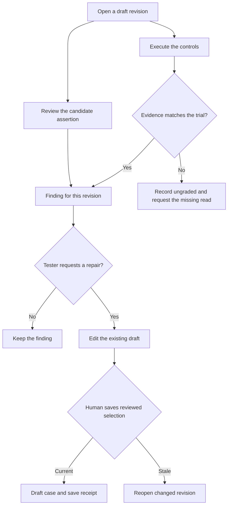

# One stale save, from task to human review

A tester writes a case for two teammates editing the same proposal. Its last step says, “Expect HTTP 409 Conflict.” The product rule also requires that refusing an outdated save creates no suite or case. **Would this test go red if the server rejected the save but still wrote to storage?**

The runnable example gives two assertions the same five observations and shows which defects each one catches. The proposed Zyra integration would put that finding on the existing task, let a tester propose a repair, and give a human the exact revision to review. The example exercises the evidence and grading portion locally.

## Run it

Run this from the repository root with Node.js 24.

```sh
node docs/qa-orchestration/examples/stale-save-harness.mjs
```

The command runs a disposable HTTP service on loopback, submits five stale saves, reads a temporary SQLite database through a separate read-only connection, and prints a JSON report. No setup, model, credentials, or Tesbo project is needed. The same observations go to both checks. Each check sees the response and available evidence. The answer key belongs to the grader. [Harness and assertions](stale-save-harness.mjs) · [HTTP fixture and SQLite reader](stale-save-fixture.mjs)

| Trial | What the independent reader found | HTTP 409 alone | HTTP 409 plus stored-state check |
| --- | --- | --- | --- |
| 01 | Zero matching suites and cases | Accepts the clean refusal | Accepts the clean refusal |
| 02 | One suite was created | Misses the defect | Catches the suite write |
| 03 | One case was created | Misses the defect | Catches the case write |
| 04 | State readback unavailable | Ungraded | Ungraded |
| 05 | The readback belongs to an older revision | Ungraded | Ungraded |

Every response was 409. The status-only check made **one correct decision out of three gradable trials**. The stronger check made **three out of three**. Both had usable evidence for three of the five assigned trials. The grader withholds an outcome on the other two even though the HTTP response is available. Otherwise a dropped read or a record from yesterday could count as a success. The counts describe these five controlled trials.

An excerpt from trial 02 shows why the status-only assertion passed and why the grader counted a miss. The writer received stale revision `A`. The independent reader found a suite in this trial after the refused save against revision `B`.

```json
{
  "context": { "project": "DEMO", "taskId": "TASK-17", "trial": "02", "revision": "B" },
  "request": { "expectedProposalRevision": "A" },
  "response": { "status": 409 },
  "readback": { "project": "DEMO", "taskId": "TASK-17", "trial": "02", "revision": "B", "suites": ["suite-under-test"], "cases": [] }
}
```

## Where it fits in Tesbo

| Step | What happens |
| --- | --- |
| **1. Create or open a task · current** | **Agents → Tasks → Create task** accepts the story, context, acceptance criteria and selected knowledge. The generation service validates project access, model allocation and the generation setting. It creates an `ai_generation_requests` row in `todo`. The worker reads the task, scoped knowledge, available linked sources and existing cases, then writes the generated drafts to the same task for review. An external producer can instead stage proposals into a review task without a model allocation. An existing review task can be opened directly. [Task creation](https://github.com/1alextest/Tesbooboo/blob/1934124f49989545eee6b5e4b26beee6cfa6ad47/Tesbo-Frontend/app/%28app%29/projects/%5Bid%5D/agents/tasks/page.tsx#L232-L251) · [Generation and worker](https://github.com/1alextest/Tesbooboo/blob/1934124f49989545eee6b5e4b26beee6cfa6ad47/Tesbo-Backend-Nest/src/legacy/legacy.service.ts#L22706-L22979) |
| **2. Select an assertion · proposed** | On an open task, select one draft item and choose **Check assertion**. The backend resolves the project, actor and grant, binds the selected content to the review snapshot, and retrieves the effective Skill instructions and version for that scope. Missing or stale required material pauses the governed check. Run a proposed Skill version only in its isolated comparison. Reopening a finding should reuse the task. [Skill delivery contract](../../specs/agent-synchronized-engineering/skills-governance.md#mandatory-skill-delivery-and-cross-member-authoring-conformance) |
| **3. Review the test design · proposed** | Give the pinned QA Investigation Harness validation reviewer the current human-approved expectation, plan item, candidate assertion and source locations. Its job is to identify which obligation the assertion covers and cite the missing check. Follow its prerequisite rules and stage contract. If the approved expectation or mapping is stale, identify the missing decision. Keep fixture variants, the repaired reference test and answers with the grader. [Upstream reviewer and prerequisites](https://github.com/QAtools-tech/qa-investigation-harness/blob/a468921c2bead820520a97df897168487b2b4985/qa-harness/stages/validation-reviewer.md) |
| **4. Exercise and grade · runnable locally** | A separate executor submits the stale save. The reader collects evidence for the same trial and revision. The deterministic grader compares each assertion to the frozen expectations. It reports misses, false blocks and unavailable evidence separately. In an integrated trial the reader needs an authorized source and the runner needs a bounded, disposable target. |
| **5. Decide on the proposed edit · current Save, proposed finding** | A finding has no draft effect by itself. If the tester chooses to propose the repair, show a field-level change in the existing draft. The human opens the Save dialog, inspects the proposal snapshot and target, selects items and chooses a suite destination. The backend rechecks the revision and selected operations. For a create operation, a successful Save creates a Test Case with status `Draft` and records the reviewer's receipt. Unselected proposals stay in review. Formal Test Case approval is a separate decision. [Native review and replay tests](../../../e2e/api/zyra.spec.ts) · [Save dialog and stale-preview tests](../../../e2e/ui/zyra.spec.ts) |



## What the tester would see

**Proposed finding on the task** · Example task `TASK-17`, evaluated revision `B`. In this fixture, `A` is the obsolete save attempt and `B` is the current proposal being evaluated. Tesbo uses opaque proposal revisions. The example labels and the following action names illustrate the design.

| On the review panel | Example content |
| --- | --- |
| Question | Can the case catch a write after a stale save is refused? |
| Evidence | Trial 02 returned 409 and left one suite. Trial 03 returned 409 and left one case. The existing expected result accepted both. Open either trial to see its response, record IDs and matching revision. |
| Proposed change to the expected result | Replace “The save returns HTTP 409” with “The save returns HTTP 409. Read back the suite and both candidate case titles in the same project using this trial's unique marker. Confirm zero matching new suites and zero matching new cases.” |
| Limits | One readback was missing and one belonged to revision A. Neither supports a conclusion about revision B. |
| Tester actions | **Inspect trial 02**, **Propose this edit**, or **Keep current draft**. A repair changes the draft revision, so reevaluate its new content before using the old finding to support the next Save. |

A second teammate can change the draft while the first reviewer has Save open. The current UI keeps the original snapshot visible, shows an alert on a stale save, and disables Save until the human reopens the task and reviews the latest snapshot. The API scenario checks that the stale request created **zero** matching suites and cases. With a freshly reviewed revision, it checks that exactly the intended Draft case is returned and the receipt contains the reviewed snapshot. A retry of an already applied identical decision can return the original receipt. [API scenarios](https://github.com/1alextest/Tesbooboo/blob/1934124f49989545eee6b5e4b26beee6cfa6ad47/e2e/api/zyra.spec.ts#L1242-L1324) · [UI scenarios](https://github.com/1alextest/Tesbooboo/blob/1934124f49989545eee6b5e4b26beee6cfa6ad47/e2e/ui/zyra.spec.ts#L2876-L2964)

## How two members share the same QA standard

Today the MCP tool `stage_testcase_changes` accepts a request key and proposed operations and returns an unpublished task and a review path. Its producer adapter derives the API token and technical actor from authenticated context. The token issuer and the human who later saves a selection are distinct. If two people use the same credential, the individual operator is unknown. The current Save payload uses selected indexes paired with the exact reviewed snapshot. [MCP staging implementation](../../../Tesbo-Backend-Nest/src/mcp/mcp.tools.ts) · [Credential boundary](../../../Tesbo-Backend-Nest/src/mcp/mcp-producer.ts)

The proposed two-member workflow requires separately authenticated members. Both clients fetch the effective Skill body, version and digest before drafting. Tesbo verifies the authenticated member, current project role, grant, Skill version and expected draft revision on submission. The change history identifies the initiating member, client, technical writer, affected item and base revision. The save receipt identifies the deciding human. When a teammate changes the selected item, show the difference and let the author reapply the intended edit to the newly reviewed version. Stable item identities and member-attributed changes across MCP clients are integration requirements. [Shared change workflow](../../specs/agent-synchronized-engineering/mcp-change-workflow.md)

Across clients, require the same fields, coverage of both storage effects, and the same treatment of missing evidence. Use a versioned template for fields that require identical wording. To test the method's benefit, compare ordinary Zyra and Zyra with the candidate reviewer on the same inputs, permissions and budget. Repeat within each supported client and keep the wrong-target A/B/C case held out. The local example uses two fixed assertions and measures whether the grader can tell them apart. Live model decisions, per-member MCP attribution and native submission are separate pilot outcomes. [Pilot measures and acceptance](../ZYRA_QA_HARNESS_OPTIONS.md#pilot-decisions-and-measurement)

## Source-review pilot run on November 25, 2026

Two fresh assistant sessions reviewed the same four synthetic cases. Each received a 250-word output budget, the same candidate assertions, source locations, human decisions and plan. Only the candidate received the four pinned upstream investigation documents. A separate grader prepared the scoring key before either session and received both answers with their assignments hidden.

| Case | Expected reviewer decision | Ordinary reviewer | With pinned method |
| --- | --- | --- | --- |
| Stale save returning 409 | Find both omitted storage checks and scope them to the request/project | Correct | Correct |
| Reordered export | Catch the one-row assertion that silently accepts the wrong selected item | Correct | Correct |
| File download | Accept the status and exact requested-file byte checks for the authorized request | Correct | Correct |
| Reopened-note recipients | Withhold conformance until a human approves the current requirement and reference version | Correct | Correct |

Each session received four items, attempted four, and made four gradable, correct decisions. Asking for the missing current approval earned credit because that was the independently expected decision. Neither asserted it had executed a test. The ordinary input was 2,359 bytes and the candidate input was 23,176 bytes. The comparison did not measure billed tokens, latency or cost. A tie on one clearly specified worksheet gives no reason to deploy the longer prompt by default. More discriminating cases should test whether Zyra discovers the missing test obligation when a tester simply asks it to write cases.

A second paired trial gave two new sessions a natural release-review request and four previously unseen cases. Both found that retrying a partially processed batch could duplicate one input and lose another while preserving the total, that grouped totals could mask errors for each parent record, and that a missing human decision prevented approval. Both scored **3/4 on the frozen key**. Both challenged the intended positive control because the plan named an accepted application path and the test called an isolated converter. Their distinction was defensible. Crediting it gives both 4/4. Omitting the ambiguous item gives both 3/3. The candidate did not meet the predeclared improvement of one additional correct decision under any interpretation. Select an unambiguous positive control before measuring false alarms. Both trials and their original scoring criteria are preserved in the audit record.

A companion `ZYR-P07` regression exercises the MCP credential boundary in Tesbo’s disposable CI project. It issues two project credentials from two human accounts, grants each client consent, reuses a request key across the two credentials, and inspects which producer and reviewer the native receipt records. That scenario checks two independently staged batches. It does not establish authorship of individual changes inside a shared batch. [Native regression](../../../e2e/api/zyra.spec.ts)

The comparison ran on the assistant surface. The workspace exposed neither a configured Tesbo MCP connection nor a running native Zyra or local-model service. The authenticated local coding CLI stopped before inference. The successful sessions received their method in the input. Native method retrieval, inference through the project model allocation and cross-client enforcement are still unverified. The [audit record](zyra-review-pilot.json) contains the shared worksheet, frozen rubric, method provenance and both answers. The [Playwright inventory](../../../e2e/README.md#inventory-at-development-commit-399b1803) records the product tests available to serve as independent references.

The [first-authoring pilot](zyra-proactive-authoring.md) follows this review comparison with a fresh feature request and 20 native-normalized draft cases.

## What a team can change

- **QA method.** A QA lead can propose a version of the shared review instructions with a new obligation, such as checking that an existing case was preserved. Qualify it on new positive and faulty controls before changing the effective Skill for the team.
- **Execution.** An engineer can replace the disposable endpoint with an authorized test deployment and the local reader with a scoped observation adapter. Keep the assertion, independent answer key and evidence identity stable so the comparison remains meaningful.
- **Evidence and review.** Keep artifact identity with project, run, test, attempt, case or draft revision, and the scoped evidence source. Preserve missing or conflicting evidence as such. Existing Tasks, Cases, Runs and save receipts own their native records. New reviewers and runners supply evidence through those owners. [Extension candidates and limits](../ZYRA_QA_HARNESS_OPTIONS.md#qa-specific-harnesses-and-extension-checks)
